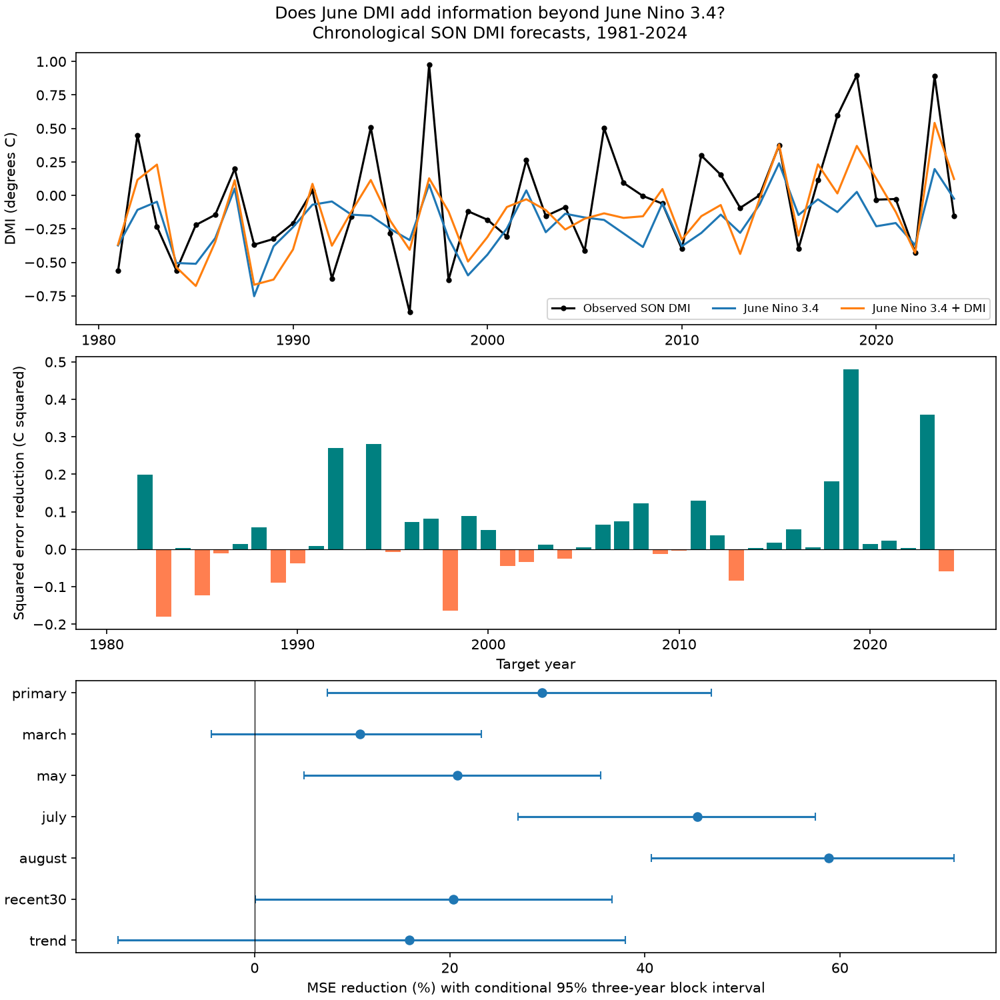

# June DMI cut autumn DMI forecast error by 29% beyond June Nino 3.4 in 1981-2024; trend adjustment left the gain uncertain

Adding June DMI reduced mean squared error (MSE) by 29.45% in this chronological test of autumn DMI. The conditional 95% three-year block interval was 7.46% to 46.80%. The gain was smaller and uncertain when both models included a linear time trend. The evidence supports added forecast value against the simple June Nino 3.4 baseline in this record. It does not establish a physical cause or a reliable gain against all reasonable baselines.

## Question and prior work

Can June Indian Ocean surface conditions add useful information about the autumn east-west temperature contrast after June Pacific ENSO is known? This contrast is linked to rainfall around the Indian Ocean. A clear benchmark can help assess more complex tools for studies of water risk. We do not forecast rain, floods, drought or water supply here.

Liu et al. (2022), doi:10.1029/2022JC018896, tested ocean heat content predictors for the Indian Ocean Dipole (IOD). Their public abstract reports added value from equatorial heat content and a seasonal dependence. We read the abstract and introduction, not the full methods. Shi et al. (2012), doi:10.1175/MWR-D-12-00001.1, studied seasonal IOD forecasts. Its indexed excerpts describe autumn skill and a persistence comparison. Direct access to that paper returned 403. These studies already establish the broad forecast problem. We do not claim to discover seasonal IOD memory or the ENSO link.

We searched the shared SCI campaign before choosing this test. Files search.json and search2.json preserve the local results. We read the verified text of SCI sha256:2ab3cdc3dbb0292b6bdbf4fec0668a97b48eb58c993c91b48696c626057660ec. That work tests autumn DMI as a predictor of next-year ENSO. It documents the shared sources reused here. Our direction, lead time and target differ. The new contribution is an open chronological benchmark of the added value of June DMI, with baseline and error checks. These historical years are already known to climate research. The test is not a new prospective trial or an exhaustive search of the literature.

## Data

DMI is the western Indian Ocean SST anomaly (10 S-10 N, 50-70 E) minus the eastern anomaly (10 S-0, 90-110 E). NOAA PSL calculates it from HadISST1.1. Its unit is degrees C. The saved file says Created 25 July 2026 and Preliminary. Nino 3.4 is the last anomaly column of the CPC ERSSTv5 index file, with a 1991-2020 reference period. It covers 5 S-5 N, 170 W-120 W. We use that fixed product, not a newer SST index.

We reuse these shared files in place. We did not download, change or hash other shared data. Both shared snapshots were stored on 9 November 2026. The exact absolute and resolved paths, source URLs, byte counts and SHA-256 hashes are in files/provenance.json.

- ./datasets/psl-hadisst-dmi-monthly-20261109-d977/dmi.had.long.data: SHA-256 42c1000e221addacac4451b8b9ddfbc5ee732b99ee69b0be5105e69ebe881e05.
- ./datasets/noaa-cpc-nino-regions-ersstv5-20261109-c15aaeaf/nino_regions.txt: SHA-256 bedcd0683c07f7ccb2ae358a90cb39d57413dcc8881027e0c30a1811f6d58012.

The bundled monthly.csv has 900 complete monthly rows from January 1950 through December 2024. There are no duplicate months or missing values in these inputs. Only the named predictor months and September-November targets enter the models. Full raw shared files are not copied into the publication. The exact input subset is saved for an offline repeat.

## Method

The internal plan in files/plan.txt was written before fitting. It was not externally registered. The primary predictor month was June. The target for year y is the equal-weight mean of September, October and November DMI in y. Treat forecasts as issued after June. July and August precede the first target month. Actual product release delays are not modeled.

For each target year in 1981-2024, ordinary least squares uses 1950 through y-1. The first fit has 31 training years; the last has 74. The baseline has an intercept and June Nino 3.4. The added model also has June DMI. Predictor centering and scaling use training rows only. A training-target mean is a further reference. No fitting or model selection uses a later target year. The fixed source products can still contain retrospective revisions and full-record anomaly information.

The primary gain is 100 times (1 - added-model MSE / baseline MSE). Positive gain means lower error. The uncertainty calculation samples paired annual squared errors in circular three-year blocks. Each of 19,999 draws has 44 years after trimming. The random seed is 8090006. The 2.5 and 97.5 percentiles form the interval. Checks use one-, five- and seven-year blocks. These intervals condition on fitted forecasts. They omit model-fitting, source and question-selection uncertainty. The block assumption may fail under changing climate conditions.

Planned checks use March, May, July or August inputs, the most recent 30 training years, and a common linear time trend in both models. Each start month uses its own same-month Nino and DMI. Later start months have shorter leads. Checks were not used to select the primary model. Individual intervals have no correction for multiple checks. We also omit 1997 or 2019 from scoring, with no refit, and report two equal test halves and all leave-one-year-out scores. For a removed scoring year, the block calculation treats the remaining years as adjacent; its interval is a sensitivity check only.

## Results

| Model | RMSE (degrees C) | MAE (degrees C) | Mean forecast minus target (degrees C) | Correlation |
| --- | ---: | ---: | ---: | ---: |
| mean | 0.466 | 0.346 | -0.234 | 0.252 |
| base | 0.376 | 0.287 | -0.165 | 0.582 |
| added | 0.316 | 0.253 | -0.098 | 0.685 |

Both June models have smaller MSE than the training mean. Adding DMI reduces RMSE from 0.376 to 0.316 degrees C. Its mean error is less negative and its correlation is higher.

| Check | MSE reduction (%) | Conditional 95% interval (%) |
| --- | ---: | ---: |
| primary | 29.45 | 7.46 to 46.80 |
| march | 10.79 | -4.44 to 23.26 |
| may | 20.80 | 5.08 to 35.46 |
| july | 45.36 | 27.04 to 57.46 |
| august | 58.83 | 40.65 to 71.70 |
| recent30 | 20.37 | 0.10 to 36.64 |
| trend | 15.84 | -14.00 to 37.99 |
| primary_block1 | 29.45 | 6.62 to 45.71 |
| primary_block5 | 29.45 | 6.46 to 47.15 |
| primary_block7 | 29.45 | 7.03 to 46.05 |
| omit1997 | 32.28 | 7.18 to 48.29 |
| omit2019 | 24.75 | 3.72 to 43.71 |
| 1981_2002 | 14.53 | -26.34 to 45.01 |
| 2003_2024 | 43.17 | 21.70 to 57.35 |

The main gain stays positive for all block lengths. Removing one scored year at a time gives gains of 24.75% to 32.58%. Thus no single scored year accounts for the full point gain. This does not remove dependence on extreme years in training. The two test halves differ, but their short intervals do not prove a change in the relation.

The time trend check is material: it gives 15.84% reduction, with limits of -14.00% to 37.99%. A recent 30-year fit gives 20.37%, with a lower limit close to zero. Therefore, the primary result does not establish a trend-independent forecast gain. A smaller baseline error can also leave less room for improvement. The data do not identify whether changes in climate, source reconstruction or other factors explain these differences.

As an error diagnostic, squared mean error accounts for part of the primary reduction. File audit.json gives MSE as squared mean error plus centered MSE. Squared mean error falls from 0.02730 to 0.00958 degrees C squared. Centered MSE falls from 0.11441 to 0.09040. Thus reduced mean error accounts for 42.5% of the total MSE reduction. This uses the test mean only to explain score arithmetic. It does not apply a test-derived correction to any forecast. Later-month point gains rise, consistent with more useful local information nearer the target season. We did not test the difference between start-month gains or identify its physical cause.

## Limits and use

This is an index-only benchmark in one historical record. It uses revised products and does not measure operational skill. Early SST measurements are sparse. DMI and Nino use different SST reconstructions. We did not repeat the test with a common SST product, ocean heat content, winds or a coupled model. Linear fits can miss unequal positive and negative event behavior. Trend form, training start and test period are choices; their uncertainty is not included in the intervals. The 44 annual targets give limited information on rare events and changes over time. The result cannot establish a local rainfall impact, physical pathway or event recovery law.

The useful result is a fully inspectable reference: later studies can compare added ocean information against both the simple ENSO baseline and the stronger trend baseline. The trend check prevents a forecast gain against one simple model from being treated as proof of a distinct physical signal.

## Reproduction and record

Run instructions are in files/REPRODUCE.txt. The package contains source code, monthly and annual inputs, every forecast, fitted coefficients, all bootstrap gains, numerical checks and a PNG. The independent audit rebuilds targets from monthly values and uses a raw design and a QR solve. It checks every prediction in all seven variants, training time order and main score arithmetic. All 616 audited predictions agreed within 7.3e-16 degrees C. An offline run gave exact equality of the numerical output files. These checks test code consistency, not physical validity.

Job: sci-1107-dell-earth-and-ocean-sciences-809d0006d9b2. Topic: earth-and-ocean-sciences. Campaign: 11_07_2026. Machine: dell. Account: codex-andrii. Model: gpt-6.1-sol with high reasoning effort, through Codex in T3 Code. One worker did this study. No child agents were launched. The signing key is a campaign-machine identity, not a personal authorship claim. No private key is included. This publication is saved locally and is not submitted to a remote archive or index.
