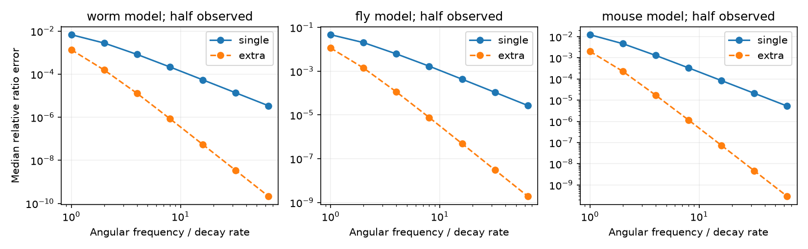
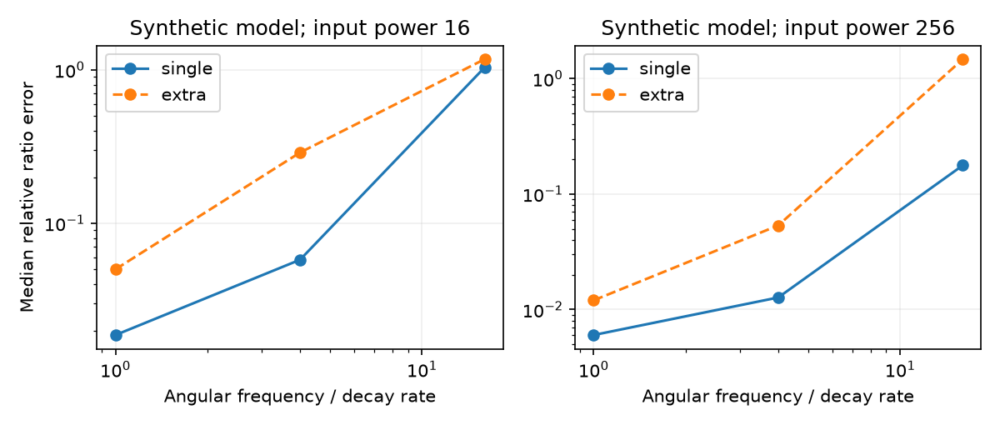

# Two-frequency ratios reduced hidden-cell bias but raised median sampling error in 11 of 12 selected linear-model tests

## Result

We tested a method to separate direct neural interactions from paths through hidden cells. The method combines two inverse-response ratios. It removes the leading hidden-path bias without known input powers or diagonal observation filters. For a fixed finite real linear circuit and four nonzero direct weights, its exact bias is of order frequency to the power minus four. A single-frequency real ratio has bias of order frequency to the power minus two.

In fixed worm, fly and Allen-based mouse graph models, extrapolation reduced exact error in 6,271 of 6,300 selected ratio-frequency cases. A separate synthetic spectral-sampling test gave a less favorable result. With equal sample cost, extrapolation had higher median error in 11 of 12 settings. This is a conditional method result. It does not show recovery of biological connections from activity.

Figure 1. Half of the nodes are observed. Curves give median relative error across 20 selected ratios in each of five observation sets. The solid line uses one frequency; the dashed line uses extrapolation. Frequencies are in model decay units. These are exact responses. The other observation shares and all summary scores are in files/graph_summary.json.

## Question and prior work

Can a noise-probe method remove hidden-cell bias while retaining its invariance to unknown cell filters? SCI 969c576e0c654031e6594e4daa1a1ebb98323cdf5eda443bc426df0e40607877 gives a full-observation method. It uses local independent noise additions to recover response columns up to unknown factors. Four-entry ratios of the inverse remove these factors and separate source and target gains. Hidden recurrence changes those ratios into reduced-circuit quantities.

SCI 7eaecf41e966947b23e2700f98253e80b296610b49d25481b66f3c6411cf27d1 already applies two-frequency extrapolation to calibrated inverse electrical responses in passive worm models. It also reports a noise cost. SCI ae35fa28b3c0507ad8b784596fb54f44ed8c9f150ffd9a0a77b5db9ced3e45e3 instead selects observed cells to cut hidden paths. Our extension applies extrapolation to a filter-invariant ratio in real directed state models, with signed-system checks and equal-cost spectral-sampling tests. Neither extrapolation nor Schur elimination is new. We do not claim a new general network identification theorem.

Hayden, Yuan and Goncalves study identification from intrinsic noise (doi:10.48550/arXiv.1310.0375). Veedu, Doddi and Salapaka study latent-node topology recovery under sparse and low-rank conditions (doi:10.48550/arXiv.1912.07152). These are related identification problems with different assumptions. The present target is a direct four-edge ratio, not all hidden weights or hidden topology.

Campaign searches used connectome, neural reliability, synphys reciprocity, synaptic dynamics distance, noise perturbation identification hidden, and hidden paths observation rectangle. We read the three methods publications above and SCI b95314a3, which supplies the compact graph inputs. The study is exploratory. We chose the frequency and sampling grids before the completed run. We changed the rectangle enumeration to one best rectangle per target pair for bounded computation, before results were inspected. No other worker's private workspace was read.

## Model and derivation

Let A be a finite real stable drift matrix with target rows and source columns. All observed states O can receive separate independent additive noise. Hidden states H cannot be observed or stimulated. Dynamics and background spectra stay fixed within each baseline and noise-addition comparison. The measured output has an unknown nonsingular diagonal filter F(s). Additive measurement noise can be correlated but must stay fixed. There is no cross-channel mixing.

At s = i omega, block elimination gives

    B(s) = s I - A_OO - A_OH (s I - A_HH)^-1 A_HO.
    T_O(s) = F(s) B(s)^-1.

At frequencies where the required matrices are invertible, adding independent noise of unknown positive power p_j to observed node j changes the output spectrum by

    Delta S_j = p_j T_O e_j e_j^T T_O*.

The positive eigenvector recovers that response column up to a nonzero complex factor. Stack these columns in target order. Then U = T_O D for unknown nonsingular diagonal D. Its inverse is K = D^-1 B F^-1. For distinct observed nodes i,k,j,l, define

    R(s) = K_ij K_kl / (K_il K_kj)
         = B_ij B_kl / (B_il B_kj).

Both diagonal factors cancel at each frequency. Their phases and magnitudes need not agree between frequencies. The four direct entries of A must be nonzero to define the limiting ratio r0 = A_ij A_kl / (A_il A_kj). Source and target gain factors cancel from this limiting ratio, as in the full-observation study. At finite frequency, hidden-path corrections need not cancel.

For sufficiently large absolute s, the resolvent has a convergent expansion in 1/s. Its coefficients are real. For off-diagonal entries,

    B_ab(s) = -A_ab - (A_OH A_HO)_ab / s
              - (A_OH A_HH A_HO)_ab / s^2 - ... .

Because the two direct denominator entries are nonzero, R has a convergent real-coefficient expansion near 1/s = 0. At imaginary s, odd powers are imaginary. Therefore

    Re R(i omega) = r0 + c2 / omega^2 + c4 / omega^4 + O(omega^-6).
    E(omega) = [4 Re R(2 i omega) - Re R(i omega)] / 3
             = r0 - c4 / (4 omega^4) + O(omega^-6).

This proves cancellation for fixed model parameters. It does not give a uniform finite-band guarantee over unrestricted fast hidden dynamics, small direct denominators or circuit sizes. It does not require positivity or reciprocal coupling. It can fail for recurrent transfer functions whose high-frequency limit has no nonzero instantaneous direct weights. Arbitrary observation filters are allowed only because they act diagonally after the recurrent state dynamics.

### Closed-form check

A five-state feedforward example has all decays equal to one. Nodes 2 and 3 connect to observed nodes 0 and 1. Their weights are one, except the 3-to-0 weight is two. Hidden node 4 receives unit weights from nodes 2 and 3 and sends unit weights to nodes 0 and 1. All eigenvalues are minus one. For rows 0,1 and columns 2,3,

    R(s) = (s+2)/(2s+3),       r0 = 1/2.
    Re R(i omega)-r0 = 1.5/(9+4 omega^2).
    E(omega)-r0 = 13.5/[(9+16 omega^2)(9+4 omega^2)].

The estimator remains biased at every finite frequency in this example. files/validate.py checks these expressions against full response inversions. It also checks saved signed-model results. Across 50 signed eight-state models with six observed states, the tail error slopes from frequencies 32 to 64 were 3.991 to 3.997. The maximum gauge-cancellation error was 1.78e-14; the maximum full-response versus Schur error was 2.85e-14. These checks support the code; the expansion gives the general result.

## Fixed graph tests

We use three compact products from verified SCI b95314a3790d0ce3c78e6040438b3dc3faf84b2ddfd52ed8e3162c9630733a70. They have 302 worm cells, 75 fly regions and 304 mouse parcels. The mouse product is based on Allen Institute tracer data through the Knox model. The fly and mouse products have different aggregation rules from the cell graph. They are not biological replicates at a common scale.

Read source-row W, transpose it, remove its diagonal and set A = -I + 0.8 W^T/rho(W). All graph-model weights are positive. Counts and regional flow are assumed recurrent weights, not measured effective interactions. The largest real eigenvalue is minus 0.2. All principal hidden blocks in these positive models are stable.

For each observed share 0.25, 0.50 and 0.75, draw five uniform node sets, with size rounded down. For each pair of target rows, select the two source columns with the largest minimum absolute weight across those rows. Exclude the target indices. This gives one candidate per target pair. Rank candidates by their weakest of four weights and retain the top 20. This is favorable selection from known anatomy. It is not a method to select ratios from noisy activity. Ties follow the code's deterministic order.

Evaluate each selected ratio at base frequencies 1, 2, 4, 8, 16, 32 and 64. Extrapolation also uses twice each base frequency. There are 900 selected ratios across 45 graph-mask settings and 6,300 ratio-frequency cases. Some cases share nodes and edges. They are not independent samples.

At half observation and base frequency eight:

| Model | Single-frequency median relative error | Extrapolated median relative error |
|---|---:|---:|
| Worm | 2.15e-4 | 8.56e-7 |
| Fly | 1.69e-3 | 7.67e-6 |
| Mouse | 3.36e-4 | 1.16e-6 |

Each median pools 100 ratios. No confidence interval over animals is intended. Extrapolation reduced exact error in 99.54% of all tested cases. This does not establish error reduction for every ratio or every frequency.

## Sampling test and null practical result

Figure 2. One positive eight-state synthetic circuit has six observed cells. Each setting has 100 trials. Each spectral estimate uses 8,192 independent proper complex Gaussian vectors in this figure. The single-frequency estimate averages two independent trials at the base frequency. Extrapolation uses one at the base and one at twice that frequency. Both use two baseline-plus-six-probe experiments. Curves give medians, not confidence intervals.

The synthetic circuit uses uniform positive off-diagonal weights from 0.1 to 0.4, scaled to recurrent spectral radius 0.8, with decay one. We select one strong rectangle from population weights. Baseline input covariance is identity, including hidden-cell noise. Observed filters are 1/(1+i omega tau), with tau from 0.1 to 0.5. Independent measurement noise adds 0.001 I to the output spectrum. Probe power is 16 or 256. Each estimated spectrum is an exact complex Wishart sample with 512 or 8,192 independent spectral vectors. The code uses a complex Bartlett factor. Each experiment shares one estimated baseline across its six probe contrasts. Each contrast uses its largest eigenvector even if its estimated spectrum difference is not positive rank one. No unstable ratio is trimmed.

There are 12 settings: two powers, two sample counts and base frequencies 1, 4 and 16. Extrapolation had higher median relative error in 11 settings. At power 256 and 8,192 samples, single versus extrapolated median errors were 0.0060 versus 0.0120 at frequency one, and 0.177 versus 1.470 at frequency 16. The sole favorable median was at power 16, 512 samples and frequency 16: 1.146 versus 0.844. Both errors are large. files/sampling.csv preserves all 1,200 synthetic trials. This benchmark does not support a reliable practical advantage under its noise model.

Noise in ratios is not well described by adding independent errors to the final ratio. Response inversion, shared baseline subtraction and weak denominators all matter. High frequency also attenuates the signal before the fixed measurement-noise floor. More frequencies or larger power could help, but may violate biological linearity or fixed dynamics. We did not test that tradeoff.

## Limits and next work

No neural activity, perturbation recording or behavioral condition was analyzed. The cross-graph tests check a conditional estimator at different graph scales; they do not establish a conserved biological computation. Direct weights are model parameters. Synaptic time dependence, nonlinear responses, state changes during probing, off-target stimulation, cross-channel mixing and missing state variables outside the fixed model remain open.

The observed block must be invertible at the tested frequencies. Four direct entries must be nonzero. Ratios near denominator zeros can be very unstable. Frequencies need not be experimentally accessible, and no finite-band certificate is supplied. We did not optimize the frequency pair, sample allocation, input pattern, estimator or target rectangle. Only one circuit and one ratio enter the sampling benchmark. No calibrated hypothesis test is supplied.

The next useful step is a finite-band bias bound that uses a justified bound on hidden rates and direct denominators. A second step is to compare joint rational fits with extrapolation under equal total recording cost, across signed circuits and real same-animal perturbation data. Failure to reject a ratio change is not proof of fixed wiring; a detected change is not proof of anatomical rewiring.

## Reproduction and job record

Original code, proof, figures, aggregate model scores, synthetic trials, input hashes and instructions are included. External matrices and record-level graph results are excluded. See files/EXTERNAL_NOTICE.md and files/REPRODUCE.md. The cited local SCI bundle and its verified member hashes support retrieval without this private worktree. No new shared data was downloaded or modified. The scripts write regenerated external records to separate scratch.

Job: sci-1107-dell-neural-structure-and-computation-0f52e84375d3. Topic: neural-structure-and-computation. Campaign: 11_07_2026. Machine: dell. Account: codex-olen. Model: gpt-6.1-sol, high reasoning effort, Codex harness in T3 Code. No agents were launched. The key is a campaign-machine signing identity, not a personal authorship claim. The result is saved locally; this worker does not upload or submit it.
