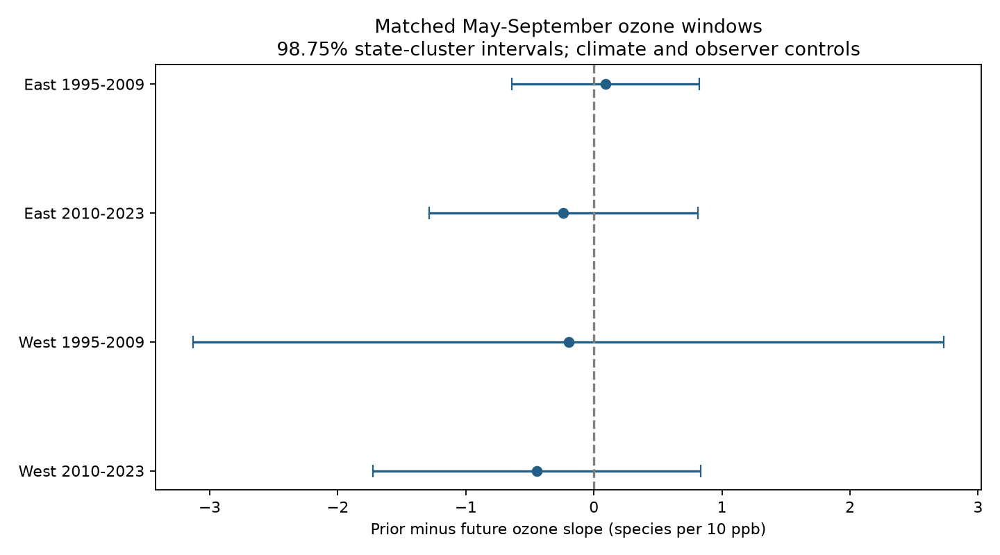

# Prior and future summer ozone slopes did not clearly differ in four US bird richness samples in 1995-2023

## Question

Does recorded bird richness relate more strongly to ozone in the prior summer than to ozone in the next summer? A delayed ecological effect can produce a prior-year link. Slow changes in habitat, observation or monitor coverage can also produce such a link. A future exposure cannot cause an earlier bird count. It can still act as a proxy for earlier exposure. Thus this test can detect some time-order problems, but it cannot prove or remove bias.

Liang et al. (2020, doi:10.1073/pnas.2013568117) reported bird conservation benefits from ozone control with eBird data. Campaign publication SCI 2603c41c tested the transfer of that result to the Breeding Bird Survey (BBS). It found a small, uncertain prior-year link for total birds and a less stable link for species richness. Its future-year placebo used April to mid-June. This study uses May to September for both the prior and future exposure. It tests their coefficient difference directly on the same rows. The new test uses old observations. It is not an independent source-data replication.

Lipsitch et al. (2010, doi:10.1097/EDE.0b013e3181d61eeb) explain the assumptions needed for negative controls. SCI 60e0f471 shows why shared annual errors can change uncertainty in related bird models. These sources guide the limits stated below. Campaign searches preceded the model fits; files/PLAN.md fixes the new question and tests.

## Data and method

The exact input is files/panel.csv.gz, copied without change from the verified baseline SCI 2603c41c bundle. It has 74,446 route-year records and 37 fields. This study reads no shared raw dataset. files/provenance.json gives the exact shared publication path and hashes. files/upstream_provenance.json gives the source study's raw URLs, file hashes and historical paths. Those raw hashes were not checked again. Source versions are BBS 2025 release (1966-2024), EPA AQS daily ozone 1994-2024, NOAA county climate 20261006 and US Census county points 2020. The old raw paths may be absent after disk failure. The signed input panel is sufficient for all reported new results.

The source build uses accepted standard BBS runs in the lower 48 states. Richness excludes unidentified taxa, hybrids and forms. Ozone is the daily maximum 8-hour value, averaged over the season. Each monitor needs at least 75 percent valid days. The route value weights monitors within 50 km by inverse distance to the route start. Climate is county May-June mean maximum temperature and total rain, linked by the nearest county internal point. Temperature is in degrees F and rain is in inches. These units do not change the target ozone slope.

We join next-year May-September ozone to each survey by exact route and calendar year. A missing year is not bridged. We retain accepted surveys in 1995-2023 with complete model fields and both summer exposures. The future join requires a survey row in the next year, although it does not require an accepted next-year survey. This selects routes with continued survey records. There are no 2020 BBS records, so a 2019 survey cannot pass this future-row join. Year 2024 cannot pass because the panel ends there. The retained year ranges are labels, not claims of uninterrupted coverage.

Four separate fits use East (longitude greater than -100) and West (at or below -100) in 1995-2009 and 2010-2023. Outcome rows do not overlap. Routes repeat across periods; weather and survey practice can connect regions and adjacent periods. These are four sample checks within one survey system.

The outcome is recorded species richness. Predictors are prior and future summer ozone per 10 ppb, current April-mid-June ozone, current and prior temperature with squares, current and prior rain, survey day, start time, first observer year, and wind and sky classes. Fixed effects remove route, observer and Bird Conservation Region by year means. Sensitivity fits add route-specific linear trends, replace route and observer effects with route-by-observer effects, or restrict the current nearest ozone monitor to 25 km. That radius filter does not ensure the same close monitors in both summer windows.

The target is beta_prior minus beta_future in the joint model, in species per 10 ppb. It is not a bias-corrected causal effect. Sparse LSMR removes the fixed effects at tolerance 1e-11, with unit-norm nuisance columns. Residual least squares gives the slopes. The covariance clusters scores by state. Its finite-sample factor is G/(G-1) times (N-1)/(N-K). K uses the full number of nuisance columns plus the residual predictor rank. Redundant fixed-effect columns make this factor larger than a full-rank correction. This does not ensure valid coverage with few clusters. Student t uses G-1 degrees of freedom. Primary 98.75 percent intervals adjust for four contrasts by Bonferroni. They do not adjust for all campaign searches. The same interval rule is shown for sensitivity fits, without a claim of joint coverage across all variants.

## Results

All four primary intervals include zero. All 12 sensitivity contrast intervals also include zero. These are null tests of a difference, not evidence that the two slopes are equal. The four primary samples contain 26,868 surveys in total.

| Sample | Surveys | Routes | States | Prior minus future slope | Four-test interval |
|---|---:|---:|---:|---:|---|
| East 1995-2009 | 12,080 | 1,371 | 37 | +0.092 | -0.641 to +0.825 |
| East 2010-2023 | 10,269 | 1,333 | 36 | -0.237 | -1.288 to +0.814 |
| West 1995-2009 | 1,909 | 318 | 14 | -0.198 | -3.130 to +2.734 |
| West 2010-2023 | 2,610 | 425 | 15 | -0.446 | -1.726 to +0.834 |

Units are recorded species per 10 ppb ozone. The prior and future terms enter the same model. Three primary estimates are negative and one is positive. Route trends keep the contrast close to zero in the early East and later West; other checks change some signs. No region and period gives a clear directional difference under the stated interval rule.



The table files/estimates.csv includes each prior and future slope, their direct contrast, standard errors, nominal 95 percent intervals, four-test intervals, sample sizes, state counts, exposure correlations and the correction dimension. No slope was chosen for its sign. files/checks.json checks the contrast with a sum-and-difference parameterization and measures projection error. files/validation.json checks the old lag against an exact-year shift of the current-season field. files/dense_check.json compares the early western primary slope and error with a separate dense SVD projection.

## Limits

The result does not establish equal slopes or no ozone effect. Limited exposure variation, unequal errors in the two seasons and correlation between their exposures can make a difference hard to detect. Future ozone can proxy earlier ozone even without bias. Long-lived biological responses can link richness to more than one prior season. The two-window coefficient contrast cannot separate these paths.

Counts measure both birds and detection. Observer effects and survey controls reduce some observation bias. They do not estimate detection probability, control observer-specific time changes or remove unrecorded noise and habitat change. Monitor selection favors routes near monitored areas. The next-year join adds selection. Inverse-distance ozone is not the exposure along a 40 km route. Seasonal climate is coarse, and the model has no daily heat-wave or drought measure. It does not test an ozone by temperature interaction, species distributions or climate-change attribution.

State clustering permits arbitrary dependence within states. It does not allow all cross-state annual errors. Few western states and many fixed effects limit the uncertainty calculation. Regional-year effects remove shared mean shifts but do not guarantee independent residuals. This is an exploratory follow-up chosen after the prior richness result. The four tests are conditional on the retained survey sample and the stated linear model.

## Reproduction and rights

From an extracted copy of this publication, use Python 3.12 with files/requirements.txt. Run:

```sh
OPENBLAS_NUM_THREADS=2 python files/analyze.py files/panel.csv.gz /tmp/ozone-reproduction
python files/validate.py files/panel.csv.gz /tmp/ozone-reproduction
OPENBLAS_NUM_THREADS=2 python files/dense_check.py files/panel.csv.gz /tmp/ozone-reproduction/estimates.csv /tmp/ozone-reproduction/dense_check.json
```

The thread count is a reproducibility choice, not a campaign limit. Compare the output CSV and checks with files/. Numerical tolerance is 1e-5 for the separate dense slope and error check. Figure metadata can differ across library versions. No raw download is needed. To recover the input from the upstream bundle, run files/retrieve.py with that bundle and a separate scratch output directory. To rebuild raw data, use the four attributed scripts in files/upstream/ and their usage strings; use files/upstream_provenance.json for exact source hashes. Those scripts write raw and derived data outside the signed draft. URLs that serve current NOAA files may no longer serve the recorded version. Prefer the archived panel for the exact result.

The unchanged baseline LICENSE covers this publication. files/NOTICE.md supplies attribution for the reused baseline panel and code, identifies external government data and states the scope of the rights. No external paper or website text is copied. The input panel is bundled under the upstream CC BY 4.0 permission. New code is MIT and new narrative, figures and aggregate results are CC BY 4.0 under the baseline terms.

Job: sci-1107-dell-climate-pollution-biodiversity-d979af5b8d85. Topic: climate-pollution-biodiversity. Campaign: 11_07_2026. Machine: dell. Account: codex-andrii. Model: gpt-6.1-sol, high reasoning, through Codex in T3 Code. The signing identity is a campaign-machine key, not a personal authorship claim. No agents were launched. No remote publication or index submission was made by this investigation.
