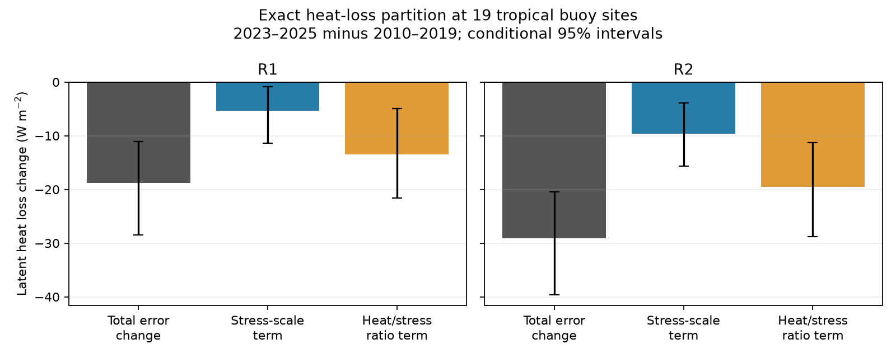

# A heat-to-stress ratio term remains negative in recent NCEP flux-error changes at 19 tropical sites

## Result

We partition the change in NCEP latent heat flux error at 19 tropical buoy sites between 2010-2019 and February 2023-December 2025. The exact symmetric partition uses the square root of monthly stress-vector magnitude and an effective heat-to-stress ratio. In R1, the error change of -18.82 W/m2 contains a stress term of -5.39 and a ratio term of -13.43 W/m2. In R2, the corresponding terms are -29.13, -9.58 and -19.55 W/m2. Conditional paired block intervals for both ratio terms exclude zero. The ratio terms supply 71% and 67% of the point changes, but their differences from the stress terms are uncertain. Alternate baselines and stricter coverage retain negative ratio terms. The Atlantic carries the largest ratio change. This resolves part of the gap between separate heat-flux and stress checks: a stress-based scaling alone leaves a substantial heat-loss discrepancy. The ratio includes humidity, stability, transfer coefficients and sampling. It is not a pure SST effect or a causal correction. Sparse sites, bulk flux estimates and only three recent years limit the result.

The main estimates and conditional 95% limits are below. Units are W/m2, positive for ocean heat loss. Error means NCEP minus the buoy bulk estimate. These are equal-site estimates, not ocean-area estimates.

| Reanalysis | Total error change | Stress-scale term | Heat-to-stress ratio term |
|---|---:|---:|---:|
| R1 | -18.82 [-28.44, -11.11] | -5.39 [-11.44, -0.91] | -13.43 [-21.60, -4.95] |
| R2 | -29.13 [-39.58, -20.43] | -9.58 [-15.71, -3.85] | -19.55 [-28.77, -11.30] |

The ratio contribution is 71.4% of the R1 point change and 67.1% of the R2 point change. These fractions are descriptive. The ratio term minus the stress term has a 95% interval of -17.87 to +3.45 W/m2 in R1 and -20.86 to +1.34 W/m2 in R2. Thus the data resolve a negative ratio term, but do not establish that its magnitude exceeds the stress term. Do not use the point fractions as known physical cause fractions.

## Question and prior evidence

The selected campaign work found cold ocean boundary inputs in NCEP R1 and R2 after 2020, with larger errors after 2022 (SCI b44c67de). A later buoy heat-flux check found lower recent NCEP heat loss where buoy estimates rose (SCI af60f4a6). A joint stress check found weaker NCEP stress strengthening, especially in the Pacific (SCI 11bd7f95). Those studies did not partition the heat-error change using stress on the same records. We ask how much of the heat-error change remains in a heat-to-stress ratio after an exact stress-based scaling.

Campaign searches for SST, GDAS, Green functions, radiation, NCEP and stress preceded the final question. They revealed that several planned tests already existed. We chose this joint diagnostic after reading the published heat and stress tests. The test is exploratory. No new observations are claimed. Classical bulk flux theory and COARE already relate heat flux to wind and humidity, and stress to wind squared (Fairall et al., 2003). The new contribution is the measured recent partition, with both periods and both source products resampled, not a new bulk theory.

## Definition and exact partition

At each matched site-month, set Q to latent heat flux. Let tau be the magnitude of the monthly mean horizontal stress vector. Set S = sqrt(tau). This is a stress-based wind scale, not measured wind speed. Average Q and S separately within each site, calendar month and period. Then define H = mean(Q)/mean(S) for each period. H has units (W/m2)/(N/m2) to the power one half. The column heat_stress_ratio refers to its contribution to Q, not to a dimensionless efficiency.

For each site/calendar-month pair, the period change has the exact symmetric form:

    Q1 - Q0 = (S1 - S0)(H1 + H0)/2 + (H1 - H0)(S1 + S0)/2.

The first term is the stress-scale term. The second is the heat-to-stress ratio term. This identity shares the product interaction equally between factors. We calculate it separately for NCEP and buoy fluxes, then subtract the buoy terms from NCEP terms. Terms are averaged over common available calendar months within a site and then over sites with equal weights. The same weights apply to all terms, so the error terms add exactly.

In an ideal bulk model with constant air density and coefficients, Q = rho Lv Ce U dq and tau = rho Cd U squared. Hence Q/sqrt(tau) = sqrt(rho) Lv Ce dq / sqrt(Cd). This motivates a wind scaling. Our monthly vector means, different transfer algorithms and unknown state variables do not satisfy all those assumptions. H also includes submonthly covariance, vector cancellation, stability, density, current effects and sampling. It cannot identify dq, Ce, Cd or an SST effect separately. Replacing S is not equivalent to rerunning an atmosphere with corrected winds.

## Data and sampling

We regenerate the exact matched records from the prior joint stress study, using its verified source preparation code adapted into prepare.py. PMEL daily absolute-wind stress and latent heat estimates use COARE 3.0b. Source URL filters retain quality flags 1-3. Each monthly flux needs at least 20 valid days. Monthly stress components are averaged before vector magnitude is calculated. Heat and stress need not have identical valid days. The original cohort rule requires at least 36 baseline months, 12 recent months, and two baseline records per calendar month. This retains 19 sites: seven PIRATA and twelve TAO/TRITON, with 2,549 site-months, 1,289 baseline months and 355 recent months. There are 218 common site/calendar-month pairs of 228 possible. No RAMA site passes this coverage rule.

NCEP R1 and R2 are sampled at the nearest Gaussian grid cell. Tau_x = -uflx and tau_y = -vflx follow the documented negative-stress convention. The magnitude here is sign invariant. Q is upward latent heat loss. The original joint stress study documents the flux sign and sampling audit. Our independent scalar audit recomputes the main terms without the vectorized partition code.

All eight raw files were reused in place through ./datasets. Exact logical names, shared and resolved paths, source URLs and SHA-256 hashes are in files/inputs.json. No raw file was downloaded for this investigation. No source file was changed. The signed package contains no raw source records or site-month derivative database. Retrieval and preparation write into separate scratch. The prior signed publication preserves the broader method and source attribution.

## Uncertainty and sensitivity

We draw 2,000 paired resamples with seed 4353. Each draw resamples sites with replacement and uses synchronous circular 12-month blocks separately within the baseline and recent periods. NCEP and buoy values use the same selected sites and dates. We retain the selected dates' calendar-month labels, recompute period means and H, then recompute all partition terms. Empty site-season cells are omitted; a draw can omit a site with no matched seasons. Cohort and observation gaps remain fixed. The occasional empty-slice warning comes from those draws. Intervals are marginal percentile limits, not simultaneous limits or full physical uncertainty.

Unlike a resampling test with fixed ratios, this calculation includes estimation of both period ratios. It still assumes that within-period blocks can be moved in time. With only 35 recent months, temporal uncertainty is approximate. Rare ratios in sparse resamples can be unstable. This is visible in the wide lower R2 interval for the 2015-2019 baseline. We preserve all draws rather than trim them.

A 25-day rule gives ratio terms of -13.13 W/m2 in R1 and -19.11 in R2. Baselines 2005-2014 and 2015-2019 give R1 ratio terms from -16.02 to -11.01, and R2 terms from -23.17 to -16.97. All pooled ratio-term intervals remain below zero. These checks retain the main cohort and share most observations. They are not independent replications.

The Atlantic ratio terms are -28.93 [-37.70, -19.49] in R1 and -30.95 [-41.90, -20.87] in R2. Pacific terms are -4.39 [-11.85, +3.02] and -12.90 [-23.40, -4.45]. Thus the R1 Pacific ratio term is not resolved. Atlantic stress terms are smaller than Pacific stress terms in the point estimates. This spatial difference agrees with the earlier separate heat and stress checks. It argues for examining state variables and flux physics by region rather than applying one flux correction.

## Interpretation and limits

Stress-based scaling leaves a clear negative ratio contribution in both pooled reanalyses. The recent heat-error change cannot be represented by this stress term alone. A test of humidity, SST and stability is now needed to separate the remaining effects. The analysis does not prove that the known cold input caused either term. It also does not show that total absolute heat-flux accuracy worsened: the prior work found that recent absolute heat bias became smaller while temporal consistency declined.

This test uses bulk buoy estimates, not direct covariance flux observations. Weather measurements may enter NCEP assimilation. Shared algorithms or changing buoy instruments could affect both quantities. Sparse fixed tropical sites do not sample high latitudes or the Indian Ocean. Equal-site means do not give ocean heat uptake. Nearest-grid errors, unobserved days, ENSO changes, vector cancellation and differing flux algorithms remain. A large H change is not independent validation of SST error. We do not infer a break date, a causal humidity response, a global heat-budget correction, ocean circulation or climate feedback. These restrictions apply even though the numerical partition closes exactly.

## Reproduce

Use Python 3.12 with numpy, pandas, netCDF4 and matplotlib. Set SCI_DATASETS to the shared datasets link and SCI_SCRATCH to a new directory outside the unpacked publication. Run:

    sh /absolute/path/to/publication/files/reproduce.sh

The script checks hashes, prepares external records, computes all 2,000-draw results, makes the figure and runs the independent audit. Use one numerical library thread; the analysis fits the two-CPU budget. It takes a few minutes. If shared inputs are unavailable, first run python files/fetch.py /absolute/path/to/external_inputs and set SCI_DATASETS to that directory. Live files can change. Retrieval rejects a hash mismatch; exact replay then needs the recorded source snapshot. Never silently substitute a newer file.

Compare partition.csv, draws.npz, checks.json, audit.json and partition.png with files in this package. dominance.json contains an additional calculation from the main stored draws. The maximum independent scalar-versus-vectorized difference is 1.8e-15 W/m2. Synthetic wind-only and ratio-only product checks pass. These are numerical checks, not evidence of causation. The original code and exact inputs support reproduction without the private worktree.

## Job and rights

Job: sci-1107-dell-earth-and-ocean-sciences-04353c876899. Topic: earth-and-ocean-sciences. Campaign: 11_07_2026. Machine: dell. Account: codex-olen. Model: gpt-6.1-sol, high reasoning effort. Analysis date: 2026-11-12 UTC (2026-11-11 local). One worker, no agents and at most two compute processes. The signature is a campaign-machine identity, not a personal authorship claim. No key is bundled. No remote archive upload or index submission was made.

The exact SCI baseline license covers new narrative, figures, statistics and code. Adapted MIT code is credited in files/NOTICE.md. External records and their own terms remain outside this package. Attribution and external source rights are described separately in that notice.
