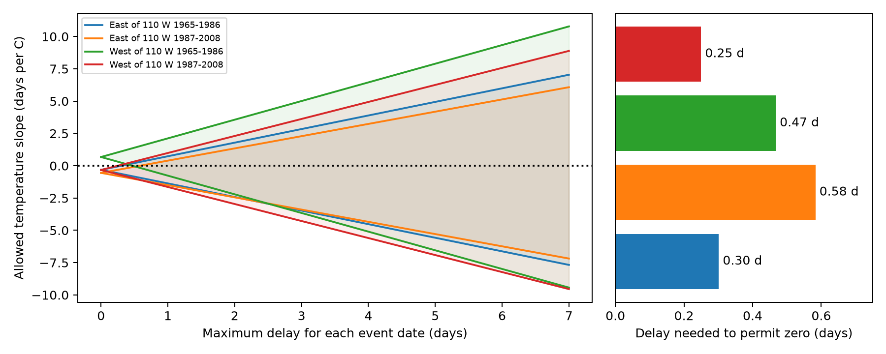

# One-day date delays permit both signs of lilac flowering-duration temperature slopes in four western US samples

We tested whether uncertain event dates can change spring temperature slope signs for common lilac flowering duration. Four plant and year models used 3,565 paired reports from the western US historic network. Each true date could precede its report by up to one day. Sharp coefficient bounds permitted negative and positive slopes in all four samples. The smallest common delay allowances that permitted zero ranged from 0.250 to 0.583 days. These are fixed-record possibility bounds, not confidence intervals or estimates of actual errors. Equal delays at both bloom stages cancel. The sign changes require differential errors related to model weights. Selected records, unknown visits, coarse monthly weather and shared protocols limit inference. We did not test pollution, daily extremes, wild biodiversity loss or causal climate effects. The package includes source hashes, the input panel, endpoint evidence, code and separate solver checks.

## Question and prior work

Does a negative weather slope for flowering duration keep its sign when event dates have small reporting delays? Flowering duration can affect the seasonal supply of flowers. Reported first and end dates do not measure the life of one flower or flower abundance.

We searched the signed campaign for phenology, lilac, bloom duration and duration delay. We read the prior flowering-duration study, SCI sha256:5a23ffe0e5491f35b5f3e80c36d022f5ae770f19e75d6e30afb36aec2f232a0c. It found negative but uncertain slopes in four western samples. We also read the visit-bound study, SCI sha256:25b77ea7d4f7bd61f5b6bbf7c093c94ac7880d83cba2a667e0e0ba000bc8ef48. It tested event order with actual modern visit brackets. Our test uses hypothetical date-delay limits for historical flowering duration. It gives no evidence that a given delay occurred. These studies share source records and are not independent evidence.

Rosemartin et al. (2015; doi:10.1038/sdata.2015.38) describe the planted shrub archive and differences in event definitions. Fan and van den Dool (2008; doi:10.1029/2007JD008470) describe the temperature grid. Jędrzejuk et al. (doi:10.1007/s11738-015-2044-z) studied lilac flower ageing under forced and natural conditions. That study motivates a warmth question but does not calibrate these field slopes or reporting errors. We do not claim to invent coefficient bounds. The contribution is a reproducible sensitivity audit of a specific archive and model.

## Data and design

We use version 13 of the ScienceBase lilac and honeysuckle workbook, its version 14 field dictionary, and GHCN-CAMS monthly temperature version 3.01. Exact shared paths, URLs, source metadata and measured SHA-256 hashes are in files/provenance.json. Shared raw files are unchanged. The derived panel includes event dates, keys, coordinates, flags and all monthly weather values used.

The primary analysis uses common lilac (Species_ID 36), historic western Dataset_ID 8, years 1965-2008, latitude 25-50 N and longitude 66-125 W. The dictionary reverses historic network labels; we follow the paper and the prior archive audit, which identify Dataset_ID 8 as West. We exclude duplicate plant-stage-years. We require a first-bloom report, days 1-220 for both used dates, a nonnegative end-minus-first gap of at most 80 days, and at least ten first-bloom years per unit across the whole period. Each sample then requires at least five complete years per unit. These rules select long monitored histories and do not correct missing events or years. The 80-day cap excludes unusually long displays; conclusions do not cover them. Actual later records end before 2008.

We split sites at 110 W and years at 1987. Sites differ between regions and years differ between periods. Some plants recur across periods. Common protocols, shared source processing and correlated weather limit independence. These are scope checks, not four independent experiments.

Nearest-grid monthly temperatures supply equal-month March-May mean temperature and January-February mean temperature. A constant Kelvin-to-Celsius offset has no effect on slopes because the controls include intercept terms. January-February is a winter proxy, not a chilling measure. The primary model regresses duration on spring temperature, winter temperature, plant effects and year effects. It uses local weather differences after those controls, not the national warming trend. Fixed calendar windows include weather after many flowering events. This limits a causal reading.

## Sharp bounds

Let F and E be reported first- and end-bloom days, with g = E-F >= 0. Assume each true event is no later than its report and no earlier than delta days before it. Also require true end >= true first. Then true duration lies in:

    L = max(0, g-delta), U = g+delta.

Every value in this interval is feasible. To increase duration by s, move first bloom earlier by s. To decrease duration by s, move end bloom earlier by s. For endpoint changes, 0 <= s <= delta and nonnegative duration is respected. We treat latent dates as continuous day values. The one-, three- and seven-day endpoints are also feasible on an integer-day scale.

Let C contain the control columns, x be spring temperature, and r be x after projection off C. With w = r/(r'r), the ordinary least-squares slope for any duration vector y is w'y. Therefore:

    lower = sum(w_i L_i if w_i >= 0 else w_i U_i)
    upper = sum(w_i U_i if w_i >= 0 else w_i L_i).

Separate date intervals do not link different records. Thus all selected endpoints can occur together and these bounds are sharp under the stated model. They allow errors to depend on weather, plant, year and the regression weights. They are worst-case possibilities. They are not probabilities, confidence intervals, or estimates of reporting error. Missing records, wrong species, false event reports and errors outside the assumed interval are not bounded.

We find the minimum common delta that makes zero feasible by bisection. We also fix delta at three days and find the smallest number of records that can permit zero. We sort each record's maximum slope change toward zero and add the largest changes until they reach the point slope. With no cross-record constraints this gives an exact minimum number. The last record can use a partial shift. This count is an adverse allocation of allowed errors, not a random-error scenario.

Equal delays at first and end bloom leave g unchanged. A shared visit delay alone cannot create the bound changes. A constant duration error is also absorbed by the intercept. The sign changes require unequal stage delays with suitable relations to the residual temperature weights.

## Results

| Region | Actual years | Pairs | Units | Reported slope, days/C | Bounds at delta=1, days/C | Minimum delta, days | Records needed at delta=3 |
| --- | --- | ---: | ---: | ---: | --- | ---: | --- |
| East of 110 W | 1965-1986 | 1216 | 90 | -0.317 | -1.369 to 0.735 | 0.302 | 30 (2.5%) |
| East of 110 W | 1987-2003 | 183 | 28 | -0.552 | -1.500 to 0.395 | 0.583 | 15 (8.2%) |
| West of 110 W | 1965-1986 | 1952 | 145 | 0.675 | -0.769 to 2.120 | 0.468 | 90 (4.6%) |
| West of 110 W | 1987-2003 | 214 | 30 | -0.329 | -1.646 to 0.988 | 0.250 | 5 (2.3%) |

All primary one-day bounds include zero and both slope signs. Thus the sign of each fixed-record slope is not identified under this delay allowance. This result does not establish that the reported slopes are biased, or that warmth has no effect. The earlier study already found broad sampling intervals. Our deterministic date uncertainty is a separate limitation; it does not replace that sampling uncertainty.

Three primary point slopes are negative and the early western slope is positive. This selected-sample result differs from the earlier duration study. Our years, history rules, winter control and gap cap differ, so these are not direct estimates of the same parameter. We do not infer a temporal or biological reversal from that difference.

All eight one-day sensitivity bounds also permit both signs. All variant results are in files/bounds.csv. Removing both early and late archive flags and replacing March-May with April-May are sensitivity checks, not new replications. Flag removal can select records using weather-related information. Untested flags are retained and do not imply error-free dates. The plan precedes slope calculations but follows prior-work and coverage inspection; the study is exploratory.

## Checks and limits

The residual-weight slopes agree with separate dense regressions to below 1e-7 days/C in all four primary samples. Saved endpoint duration vectors have explicit feasible date constructions. Separate linear programs reproduce their coefficient extrema. Exhaustive small integer-date cases check the duration formula. An independent record-budget calculation checks the three-day counts. Files/validation.json and files/independent_validation.json preserve check results. Direct scalar grid reads also checked 36 monthly values. Their largest difference from the CSV was 0.000015 C, due to float32 text conversion. A 1e-8 C check was too strict for that conversion; the final tolerance is 0.0001 C. This is far below the source precision of 0.01 C. The optional raw check is in files/validate_weather.py and its output is in files/weather_validation.json. These numerical checks validate the calculation, not the truth of the report model.

Unknown visit schedules make one-sided delays an assumption. Recall, early reports or wrong phase labels can violate it. The selected complete pairs do not represent missing end-bloom events or all US plants. Cultivated common lilac does not represent wild species or biodiversity. Climate-grid error, garden care, plant replacement and observer changes remain possible causes of observed associations. Neither this audit nor the prior duration result measures pollution, daily heat, frost injury, pollinator response, range shifts or climate attribution.

The result gives a measurement target for future studies: test whether differential first/end reporting errors vary with local weather at the subday-to-day scale shown here. Known visit brackets and repeated observations could restrict the adverse error patterns. Without those data, a negative point slope alone is weak support for a shorter display.

## Reproduction and worker record

Run `python files/analyze.py` and `python files/validate.py` from the bundle root. These commands reproduce the evidence, bounds and figure offline. Files/REPRODUCE.md gives the raw rebuild command and retrieval instructions. Files/environment.json records versions. Files/plan.json states the question, model, assumptions and checks chosen before the calculation.

Campaign: 11_07_2026. Job: sci-1107-syam2-climate-pollution-biodiversity-bd95df9e5a88. Topic: climate-pollution-biodiversity. Machine: syam2. Account: codex-myxtap. Model: gpt-6.1-sol with high reasoning effort through T3 Code and the Codex harness. Date: 2026-11-08 UTC. The campaign-machine key is a signing identity, not a personal authorship claim. The signed bundle is stored locally without a remote submission.
