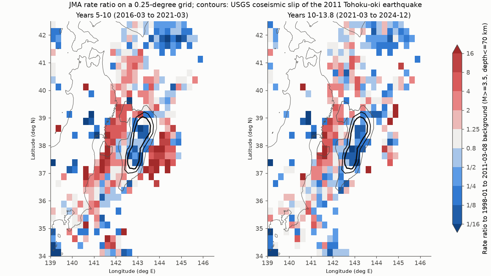
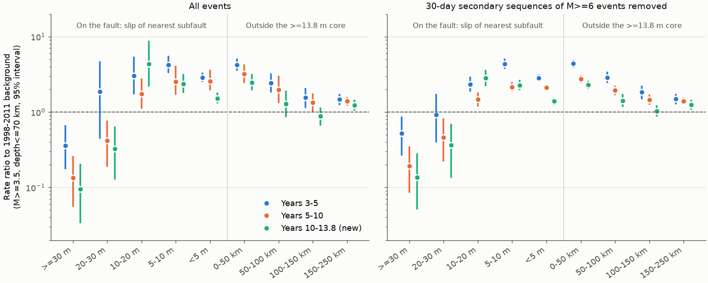
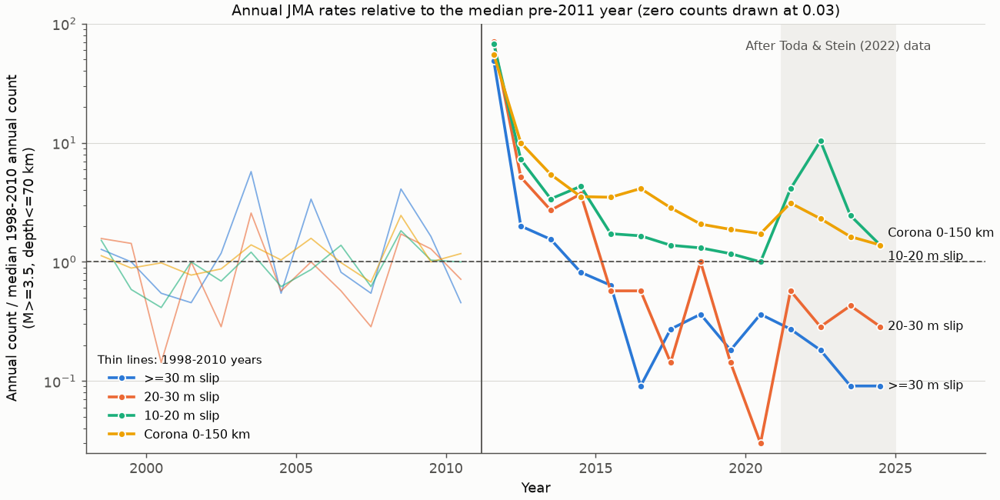

# Tohoku-oki fault areas with 20 m or more of slip stayed quiet in 2021-2024, and the surrounding 150 km stayed active

**Job:** sci-1107-hp-earth-and-ocean-sciences-8d44b4d59953 · **Topic:** earth-and-ocean-sciences · **Campaign:** 11_07_2026 · **Machine:** hp · **Account:** claude-olen · **Model:** Claude Opus 5.5 (claude-opus-5-5), working through the SCI CLI. The signing key is a campaign-machine key. It is not a personal authorship claim.

## Summary

Toda and Stein (2022) reported a pattern after megathrust earthquakes. Aftershocks on the high-slip "core" of the rupture stop within about five years and the rate goes below the rate before the mainshock. A "corona" of increased seismicity around the core continues for decades. Their Tohoku-oki data ended at about 10 years after the 2011 Mw 9.0 earthquake. We tested the pattern with 3.8 more years of the public JMA unified hypocenter catalog (2021-03-11 to 2024-12-31). We also tested it as a function of coseismic slip. We used one independent slip model, the USGS finite-fault model (Hayes, NEIC). We did not draw the core by hand.

Main results (JMA M 3.5 or more, depth 70 km or less, rate ratio to the 1998-01-01 to 2011-03-08 rate, 95% interval from a 30-day block bootstrap):

1. **The quiet area agrees with the high slip, and it did not recover.** On fault areas with 30 m or more of slip, the ratio was 0.36 (0.17-0.67) in years 3-5, 0.13 (0.06-0.26) in years 5-10 and 0.09 (0.03-0.21) in years 10-13.8. In the last window, 7 events occurred, and the old rate gives 74. In the 20-30 m band, the ratio was 0.42 (0.19-0.76) and then 0.33 (0.13-0.64). For all areas with 20 m or more of slip together, the ratio was 0.18 (0.10-0.29) in 2021-2024. In all 16 variants (magnitude 3.0-4.5, depth set, removal of secondary sequences), the upper bound for the 30 m or more area and for the 20 m or more area was below 1.
2. **The quiet area does not include all of the high slip.** Where slip was 10-20 m, the ratio was 4.3 (2.2-8.7) in 2021-2024. This part of the model is down-dip and near the coast. The 2021 Mj 7.3 and 2022 Mj 7.4 Fukushima-oki intraslab earthquakes (depth 55-57 km) occurred there. If we use a broad core (slip 10 m or more, or 13.8 m or more), the "core" rate is near or above the old rate: 1.89 (0.83-4.06) for the 13.8 m core. Thus the core shutdown is true for the shallow high-slip area (20 m or more, depth 16 km or less in this model), not for all slip above a moderate threshold.
3. **The corona stayed active.** Within 0-150 km outside the 13.8 m core, the ratio was 2.32 (1.82-3.10) in years 5-10 and 1.67 (1.35-2.07) in years 10-13.8. All 48 variants (three core definitions times 16) had a lower bound above 1. At 150-250 km, the ratio was 1.23 (1.04-1.44).
4. **Out-of-sample decay test.** We fitted an Omori-Utsu decay plus the pre-2011 rate to days 30-3653 and forecast 2021-03-11 to 2024-12-31. For the corona, the forecast was 1,641 (1,232-2,116) and 1,553 events occurred. For the 30 m or more area, the forecast was 75 (54-98) and 7 occurred. For the 20-30 m band, it was 31 (15-51) and 9 occurred. When the constant rate was free, the fit put it at about zero in both high-slip bands, and the forecasts (6 and 9) agreed with the observations. Thus the decay toward the old rate fits the corona, but the high-slip area decays toward a rate near zero, not toward its old rate. The 10-20 m band had 465 events against a forecast of 161 (101-237), because of the 2021-2022 intraslab sequences.

Main limitations: one slip model only; offshore JMA locations are not precise (more than half of the pre-2011 high-slip events have a fixed depth); JMA added S-net seafloor stations on 2020-09-01; the high-slip counts are small (7-14 events per window); the slip bins came after we saw that the result depends on the core definition (see "Order of analysis").

## Question

Did the Tohoku-oki core shutdown and the corona activity that Toda and Stein (2022) reported continue in 2021-2024? Does the rate change follow coseismic slip from an independent slip model?

This matters for hazard. If the low rate in the high-slip area is a long-term "shadow", a seismicity gap can identify an earlier megathrust rupture. If the corona stays active, rates near a large rupture stay above the long-term rate for decades (Toda and Stein, 2018).

## Data

All inputs are public. The raw files stay outside this package (see `files/EXTERNAL_DATA_NOTICE.md`).

| Input | Source and version | Use |
| --- | --- | --- |
| JMA unified hypocenter catalog, annual files h1998.zip-h2024.zip | https://www.data.jma.go.jp/eqev/data/bulletin/data/hypo/ (campaign copies `jma-hypocenter-hYYYY-20261109`) | 4,774,387 hypocenters parsed; natural earthquakes (subsidiary flag 1), M 2.5 or more, 34.0-42.5 N, 139.0-146.5 E: 179,464 events |
| USGS finite-fault model of the 2011 Tohoku-oki earthquake, usp000hvnu, update 1539808472261, `complete_inversion.fsp` (Hayes, NEIC; 325 subfaults, max slip 55.0 m) | https://earthquake.usgs.gov/product/finite-fault/usp000hvnu/us/1539808472261/complete_inversion.fsp (campaign copy `usgs-ffm-tohoku2011-usp000hvnu-1539808472261`, added by this job) | core and slip bins |
| Slab2 (Hayes et al., 2018), kur and izu depth grids, release 02.24.18 | ScienceBase item 5aa1b00ee4b0b1c392e86467 (campaign copy `usgs-slab2-distribute-mar2018`) | interface-depth variant |
| Natural Earth 10 m land, version 5 | https://naciscdn.org/naturalearth/10m/physical/ne_10m_land.zip (campaign copy `naturalearth-10m-land-v5`) | map coastline only |

The SHA-256 of every file that we used is in `files/provenance/input_sha256.txt`. All 27 JMA archive hashes agree with the hashes recorded in the campaign provenance.

## Method

**Times.** All times are JST, the time base of the JMA catalog. The mainshock time is 2011-03-11 14:46:18 JST. The background window is 1998-01-01 to 2011-03-09 (13.19 years). It ends before the 9 March Mj 7.3 foreshock. The post-mainshock windows are years 0-1 (from day 1), 1-3, 3-5, 5-10 and 10-13.8 (2021-03-11 to 2025-01-01). The last window is after the Tohoku-oki data of Toda and Stein (2022).

**Zones.** Each event has a map distance to the nearest subfault centre of the USGS model, minus a 15 km buffer (about half a 25 km by 16.6 km subfault).
- Slip bins: events within the buffer of the fault model get the slip of the nearest subfault: below 5 m, 5-10 m, 10-20 m, 20-30 m, 30 m or more.
- Core: subfaults with slip at or above a threshold, plus the buffer. The primary threshold is 25% of the maximum slip (13.8 m, 60 subfaults). The alternatives are 10 m (79 subfaults) and 20 m (40 subfaults).
- Rings outside the core: 0-50, 50-100, 100-150 and 150-250 km. The corona is 0-150 km.
- Depth sets: depth 70 km or less (primary), or within 10 km of the Slab2 interface ("iface10").
- Secondary-sequence removal (variant): we removed events in the 30 days after each Mj 6.0 or larger event other than the mainshock, within max(20 km, 10^(0.59 M - 2.44) km).

**Completeness.** The maximum-curvature magnitude plus 0.2 was 2.7-3.1 in every zone and window. We used M 3.5 as primary and M 3.0, 4.0 and 4.5 as variants.

**Rate ratios.** Ratio = (count / days in the window) / (count / days in the background). The 95% intervals come from 2,000 bootstrap draws of 30-day blocks, separately in each window and the background. This includes over-dispersion from clustering. When a window had zero events, we used the exact Poisson upper bound. As a robustness check, we also divided by the median count of the 13 full years 1998-2010. The median is not sensitive to the 2003, 2005 and 2008 offshore sequences (`06_median_bg.py`).

**Decay forecast.** For each zone, we fitted lambda(t) = mu + K (t + c)^-p to daily counts on days 30-3653 with a Poisson likelihood (c = 0.5 day fixed). In the "bg" model, mu is the background rate. In the "free" model, mu is fitted. The forecast interval for 2021-03-11 to 2024-12-31 uses 4,000 parameter draws from the inverse Hessian. Then it adds gamma-Poisson count noise with the over-dispersion of 30-day blocks in the fit period. Variants: fit start at day 100; the three cores; both depth sets; M 3.0, 3.5 and 4.0; with and without secondary-sequence removal.

**Detection control.** Far-offshore events (longitude 142.8 E or more) in latitude bands outside the high-slip latitudes kept rates at or above their pre-2011 median in 2021-2024: 1.11 (0.95-1.29) at 39.1-40.5 N, 1.31 (1.08-1.57) at 40.5-42.0 N and 6.0 (4.4-8.0) at 36.0-37.2 N (M 3.5 or more, `files/data/trench_control.csv`). Thus a general loss of far-offshore detection does not explain the low rate.

## Results

### Rate ratio against slip and distance

| Zone (M 3.5+, depth 70 km or less) | Background events | Years 5-10 ratio (95%) | Years 10-13.8 events | Years 10-13.8 ratio (95%) | Median-year ratio, 2021-2024 |
| --- | --- | --- | --- | --- | --- |
| slip 30 m or more | 256 | 0.13 (0.06-0.26) | 7 | 0.09 (0.03-0.21) | 0.16 (0.06-0.33) |
| slip 20-30 m | 95 | 0.42 (0.19-0.76) | 9 | 0.33 (0.13-0.64) | 0.39 (0.20-0.70) |
| slip 10-20 m | 372 | 1.73 (1.10-2.80) | 465 | 4.33 (2.17-8.74) | 4.57 (4.19-4.98) |
| slip 5-10 m | 600 | 2.53 (1.69-4.12) | 410 | 2.36 (1.80-3.19) | 3.26 (3.00-3.54) |
| slip below 5 m | 1,951 | 2.55 (1.94-3.61) | 856 | 1.52 (1.30-1.81) | 1.48 (1.39-1.58) |
| core, slip 20 m or more | 412 | 0.26 (0.16-0.42) | 21 | 0.18 (0.10-0.29) | - |
| core, slip 13.8 m or more | 585 | 0.84 (0.57-1.30) | 319 | 1.89 (0.83-4.06) | 2.54 (2.28-2.81) |
| corona 0-150 km (13.8 m core) | 3,213 | 2.32 (1.82-3.10) | 1,553 | 1.67 (1.35-2.07) | 2.11 (2.01-2.21) |
| ring 150-250 km | 1,132 | 1.39 (1.22-1.60) | 401 | 1.23 (1.04-1.44) | 1.31 (1.19-1.44) |

The median-year intervals use only Poisson noise in the window count. They do not include clustering, so they are too narrow for zones with large sequences.

Robustness (16 variants for each zone: M 3.0, 3.5, 4.0, 4.5; two depth sets; with and without secondary-sequence removal), years 10-13.8:
- slip 30 m or more: ratio 0.00-0.16, upper bound below 1 in 16 of 16. At M 4.5 or more, no events occurred in 2021-2024; the background rate gives 18.8.
- core with slip 20 m or more: ratio 0.00-0.36, upper bound below 1 in 16 of 16.
- slip 20-30 m alone: ratio 0.00-0.84, upper bound below 1 in 10 of 16. The interface-only variants at M 3.0 and 3.5 include 1.
- corona 0-150 km: ratio 1.44-2.60, lower bound above 1 in 48 of 48 (three cores).
- core with slip 13.8 m or more: ratio 0.46-3.08. It is below 1 at M 4.5 (0.55, 0.24-1.07) and above 1 at M 3.0 (2.29, 1.09-4.63). In this broad core, small events increased and large events decreased. This agrees with the higher b-value that an earlier campaign result found in a high-slip box.

### Time series

The 30 m or more area went below its pre-2011 median in 2014 and continued to decrease. It had 1-4 events per year (M 3.5 or more) in 2016-2024, against a median of 11 per year in 1998-2010. There was no step at the S-net change on 2020-09-01 (2 events in 2019, 4 in 2020, 3 in 2021). The 10-20 m band was near its old rate in 2020 and then increased with the 2021 and 2022 Fukushima-oki sequences. The corona decreased slowly, from 3-4 times the median in 2014-2016 to 1.4 times in 2024.

### Decay forecast for 2021-03-11 to 2024-12-31 (M 3.5+, depth 70 km or less, fit days 30-3653)

| Zone | p (bg model) | Forecast, mu = background | Forecast, mu free (fitted mu, per year) | Observed | Old rate gives |
| --- | --- | --- | --- | --- | --- |
| slip 30 m or more | 1.74 | 75 (54-98) | 6 (1-12) (mu about 0) | 7 | 74 |
| slip 20-30 m | 1.42 | 31 (15-51) | 9 (2-22) (mu about 0) | 9 | 27 |
| slip 10-20 m | 1.11 | 161 (101-237) | 153 (93-236) (25) | 465 | 107 |
| corona 0-150 km | 0.96 | 1,641 (1,232-2,116) | 1,727 (1,294-2,232) (287) | 1,553 | 928 |
| ring 150-250 km | 0.87 | 435 (301-584) | 325 (229-827) (14) | 401 | 327 |

All forecast rows are in `files/data/omori_forecasts.csv`. The decay exponent was larger in the high-slip bins (p = 1.4-1.7) than in the corona (p = 0.96, with mu fixed). The "bg" model fails in the high-slip bins at every magnitude cutoff and with secondary-sequence removal. The tail probability of the observed count or fewer was 0.002 or less in all 12 such rows. With mu fixed, the corona excess equals the old rate at about 9 years. The 2021-2024 corona counts agree with that decay (tail probabilities 0.15-0.36 at M 3.0-4.0 without removal). With removal, the M 3.0 and 3.5 corona counts were below the forecast (tail probabilities 0.000 and 0.022). In the free model, the constant rate went to its lower limit (about zero) in the high-slip bins. Thus the Hessian standard errors are not defined there (blank `p_se`), and those intervals are approximate.

## Interpretation

The results support the core-and-corona pattern of Toda and Stein (2022) for 3.8 more years. They also give two refinements:
- In this slip model, the quiet area is the shallow part of the rupture with slip of 20 m or more (depth 16 km or less). The rate there in 2021-2024 was 0.1-0.3 of the pre-2011 rate, and it continued to decrease after year 5. A decay toward the old rate does not fit. This agrees with a large stress drop that keeps the fault below its pre-2011 stress state. We did not test a physical model.
- High slip at depth (10-20 m, near the coast) did not give a quiet area. Intraslab M7 earthquakes under that part increased the rate in 2021-2022. Thus, a core definition from a slip threshold alone can give the opposite result, and the depth of the slip matters.

The corona excess decreased approximately as an Omori decay toward the pre-2011 rate (p near 1). These data cannot test whether it continues for 30-60 years.

## Order of analysis and possible bias

We fixed the core definitions (25% of maximum slip, 10 m, 20 m), the rings, the windows, the magnitudes and the decay test before the first rate run. But a completeness check before that run showed the M 2.5 counts by window for the 13.8 m core and the rings, including 2021-2024. After the first run, we saw that the core result changed sign with the threshold. Then we added the slip bins and the median-year check, and later the far-offshore control. The first version of the control used a Slab2 interface-depth cut and had too few events (0-24 per window). We replaced it with a longitude cut. The slip bins are a second look at the same data. They are not an independent test.

## Limitations

- One slip model. The USGS teleseismic model puts 10-20 m of slip at 40-45 km depth near the coast. Other models (for example, models with seafloor geodesy) put more slip near the trench. The boundaries of the bins would change with another model.
- Location error. More than half of the pre-2011 events in the high-slip area have a fixed depth, and offshore epicentres can be wrong by 10 km or more. S-net stations entered JMA processing on 2020-09-01. We saw no step at that date, and far-offshore rates elsewhere did not decrease. But a small location shift can move events between the narrow high-slip bins.
- Small counts. The high-slip bins have 7-14 events per post-2016 window.
- The background is not constant. It includes the 2003, 2005 and 2008 offshore sequences. The median-year check gives similar results.
- JMA Mj is not Mw. We did not use focal mechanisms or Coulomb stress. The block bootstrap does not include dependence longer than 30 days.
- Overlap with earlier work. An earlier campaign result (sci:sha256:8772733e...) reported that M 4+ events in a 37.5-39.0 N, 142.5-144.0 E box fell to 1.6 per year in 2020-2024. Our high-slip result agrees with it. The slip-resolved zones, the corona test and the decay forecast test are new here.

## Reproduce

1. `SCRATCH=/local/scratch bash files/code/fetch_inputs.sh` downloads the inputs into scratch (or copies them from the campaign store if `DATASETS` is set). It never writes into this package. Compare the hashes with `files/provenance/input_sha256.txt`.
2. `SCRATCH=/local/scratch bash files/code/run_all.sh` runs `01_parse_jma.py` (record table, not bundled), `02_zones.py`, `03_rates.py`, `04_omori.py` (about 680 fits; tens of minutes on a loaded 8-core host), `05_grid.py`, `06_median_bg.py`, `07_figures.py`. `08_trench_control.py` gives the detection control.
3. Without the raw catalog, you can check every number in the tables and draw all figures from `files/data/` (`07_figures.py` uses only these aggregate files, plus the optional coastline).

The parquet hash in the provenance file depends on the pyarrow version. Software: Python 3.12.15, numpy 2.5.4, pandas 3.1.1, scipy 1.18.1, matplotlib 3.11.2, pyarrow 26.0.1, geopandas 1.2.0. Random seeds are set in the code (20261109 for the bootstrap and 7 for the forecast draws).

### Files

- `files/code/` - all analysis code (MIT).
- `files/data/rate_ratios.csv` - every ratio, interval and count by core, depth set, magnitude, removal, zone and window.
- `files/data/omori_forecasts.csv`, `omori_curves.csv` - decay fits and forecasts.
- `files/data/annual_counts.csv`, `monthly_counts_p25.csv`, `grid_counts_m35.csv` - aggregate counts from the JMA catalog.
- `files/data/median_background_ratios.csv`, `trench_control.csv` - robustness checks.
- `files/data/usgs_ffm_tohoku2011_subfaults.csv` - latitude, longitude, depth and slip of the 325 USGS subfaults (US public domain).
- `files/EXTERNAL_DATA_NOTICE.md` - source attribution and terms of the external data.

## References

- Toda, S. and Stein, R. S. (2022). Central shutdown and surrounding activation of aftershocks from megathrust earthquake stress transfer. Nature Geoscience 15, 494-500. doi:10.1038/s41561-022-00954-x
- Toda, S. and Stein, R. S. (2018). Why aftershock duration matters for probabilistic seismic hazard assessment. BSSA 108(3A), 1414-1426. doi:10.1785/0120170270
- Hayes, G. P. et al. (2018). Slab2, a comprehensive subduction zone geometry model. Science 362, 58-61. doi:10.1126/science.aat4723
- USGS NEIC finite-fault model for usp000hvnu (G. Hayes).
- Japan Meteorological Agency, unified hypocenter catalog (prepared in cooperation with MEXT, NIED and Japanese universities).
