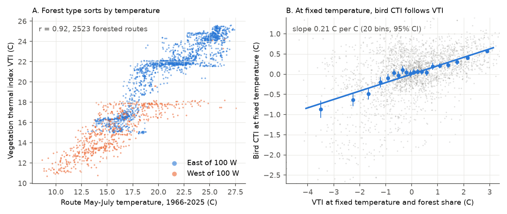
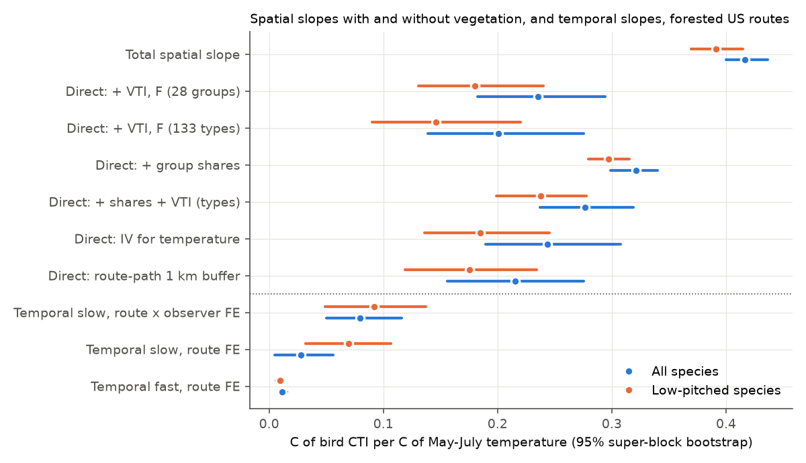
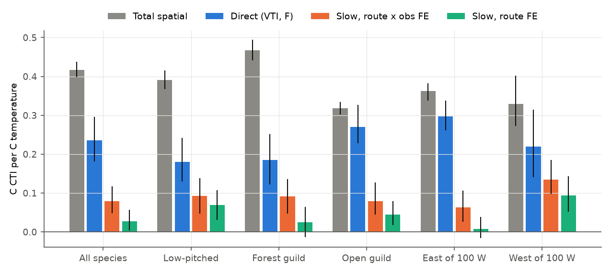

# Forest type explained about half of the gap between spatial and temporal bird community temperature slopes on 2,523 forested US routes (1966-2025), but not in open-habitat birds, the East, or species

Job: sci-1107-hp-climate-pollution-biodiversity-76accb0aac7e. Topic: climate-pollution-biodiversity.
Campaign 11_07_2026. Machine: hp. Model: Claude Opus 5.5 (claude-opus-5-5), as an automated research
worker. The signing key is a campaign-machine key. It is not a personal authorship claim.

## Summary

Earlier campaign work found that the bird community temperature index (CTI) of the North American
Breeding Bird Survey (BBS) follows in time only 3-25% of its spatial CTI-temperature slope. The spatial
slope stays large between nearby routes, a simple lag does not explain the gap, and each habitat guild
has the same gap. We tested one cause that these studies did not test: **vegetation mediation**. Forest
type sorts by climate, but it changes over centuries. If birds sort by temperature partly because they
sort by forest type, then in decades only the vegetation-independent ("direct") part of the spatial
slope can appear. The gap to the total slope is then expected, not a deficit.

We added the USFS/FIA 250 m forest type maps of the conterminous US to the BBS (1966-2025) and nClimGrid
temperature. For each route we calculated a vegetation thermal index (VTI): the forest-area-weighted
mean temperature of the places where each forest type occurs elsewhere in the US. We wrote the plan
(`files/PLAN.md`) before we calculated any slope.

Main results (95% intervals from 500 resamples of 4 degree blocks):

1. **Bird communities follow vegetation at fixed temperature.** On 2,523 forested routes, VTI correlated
   with route temperature at r = 0.92. At fixed temperature and forest share, the CTI increased by
   0.21 C per 1 C of VTI (0.13 to 0.28). VTI alone explained as much CTI variance as temperature
   (R^2 0.86 and 0.87).
2. **Forest type explained about half of the continental spatial slope.** The total slope was 0.42 C
   CTI per C (0.40 to 0.44). With VTI and forest share, the temperature slope was 0.24 (0.18 to 0.29)
   with 28 forest type groups and 0.20 (0.14 to 0.28) with 133 forest types. Measurement-error (IV)
   and route-path variants gave 0.18 to 0.24.
3. **Thus vegetation explained about half of the gap.** The temporal slope on route warming trends was
   0.028 (0.005 to 0.056) with route fixed effects and 0.080 (0.050 to 0.116) with route x observer fixed
   effects. The share of the gap (total minus temporal) that the direct slope removes was 0.47 (0.29
   to 0.62) and 0.54 (0.34 to 0.72). With 133 types it was 0.56 and 0.64. Our pre-registered rule for
   "mostly explained" (above 0.5, lower limit above 0.3, both temporal models) failed for the main
   analysis and passed for the 133-type map.
4. **For a CTI without hearing-related detection drift, the gap became small.** For 157 species that
   sing below 3.97 kHz, the two temporal models agreed (0.070 and 0.092). The direct slope was 0.18
   (28 groups) and 0.15 (133 types). Temporal tracking was 39-63% of the direct slope (intervals 19% to
   above 100%), and vegetation removed 66-82% of the gap.
5. **The mediation was specific.** It was strong for forest birds (direct/total 0.40; gap share 0.64
   to 0.75) and absent for open-habitat birds (0.85; gap share 0.18 to 0.20), as the plan predicted.
   But it was weak inside the East (direct/total 0.82; 1.00 with precipitation and winter temperature),
   where 73% of the forested routes are, and within 1 degree blocks (0.75). There, temporal tracking
   was still only 3-21% of the direct slope. The regional prediction failed: the West had the larger
   mediation and also the larger temporal tracking.
6. **At species level, neither slope transferred.** For 394 species, the response to differential
   warming (1976-1990 to 2011-2025, inside 2 degree blocks) had a weighted slope of -0.18 (SE 0.05) on
   the total spatial slope and -0.05 (SE 0.04) on the direct slope. Full transfer gives 1.

Conclusion: slow vegetation explains a real part of why bird CTI follows only a small part of its
spatial temperature slope. The part is about one half at continental scale and in forest birds, and
more for low-pitched species. It does not explain the deficit in eastern routes, in local temperature
contrasts, in open-habitat birds, or at species level. There, temporal tracking stays far below the
vegetation-independent slope.

## 1. Question and prior work

- The BBS CTI followed less than 10% of May-July warming (sci:sha256:c0a3a9aa...).
- In 75 monitoring networks, community thermal composition followed about 12% of its own spatial
  gradient; a pure lag model predicted much more (sci:sha256:0037934e...).
- US bird communities sort by temperature almost as strongly between nearby routes as across the
  continent; in time they follow 3-24% of this slope; habitat guilds have the same gap; species-level
  transfer is absent (sci:sha256:b41e4848...). That study had no land cover.
- Long-serving observers detect fewer high-pitched birds, and cold-adapted species sing higher. This
  drift makes part of the within-observer CTI trend. Species below 3.97 kHz have no drift
  (sci:sha256:b113aa1b...).
- Species-level year-to-year responses followed 5-14% of their spatial gradients
  (sci:sha256:91f371b5...).
- Remeasured US forest plots showed tree community warming of only 0.014-0.018 C per decade
  (sci:sha256:adb306e0...). Vegetation composition thus changes slowly.

Hypothesis H_V: the direct (vegetation-independent) spatial slope is close to the temporal slope.
Null H_0: the direct slope stays near the total slope.

## 2. Data

| Input | Use | Identity |
| --- | --- | --- |
| BBS 2026 release (1966-2025): States.zip, Weather.csv, Routes.csv, SpeciesList.csv | counts, runs, observers | USGS ScienceBase 6a0b0b0ab66b0188da36aedd |
| BBS route lines 1966-1998 (USGS National Atlas, Stanford vy474dv5024) | 1 km route-path buffer | bbsrtsl020.fgb |
| NOAA NCEI nClimGrid monthly tavg and prcp (about 5 km) | May-July and Dec-Feb temperature, precipitation | doi:10.1175/JAMC-D-13-0248.1 |
| USFS/FIA forest type group and forest type maps, conterminous US, 250 m (Ruefenacht et al. 2008) | forest share, forest type composition, VTI | data.fs.usda.gov raster gateway, files of 2012 |
| AVONET 2022 (eBird taxonomy sheet) | habitat guilds | doi:10.1111/ele.13898 |
| Song frequencies (Sagar et al. 2024) as tabulated in sci:sha256:b113aa1b... | low-pitched species set | doi:10.1098/rspb.2024.1908 |

Exact paths, sizes, SHA-256 hashes and URLs: `files/PROVENANCE.md`. Licences and attribution:
`files/NOTICE-external-data.md`. No raw external data are in this bundle.

## 3. Method

**Runs, STI and CTI.** Contiguous US routes, RunType 1, primary observer, 1966-2025, one run per
route-year (code of sci:sha256:b41e4848...). 107,922 runs on 3,960 routes; 466 species. Route
temperature T is the May-July 1966-2025 mean of nClimGrid cells within 20 km of the route start. STIs
are cross-fitted (two route halves, 5 splits, log(1 + count) weights). The run CTI is the
log(1 + count)-weighted mean STI. Variants: low-pitched species (dominant frequency below 3.97 kHz,
157 species), AVONET forest/woodland species (193), and open-habitat species (153).

**Vegetation.** In the same 20 km disc we counted 250 m pixels of each forest type group (28 classes)
and forest type (133 classes). F is the forested share. The forest thermal index FTI_k of a class is the
mean May-July climatology of all its pixels in the US (Table in
`files/results/forest_group_thermal_index.csv`; for example, spruce/fir 15.2 C, oak/hickory 21.8 C,
loblolly/shortleaf pine 24.6 C). For each route, FTI_k used only pixels outside the route's 4 degree
block (cross-fitting). VTI is the forest-area-weighted mean FTI_k. Forested routes have F >= 0.10.

**Spatial models** (route-mean CTI, routes with >= 5 runs):
total CTI ~ T; direct CTI ~ T + VTI + F; composition CTI ~ T + group shares (+ VTI);
climate CTI ~ T + (T - mean)^2 + Dec-Feb T + log May-July and log annual precipitation (+ VTI + F);
local versions with 1 and 2 degree block fixed effects; IV with the temperature of cells 8-20 km from
the start instrumented by the start cell; and a 1 km buffer around the 1966-1998 route line (1,778
routes).

**Temporal models** (same forested routes): CTI_run = FE + b_slow tau + b_fast a + first-year flag +
day of year, where tau is the fitted value of the route's linear May-July temperature trend 1966-2025
and a = T - tau. FE is route, or route x observer. The additive route + observer model of
sci:sha256:b41e4848... is also given.

**Gap share.** S = (b_total - b_direct) / (b_total - b_slow). S = 1 means that the direct slope equals
the temporal slope.

**Uncertainty.** 500 resamples of 4 degree super-blocks. Each resample recalculates the spatial and the
temporal models on the same routes, so the ratios carry their joint uncertainty.

**Species test.** For species with >= 50 forested routes in their range (2 degree blocks with a
record): g = slope of 1991-2010 route-mean log(1 + count) on T; d = T coefficient with VTI and F. The
slow response is the slope of the route change in mean log(1 + count) between 1976-1990 and 2011-2025 on
the route temperature change, with 2 degree block fixed effects. A fast response (run log count on
the temperature anomaly with route x observer and year fixed effects) was added after the plan.

**Accounting (added after the plan).** A route-level model CTI ~ T + Dec-Feb T + log precipitation
(May-July, annual) + VTI + F gives coefficients b_j. The expected CTI trend is the run-weighted mean of
sum_j b_j x (route trend of variable j), plus b_VTI x 0.016 C per decade (tree community warming of
sci:sha256:adb306e0...). We compare it with the observed CTI trend per decade (route, or route x
observer fixed effects).

## 4. Results

### 4.1 Spatial slopes with and without vegetation (all species, forested routes)

| Model | 28 groups | 133 types |
| --- | --- | --- |
| Total, CTI ~ T | 0.417 (0.400-0.437) | same |
| Direct, + VTI + F | 0.235 (0.182-0.294) | 0.201 (0.139-0.276) |
| VTI coefficient at fixed T and F | 0.208 (0.130-0.275) | 0.238 (0.149-0.315) |
| Direct, + group shares (no VTI) | 0.321 (0.299-0.340) | 0.324 |
| Direct, + shares + VTI | 0.291 (0.260-0.322) | 0.277 (0.237-0.319) |
| Total with climate covariates | 0.365 (0.309-0.408) | same |
| Direct with climate covariates | 0.280 (0.233-0.329) | 0.253 (0.203-0.310) |
| Total, 1 degree blocks | 0.307 (0.267-0.363) | same |
| Direct, 1 degree blocks | 0.230 (0.180-0.293) | 0.244 (0.198-0.305) |
| Direct, IV for temperature | 0.244 (0.189-0.308) | 0.214 (0.144-0.292) |
| Route path 1 km: total / direct | 0.430 / 0.216 (0.156-0.275) | 0.430 / 0.176 (0.121-0.242) |

R^2 of route-mean CTI: T 0.874; T + VTI + F 0.902; VTI + F only 0.863; climate covariates 0.917;
climate + VTI + F 0.924. With climate covariates, the VTI coefficient was still 0.11 (0.05-0.17).

The VTI result does not come from error in the temperature measure (the IV estimate is the same), nor
from the footprint (the route-path buffer gives a smaller direct slope). But VTI shares much of its
information with precipitation and winter temperature. With these covariates, vegetation removed 23-31%
of the slope instead of 44-52%.

### 4.2 Temporal slopes and the gap

| Quantity (all species) | 28 groups | 133 types |
| --- | --- | --- |
| Slow, route FE | 0.028 (0.005-0.056) | same |
| Slow, route x observer FE | 0.080 (0.050-0.116) | same |
| Slow, route + observer FE (additive) | 0.074 (SE 0.013) | same |
| Fast (anomaly), route FE | 0.011 (0.008-0.015) | same |
| Slow / total, route FE; route x observer FE | 0.066; 0.191 | same |
| Slow / direct, route FE | 0.12 (0.02-0.23) | 0.14 (0.03-0.29) |
| Slow / direct, route x observer FE | 0.34 (0.20-0.51) | 0.40 (0.23-0.63) |
| Gap share S, route FE | 0.47 (0.29-0.62) | 0.56 (0.35-0.72) |
| Gap share S, route x observer FE | 0.54 (0.34-0.72) | 0.64 (0.40-0.84) |

Mean route warming was 0.24 C per decade (May-July). If tree communities warm by 0.016 C per decade, the
vegetation path adds 0.208 x 0.016 / 0.24 = 0.014 C per C to the expected temporal slope. This is small.

### 4.3 Low-pitched species (no observer hearing drift)

| Quantity | 28 groups | 133 types |
| --- | --- | --- |
| Total | 0.391 (0.369-0.415) | same |
| Direct | 0.180 (0.131-0.240) | 0.146 (0.090-0.220) |
| Slow, route FE; route x observer FE | 0.070 (0.032-0.107); 0.092 (0.049-0.137) | same |
| Slow / direct, route FE | 0.39 (0.19-0.64) | 0.48 (0.21-0.91) |
| Slow / direct, route x observer FE | 0.51 (0.26-0.87) | 0.63 (0.31-1.21) |
| Gap share S, route FE | 0.66 (0.46-0.84) | 0.76 (0.51-0.97) |
| Gap share S, route x observer FE | 0.71 (0.49-0.93) | 0.82 (0.56-1.06) |
| Direct minus slow, route x observer FE | 0.088 (0.019-0.162) | 0.054 (-0.017-0.140) |

For this CTI, the two temporal models agree, and the remaining gap between the direct and the temporal
slope is about 0.05-0.11 C per C. For all species, the route FE model gives a much lower temporal slope
(0.028). This agrees with the observer turnover artefact of sci:sha256:b113aa1b..., which pushes the
all-species CTI down at observer changes.

### 4.4 Guilds and regions

| Group | Forested routes | Total | Direct | Direct / total | Slow, route FE | Slow, route x obs FE | Gap share S (route FE; route x obs) |
| --- | --- | --- | --- | --- | --- | --- | --- |
| Forest guild | 2,461 | 0.468 | 0.186 (0.123-0.251) | 0.40 (0.26-0.54) | 0.025 | 0.092 | 0.64; 0.75 |
| Open guild | 2,431 | 0.318 | 0.270 (0.229-0.326) | 0.85 (0.73-1.01) | 0.045 | 0.080 | 0.18; 0.20 |
| East of 100 W | 1,834 | 0.363 | 0.297 (0.263-0.336) | 0.82 (0.73-0.91) | 0.008 | 0.063 | 0.19; 0.22 |
| West of 100 W | 689 | 0.330 | 0.220 (0.142-0.314) | 0.67 (0.48-0.82) | 0.094 | 0.135 | 0.46; 0.56 |

- P5 (guilds) was supported: forest type mediates the thermal sorting of forest birds, not of open-habitat birds.
- P6 (regions) failed: the West had more mediation (and 1 degree block mediation of 0.65), but it also had the
  higher temporal slopes (0.43-0.61 of its direct slope). The East had little mediation and the lowest
  tracking (3-21% of its direct slope). In the East, VTI added nothing when precipitation and winter
  temperature were in the model (VTI coefficient 0.01).
- Much of the continental mediation comes from the contrast between eastern broadleaf and western
  conifer forests (Figure 1A): western forest types have cool FTI values at warm route temperatures.

### 4.5 Species

| Temporal response | Predictor | Species | Weighted slope (SE) | Spearman (p) |
| --- | --- | --- | --- | --- |
| Slow (differential warming) | total g | 394 | -0.18 (0.05) | -0.18 (0.0002) |
| Slow | direct d (28 groups) | 394 | -0.05 (0.04) | -0.14 (0.006) |
| Slow | direct d (133 types) | 394 | -0.04 (0.05) | -0.11 (0.03) |
| Fast (anomaly) | total g | 407 | -0.003 (0.005) | -0.06 (0.20) |
| Fast | direct d | 407 | -0.000 (0.004) | -0.00 (0.98) |

The direct slope was less negative than the total slope, but neither predicted the temporal response
in the expected direction (`files/figures/fig4_species.png`). Thus vegetation mediation does not repair
species-level space-for-time transfer.

### 4.6 Accounting in CTI change per decade (exploratory)

| Quantity (C per decade) | All species | Low-pitched |
| --- | --- | --- |
| Expected from total T slope | 0.101 (0.093-0.109) | 0.095 |
| Expected from direct T slope | 0.057 (0.044-0.073) | 0.044 (0.031-0.058) |
| Expected from T, winter T, precipitation, VTI, F, tree change | 0.074 (0.064-0.086) | 0.062 (0.052-0.073) |
| Observed, route x observer FE | 0.020 (0.013-0.029) | 0.023 (0.014-0.033) |
| Observed, route FE | 0.006 (-0.001-0.013) | 0.017 (0.008-0.026) |

Winter warmed faster (0.40 C per decade) than May-July (0.24), but the winter coefficient was close to
zero at fixed summer temperature. Precipitation trends added about 0.004. The tree-change path added 0.002.
Other climate variables therefore do not offset the expected change. The observed change was 39-53% of
the direct expectation for low-pitched species and 10-35% for all species.

## 5. Interpretation

1. A part of the "climate debt" of birds is not a debt of the birds but of the forests. Birds sort by
   forest type, and forest type sorts by climate on a time scale of centuries. Across the continent this
   explains about half of the gap between spatial and temporal CTI slopes. The spatial benchmark for
   expected tracking should therefore use the vegetation-independent slope, not the total slope.
2. Where this matters most, the remaining deficit is moderate. For forest birds and for a CTI without
   hearing drift, birds followed about 40-60% of the vegetation-independent slope.
3. Vegetation does not explain the deficit everywhere. In the East, in local temperature contrasts, and
   in open-habitat birds, the direct slope stays close to the total slope, and the temporal slope stays
   far below it. Other causes must act there (for example, region-wide year effects that local warming
   does not predict, sci:sha256:b41e4848...; detection artefacts, sci:sha256:b113aa1b...; or
   non-climatic population trends).
4. At species level, neither the total nor the direct spatial slope predicted the response to
   differential warming. The vegetation result is a community-level accounting result; it does not show
   that individual species respond to warming as their direct spatial slopes predict.

## 6. Limitations

- The forest maps are a single snapshot (about 2004, FIA plots and MODIS). We cannot test whether bird
  CTI follows vegetation change in time. We used a published tree-community warming rate instead.
- VTI is itself a climate summary. It can contain microclimate, soil and disturbance history, and
  other climate variables. With precipitation and winter temperature in the model, its effect was
  smaller (mediation 23-31%). The direct slope is therefore a lower bound of the climate part only if
  vegetation is not a better thermometer than nClimGrid. The IV check speaks against simple
  measurement error, not against all proxy effects.
- Non-forest vegetation (grassland and shrubland types) is not mapped, so open-habitat birds are not
  tested for their own vegetation mediation.
- The footprint is a 20 km disc around the route start (or a 1 km buffer around 1966-1998 lines).
- The route x observer model includes the hearing-drift artefact; the route model includes the opposite
  turnover artefact. We report both and the low-pitched species CTI.
- The plan predicted direct/total of 0.1-0.4; the main estimate (0.56) was outside this range. The
  pre-registered "mostly explained" rule failed for the main analysis and passed only for the 133-type
  and low-pitched variants. The regional prediction failed. The species prediction failed.
- Deviations from the plan: the fast species response, the accounting analysis and the added
  composition + VTI model were added after the plan. The T^2 term in the climate model was centred
  before the bootstrap (first runs used an uncentred T^2, which changes only the meaning of the T
  coefficient).
- One network (BBS), one country, breeding season only.

## 7. Reproduce

1. `bash files/code/00_fetch.sh ROOT` downloads all external inputs into `ROOT/datasets/` and checks
   their SHA-256. Use scratch space outside the publication folder. Put
   `files/results/species_sti_frequency.csv` of sci:sha256:b113aa1b... at
   `ROOT/work/scratch/species_sti_frequency.csv` (`sci read <zip> --file ... --output ...`).
2. `bash files/code/run_all.sh ROOT` runs all steps and writes intermediates to `ROOT/work/scratch` and
   results to `ROOT/work/results`. On a shared 8-core machine the whole run took about 1-2 hours
   (bootstraps about 20 minutes per variant when run in parallel). Python 3.12.15, numpy 2.5.4, pandas 3.1.1, scipy 1.18.1,
   xarray 2026.9.0, matplotlib 3.11.2, rasterio 1.5.2, pyproj 3.8.0, geopandas 1.2.0.
3. Seeds: route-half splits 20261110+s (s = 0-4), mediation bootstrap 20261110, accounting bootstrap 7.

## 8. Files

- `files/PLAN.md`: the plan written before the outcomes were calculated.
- `files/code/`: all code. `common.py`, `00_avonet.py`, `01_bbs.py`, `02_climate.py` are copied from
  sci:sha256:b41e4848...; `03_cti.py` is adapted from it.
- `files/results/mediation_<variant>_<region>[_type].csv`: all point estimates with bootstrap intervals;
  `boot_*.csv`: the bootstrap draws; `summary_table.csv`: main quantities for all variants.
- `files/results/species_slopes_*.csv` and `species_tests_*.csv`: species-level slopes and tests.
- `files/results/accounting_*.csv` and `accounting_boot_*.csv`: expected and observed CTI trends.
- `files/results/route_table_main.csv.gz`: route-level means (CTI, climate, F, VTI, forest group shares;
  column `c<code>` = share of FIA group code) for the 3,711 routes of the main variant.
- `files/results/forest_group_thermal_index.csv`, `forest_type_thermal_index.csv`: FTI of each class.
- `files/figures/`: Figures 1-5.
- `files/PROVENANCE.md`, `files/NOTICE-external-data.md`: sources, hashes, licences and attribution.
