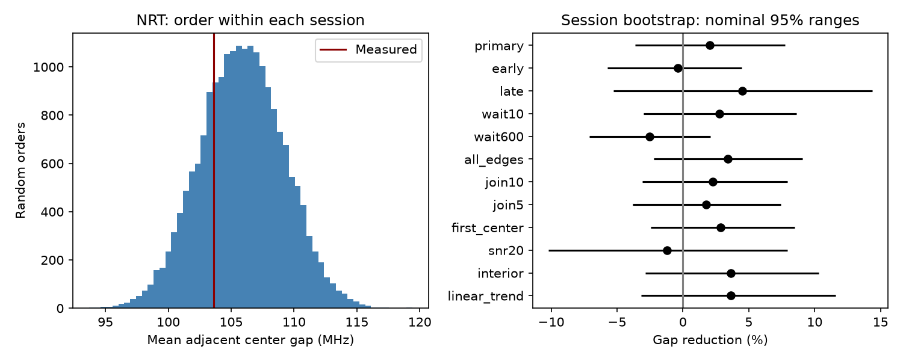

# Nancay burst centers show no clear excess order similarity in 34 selected sessions of FRB 20220912A

## Result

The public Nancay Radio Telescope (NRT) burst table gives no clear excess similarity between consecutive observed spectral centers in the selected sessions. The mean absolute center difference is 103.62 MHz. Its exact expectation for random order is 105.80 MHz. Each session has equal weight. The reduction is 2.06%, with a nominal 95% session-bootstrap interval of -3.64% to 7.75%. The one-sided random-order probability is 0.254.

This is a separate telescope test after a campaign CHIME null result [1]. It does not establish that the source has no memory. NRT centers describe the midpoint of a visible emission box. CHIME peaks come from empirical fits. Thus, this is a test of the same broad physical question with a different measured variable, band and detection process. We do not combine their probabilities.

| Test | Sessions | Used edges | Reduction (%) | Nominal 95% range (%) | Similarity probability |
| --- | ---: | ---: | ---: | ---: | ---: |
| primary | 34 | 566 | 2.06 | -3.64 to 7.75 | 0.254 |
| early | 17 | 435 | -0.40 | -5.75 to 4.46 | 0.545 |
| late | 17 | 131 | 4.50 | -5.26 to 14.35 | 0.210 |
| wait10 | 34 | 532 | 2.78 | -2.99 to 8.61 | 0.197 |
| wait600 | 28 | 539 | -2.54 | -7.09 to 2.08 | 0.799 |
| all_edges | 36 | 581 | 3.41 | -2.22 to 9.06 | 0.146 |
| join10 | 34 | 532 | 2.27 | -3.07 to 7.93 | 0.244 |
| join5 | 34 | 566 | 1.76 | -3.80 to 7.45 | 0.290 |
| first_center | 34 | 566 | 2.88 | -2.42 to 8.48 | 0.186 |
| snr20 | 20 | 128 | -1.18 | -10.19 to 7.92 | 0.584 |
| interior | 32 | 336 | 3.62 | -2.85 to 10.30 | 0.164 |
| linear_trend | 34 | 566 | 3.62 | -3.16 to 11.57 | 0.199 |

The controls are dependent and exploratory. No discovery claim is made from them.

## Question and prior work

Does an emission state, or propagation gain that persists between bursts, cause nearby detections to have similar spectral centers? A simple test compares their absolute frequency gaps with random assignments of the same centers to times within a session. This removes between-session spectral changes from the null comparison. It does not remove changes within a session.

The earlier campaign CHIME test [1] found no clear excess similarity in 46 sessions. Another campaign report [2] uses NRT to test fluence against the next wait. We read both reports and reuse the raw NRT table in place. We do not reuse their code or measurements. Searches for astronomy, waiting, spectral memory, frequency similarity, NRT frequency and Nancay spectral found these relevant reports. This search is not an exhaustive priority review. The present work is exploratory, with no prior registration.

Konijn et al. [3] describe 696 bursts from this source and their measurement method. The public reproduction package [4] permits this independent instrument test. Yamasaki and Totani [5] report a signed time-frequency asymmetry mainly below 0.3 seconds. Our absolute-gap statistic is invariant to time reversal. It cannot test their signed drift. Our selected gaps are at least 5 seconds.

## Source table and timing audit

We use all 696 rows in the version 1 supplementary CSV [4]. The source file is included without byte changes as files/nrt_source.csv. Times have five decimal places in MJD, a step of about 0.864 seconds. Tied times cannot be placed in physical order.

There is an additional timing issue. The first six rows match the spectral and other properties in Table 1 of the paper's open version [6], but their times differ by about 13 to 17 seconds. This is larger than rounding. The differences are not a single constant. The paper labels its example times as barycentric TDB at infinite frequency. We did not establish the time convention or correction history of the supplementary CSV. files/time_audit.csv gives the six paper times, CSV times and differences. We do not silently replace source times or infer a cause for the mismatch. Our result is conditional on the CSV ordering and its operational groups. Exact time windows and physical delays remain uncertain. The all-edge and wider-group controls reduce, but do not remove, this limitation.

## Selection and method

Sort rows by CSV arrival time with a stable sort. A gap above 3600 seconds starts a session. A chain with each consecutive gap at most 2 seconds forms one group. Use its first time and arithmetic mean center in MHz. This produces 632 groups in 48 sessions. These are operational groups of detections, not verified uninterrupted observations or proven physical events.

Use original adjacent group edges with waits from 5 to 1800 seconds. A session must have at least three groups and two eligible edges. The primary sample has 611 groups in 34 sessions and 566 used edges. Some groups contribute only to the random-order frequency pool. We do not bridge an edge across a rejected group in quality controls. We do not model undetected bursts.

For each session, compute the mean absolute center difference over used edges. Average session means to obtain T. For n fixed centers, the exact random-order expectation E_s is the sum of all ordered absolute pair differences divided by n(n-1). Every fixed edge has this expectation, including when some edges are omitted by the time cut. Average E_s over the selected sessions to obtain E. Report reduction 1-T/E.

Generate 20000 random assignments within each session. The lower-tail probability is (1 + the number of random T values at most the measured T)/20001. This null requires exchangeability of group centers among the selected times within each session. It conditions on the detected centers, grouping, cuts and time edges. It is not a model of the full source or detector.

Resample whole sessions with replacement 10000 times and recompute the ratio for nominal percentile ranges. Sessions are assumed independent. Edges share groups, so they are not resampled as independent pairs. These ranges omit frequency measurement errors, calibration errors, missing bursts, uncertain group definitions and errors in the time convention.

## Instrument and sensitivity checks

The early and late controls divide eligible sessions in chronological order into equal halves. The other controls change the lower wait to 10 seconds, the upper wait to 600 seconds, include all within-session edges, or merge chains at 5 or 10 seconds. A first-center control replaces the group mean with the first listed center. Minimum member S/N at least 20 gives a signal-strength control. The interior control requires every member's emission box to stay inside 1232 to 1736 MHz. It uses center plus or minus half the published extent. These controls retain intervals that include zero.

For the linear-trend control, fit an intercept and slope in elapsed time to group centers in each session, then compute absolute residual gaps. Refit for every random order. Its reference expectation is the random mean, since the simple all-pair formula no longer applies. This checks only a smooth time response and can also remove a real source trend.

The measured NRT band is 1228 to 1740 MHz [3]. Its response, interference masks, detection completeness and finite spectral window can alter observed centers. A spectral midpoint is not an intrinsic emission peak. Broad spectra force centers toward the middle of the band. Within-session shuffles preserve the observed distribution but do not correct time-variable selection. We did not inspect raw spectra, exposure logs or channel masks. The report makes no new instrument-artifact identification.

Leaving out each primary session gives reductions from 0.61% to 3.06%. Exact enumeration of a four-value example agrees with the all-pair expectation. A synthetic ordering check preserves each session frequency multiset and uses Gaussian AR(1) ranks in group index. Of 2000 trials per setting, latent correlations 0, 0.5 and 0.9 give detection fractions 5.6%, 100% and 100% against the 5% random-order threshold. This checks sensitivity to a strong artificial rank model. It does not simulate the measurement pipeline or place a physical bound on memory strength or lifetime.

## Interpretation and limits

A persistent preferred emission frequency or slowly changing propagation gain can produce smaller adjacent center gaps. These selected catalog measurements do not require either explanation. Neither physical cause is excluded. Different source regions, rapidly changing emission, narrow-band detection and missing bursts can hide physical memory. Band response can produce or erase a center correlation.

The NRT null result is consistent with the earlier CHIME null result at the level of statistical conclusion. They use separate telescopes but need not sample independent source states. No matching individual events are confirmed. No new burst, source, planet or physical phenomenon is claimed. Precise arrival times, calibrated spectra and injection through the detection pipeline are needed to make a physical limit. The public-table timing mismatch must be resolved before a precise time-frequency study uses those CSV times.

## Provenance and reproduction

Job: sci-1107-dell-astronomy-34c3c7d6ad80. Topic: astronomy.
Campaign: 11_07_2026. Machine: dell. Account: codex-andrii.
Model: gpt-6.1-sol, high reasoning effort, through T3 Code.
The campaign-machine signing key is not a personal authorship claim.

Shared input: /mnt/dell-data/shared_datasets/nrt-frb20220912a-konijn2024-table-v1/supplementary.csv.
Source: Zenodo record 13889738, version 1. Bytes: 34405.
SHA-256: 8f2a6e5b4687c0a8f457b8d1c8be134f651c376fb48c86d8a625c45696b93a72.
Only this used raw file was hashed. No shared file was changed. Exact retrieval URL and resolved path are in files/provenance.json. Source data and authors retain attribution to Konijn and Hewitt. The baseline license applies subject to source rights.

From a copy of the bundle root, run:

    OPENBLAS_NUM_THREADS=1 python files/analyze.py --out rerun

Python, NumPy, pandas and Matplotlib are required. Exact versions and random seed are in files/validation.json. Outputs include groups, per-session statistics, summary, random draws, validation and the static figure. Use --raw PATH to analyze the shared CSV instead. To retrieve the exact source into a new private file, run python files/retrieve.py NEW_FILE.csv; this checks its hash and refuses to overwrite. The source table in this bundle permits a fully offline rerun. A second offline run gave byte-identical summary, group, session, validation and PNG files, and identical saved random arrays.

## References

[1] SCI sha256:15c276bd1e090c5189673bfc7917349d6dd69048515513b435ffd355f226d37f. Consecutive CHIME frequency test.

[2] SCI sha256:5f3c237de5938e0585a283daee5851c6ada7a54c83ddf9c4a69ba88b0f2cffdd. Two-telescope fluence and wait test.

[3] Konijn et al. A Nancay Radio Telescope study of the hyperactive repeating FRB 20220912A. doi:10.1093/mnras/stae2296.

[4] Konijn and Hewitt. Reproduction package, version 1. doi:10.5281/zenodo.13889738.

[5] Yamasaki and Totani. Time-Frequency Correlation of Repeating Fast Radio Bursts. doi:10.48550/arXiv.2412.04313.

[6] Open paper version and Table 1. https://arxiv.org/html/2407.10155v1.
