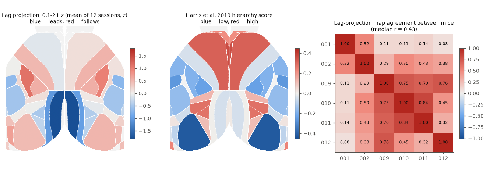
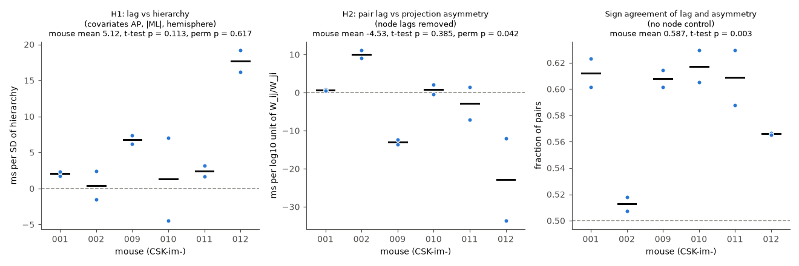
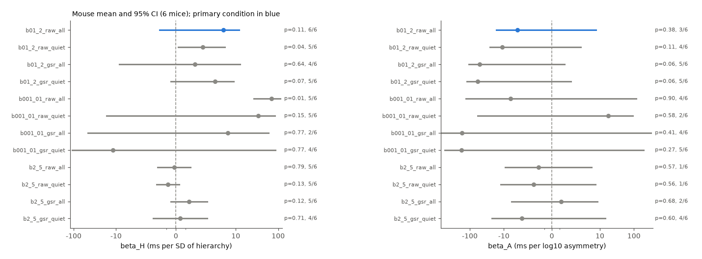

# In 12 IBL widefield sessions from 6 mice, cortical activity lags were reliable but did not follow the anatomical hierarchy or pair-specific axonal projection asymmetry

## Summary

**Question.** Does the direction of mesoscale activity flow across mouse dorsal cortex follow the direction of
axonal projections? We tested two structure-function predictions with widefield calcium imaging:

- **H1 (area level).** Areas low in the Harris et al. (2019) anatomical hierarchy lead, and high areas follow.
- **H2 (pair level).** In a pair of areas, the area that sends the stronger projection (Knox et al. 2019 voxel
  connectome) leads, after the mean lag of each area is removed.

**Data.** International Brain Laboratory (IBL) widefield sessions (Zador lab, widefield choice-world task,
haemodynamic-corrected GCaMP signal, 15.15 Hz). 12 confirmatory sessions, 2 for each of 6 mice, were selected
by a fixed rule. One more session was used only to develop the code. 42 to 48 cortical areas (both hemispheres)
per session.

**Method.** We warped the Allen dorsal-cortex map onto each session with the IBL landmark transform. We band-pass
filtered the area signals (primary band 0.1-2 Hz) and measured the lag of each area pair with the peak of the
cross-covariance and parabolic interpolation (Mitra et al. 2014). The analysis plan (files/code/PLAN.md) was
written before we analysed any confirmatory session. The pre-set decision rule: mouse-level t-test p < 0.05, the
same sign in at least 5 of 6 mice, and permutation p < 0.05.

**Main results.**

1. **The lag structure is real and reliable.** Pair lags had a mean absolute value of 41 ms. The split-half
   reliability (odd versus even 60-s blocks) of area lags was r = 0.99 (range 0.98 to 1.00), and of pair lags
   after removal of area lags it was r = 0.97 (0.94 to 0.99). The two sessions of one mouse agreed at r = 0.54 to
   0.98 (area lags). Mice agreed less (median r = 0.43). Dorsal retrosplenial cortex (RSPd) led in all 6 mice. The
   areas that followed were different between mice (SSp-ul, MOp, auditory, temporal or lateral visual areas).
2. **H1 is not supported.** After the AP, medio-lateral and hemisphere covariates, the hierarchy slope was +5.1 ms
   per SD of hierarchy (95% CI -1.7 to +12.0; mouse t-test p = 0.11). It was positive in 6 of 6 mice (low areas
   lead), but the area-label permutation p was 0.62. Without covariates, the mean Spearman correlation of area lag
   and hierarchy was -0.08. A spatial-autocorrelation-preserving null (Moran spectral randomisation) also gave no
   effect (p = 0.67 to 0.93).
3. **H2 is not supported.** With area lags removed, the slope of pair lag on projection asymmetry was -4.5 ms per
   log10 unit (95% CI -16.8 to +7.7; mouse p = 0.39; 3 of 6 mice negative). The permutation p was 0.042, but in the
   direction opposite to the prediction, and the mouse-level test and sign rule failed.
4. **A weak area-level association exists, but space explains it.** Without area-lag control, the area that sends
   the stronger projection led in 58.7% of pairs (mouse p = 0.003; area-label permutation p = 0.006, null mean
   50.0%). This came from an area-level property: areas with a larger net outflow led (mean Spearman -0.28, 6 of 6
   mice). But spatially smooth surrogate maps with the same spatial autocorrelation gave the same slope (p = 0.21 to
   0.27). Thus the data do not separate a projection effect from any smooth spatial gradient.
5. **The pair-specific lags are mostly specific to each mouse.** The pair lags that remain after area lags are
   removed had an SD of 7 to 40 ms. They repeated between the two sessions of a mouse (median r = 0.53) but only
   weakly between mice (median r = 0.18). Projection asymmetry did not explain them.

**Conclusion.** In this widefield data set, mesoscale lags across dorsal cortex are stable within an animal, but
they do not follow the tracer-based hierarchy or the pair-specific direction of axonal projections. This agrees with
the earlier campaign result that IBL spike Granger direction does not follow projection asymmetry
(sci:sha256:734b7b0e). It is a new modality (cortex-wide optical imaging, no neuron-count bias) for the same
negative answer.

## Question and prior work

Many studies ask if anatomical connections predict the direction of activity flow. In the campaign record, IBL
spike Granger direction did not follow axonal projection asymmetry (sci:sha256:734b7b0e), LFP Granger in six
visual areas went from lower to higher areas (sci:sha256:0dd17ccb), and in larval zebrafish the alignment of
projection and lag changed sign after global signal removal (sci:sha256:2f2b0c36) and gave no lag prediction gain
(sci:sha256:31e603bc). The hierarchy did not reliably predict spiking timescales (sci:sha256:545f2eaa). Before this
work, the campaign had no widefield imaging study. Widefield imaging samples the full dorsal cortex at the same
time. Thus it does not have the unequal neuron-count problem of spike data.

## Data

- **IBL widefield** (CC BY 4.0). Public bucket `s3://ibl-brain-wide-map-public`, lab zadorlab, task protocol
  `_iblrig_tasks_widefieldChoiceWorld6.4.2`, 51 sessions from 6 mice (CSK-im-001, -002, -009, -010, -011, -012).
  Files used per session: `widefieldU.images.npy` (540 x 640 x 200), `widefieldSVT.haemoCorrected.npy` (200 x
  frames), `widefieldLandmarks.dorsalCortex.json`, `imaging.times.npy`, `imaging.imagingLightSource.npy`,
  `widefieldChannels.frameAverage.npy`, `_ibl_trials.table.pqt` (revision 2025-07-29),
  `_ibl_wheelMoves.intervals.npy`. Session list: files/code/sessions_confirm.csv. Hashes:
  files/provenance/. The U and SVT files are in the campaign shared store as `ibl-widefield-<subject>-<date>-u-images`
  and `-svt-haemo` (26 directories with provenance.json).
- **Atlas.** wfield dorsal-cortex reference (Allen CCF top projection, area contours; jcouto/wfield commit 6bb958bf).
  Our own code reads the landmark transform; no wfield code is used.
- **Hierarchy.** Harris et al. (2019), `Output/TCCT_CCconf_iter.xls`, final iteration (AllenInstitute/MouseBrainHierarchy
  commit 8e4e0dd2).
- **Connectome.** Knox et al. (2019) normalized ipsilateral connection density (Allen Institute). Asymmetry
  A_ij = log10(W_ij / W_ji) does not depend on source or target volume.

The external data are not in this bundle. See files/NOTICE-external-data.md.

## Methods

- **Areas.** wfield Allen map warped to the image with the IBL similarity transform (reference pixels to image
  pixels; 0.0194 mm per reference pixel). Each area mask was eroded by 3 pixels. Excluded before analysis: MOB, FRP,
  ACAd, PL, RSPv, AUDv, VISli, VISpl, and areas with fewer than 200 pixels. Fig. 1 shows the alignment for all 12
  sessions.
- **Signals.** Area signal = (mean of U over the area pixels) x haemodynamic-corrected SVT (blue frames).
- **Lags.** 2nd-order Butterworth zero-phase band-pass. Cross-covariance in 60-s blocks (z-scored per block),
  averaged; lag window +-1 s (+-4 s for 0.01-0.1 Hz). tau_ij = lag of the positive peak, parabolic interpolation,
  antisymmetrised. Pairs with zero-lag correlation below 0.1 were dropped (no pair in the primary condition).
  Area lag (lag projection) = mean lag of the area relative to all others.
- **H1.** Per session, OLS of area lag on z(hierarchy) + AP + |ML| + hemisphere. Mouse mean of the 2 sessions;
  one-sample t-test over 6 mice; area-label permutation of the hierarchy (10,000) for the mean session slope.
- **H2.** Per session, ipsilateral pairs: tau_ij = theta_j - theta_i + beta_A A_ij, with free area lags theta.
  The area terms remove every area-level gradient (position, hierarchy, signal quality, rolling-shutter row
  offsets). Same mouse-level test; permutation of area labels of A (10,000).
- **Secondary conditions** (exploratory): 0.01-0.1 Hz and 2-5 Hz bands; wheel-quiescent samples only; global
  signal regression.
- **Additional analyses (not pre-registered):** spatial null for area-level effects (Moran spectral
  randomisation, singleton sign flips, Gaussian kernel 0.5, 1 or 2 mm, 10,000 surrogates; Wagner and Dray 2015);
  permutation null for sign agreement; between-mouse consistency of residual pair lags; stimulus-evoked half-peak
  latency.

## Results

Figure 2. Left: mean area lag (z per session) in 0.1-2 Hz activity; blue areas lead. Middle: Harris et al. 2019
hierarchy score of the same areas. Right: correlation of the area-lag maps between mice.

Figure 3. Pre-registered tests, primary condition. Dots are sessions, bars are mouse means.

| Condition | beta_H, ms/SD (95% CI) | p mouse | same sign | p perm | beta_A, ms/log10 (95% CI) | p mouse | same sign | p perm | sign agreement |
| --- | --- | --- | --- | --- | --- | --- | --- | --- | --- |
| **0.1-2 Hz, all (primary)** | 5.1 (-1.7, 12.0) | 0.11 | 6/6 | 0.62 | -4.5 (-16.8, 7.7) | 0.39 | 3/6 | 0.042 | 0.587 |
| 0.1-2 Hz, quiescent | 2.8 (0.2, 5.4) | 0.037 | 5/6 | 0.75 | -11.0 (-25.8, 3.8) | 0.11 | 4/6 | 0.001 | 0.630 |
| 0.1-2 Hz, GSR | 2.0 (-8.5, 12.5) | 0.64 | 4/6 | 0.76 | -52 (-106, 2) | 0.055 | 5/6 | 0.017 | 0.492 |
| 0.1-2 Hz, GSR, quiescent | 4.2 (-0.5, 8.9) | 0.071 | 5/6 | 0.62 | -59 (-121, 2) | 0.057 | 5/6 | 0.005 | 0.496 |
| 0.01-0.1 Hz, all | 69 (26, 112) | 0.009 | 5/6 | 0.082 | -6 (-131, 118) | 0.90 | 4/6 | 0.57 | 0.516 |
| 2-5 Hz, all | -0.2 (-1.9, 1.6) | 0.79 | 5/6 | 0.48 | -1.7 (-9.1, 5.6) | 0.57 | 1/6 | 0.012 | 0.502 |

All 12 conditions: files/results/summary.csv and Fig. 4. No condition met all three parts of the decision rule.
In several secondary conditions beta_A was negative with a small permutation p, which is opposite to the
feedforward prediction; the mouse-level tests did not confirm it.

Figure 4. Mouse mean and 95% CI for every band, epoch and global-signal condition (symmetric log axis).

**Spatial null for area-level effects** (files/results/spatialnull.csv): hierarchy slope 3.2 ms per SD of the
hierarchy over the 23 imaged areas, null SD 7.2 to 9.1, p = 0.67 to 0.93; net projection asymmetry slope -10.0 ms
per SD, null SD 7.6 to 8.2, p = 0.21 to 0.27. Hierarchy and net asymmetry correlate (r = 0.41) over the imaged
areas.

**Reliability** (files/results/reliability.csv, pairresid_within.csv, pairresid_between.csv): split-half r of
area lags 0.976 to 0.999; of residual pair lags 0.94 to 0.99; residual pair lags between the two sessions of a
mouse r = 0.10 to 0.90 (median 0.53); between mice median 0.18 (range -0.15 to 0.58).

**Evoked control (failed).** We planned a stimulus-locked latency check as a positive control. The mice moved the
wheel quickly (median reaction time 0.14 s in the development session), so only 10 to 17 trials per session and
side had a reaction time above 0.3 s. Contralateral VISp did not respond first, and evoked latencies did not
follow the hierarchy (Spearman -0.00). Thus this data set gives no independent proof that the lag method detects
a known sensory direction. The high split-half reliability shows that the lags are stable, but not that they are
neural in origin.

Figure 1. Quality check: Allen areas warped onto the mean blue frame of each confirmatory session.

## Interpretation

- Widefield lags at 0.1-2 Hz have a strong, stable spatial pattern: dorsal retrosplenial cortex leads in every
  mouse, and lateral, auditory or forelimb areas follow. This pattern is not the tracer hierarchy and not the pair-specific projection direction.
- The 6/6 positive hierarchy slope after spatial covariates and the 6/6 sign agreement with projection asymmetry
  are area-level effects. Spatially smooth surrogate maps give effects of the same size. A larger number of areas or
  animals with different spatial layouts is necessary to separate these alternatives.
- The pair-specific lags are reliable but mostly specific to each mouse. Possible causes are individual brain
  state, alignment error, blood-vessel signals and the window edge, as well as real individual differences.

## Limitations

- Six mice from one lab and one task; two sessions per mouse. The mouse-level t-test has 5 degrees of freedom.
- Haemodynamic correction is not perfect. The leading retrosplenial areas are next to the midline sinus, so vessel
  signals can affect them. Camera rolling-shutter timing is not documented; any row-wise offset is an area-level
  effect and is removed in H2 but not fully in H1 (AP covariate only).
- The widefield signal is a mix of layers and of neuropil; the 0.1-2 Hz lags of GCaMP signals are of the order of
  one frame (66 ms), so they depend on interpolation.
- Knox and Harris come from other mice. Areas are coarse and the atlas warp is a 4-landmark similarity transform.
- The evoked positive control failed (see above).
- The lag scale differed between mice (mean |tau| 16 to 61 ms); mice with larger lags have more weight in ms-unit
  slopes. Scale-free slopes (files/results/explore_session.csv) gave the same conclusions (beta_H per SD of area lag
  0.10, p = 0.057, 6/6; beta_A per SD of pair lag -0.02, p = 0.86).

## What remains open

- A positive control with passive visual stimuli or a slower task (for example other widefield data sets with
  sensory mapping) to show that the method detects a known direction.
- More areas (lateral cortex) or a pixel-level analysis with axon projection maps from single tracer experiments.
- The cause of the mouse-specific pair lags (vessels, alignment or brain state).

## Reproduction

Layout: run from a folder with `work/code` (= files/code), `work/raw` and the campaign `datasets/` link.

1. `bash work/code/fetch_refs.sh` (wfield atlas files, Harris tables, IBL ONE cache; installs xlrd into work/pylib).
2. Data: `bash work/code/fetch_all.sh` (uses the campaign `campaign-dataset` helper). Outside the campaign, run
   `bash work/code/fetch_session.sh zadorlab/Subjects/<subject>/<date>/001 work/raw/wf/<subject>_<date>` for each row
   of sessions_confirm.csv; `process_session.py` then uses the local U and SVT copies. Compare hashes with
   files/provenance/.
3. `bash work/code/run_confirm.sh` (12 sessions, about 15 s each) and
   `python -I work/code/process_session.py CSK-im-001 2021-01-17` (development session).
4. `PYTHONPATH=work/pylib python work/code/stats.py work/res/confirm <12 session names>` (about 30 min, 2 CPUs).
5. `explore.py`, `spatial_null.py`, `agree_perm.py`, `pair_consistency.py` with argument `work/res/confirm`, then
   `figures.py work/res/confirm <figure folder>`.

Software: Python 3.12, numpy, scipy, pandas, matplotlib, xlrd 2.0. The per-session primary lag matrices (ms) and
area tables are in files/results/lag_matrices_primary/.

## Provenance

Job sci-1107-dell-neural-structure-and-computation-f47c1f46840a, topic neural-structure-and-computation, machine
dell, model claude-opus-5-5 (Claude Code), campaign 11_07_2026, 2026-11-12. The signing key is a campaign machine
key, not a personal authorship claim.
