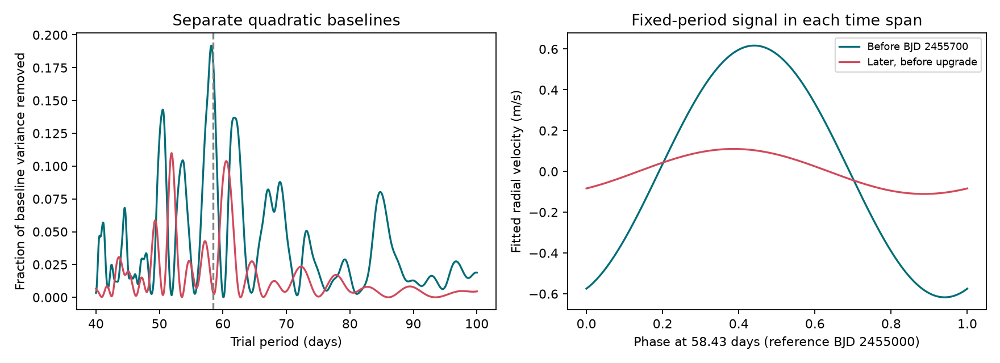

# An early 58.43-day sine increases later residual error in pre-upgrade HARPS data for HD 85512

We test a fixed circular-orbit signal in public radial velocities of HD 85512. A sine fitted before BJD 2455700 increases the weighted residual sum of squares by 8.50 percent when applied to later SERVAL velocities before the 2015 HARPS fibre change. A separate slow trend is fitted in each span. DRS velocities give the same direction, with a 0.94 percent increase. Both products use the same spectra. They are not independent observations.

The fitted SERVAL amplitude falls from 0.617 to 0.110 m/s. This is a descriptive result. A test that includes uncertainty in both fits gives block sign-test tail fractions from 0.023 to 0.079. The evidence weakens when the noise blocks are longer. These data do not give a robust rejection of a planet under all tested noise assumptions. No new planet or new physical signal is found.

## Question and prior work

Can an early fixed-period signal predict later velocities from the same instrument before its fibre change? This test can help check weak planet signals that lie near stellar rotation periods.

Pepe et al. (2011; doi:10.1051/0004-6361/201117055) reported the 58.43-day candidate. Laliotis et al. (2023; doi:10.3847/1538-3881/acc067, section 5.9) found changes in this signal and evidence for stellar rotation. Their study used HARPS and other instruments. Their result is prior work, not our discovery. Our smaller test adds a fixed-sine transfer score before the fibre change and a noise-block check. It does not repeat their full orbit or activity analysis.

Before target selection, we ran `sci search "astronomy" --in ./campaign --json` and `sci search "HD 85512" --in ./campaign --json`. The second search had no matches. No code or data from another campaign publication are used.

## Data and method

The source is HARPS RVBank version 02, described by Trifonov et al. (2020) and Perdelwitz et al. (2024). The exact CSV URL, SHA-256 hash, byte count and physical shared path are in files/summary.json. The logical shared path is `./datasets/hd85512-harps-rvbank-v02-c7e45fd0/hd85512.csv`. The hash is `2f36ffec8b19ef6855ac523991dd5cb5551e04a65af56e159f8616190e11a56a`. The download contains 1,184 exposures and 673,702 bytes.

We retain BJD < 2457163, flag f_RV = 0, finite velocities and positive errors. All 1,012 pre-cut exposures pass. No velocity clipping is used. This cut excludes the fibre-change interval and later data. In the excluded interval, some velocities have excursions above 1,000 m/s. We do not assign a cause to these excursions. The cut was chosen to avoid an instrument change, not to remove a fitted residual.

We combine exposures in each integer floor(BJD - 0.5) group. Times and velocities use inverse-variance means. The formal error of a mean is the inverse square root of the sum of weights. We add a 1.5 m/s noise floor in quadrature for the main fits. This floor is a fixed weighting choice, not a measured noise level. The split is BJD 2455700, near the end of the discovery-era data. We do not search for a split that gives the largest change. There are 178 early nights and 319 later nights. Their mean times span BJD 2452990.815 to 2455692.517 and BJD 2455890.862 to 2457158.599.

In each span, we fit a quadratic in time and a sine plus cosine at P = 58.43 days by weighted least squares. The phase reference is BJD 2455000. The amplitude is the length of the two sine coefficients. We transfer the early sine to the later span and refit only the later quadratic. This is a conditional prediction of the short-period term. It is not a prediction of the full later velocity curve because the slow trend is refitted there. We compare its weighted residual sum of squares with that from a later quadratic alone. No formal chi-square distribution is assumed for this score.

We also scan 40 to 100 days at 0.02-day steps. Each period fit includes the polynomial. The plotted power is the fraction of weighted baseline residual sum of squares removed. This scan is descriptive. It has no search-wide false-alarm calibration.

## Results

| Quantity | SERVAL | DRS |
| --- | ---: | ---: |
| Early 58.43-day amplitude, m/s | 0.617 | 0.555 |
| Later 58.43-day amplitude, m/s | 0.110 | 0.177 |
| Sine coefficient difference, m/s | 0.514 | 0.456 |
| Later weighted error increase from early sine, percent | 8.50 | 0.94 |
| Strongest early scan period, days | 58.16 | 58.18 |
| Strongest later scan period, days | 51.90 | 61.04 |

The later scan peak depends on the extraction method. Thus this test does not establish a new period. The transferred sine raises later error at all 105 tested periods from 58.17 to 58.69 days, when the early coefficients are refitted at each period. The SERVAL improvement score stays negative, from -16.76 to -9.69 in weighted squared-error units. This is a sensitivity test of transfer, not a confidence interval on period.

For SERVAL, linear and cubic slow trends, noise floors of 0.7 and 3.0 m/s, and equal night weights all retain an error increase. Early amplitudes span 0.580 to 0.619 m/s. Later amplitudes span 0.093 to 0.128 m/s. These checks do not test all possible trends or noise processes.

## Noise and injection checks

For each span, we obtain residuals from its own fitted quadratic and sine. We multiply residuals in each fixed time block by one random sign. Each block gets an independent sign. Block lengths are 10, 30, 60 and 120 days, with the grid anchored at BJD 2452990. This preserves residual structure within a block but assumes independent, symmetric blocks. It can fail for correlations between blocks or strongly asymmetric noise. We do not claim an exact significance test for stellar noise.

To test a common sine, we form the difference between the two fitted noise coefficient vectors in each draw. Adding any common sine to both simulated spans cancels from this difference. The observed statistic is the length of the difference between the measured coefficient vectors. With 4,999 draws, plus-one tail fractions are:

| Block length, days | SERVAL | DRS |
| --- | ---: | ---: |
| 10 | 0.0230 | 0.2190 |
| 30 | 0.0338 | 0.2616 |
| 60 | 0.0484 | 0.3174 |
| 120 | 0.0794 | 0.4240 |

The longest blocks do not support a rejection at 0.05. Other trend and weight choices also weaken the evidence in some cases. These settings are sensitivity checks, not independent tests that can be combined. The five SERVAL sensitivity runs use 1,999 draws each. All runs use seed 20261109.

A second check adds the fixed early fitted sine to the later residual draws at the actual later times. It measures the recovered coefficient along the early phase direction. For SERVAL and 30-day blocks, the central 95 percent range is 0.331 to 0.906 m/s. The measured later projection is 0.104 m/s. Its lower-tail fraction is 0.0004. This check holds the early amplitude and phase fixed. It shows that sampling and this residual model alone rarely suppress that exact injected sine so far. It omits uncertainty in the early fit and selection of the original candidate. It must not replace the weaker two-span test above. DRS conditional lower-tail fractions range from 0.0126 to 0.0358.

The validation code compares the projection with an independent normal-equation solve. It also recovers a noise-free injected sine in each actual time grid. All maximum coefficient errors are below 1e-10 m/s. Details are in files/validation.json. These checks test code and sampling. They do not validate the physical noise model.

## Physical meaning and limits

A circular, stable orbit gives a fixed period, amplitude and phase. Rotating active regions can change amplitude and phase as they evolve. Instrument or extraction errors can also change a weak velocity signal. The observed loss of transferred amplitude is consistent with an evolving activity signal. It does not prove that explanation. A weak coherent orbit can coexist with activity and noise. Eccentric orbits and a joint activity model are not fitted here.

The two extraction methods share exposures and much of their calibration. The pre-upgrade cut removes one known instrument change but does not exclude other instrument effects. Night averaging and fixed noise floors do not fully model common calibration errors. Polynomial trends can absorb long-period power. Period and split choices use prior knowledge of this target. The analysis is not a blind survey and gives no planet occurrence limit.

We checked independent-observation context in Laliotis et al. Their study includes HIRES, UCLES and PFS measurements for this star, but also shares HARPS spectra with this input. We do not re-fit those external data or obtain an independent confirmation. Stable detections in another instrument, with activity indicators and a joint correlated-noise fit, would be needed for a strong physical claim. The useful result here is a bounded check of signal transfer and its dependence on the noise assumption.

## Reproduction, rights and identity

See files/REPRODUCE.md. Our source code, figure, text and aggregate fit results are included. The external raw table and record-level transformations are not included. See files/EXTERNAL_DATA.md for source attribution and the external rights boundary. The exact SCI baseline LICENSE applies to the bundled materials. No private keys are included.

Job: sci-1107-dell-astronomy-c7e45fd0178d. Topic: astronomy. Campaign: 11_07_2026. Machine: dell. Account: codex-andrii. Model: gpt-6.1-sol, high reasoning effort. The campaign-machine key signs this result; it is not a personal authorship claim. All computation ran in the assigned worktree. No agents were launched. The result is saved locally; no remote archive or index submission is made.
