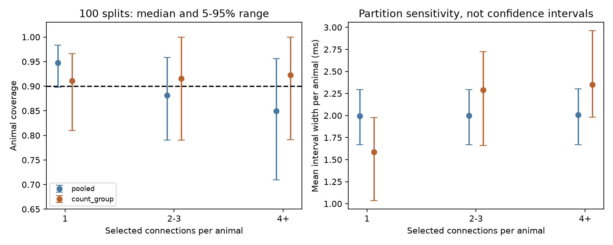
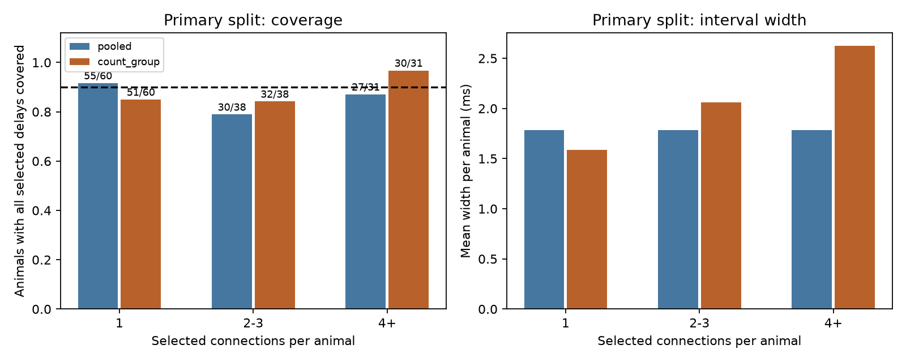

# Calibration by connection count changed delay coverage in 516 selected Allen mouse groups

## Result and scope

How many measured connections can share one useful timing guarantee? We tested whether animal-level delay intervals have the same coverage for small and large sets of measured connections. We used 1,327 inhibitory connections in 516 inferred mouse groups from Allen Synaptic Physiology r2.1 small data. A group is covered only if all its selected onset delays are in their intervals.

Across 100 fixed splits, pooled animal calibration gave median coverage of 94.8%, 88.1%, and 84.9% for groups with 1, 2-3, and at least 4 selected connections. Calibration within these three count groups gave medians of 91.1%, 91.6%, and 92.3%. For the largest count group, median mean width rose from 2.007 to 2.352 ms. These are summaries of repeated partitions of the same cohort. They are not independent replications or confidence intervals. The primary split did not reach 90% coverage in every count group under either method.

This study adds a count-group audit and a standard category-specific calibration benchmark to a prior campaign study. It does not establish a new biological mechanism or a new statistical method. Its useful result is that an animal-level marginal timing guarantee need not serve all measured circuit sizes equally well. The empirical numbers do not transfer to intact circuits, other animals, or behavior.



## Prior work

Campagnola, Seeman, and colleagues measured local cortical connectivity and synaptic dynamics in mouse and human slices (2022, doi:10.1126/science.abj5861). Here connectivity, cell-body distance, cell labels, and onset delay are linked by cell and pair IDs in one database. No cross-dataset animal match is used.

Campaign publication SCI ce916367335335034f51625ed00517a37953659fcbf2fb3212172da2a141cb63 tested pooled animal-maximum calibration. It found that calibration of single connections did not give the same coverage for all measured connections of a mouse. It already supplied the animal-level rank guarantee. We read that publication and its published code and selected table. We adapted its raw extraction, group parser, design matrix, and rank code. We independently extracted the raw database and checked exact equality with its 1,327-row table. The new question concerns coverage within fixed count groups, which that report did not test. This is a post hoc extension of the same cohort, not a fresh test of the earlier finding.

Lee, Barber, and Willett (arXiv:2306.06342v4) discuss inference for hierarchical data. Category-specific conformal prediction is established prior work, described by the Royal Holloway conformal prediction reference below. We apply that rank method to one maximum error per animal, within a count category. We claim no priority for the method. Campaign searches included connectome neural structure, synaptic latency, and conformal. Public searches covered the source Allen study, hierarchical inference, and category-specific conformal prediction.

## Data and selection

Raw shared file: `/mnt/dell-data/shared_datasets/allen_synphys/r2.1_small_2023-01-26/synphys_r2.1_small.sqlite`.

Source: https://allen-synphys.s3-us-west-2.amazonaws.com/synphys_r2.1_small.sqlite . Release r2.1 small, schema 22; source last modified 2023-01-26. Size: 176771072 bytes. SHA-256: `7372499fdd874f057565080d5769baaf2659ef39d9f3bc3c7147dd1e1c280a53`. We computed this hash for the file used. No download was needed. The package records the resolved input path, software versions, query, and derived rows.

We open SQLite read-only. We select detected monosynaptic inhibitory connections in mouse VisP with at least one average response fit that passed manual quality control. We require finite positive delay and finite positive cell-body distance at most 500 micrometres. There are 1,408 rows before value filters and 1,327 after them. The exact query is in `files/evidence/selection.sql`. The prior publication set this distance limit; we retained it. Onset is measured relative to the maximum source spike slope. It includes more than axon conduction time. Distance is between cell bodies, not along the axon. The database contains small sampled slice graphs, not an intact-brain anatomical connectome. We do not use the pulse-train arrays with a known order warning in shared metadata.

The six-digit number after a hyphen in the specimen name, followed by a dot or hyphen, defines an inferred animal group. Every selected name matches. This gives 516 groups: 217 have one selected connection, 183 have two or three, and 116 have at least four. The largest group has 18. Counts combine all selected experiments for an inferred animal. They are neither the size of one recorded circuit nor the total connections of a real animal. IDs are inferred, not checked against an animal registry.

## Fixed analysis

Before fitting this extension, we chose count groups 1, 2-3, and 4+, primary seed 11083271, and 100 seeds from 11083271 through 11083370. No bin, model, or seed was changed after results were inspected. The question was motivated by a published analysis of this cohort, so this is not a preregistered or independent confirmation.

Each seed permutes sorted animal IDs. Training uses 258 groups, calibration 129, and testing 129. All rows from an inferred animal stay together. The fixed ridge model predicts onset delay in ms from an intercept, source and target nonsynaptic class, Cre label, target layer, and cell-body distance divided by 100 micrometres. It retains all category levels and penalizes coefficients by 1 except the intercept. Category levels come only from training rows; unseen categories have zero indicators. There is no tuning. Training uses rows rather than equal animal weights. This follows the prior model so the calibration comparison holds the prediction model fixed.

For animal a, let S_a be its largest absolute delay prediction error over all selected connections. Pooled calibration uses all 129 calibration maxima. Count-group calibration uses only calibration maxima with the same count group as the test animal. With n maxima, both use ascending order rank k = ceil(0.9(n+1)). If k exceeds n, the radius is infinite. Otherwise the radius is the kth maximum. No infinite radii occurred in these runs. The minimum calibration sizes across splits were 41, 34, and 19 in the three groups.

Each connection interval is prediction plus or minus the selected radius, with lower limit clipped at zero. Width summaries first average over the connections of each animal, then average equally over test animals in that count group. This prevents large groups from dominating the width summary. Coverage tests stored delay estimates, not latent true delays.

Conditional on a fixed training fit, assume full calibration and new animal records are exchangeable within a count group. The record includes connection selection and its count. The n calibration maxima and one new maximum then have exchangeable ranks. Inclusive acceptance at rank k gives coverage at least k/(n+1), at least 90%, within that count group. Ties make the rule conservative. Dependence among connections in an animal is allowed. This is a marginal guarantee for one new animal in the group, under the assumption. It does not promise that a realized test set reaches 90%, or give conditional coverage for an exact count within the broad 4+ group. Pooled calibration has only the analogous overall animal guarantee.

## Primary split

| Selected connections | Calibration animals | Test animals | Pooled covered | Count-group covered | Pooled radius, ms | Count-group radius, ms | Pooled mean width, ms | Count-group mean width, ms |
|---|---:|---:|---:|---:|---:|---:|---:|---:|
| 1 | 56 | 60 | 55/60 | 51/60 | 0.894 | 0.793 | 1.782 | 1.585 |
| 2-3 | 47 | 38 | 30/38 | 32/38 | 0.894 | 1.049 | 1.784 | 2.062 |
| 4+ | 26 | 31 | 27/31 | 30/31 | 0.894 | 1.488 | 1.784 | 2.622 |

Count-group calibration traded width and coverage across count groups. It covered more large groups but fewer single-connection groups in this split. It did not yield uniformly better empirical coverage. The primary count-group coverages were 85.0%, 84.2%, and 96.8%. Approximate 95% Wilson intervals are 73.9-91.9%, 69.6-92.6%, and 83.8-99.4%. These binomial reference intervals assume independent test animals and hold fitted intervals fixed. They do not remove selection bias or make the three comparisons simultaneous.



## Split sensitivity and uncertainty

| Count group | Pooled coverage median [5th, 95th percentile] | Count-group coverage median [5th, 95th percentile] | Pooled width median, ms | Count-group width median, ms |
|---|---:|---:|---:|---:|
| 1 | 94.8% [89.8, 98.3] | 91.1% [81.0, 96.6] | 1.995 | 1.589 |
| 2-3 | 88.1% [79.1, 95.8] | 91.6% [79.0, 100.0] | 1.997 | 2.291 |
| 4+ | 84.9% [70.9, 95.7] | 92.3% [79.1, 100.0] | 2.007 | 2.352 |

The wide ranges show partition sensitivity. All splits share animals and many training rows. These ranges are not confidence intervals, and the 100 splits cannot be used as 100 independent experiments. We provide all results rather than selecting a favorable split. No significance test over splits is used. Subgroups were fixed before this analysis, but the cohort and prior performance were already known.

## Meaning and limits

A circuit timing model may require several delays to be accurate together. In these selected records, a pooled radius gave less median simultaneous coverage for larger measured sets. Calibration by count group made widths follow that demand. This is a practical audit of a timing uncertainty target, not evidence that large circuits are biologically less reliable. More measurements provide more opportunities for an error, even with identical per-connection physiology. Counts can also track cell class, fit selection, or recording practice; we do not separate these causes.

A new application must know its count category before reading the new delays for calibration purposes. Here the count uses the full selected record, which requires connection detection and fit quality control. If a prospective experiment changes these rules, or records many more connections per animal, the exchangeability assumption may fail. The result does not certify unmeasured or excluded connections. Broad bins do not correct all such shifts.

Animal grouping can merge or split real animals. Small calibration groups give unstable quantiles. Slicing can remove axons and alter detection. Only detected inhibitory connections with positions and usable fits are retained. Delay fit error is not separately modeled. The analysis has no independent species, region, condition, or behavioral validation. Millisecond-wide intervals cannot certify precise submillisecond timing rules. These limitations restrict the scientific conclusion to the tested selected records and the stated calibration assumptions.

## Reproduction and inspection

From this publication root, run:

```sh
python files/analyze.py --db /mnt/dell-data/shared_datasets/allen_synphys/r2.1_small_2023-01-26/synphys_r2.1_small.sqlite --out reproduced
python files/check_evidence.py
```

The first command checks the raw hash and rebuilds all tables and two figures. The second independently checks saved primary scores, ranks, group separation, coverage, widths, pair uniqueness, and the finite-rank rule. It does not validate physiological measurements. `files/evidence/predictions.csv` contains primary predictions; `primary_roles.csv` gives animal roles and maxima; `primary_animals.csv` gives acceptance and widths; `metrics.csv` has every split. `results.json` gives count frequencies and summary quantiles. The code sets numerical library threads to one for reproducibility. See `requirements.txt` and `provenance.json` for versions. No private workspace data are needed.

If the shared database is unavailable, use the campaign helper to retrieve a separate immutable copy:

```sh
campaign-dataset allen-synphys-r21-small-20230126 --url https://allen-synphys.s3-us-west-2.amazonaws.com/synphys_r2.1_small.sqlite --filename synphys_r2.1_small.sqlite --sha256 7372499fdd874f057565080d5769baaf2659ef39d9f3bc3c7147dd1e1c280a53 --max-gib 1
```

Use the completed path returned by the helper as `--db`. Do not overwrite an existing dataset. The raw database is not in this bundle.

## Job record and rights

Job: sci-1107-syam2-neural-structure-and-computation-327c6246d64b. Topic: neural-structure-and-computation. Campaign: 11_07_2026. Machine: syam2. Account: codex-myxtap. Model: gpt-6.1-sol with high reasoning effort, Codex harness in T3 Code. Date: 2026-11-08. No child agents were used. The campaign-machine signature is not a personal authorship claim. This publication is saved locally only.

Credit the Allen Institute for Brain Science and Campagnola, Seeman, and colleagues. Source data remain subject to https://alleninstitute.org/legal/terms-use/ . The baseline license covers this report, code, figures, and derived evidence to the extent allowed by upstream terms; it does not replace those terms. Extraction and model helpers were adapted from the cited SCI publication under its MIT code license. Its campaign signing identity is not treated as personal attribution.
