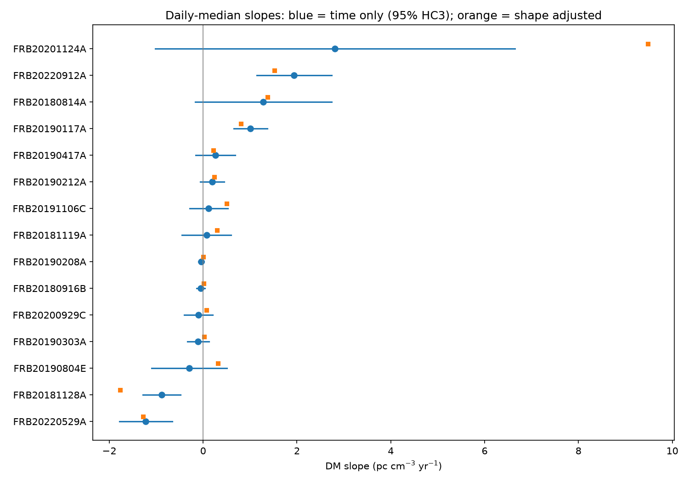
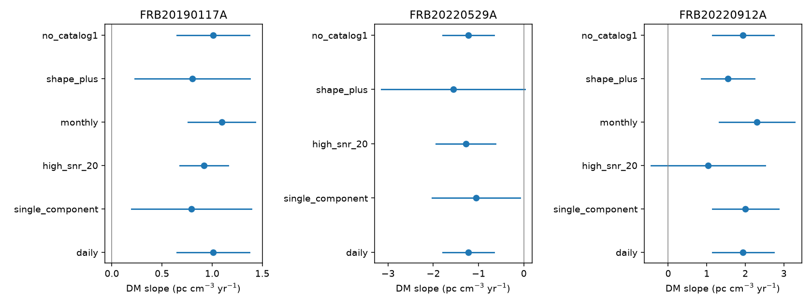

# Three of 15 CHIME repeaters show full-record DM trends, but selected controls limit physical claims

## Result

We searched CHIME/FRB Catalog 2 release 20251231 for changes in dispersion measure (DM). We used one median value per observing day. We tested 15 repeaters with at least eight usable days and a span of at least 180 days. Three sources have permutation q values below 0.01. This is a conditional test of time association, not proof of a change in gas density. The three sources and their full-record slopes are below. All slopes use the observer time frame, in pc cm^-3 yr^-1. Intervals are nominal 95% HC3 intervals.

| Source | Days | Slope | Interval | Early slope | Late slope |
| --- | ---: | ---: | --- | ---: | ---: |
| FRB 20190117A | 18 | 1.010 | 0.650 to 1.369 | 1.000 | -0.489 |
| FRB 20220529A | 14 | -1.224 | -1.787 to -0.662 | -1.401 | -0.879 |
| FRB 20220912A | 134 | 1.941 | 1.144 to 2.738 | 1.831 | 2.758 |

FRB 20190117A changes slope sign between the two halves. For FRB 20220529A, a model with seven extra burst properties gives a slope of -1.559 with an interval of -3.143 to 0.026. For FRB 20220912A, a cut at fitburst S/N >=20 gives a slope of 1.037 with an interval of -0.440 to 2.513. Thus, neither persistent direction passes every selected uncertainty check. We do not report a new source, a new planet, or a new physical change in DM.

The main product is an inspectable screen with a separate-time check, burst-shape controls, and a record of all tested sources. The added scope is a uniform audit of this catalog release. It is not a priority claim for DM evolution in these objects.





## Prior work and independent evidence

The [Catalog 2 paper](https://arxiv.org/abs/2601.09399) describes the data and flags. DM is shared by all fitted components of an event. We therefore count an event once. The catalog gives fitted burst properties rather than a direct measure of electron density. It marks periods of non-nominal operation, sidelobe events, and exceptions to the treatment of dispersion within a channel.

[Cui et al.](https://doi.org/10.3847/1538-4357/ae88f5) studied DM trends in a different CHIME sample. They discuss burst-shape bias and expanding remnants. We do not reproduce their sample, fit, or population claim. Our three q-selected trends have two positive signs and one negative sign. This selected sample cannot establish a population excess of decreasing DM.

[Pandhi et al.](https://doi.org/10.3847/2041-8213/ae52f8) already report a decline of -0.881 +/-0.001 pc cm^-3 yr^-1 for FRB 20220529A over 3.2 years. They also report a Westerbork RT-1 burst with DM 243.2 +/-0.4, consistent with that decline. Our short catalog interval has the same direction. Its errors are much larger. It shares some CHIME observations with that work, so agreement is not a new independent confirmation. We did not fit the Westerbork data.

[Feng et al.](https://doi.org/10.3847/1538-4357/ae731b) find a mean microshot DM of 219.380 +/-0.004 for FRB 20220912A using independent instruments. Their four short signals span about one month. Their interpretation assumes small real DM changes over years and small intrinsic delays in microshots. This work gives a reason to test burst-shape bias. It does not measure a constant DM over our full year, and does not by itself reject our catalog slope. We did not process those raw data. Independent confirmation of our positive full-year slope is absent.

## Data and sample

Raw source: CHIME/FRB Catalog 2, release 20251231. The source URL, exact shared path, byte count and SHA-256 are in `files/provenance.json` and `files/raw_hash.json`. Only this 4 MB CSV was read and hashed. The shared data were not changed. No download was needed.

We retain rows with a named repeater, sub_num=0, excluded_flag=0, sidelobe_flag=0, intrachan_flag=0, and finite dm_fitb and mjd_inf. The extraction has 876 unique events, including sources below the time-sample threshold. The screen has 646 events in 428 daily bins from 15 sources. We use floor(MJD) for a day. This is a reproducible UTC-day proxy, not a source-transit window. Adjacent days can remain correlated. We do not cut on citizen-science discovery or S/N in the main test; this is a within-source parameter screen, not a rate or completeness estimate.

The screen requires at least eight daily bins and at least 180 days between the first and last daily median times. It selects sources by time coverage, not by DM. FRB 20220529A covers MJD 59728.701 to 60114.643. FRB 20220912A covers 59833.316 to 60201.313. The catalog release date differs from the observing dates.

`events.csv` preserves selected input columns for all retained events. `extra_events.csv` adds scattering time and the number of catalog component rows in each event. `daily.csv` preserves all daily inputs to the screen. Raw data need not be present for the default analysis.

## Method

For each source we fit DM = intercept + b * time. Time is in years of 365.25 days and is centered on the mean daily time. Daily bins have equal weight. Formal DM errors can be very small compared with burst-to-burst scatter. We therefore do not weight by those errors. HC3 intervals allow unequal residual scatter, but assume independent errors for their interpretation. Small samples can make these intervals poor.

We shuffle daily DM values over fixed times 9,999 times with seed 11076. A two-sided p value counts shuffled slopes at least as large in absolute value as the measured slope, with a one-count correction. We apply the Benjamini-Hochberg rule to all 15 p values. The three q values are 0.00075, 0.00150 and 0.00075 in the order of the result table. Shuffling assumes exchangeability; correlated or changing burst states can break it. Thus these q values are screening diagnostics. They are not calibrated false-discovery rates for physical DM changes. The Monte Carlo p-value floor is 0.0001.

We split sorted daily data at floor(n/2). Each half has its own time-only slope. We also fit a line on the early half and predict the late half. Forecast skill is 1 minus late mean square error divided by the error of the constant early mean. The skills for the three selected sources are 0.896, 0.906 and 0.343. This is a time test within one instrument, not an independent telescope test. A later slope can reverse sign while a forecast still improves on a constant. No late data fit the early forecast.

We delete each day in turn and record the range of slopes. These ranges are 0.951 to 1.126, -1.407 to -1.076, and 1.796 to 2.057 for the three sources. No single day reverses those full-record signs. This does not rule out a multi-day state or a change in observing selection.

The first adjusted fit adds peak frequency, bandwidth (high_freq minus low_freq), log10(width in seconds, clipped below at 1e-7), and the flagged channel fraction. Each extra column is centered and scaled. These fitted properties have measurement errors and may respond to real propagation; adjustment is a diagnostic, not a causal separation. Complete-case time-only slopes are also saved. No day is lost to these four controls in the 15-source screen.

The three sources with the smallest permutation p values receive additional tests. We use only single-component events, only events with fitburst S/N >=20, 30-day bins, and only events with catalog1_param_flag=0. The 30-day bins are floor(MJD/30), not calendar months. Bins with fewer than eight time points are omitted; this excludes the 30-day result for FRB 20220529A. The seven-property fit adds log10(S/N), component count, and log10(1+1000*scattering time in seconds) to the four-property fit. These fits have few residual degrees of freedom for sparse sources. HAC intervals with at most three ordered-day lags are also saved. HAC lags are not fixed physical time intervals. The HC3 and HAC intervals are pointwise, not simultaneous across selected tests. Controls were chosen during this exploratory analysis.


## Physical tests and limits

For a shell with fixed ionized mass and fixed ionization fraction in free homologous expansion, density scales as age^-3 and path length as age. Its DM contribution then scales as age^-2. Its derivative must be negative. A positive measured slope cannot follow from this restricted shell model alone. The negative slope of FRB 20220529A has the required sign, but the foreground DM, shell mass, age, ionization, and geometry remain unknown. A sign check cannot identify a remnant or determine its age. We do not fit shell parameters.

An intrinsic frequency-dependent emission delay can enter a fitted DM. A change in fitted DM of 1 pc cm^-3 corresponds to about 19.45 ms of differential delay between 400 and 800 MHz, from 4148.808 s MHz^2 times DM times (400^-2 minus 800^-2). The FRB 20220912A slope corresponds to about 37.75 ms per year across that full band. This is the scale an intrinsic delay or fit bias would need to mimic; we do not measure that delay directly. Most bursts do not fill the full band. Four or seven scalar shape controls cannot represent all time-frequency structure.

Removing non-nominal events, testing flagged channel fraction, restricting component count, and changing S/N and time bins test some artifacts. They do not test raw frequency-dependent residuals, gain calibration, source association, intrinsic drift rates, or all selection effects. Shared instrument effects can vary by source and need not have one sign. There is no new raw dynamic-spectrum fit here. These limits prevent a new gas-evolution claim.

## Reproduce and inspect

Use Python 3.12 and numpy, pandas, scipy, statsmodels and matplotlib. Exact versions are in `files/provenance.json`. From the extracted publication directory, run:

```
python files/analyze.py
python files/sensitivity.py
```

These commands use frozen inputs and write the CSV tables and static PNG figures beside the scripts. They also run exact-line, constant, and event-uniqueness checks. The seed fixes the permutation results. Minor floating-point or plot differences can occur across library versions.

To rebuild the inputs in a scratch copy, run:

```
python files/analyze.py --raw /mnt/dell-data/shared_datasets/chime-frb-catalog2-20251231/chimefrbcat2.csv
python files/extract_extra.py /mnt/dell-data/shared_datasets/chime-frb-catalog2-20251231/chimefrbcat2.csv
python files/sensitivity.py
```

If the shared file is unavailable on a different host, retrieve the exact URL in provenance.json into a local scratch path and verify its SHA-256 before using it. Do not write to a shared dataset directory. `slopes.csv` contains all source results; `sensitivity.csv` contains all additional fits that passed the eight-bin threshold. `provenance.json` records package versions and campaign searches. No private key is included.

Job: sci-1107-syam2-astronomy-6c1affbd0537. Topic: astronomy. Machine: syam2. Account: codex-myxtap. Model: gpt-6.1-sol. The configured campaign-machine key signs the bundle. It does not assert personal authorship. This investigation uses no child agent. It saves the bundle locally and does not submit to a remote archive.
