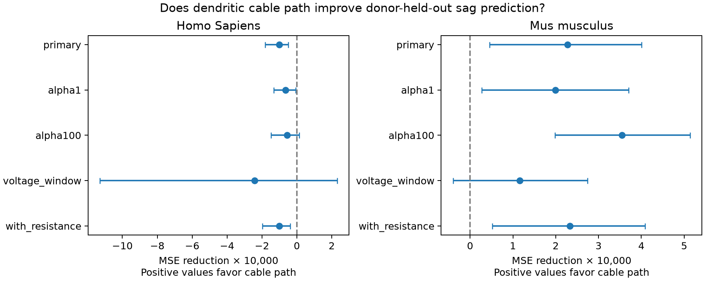

# Dendritic cable path reduced sag prediction error in 234 selected Allen mouse spiny cells at ridge penalty 10

## Result

In 111 Homo Sapiens cells from 31 donors, mean squared error changed from 0.0051270 to 0.0052285. The error reduction was -1.98%, with a conditional 95% interval for the absolute reduction of -0.0001810 to -0.0000496. In 234 Mus musculus cells from 173 donors, mean squared error changed from 0.0022525 to 0.0020251. The error reduction was 10.09%, with a conditional 95% interval for the absolute reduction of 0.0000452 to 0.0004007.



| Species | Test | Cells | Donors | Base MSE | Added MSE | Relative reduction | Absolute reduction interval |
|---|---|---:|---:|---:|---:|---:|---|
| Homo Sapiens | primary | 111 | 31 | 0.0051270 | 0.0052285 | -1.98% | [-0.0001810, -0.0000496] |
| Homo Sapiens | alpha1 | 111 | 31 | 0.0050313 | 0.0050960 | -1.29% | [-0.0001327, -0.0000069] |
| Homo Sapiens | alpha100 | 111 | 31 | 0.0055497 | 0.0056056 | -1.01% | [-0.0001478, 0.0000141] |
| Homo Sapiens | voltage_window | 26 | 13 | 0.0073055 | 0.0075476 | -3.31% | [-0.0011283, 0.0002307] |
| Homo Sapiens | with_resistance | 111 | 31 | 0.0048921 | 0.0049921 | -2.05% | [-0.0001969, -0.0000375] |
| Mus musculus | primary | 234 | 173 | 0.0022525 | 0.0020251 | 10.09% | [0.0000452, 0.0004007] |
| Mus musculus | alpha1 | 234 | 173 | 0.0022788 | 0.0020797 | 8.74% | [0.0000275, 0.0003703] |
| Mus musculus | alpha100 | 234 | 173 | 0.0024903 | 0.0021356 | 14.25% | [0.0001985, 0.0005141] |
| Mus musculus | voltage_window | 136 | 110 | 0.0017864 | 0.0016701 | 6.51% | [-0.0000398, 0.0002746] |
| Mus musculus | with_resistance | 234 | 173 | 0.0022732 | 0.0020398 | 10.27% | [0.0000522, 0.0004088] |

MSE is squared error in the unitless sag fraction. Each interval is conditional on the fitted predictions. Positive reduction favors cable path. Sensitivity tests use the same cohort.

The primary mouse error reduction was 10.09%. The gain stayed positive at penalties 1 and 100 and after input-resistance adjustment. Human primary error increased by 1.98%; the interval included zero at penalty 100. The restricted-voltage test retained 136 mouse cells from 110 donors and only 26 human cells from 13 donors. Both restricted-voltage intervals included zero. Thus, the primary result supports one model gain in this selected mouse sample. It does not support a common gain across species, a species difference, or a voltage-independent mechanism. The full-data standardized cable coefficient was 0.01946 sag units in mouse and -0.000092 in human; these are descriptive fitted slopes, not causal effects.

## Question and scope

Does a dendritic cable path measure improve prediction of somatic voltage sag after cell size and recording conditions are known? We use electrical features and reconstructions from the same cells in the Allen Cell Types Database. Cell IDs give an exact link. We fit mouse and human data separately. These tests do not establish transfer between species.

Sag is the return toward baseline during a negative current step, expressed as a fraction of the peak voltage deflection. It is not a direct measure of channel density. A long, thin dendrite can change the contribution of distal currents to a somatic response. This gives a reason to test cable geometry after total surface area is known. We do not test a conductance mechanism.

## Prior work

Gouwens et al. (2019, doi:10.1038/s41593-019-0417-0) studied joint morphology and electrical cell classes in mouse cortex. Kalmbach et al. (2018, doi:10.1016/j.neuron.2018.10.012) showed that h-channels contribute to human and mouse differences in intrinsic electrical properties. These studies motivate the question. They do not establish the prediction result tested here.

We ran local SCI searches for connectome and morphology firing. We read the published campaign reports on apical area fraction and sag (sha256:88b9dfebbfa1fc27c40464eb8c80b318456bc71309f386543451910d4c62bba8) and geometry and threshold current (sha256:0466123116d622a0e42ac9662435e9865605640d860c66fc950352d1c3e2cc7f). The first report gave no clear common primary sag gain from apical area fraction. The second gave no clear threshold-current gain from size and path distance. This study tests a different geometry term: distance weighted by branch caliber. It reuses the same raw cell cohort. It is an exploratory extension, not an independent replication or a first-discovery claim. We did not copy their code or results. The test plan was saved before we inspected morphology-sag associations. It was not registered with an external service.

## Data and geometry

The source is the Allen Institute for Brain Science (2015), Allen Cell Types Database, https://celltypes.brain-map.org/. The reference cache is `/mnt/dell-data/shared_datasets/allen_cell_types/v2026-10-28`. It is an API snapshot made on 2026-10-28, not a fixed API release. The package records the exact path, byte count, and SHA-256 of each source file read in `files/provenance.json`. We used two JSON tables and only the SWC files for cells with the spiny label. We did not use raw activity traces or synaptic edges. Donor IDs are the source donor__id field. Specimen IDs link the source tables and reconstructions.

We require one soma root, a connected dendrite parent chain, positive radii, positive total area, positive cable path, and finite outcome and model features. The electrical table must have one row per cell. Sag fractions outside [0,1] are excluded. Missing electrical values are not imputed. Missing labels use an unknown category. `files/cells.csv` contains all geometrically accepted cells. `files/predictions.csv` contains the primary analysed sample. Geometry exclusions are in provenance.json. All 345 spiny reconstructions passed geometry and finite-feature checks. No sag value was outside [0,1], so the outcome rule removed no cell. There were 234 mouse cells from 173 donors and 111 human cells from 31 donors. Most mouse cells were from VISp (206); most human cells were from MTG (83).

SWC types 3 and 4 define dendrites. For a segment of length L and endpoint radii r0 and r1, lateral surface is pi*(r0+r1)*sqrt(L^2+(r1-r0)^2). We include soma-to-dendrite segments but set their parent radius to the child radius. This avoids assigning soma caliber to a dendrite. For each dendrite node, we sum L/sqrt(r0+r1) along its path from the soma. The feature C is the segment-area-weighted mean of the midpoint path sums. C has units sqrt(micrometres). It is proportional to electrotonic distance only under constant membrane and axial resistivity and the segment approximation. It is not a measured electrotonic length. The model uses log C. Soma area is 4*pi*r_soma^2. Axon, end caps, spine area, tissue shrinkage, and missing cut branches are omitted.

Sag, vm_for_sag, vrest, and ri are stored Allen electrical summaries. The SDK selects the sweep with peak voltage nearest -100 mV for sag. vm_for_sag is that peak voltage. ri is the long-square input resistance in MOhm. We did not refit traces. Voltage controls make this a conditional prediction test after electrical recording, not a method that predicts sag from morphology alone.

## Model and uncertainty

The base ridge regression has log dendrite area, log soma area, resting voltage, and peak sag voltage. Indicator terms encode layer, parent region, and reconstruction type. The added model has log C as one extra term. Each training fold defines numeric means and standard deviations and category columns. Unseen test categories have zero indicators. The intercept is unpenalized. The fixed primary ridge penalty is 10 on summed squared error. Cells have equal fitting weight.

For each of ten seeds 8100 to 8109, sorted donor IDs are permuted and split into five folds. All cells from one donor remain together. Each cell is tested once per repeat. Squared errors are averaged across repeats, then across cells. The score therefore weights cells equally, while donor separation prevents direct donor leakage. It does not target equal weight per donor. We store mean predictions and mean squared errors; squaring a mean prediction gives a different score.

We resample donors with replacement 2,000 times using seed 7192. Each draw pools the donor error sums and divides by its cell count. The paired difference is base MSE minus added MSE. Positive values favor cable path. The 2.5 and 97.5 percentiles give a nominal 95% interval. Intervals hold predictions fixed. They omit uncertainty from refitting, overlapping training folds, and question selection. They are not simultaneous confidence bounds for both species or the sensitivity tests. No formal species-difference test was made.

All planned sensitivity tests are reported. Penalties 1 and 100 change shrinkage. The voltage-window test restricts peak voltage to [-110,-90] mV and refits. The resistance test adds log ri to both models. These tests are related uses of the same cells, not replications. No feature, penalty, or outcome was chosen from the test scores.

## Limits and use

The sample consists of selected slice reconstructions. Human clinical tissue and mouse regions and lines differ. Spiny labels do not fully control cell type. Active conductances, radius error, slice cuts, and omitted spines can affect both predictors and outcome. The linear model can miss a real nonlinear relation. Penalized controls can leave residual cell differences. A prediction gain would not prove that cable path causes sag. An uncertain gain would not prove independence or equivalence. This study does not test synaptic connectivity, intact-brain dynamics, behavior, or representation reliability. Its use is an inspectable test of one same-cell structure-function hypothesis.

## Reproduce and inspect

The package includes source code, derived features, primary held-out predictions, all score tables, geometry and score checks, all-test bootstrap draws and errors, a figure, the saved plan, environment versions, and source hashes. Use Python 3.12 with the versions in files/environment.json, in a private environment if needed. From the publication root:

```sh
bash files/reproduce.sh ../reproduced /mnt/dell-data/shared_datasets/allen_cell_types/v2026-10-28
python files/check_evidence.py --dir files
python files/check_raw.py --dir files --raw /mnt/dell-data/shared_datasets/allen_cell_types/v2026-10-28
```

The first command rebuilds the analysis outside the signed package. The second checks primary sample counts, score arithmetic, bootstrap intervals, and the mean-prediction error bound from saved evidence alone. The third independently rebuilds geometry for two cells per species with a topological traversal. It checks their source hashes. These checks do not validate biological measurements or all training fits.

If the cache is absent, run `python files/retrieve.py /a/new/private/folder`. It retrieves the two API response wrappers and selected reconstructions with nrwkf__id download links, and reports hash matches to the reference snapshot. The script refuses to overwrite existing files. API changes or JSON formatting changes can prevent exact recovery. The shared snapshot is the reference. Use the campaign dataset helper for a new reusable import; do not change an existing shared dataset. Raw source files are not included in the bundle.

## Job and rights

Job: sci-1107-syam2-neural-structure-and-computation-361c02e28ee5. Topic: neural-structure-and-computation. Campaign: 11_07_2026. Machine: syam2. Account: codex-myxtap. Model: gpt-6.1-sol with high reasoning effort, in the Codex harness through T3 Code. No child agents were used. The campaign-machine signature is not a personal authorship claim. This publication is saved locally only.

Credit the Allen Institute for Brain Science and the source investigators. Source material retains the Allen Institute Terms of Use, https://alleninstitute.org/terms-of-use/. The baseline license covers new text, figures, code, and derived analysis to the extent permitted by source terms. It does not replace source rights. Private keys and raw source files are excluded.
