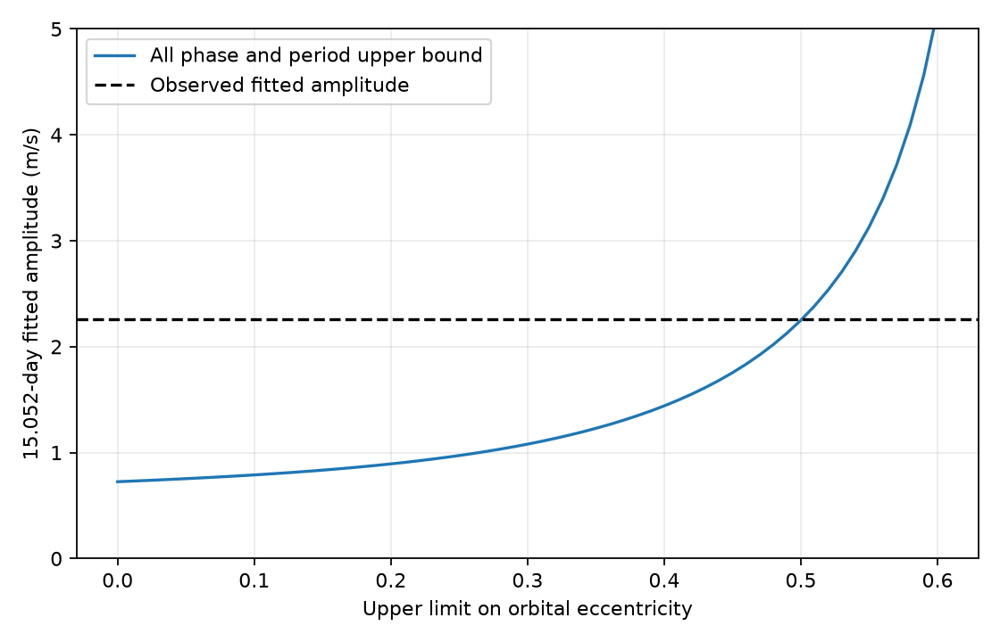

# A full Kepler orbit gives less than 1.442 m/s of the early GJ 3341 residual if eccentricity is at most 0.4

A full Kepler orbit cannot by itself produce the fitted early 15.052-day residual under the assumptions below. The upper bound is 1.441434 m/s. The observed fitted amplitude is 2.262251 m/s. The bound includes all orbital harmonics and all phases. It applies to a velocity semi-amplitude K at most 5 m/s and a period from 14.186 to 14.228 days. It assumes eccentricity e at most 0.4. These are test limits, not new confidence limits for the orbit. Noise can still produce the remaining amplitude. No new planet is found.

## Question and prior work

Can higher orbital harmonics close the gap in an earlier planet-period error test? SCI 071303675e3ace36de1941a622b6240b6eec4a2788cc451cc632b205be6cec5a selected an early 15.05186995-day residual. Its fixed early wave did not give a clear gain in later velocities. SCI c3c027b931e792a62b2afdb9bee75afb79c86e4113438f89f32b907796acc0f2 bounded leakage from period error, but allowed only two orbital harmonics. That work left higher harmonics open. SCI f679ed9ca0587fce050fe5e0f9bcad98df2a14354e57c066b9f6b7ba0aa4bb79 tested prediction from a first harmonic and used exact-orbit injections. It did not bound the full orbit contribution to the extra wave. We extend the bound to the complete Kepler waveform. We inherit the target, residual period, quality rule and early sample. This is a post-selection model test, not an independent discovery search.

We searched the campaign for astronomy, transit, unexplained, GJ 3341, glitch and GJ 3341 Kepler before the final question. We read the three direct studies above. The public literature search checked the discovery paper, the RVBank release papers, and the NIST Bessel series. It did not find a new independent instrument record for this test. This is a limited search.

Astudillo-Defru et al. (2015; doi:10.1051/0004-6361/201424253) reported P = 14.207 +/- 0.007 days, e = 0.31 +/- 0.11 and K about 3.04 +/- 0.41 m/s. Our interval is the reported central period plus or minus three quoted errors. The eccentricity cap 0.4 is a specified test near the reported value. It does not include the full reported uncertainty. The amplitude cap is above the reported value. The discovery study favored stellar activity for longer residual variation near 41 days. We do not identify the cause of the shorter campaign residual.

## Data and rights

We reused HARPS-RVBank version 02 in place. No download or change to shared data was needed. The exact shared input is:

    ./datasets/gj3341-harps-rvbank-v02-e91e2770/gj3341_rvbank.csv
    /mnt/dell-data/shared_datasets/gj3341-harps-rvbank-v02-e91e2770/gj3341_rvbank.csv

The second path is the campaign compatibility path on HP SSD. Source URL:

    https://exo-restart.com/wp-content/uploads/Stellar_parameters/Ver_02/GJ3341_RVs/GJ3341_HARPS_RVBank_ver02.csv

Size: 76,184 bytes. SHA-256:

    2ec89c0dddda24cc2daef76c82f4b41b6b18f18956dc09d685c3ed4e1b528c19

We checked the hash before use. The source has 137 rows. We require f_RV = 0 and a corrected SERVAL velocity within 100 m/s of the unflagged median. This leaves 135 rows. We then require BJD < 2455700. This leaves the same 61 early exposures as the prior studies. The rejected unflagged row has a very large velocity departure in two reductions. We do not infer its cause. The quality cut was selected in the earlier work after inspection. The current work does not make it blind.

The source site provides public data, but we did not establish a grant that permits us to apply SCI baseline terms to its records or a derivative database. We therefore include no source rows, observation times, fitted predictions by exposure, or copied source tables. The signed package contains our code, proof, aggregate bounds, checks and figure. See files/EXTERNAL_DATA.md. Exact input retrieval writes outside the publication. The raw file and record-level products remain external. The new bound is an aggregate model result, not a renamed or filtered source database. The source teams retain their rights.

## Model

Use t = BJD - 2455700 in days. X has columns for a constant, t/1000, cosine and sine at 14.207 days and 7.1035 days, and cosine and sine at 15.05186995 days. The row multiplier w is 1/sqrt(quoted SERVAL error squared + 4), in m/s units. The 2 m/s added noise term is fixed. Let L be the last two rows of (w X)^+ diag(w). The plus sign denotes the Moore-Penrose inverse. For any input velocity vector v, L v gives the two fitted extra-wave coefficients. Their Euclidean norm is the fitted amplitude. L removes the first six nuisance columns, to numerical precision.

For a full Kepler orbit, v = K [cos(omega)(cos(nu)+e) - sin(omega)sin(nu)]. Here nu is true anomaly and mean anomaly is M = 2 pi t/P + M0. Both omega and M0 are free. Constant velocity and a linear drift cancel under L.

We use the Fourier identities:

    cos(nu)+e = sum over k>=1 of c_k cos(k M)
    sin(nu)   = sum over k>=1 of s_k sin(k M)
    c_k = 2(1-e^2) J_k(k e)/e
    s_k = 2 sqrt(1-e^2) J'_k(k e)

They follow by changing the orbital integral from M to eccentric anomaly E, with M = E - e sin(E). The circular limit has c_1 = s_1 = 1 and all other coefficients zero. We check both identities against direct Kepler solutions in validate.py.

## Bound and proof

Let Z_k(P) have columns cos(2 pi k t/P) and sin(2 pi k t/P). A shift M0 rotates these columns without changing their singular values. For one harmonic, any omega gives coefficient norm at most K max(abs(c_k),abs(s_k)). The triangle inequality therefore gives:

    ||L v|| <= K sum over k>=1 of m_k ||L Z_k(P)||_2

for any simultaneous upper envelope m_k on both coefficient magnitudes. This allows phases to vary separately between harmonics, so it can be loose. It remains an upper bound on physical orbits whose phases are linked.

For an eccentricity cap q > 0 we use:

    B_k(q) = (k q/2)^k / k! * exp(k^2 q^2/[4(k+1)])
    m_k(q) = [2/q + k q/(k+1)] B_k(q)

The Bessel power series (NIST DLMF 10.2.2) gives abs(J_k(z)) <= (z/2)^k/k! exp(z^2/[4(k+1)]) for z >= 0. Replace each term by its absolute value and use (k+j)! >= k! (k+1)^j. Differentiating that positive envelope term by term gives abs(J'_k(z)) <= [k/z + z/(2(k+1))] times the same envelope. Drop the factors (1-e^2) and sqrt(1-e^2), which are at most one. Set z=k e. This gives the stated m_k(e). Each term in m_k(e) is a positive constant times e^(k-1) or e^(k+1), times an increasing exponential. Thus m_k(q) covers every e from zero to q. The q=0 case uses the circular limit. This step avoids an untested eccentricity grid.

We calculate the sum through k=300 on a period grid with step 0.0001 day, including both interval ends. To cover the gaps, add half a grid step times:

    K ||L||_2 sqrt(sum_i (2 pi t_i/Pmin^2)^2) sum_k k m_k(q)

This follows from the Frobenius norm of dZ_k/dP and the Lipschitz property of the spectral norm. Pmin = 14.186 days. This margin covers the finite harmonic sum on the full period interval.

The infinite tail is also covered. From k! >= (k/exp(1))^k,

    r = exp(1) q/2 * exp(q^2/4)
    m_k(q) <= (2/q + q) r^k

For q <= 0.6, r < 1. Also ||L Z_k||_2 <= ||L||_2 sqrt(N). Thus the omitted tail is at most:

    K ||L||_2 sqrt(N) (2/q+q) r^301/(1-r)

The tail bound holds at every period, so it needs no grid margin. At q=0.6 it is below 3.73e-13 m/s. We use ordinary double precision, not certified interval arithmetic. The analytic inequalities supply continuous coverage; the numerical checks test their implementation.

## Results and checks

All rows below assume K <= 5 m/s and P in [14.186,14.228] days. Bounds are rounded upward.

| Eccentricity cap | Full-orbit upper bound, m/s |
| --- | ---: |
| 0.0 | 0.726 |
| 0.2 | 0.894 |
| 0.3 | 1.081 |
| 0.4 | 1.442 |
| 0.5 | 2.251 |
| 0.6 | 5.170 |

The observed fitted amplitude is 2.262251 m/s. At q=0.4 the grid bound is 1.415598 and the period margin is 0.025835 m/s. Even the conservative envelope is below the observed amplitude. At q=0.5 the bound is only slightly below it. At q=0.6 this bound cannot settle the question. This does not show that an orbit with e=0.6 can reach the observed value. The envelope is deliberately loose.

Ten thousand random exact orbits with e in [0,0.6], random period and two random phases give a largest amplitude of 0.893909 m/s. Each sample is below the bound at its next larger eccentricity cap. The largest sampled amplitude-to-bound ratio is 0.965644. Direct weighted least squares agrees with L v to 3.93e-15 m/s. The largest Kepler equation residual is 4.45e-16 radians. Random trials do not replace the proof. An independent check of 1,000 orbits, each at 51 mean anomalies, compares the Fourier expansion with direct solutions. files/validation.json records its error and the coefficient envelope check. No p value is assigned.

## Limits and next work

This bound concerns the deterministic contribution from one specified full Kepler orbit. It cannot bound the sum of that contribution and noise. Subtracting it from the observed amplitude does not give a statistical lower limit on a second signal. The extra period was selected in earlier work on the same data. Earlier prediction tests did not confirm it as a stable new companion.

The period interval, K cap, eccentricity cap, fixed weights, nuisance design and sample are essential. We do not fit or validate these caps as hard physical constraints. Instrument errors, correlated noise, stellar activity, interacting planets, a changing orbit, or a different period are outside this bound. No detector pixels or spectra were inspected. All observations come from HARPS. No independent telescope confirms the residual. A useful next step is a tighter full-orbit envelope at higher eccentricity, followed by a noise-calibrated test or independent velocities. Searching more harmonics on the same data would not provide independent confirmation.

## Reproduction

Use Python 3.12 with NumPy, SciPy, pandas and Matplotlib. Versions are in files/summary.json. From an extracted bundle, use separate scratch outside its directory:

    python files/retrieve.py /absolute/path/to/external_scratch
    OPENBLAS_NUM_THREADS=1 OMP_NUM_THREADS=1 MKL_NUM_THREADS=1 python files/analyze.py --raw /absolute/path/to/external_scratch/gj3341_rvbank.csv --out /absolute/path/to/derived_scratch
    OPENBLAS_NUM_THREADS=1 python files/validate.py --out /absolute/path/to/derived_scratch

If the exact shared input is available, pass it to --raw and omit retrieval. Do not overwrite it. The source hash is mandatory; changed data cause a stop. Retrieval also refuses to write into the publication or overwrite an existing input. Compare generated bounds.csv, summary.json, validation.json and evidence.png with the included aggregates. Analysis runs as one process and takes seconds on this host. No network is needed after input retrieval. The package does not rely on private scratch surviving.

## Job record

Campaign 11_07_2026. Job sci-1107-dell-astronomy-d913d0b8fa5c. Topic astronomy. Machine dell. Account codex-olen. Model gpt-6.1-sol, high reasoning effort, in T3 Code through the Codex harness. One finite worker did the study. No child agents were started. The campaign-machine signing key is not a personal authorship claim. No key is bundled. The publication is saved to the local campaign only. No remote upload or index submission is made.
