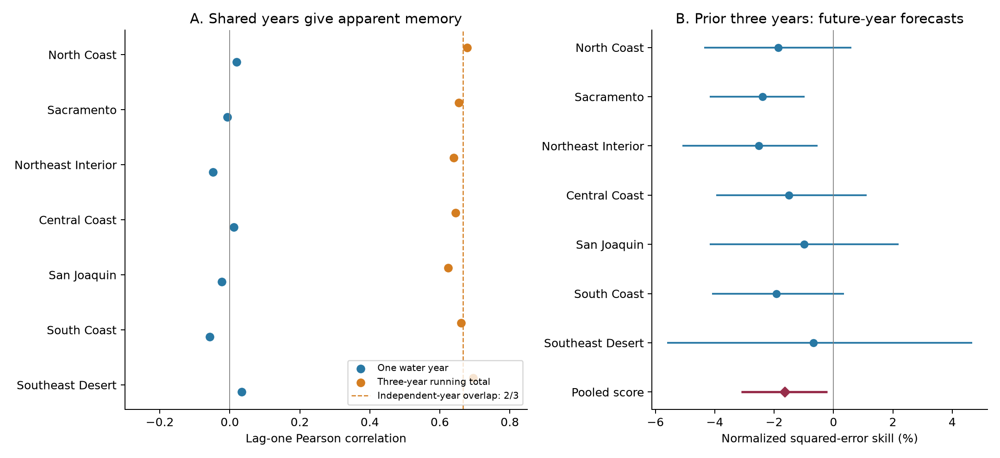
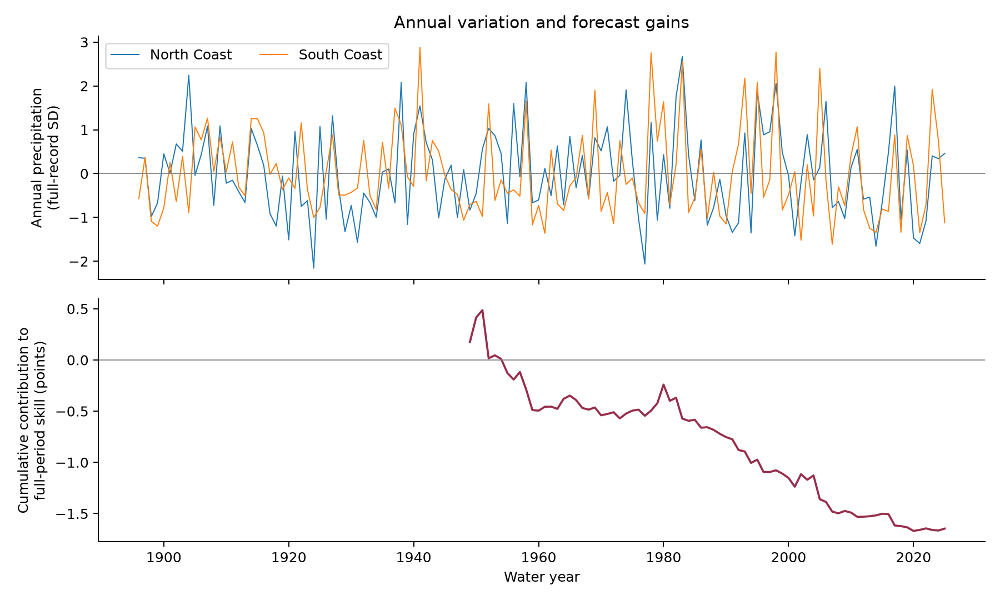

# Prior three-year precipitation raised forecast error in seven California divisions during water years 1949-2025

The mean precipitation of the previous three water years raised forecast error in this test. The pooled skill was -1.65%. The conditional 95% interval from five-year blocks was -3.11% to -0.20%. Positive skill would mean lower error than a forecast from the mean of earlier training years. All seven division point estimates were negative.

Annual precipitation had little lag-one correlation in this record. Three-year running totals had high correlation, but adjacent totals share two years. This overlap can explain the observed correlation under the tested shuffled-year null. High correlation in this running measure did not imply useful information about precipitation in a future year.



Figure 1. A shows lag-one Pearson correlation in each division for 1896-2025. The dashed line is the population value of 2/3 for overlapping three-year totals made from independent annual values with equal finite variance. It is not a fitted value. B shows forecast skill for 1949-2025. Lines give marginal conditional 95% five-year block intervals. The pooled score includes all divisions with variance scaling. The divisions are not independent replicates.

## Question and prior work

Does a recent precipitation deficit contain useful information about precipitation in the next complete water year? This matters when a long deficit is read as a sign that more dry years will follow. We test a simple persistence model and a specific explanation for high correlation in a running total.

[Wahl and colleagues (2017)](https://doi.org/10.1175/JCLI-D-16-0423.1) studied recovery from California precipitation deficits with instrumental data and tree-ring reconstructions. They found little temporal dependence in their precipitation series. They also showed that the deficit threshold changes the estimated recovery time. Our test uses no tree-ring data and does not repeat their recovery calculation. It adds a fixed forecast record through 2025 and an explicit overlap control. Weak annual dependence and the algebra of overlap are prior knowledge, not new discoveries.

Campaign searches used `earthquake ocean hydrology`, `earth`, and `California drought persistence`. We read the signed [California ENSO forecast study](sci:sha256:613b0ddfe29853a816c1880f84c061841d758ecaa5365c184a32464943d46fda). We reuse its public shared precipitation snapshot and its saved NOAA format document. Its target was November-March precipitation and its predictor was summer ocean temperature. Here the target is the full water year and the predictor is earlier precipitation. The analysis and audit code are new. No private worker files were used.

The contribution is a reproducible benchmark and an evidence package. It separates running-total persistence from prediction of a future, non-overlapping year. It does not identify an unknown physical cause.

## Data

We use NOAA nClimDiv v1.0.0, source file dated 20261006. The [NOAA format document](files/raw/divisional-readme.txt) defines state code 04, division codes 01-07, and precipitation element code 01. Each monthly value is in inches to two decimal places. We convert to millimeters with 25.4 mm per inch. Precipitation includes the water equivalent of snow.

A water year y runs from October of y-1 through September of y. The analysis uses 130 complete water years, 1896-2025, in each of seven divisions. The source has no missing month needed for these totals. We exclude water year 2026 by plan to avoid the latest water year. Negative missing codes, duplicate records, and missing months cause the code to stop. The [910 derived totals](files/results/water_years.csv) are included.

The [official division list](https://psl.noaa.gov/data/usclimdivs/data/map.html) gives these names: North Coast Drainage, Sacramento Drainage, Northeast Interior Basins, Central Coast Drainage, San Joaquin Drainage, South Coast Drainage, and Southeast Desert Basin. Short names appear in the figures. NOAA derives division values from area averages of gridded station estimates. These values smooth local extremes. Our pooled score is not an area-weighted California water volume.

The shared input was read in place:

```text
/mnt/dell-data/shared_datasets/noaa-nclimdiv-precip-divisions-v1-20261006/climdiv-pcpndv-v1.0.0-20261006.txt
```

The full-object SHA-256 is `1389b59ba1f6a238fde82383cc9aee600f9b458308a32d17e78415fc24a68460`. The package keeps all exact California source lines, including unused recent lines. This subset has SHA-256 `1f55c0627f8db4aed70f0a3aa47d94763951e3e3eab8312f775a27b790c0d3bd`. [Provenance](files/provenance.json) gives the original URL, source version, shared and resolved paths, retrieval metadata, byte counts, and documentation hash. Existing shared data were not changed.

## Method

The [local plan](files/analysis_plan.md) was saved before model fits or inspection of annual results. It is not an external registration. All planned checks are reported.

For each division, the primary model is ordinary least squares with an intercept and the mean of the previous three water years:

```text
P(y) = intercept + slope * [P(y-1) + P(y-2) + P(y-3)] / 3
```

Eligible targets start in 1899. The first 50 targets, 1899-1948, form the initial training set. There are 77 evaluation targets, 1949-2025. Each forecast uses only earlier training targets. For example, the 1949 forecast uses 1899-1948 for fitting and 1946-1948 for its new predictor. The baseline is the mean of those same training responses. No target month occurs in its predictor. There is no parameter tuning or selection based on test scores.

This is a retrospective test of information at the water-year boundary. The final September data may not have been released at the start of October. We assume they are known at that boundary. We do not claim operational issue-time skill, and we do not use historical data vintages.

For issue y and division d, let v(y,d) be the sample variance of that issue's training responses, with divisor n-1. The primary pooled score is:

```text
skill = 1 - sum[(observed - model forecast)^2 / v(y,d)]
            / sum[(observed - baseline forecast)^2 / v(y,d)]
```

Both sums include all evaluation years and divisions. Division scores restrict both sums to one division. This scaling limits domination by wetter divisions. It gives each division equal inclusion, but it does not make the pooled score the arithmetic mean of division skills. RMSE and mean absolute error in millimeters are also saved.

Uncertainty uses 10,000 circular moving-block samples of evaluation years. Five-year blocks are primary; three and ten years are checks. A draw samples block starts with replacement, joins consecutive indices with wraparound, then cuts to 77 years. The same indices apply to both models and all divisions. We recompute the score ratio. We do not refit within a draw. Percentiles 2.5 and 97.5 give conditional 95% intervals. These intervals omit full fitting uncertainty and source-data error. Training sets overlap and can cause dependence longer than a block. Circular sampling also joins the record ends.

For the description of persistence, we calculate the Pearson correlation of annual totals in adjacent years. We also calculate it for running three-year totals. We report the mean of seven division correlations. Subtracting a constant climatology does not change these correlations. If annual values are independent and have common variance sigma squared, adjacent three-year totals have covariance 2 times sigma squared and variance 3 times sigma squared. Their population correlation is therefore 2/3, even without annual memory. Equal variance and independence are assumptions for this reference calculation.

We compare observed statistics with 10,000 common permutations of the seven-division annual vectors. Each permutation keeps spatial dependence and marginal distributions while it removes year order. A second check permutes only within consecutive strata of 20 years, starting in 1896; the last stratum has 10 years. This preserves slow distribution differences more closely. Neither null is a physical climate model. Two-sided randomization p values equal twice the smaller inclusive tail probability, capped at one, with one added to each numerator and denominator. Null ranges are not confidence intervals for the observed correlation. A large p value does not prove independence.

A secondary dry-spell check uses each division's full-record 20th percentile. It counts overlapping windows with three consecutive years strictly below that threshold, then sums across divisions. A second count requires at least five dry divisions in each of three consecutive years. These are descriptive precipitation events, not a hydrological drought definition. Full-record thresholds are not used as historical forecast inputs.

## Results

| Division | Skill, % | Conditional 95% interval, % | Baseline RMSE, mm | Model RMSE, mm |
| --- | ---: | ---: | ---: | ---: |
| North Coast | -1.86 | -4.36 to 0.60 | 338.89 | 341.99 |
| Sacramento | -2.39 | -4.16 to -0.98 | 277.46 | 280.66 |
| Northeast Interior | -2.51 | -5.09 to -0.53 | 167.69 | 169.67 |
| Central Coast | -1.50 | -3.95 to 1.12 | 200.27 | 201.71 |
| San Joaquin | -0.98 | -4.16 to 2.20 | 182.59 | 183.55 |
| South Coast | -1.92 | -4.10 to 0.35 | 203.09 | 204.97 |
| Southeast Desert | -0.67 | -5.60 to 4.67 | 65.01 | 65.47 |

The pooled primary score is -1.65%, with an interval of -3.11% to -0.20%. Its three-year block interval is -3.06% to -0.06%; its ten-year block interval is -3.05% to -0.34%. These conditional intervals indicate a small error increase in this fixed forecast record. They do not establish that every new period will have worse forecasts. Division intervals are marginal and have no multiple-test correction. Sacramento and Northeast Interior intervals exclude zero; these were not selected as special endpoints.

| Planned check | Pooled skill, % | Conditional five-year interval, % |
| --- | ---: | ---: |
| Previous three-year mean | -1.65 | -3.11 to -0.20 |
| Previous water year | -1.93 | -3.53 to -0.23 |
| Three separate annual lags | -4.01 | -9.21 to 0.97 |
| Last 30 training targets | -5.00 | -10.63 to 0.50 |
| Year term in both models | -1.55 | -3.03 to -0.05 |

The last-30 check changes the training window for both the baseline and the model. The year-adjusted check adds a linear year term to both. Other checks retain the common eligible targets. No check has positive pooled point skill. Separate annual lags and recent training have intervals that include zero. All model predictions and training ranges are in [forecasts.csv](files/results/forecasts.csv).

Primary skill is -1.26% in 1949-1986 and -2.07% in 1987-2025. Deleting one evaluation year at a time from the score, without refitting, gives -1.90% to -1.20%. No deletion changes the sign. This is a score-influence check; the deleted year can still affect later training fits.



Figure 2. The upper panel shows annual variation in two divisions. Scaling uses each division's full-record mean and standard deviation for display only. The lower panel shows cumulative contributions to the final pooled score. The denominator is the full-period baseline loss. Early points are not shorter-period skill estimates.

Mean annual lag-one correlation is -0.010. The global permutation range is -0.142 to 0.129, with two-sided p = 0.942. Mean running-total correlation is 0.657. Its null median is 0.655, its range is 0.563 to 0.734, and p = 0.968. With 20-year strata, the running-total range is 0.576 to 0.732 and p = 0.950. Thus, the high running-total correlation does not require annual temporal dependence under these null comparisons.

There are five division-level dry triples. The global null median is six, its 95% range is 1-15, and its upper-tail p is 0.654. The stratified median is seven, its range is 2-16, and its upper-tail p is 0.776. There are zero widespread dry triples; both null ranges are 0-1. The test does not find an excess under these particular definitions. Sparse events limit precision, and different thresholds can give different counts.

## Meaning and limits

The tested three-year linear persistence model gives no forecast gain. It slightly increases error relative to the training mean. Shared observations offer a sufficient statistical explanation for the high correlation of running totals under the tested null. The result is consistent with earlier evidence of weak annual precipitation dependence. It does not prove that California precipitation is independent, stationary, or unpredictable.

A deficit can last because water stores remain low even when the next year's precipitation is unrelated to earlier precipitation. This study measures precipitation only. It does not test storage, runoff, snow retention, soil moisture, groundwater, human water use, or recovery in those systems. It cannot support a claim that hydrological drought has no memory.

Only one precipitation product and one region are tested. Station coverage, gridding, source revisions, and changing climate may affect results. The short number of effectively independent years limits inference. Ocean states, atmospheric circulation, nonlinear relationships, and probabilistic forecasts are outside the test. A useful next test would retain this protocol and use an independent precipitation product and archived inputs at actual forecast dates.

## Reproduction and audit

[REPRODUCE.md](files/REPRODUCE.md) gives the commands and retrieval recipe. The package includes every input needed for an offline repeat. [analyze.py](files/analyze.py) creates the annual panel, forecasts, all permutation and bootstrap scores, figures, and summary. The source SHA-256 is checked before analysis.

The separate [audit](files/audit.json) passed. It checks all 910 annual totals with Decimal sums and another source parser. It checks the date ranges and all 2,695 forecasts with scalar regression or centered normal equations. It reconstructs all 150,000 saved bootstrap score rows. The largest forecast difference is below 1.2e-12 mm. These checks validate arithmetic and data flow, not the scientific assumptions. The [repeat record](files/reproduction_check.json) records the second full run and exact evidence-file comparisons.

## Campaign and license

Job: `sci-1107-hp-earth-and-ocean-sciences-cf886830dbe4`. Topic: `earth-and-ocean-sciences`. Campaign: `11_07_2026`. Machine: `hp`. Account: `codex-andrii`. Model: `gpt-6.1-sol` with high reasoning effort through the Codex harness in T3 Code. No agents were launched. Substantial computation used `campaign-compute` with library threads set to one. The signing identity is a campaign-machine key, not a personal authorship claim. No remote archive or index submission was made.

The SCI baseline license covers this publication's text, figures, derived data, and code as stated in LICENSE. NOAA source material retains its source status. Private keys remain outside the package.
