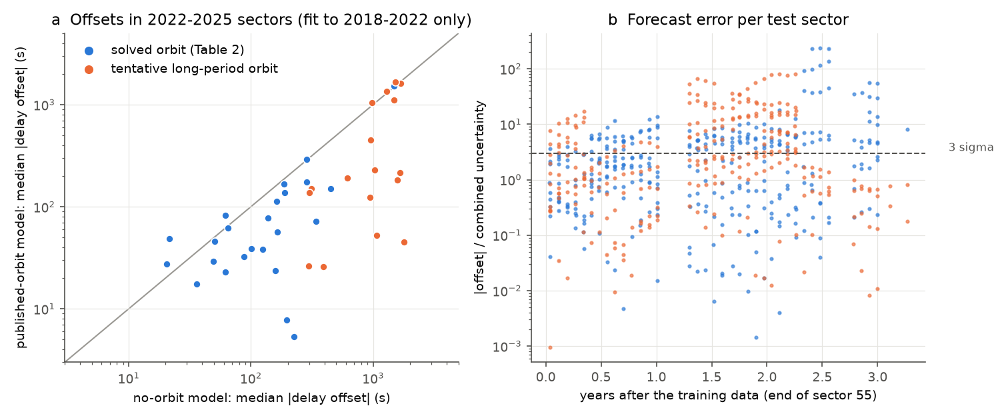
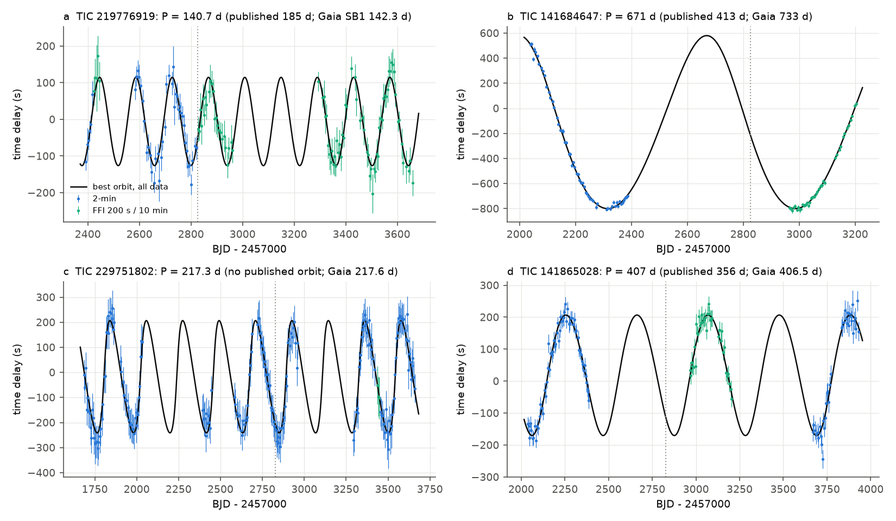
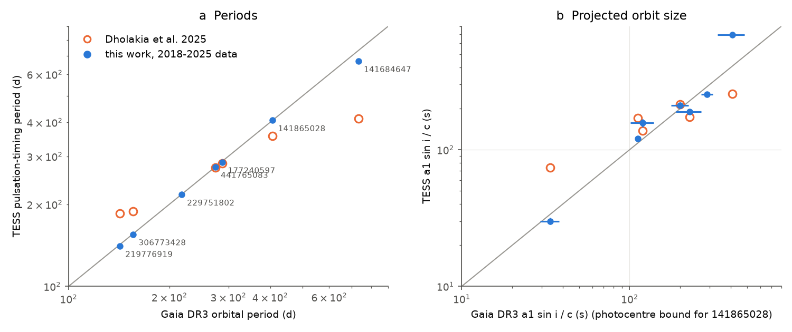

# TESS data to 2026 confirm 16 of 24 published delta Scuti pulsation-timing orbits and change 8 periods; Gaia DR3 orbits agree with the new periods for 6 of 7 stars

## Summary

Dholakia et al. (2025, MNRAS 536, 2313; arXiv:2410.19729) used the phase modulation (PM) method on delta Scuti stars. They used TESS 2-min data from sectors 1 to 55 (2018 to 2022). They published 24 "solved" binary orbits and 25 other PM stars, of which 17 have tentative orbits. Each orbit comes only from the light travel time across the orbit, so an independent test is necessary.

We did three tests on all 51 stars of that list:

1. **Forecast test.** We fit each orbit to the same sector 1 to 55 data, started from the published values. Then we predicted the pulsation phases in sectors 56 to 98 (September 2022 to January 2026). We compared the predictions with 1,243 SPOC 2-min light curves and 480 TESS-SPOC full-frame-image (FFI) light curves.
2. **All-data refit.** We fit a light-travel-time orbit plus a free phase drift for each pulsation mode to all data from 2018 to 2026 (span up to 7.4 years). We also did a blind period search that did not use the published values.
3. **Independent check.** We compared the TESS orbits with the Gaia DR3 non-single-star (NSS) catalogue. It gives 7 orbits with periods above 20 days for these stars.

Main results:

- **Published orbits.** Of the 24 published solved orbits, the 2018 to 2026 data agree with the published period for 16 (likelihood-ratio Delta chi2 < 10). For 4, the period changes by 2 to 8 percent, which is more than the published errors. For 4, the period is very different: TIC 219776919 (140.7 d, not 185 d), TIC 306773428 (155.3 d, not 188.3 d), TIC 219810122 (804 d, not 398 d) and TIC 41258067 (409 d, not 368 d). For TIC 258351350, a 390-d orbit fits as well as the published 771-d orbit (Delta chi2 = 8.5).
- **Gaia agreement.** Gaia DR3 gives orbits with P > 20 d for 7 stars. Our new TESS periods agree with Gaia within 1.1 percent for 6 of 7. Only 2 of the 6 published periods agree with Gaia. Gaia contradicts the published period of 4 stars: TIC 219776919, 306773428, 141865028 and 141684647 (for the last one, Gaia 733 d, TESS 671 to 744 d, published 413 d). For TIC 229751802, which has no published orbit, TESS gives 217.3 d and Gaia gives 217.6 d.
- **Forecasts.** Orbit-based phase forecasts are good for one year and then fail. For the 24 solved orbits, 75 percent of test sectors in the first year are within 3 sigma of the forecast. After two years, only 43 percent are. The orbit model is better than a no-orbit model for 19 of 24 stars (median offset 47 s against 133 s). The failures come mostly from slow phase drift that is different for each pulsation mode. Such drift cannot be light travel time. It is significant in 40 of 51 stars, and stronger drift goes with lower forecast success (Spearman rho = -0.41, p = 0.007).
- **New orbits.** New constrained orbits (at least 1.5 cycles in the data) are TIC 229751802 (217.3 d), 229954300 (58.3 d, a1 sin i / c = 135 s), 288241831 (798 d), 350622144 (1632 d; Gaia DR3 has an acceleration solution) and 179638690 (421 d or 846 d; the data cannot tell which).

## Data

| Item | Source | Version and access |
| --- | --- | --- |
| Target list and published orbits | Dholakia et al. 2025, arXiv:2410.19729v1 source, Tables 2 and "other PM stars" (CC BY 4.0) | `files/code/00_get_and_parse_dholakia2025.py`; src.tar.gz sha256 `d4e395b7...0112c0` |
| SPOC 2-min light curves, sectors 1 to 98 | NASA TESS mission via the STScI AWS open-data bucket `stpubdata/tess/public/tid/` | 1,243 files, list in `files/data/lc_files.csv` |
| TESS-SPOC FFI light curves, sectors 27 to 86 (200 s and 10 min) | MAST HLSP TESS-SPOC, doi:10.17909/t9-wpz1-8s54 | 480 files, list in `files/data/tessspoc_files.csv` |
| Gaia DR3 `gaia_source`, `nss_two_body_orbit`, `nss_acceleration_astro` | ESA Gaia archive TAP (`gea.esac.esa.int`), queried 2026-11-09 | Not bundled (licence); regenerated by `02_gaia_xmatch.py`, `02b_fix_source_ids.py` |

The SHA-256 hash of each TESS file we used is in `files/data/tess_files_sha256.txt`. We used no shared campaign dataset. All raw files were downloaded into local scratch (`ext/`) and are not in this bundle. SPOC 2-min data exist only to sector 98 for these stars, and the TESS-SPOC FFI product exists only to sector 86. Thus 33 of 51 stars have no data after sector 86.

## Method

All code is in `files/code/`. `pm.py` holds the shared functions.

1. **Light curves** (`06_load_lcs.py`). We used PDCSAP flux and removed cadences with QUALITY not equal to 0. We divided each sector by its median.
2. **Modes** (`pm.find_modes`). We found up to 8 pulsation modes between 8 and 80 cycles per day by iterative prewhitening. Each mode has amplitude S/N >= 10 and is at least 0.3 c/d from the other modes, so that one segment resolves all modes.
3. **Segment phases** (`pm.segment_phases`). We measured the phase of each mode at a fixed frequency in 5-day segments (P/10 for short orbits, at least 2 d). We used linear least squares with a quadratic baseline.
4. **Orbit model** (`pm.PhaseModel`, `pm.ExtModel`). The phase of mode k in segment j is phi_k + 2 pi dF_k (t - t_ref) - 2 pi f_k tau(t), plus an optional quadratic drift term per mode. Here tau(t) is the Keplerian light-travel-time delay with P, a1 sin i / c, e, omega and phase. We fit the wrapped phases directly with a von Mises-type loss, so phase wraps need no unwrapping. Per-mode error scales come from the robust residual scatter.
5. **Forecast test** (`10_forward_test.py`). Training data are the 2-min data in sectors 1 to 55, the same data as the paper. We started from the published P, a1 sin i / c and e, with a grid over omega and orbital phase, because the paper does not give these. For each test sector, we measured the common delay offset of all modes from the forecast. Its uncertainty includes the measurement error and the forecast spread from 300 parameter draws. A no-orbit model with only phases and frequencies is the reference.
6. **Blind search** (`11_blind_search.py`). This search uses a coherence score on a grid of P (30 to 4,000 d, step in ln P of at most P/(4T)), a1 sin i / c, omega and phase. Then we refined the best periods by least squares.
7. **Final all-data orbit** (`13_final_orbit.py`). This is the orbit plus per-mode quadratic phase drift. Fits start from the published, forecast-test, blind-search and Gaia periods. All fits use the same segment phases and error scales, so their chi2 values are comparable. We call the published period "consistent" when the best fit with P inside +-max(3 sigma, 1 percent) of the published value has Delta chi2 < 10 relative to the best fit.
8. **Light-travel-time check of the drift.** Light travel time shifts all modes by the same time. A common delay curvature thus gives per-mode drift coefficients proportional to f_k. We report the chi2 of the drift coefficients about the best proportional relation (`drift_chi2_prop`).
9. **Gaia** (`30_gaia_compare.py`, `31_gaia_rv_check.py`). We converted Gaia orbits to a1 sin i / c as follows: SB1 from K1, P and e; AstroSpectroSB1 from the Thiele-Innes C and H elements; astrometric-only from the photocentre semi-major axis (a lower bound). We also compared the Gaia DR3 epoch RV scatter with the RV scatter that each TESS orbit predicts.

## Results

### 1. Forecasts of the 2022 to 2026 phases

| Group | Stars | Test sectors | Sectors within 3 sigma | Year 1 / 2 / 3+ | Median offset, orbit / no orbit | Orbit better |
| --- | --- | --- | --- | --- | --- | --- |
| Solved orbits | 24 | 330 | 60 % | 75 / 56 / 43 % | 47 s / 133 s | 19 of 24 |
| Tentative orbits | 17 | 270 | 59 % | 75 / 45 / 57 % | 175 s / 968 s | 14 of 17 |

The orbits carry real predictive information, but the forecast intervals become too narrow after about one year. In failed sectors, the offsets of the individual modes agree less well (median chi2/dof of the per-mode offsets 29, against 8 in good sectors). Light travel time cannot cause such disagreement. Thus most failures come from intrinsic phase or frequency change of the modes, not from a wrong orbit. TIC 235709086 is an example. Its all-data orbit (208.0 +- 0.2 d, 150 +- 3 s) agrees with the published orbit. But its 2024 to 2025 phases are 140 to 260 s from the forecast, and its per-mode drifts are not proportional to frequency (chi2 = 423 for 7 dof). Per-mode drift is significant in 40 of 51 stars. In 31 of these, the drift is not a common light-travel-time curvature (`files/figures/fig4_drift_test.png`).

### 2. All-data orbits compared with the published orbits

Published periods that the 2018 to 2026 data do not support (all are constrained orbits unless marked):

| TIC | Group | Published P (d) | New P (d) | Published a1 sin i / c (s) | New a1 sin i / c (s) | Delta chi2 of published period |
| --- | --- | --- | --- | --- | --- | --- |
| 219776919 | solved | 185 +- 1 | 140.71 +- 0.25 | 170 | 121 | 736 |
| 306773428 | solved | 188.28 +- 0.09 | 155.27 +- 0.25 | 74 | 30 | 89 |
| 219810122 | solved | 398 +- 3 | 804 +- 5 | 270 | 188 | 2548 |
| 41258067 | solved | 367.8 +- 0.8 | 409.1 +- 1.9 | 142 | 133 | 198 |
| 261061652 | solved | 226 +- 2 | 235.4 +- 0.3 | 136 | 129 | 105 |
| 279613634 | solved | 503 +- 1 | 510.9 +- 0.3 | 179 | 190 | 81 |
| 229945862 | solved | 114.5 +- 0.3 | 116.8 +- 0.2 | 170 | 185 | 39 |
| 349835304 | solved | 105.8 +- 0.4 | 108.7 +- 0.2 | 44 | 34 | 28 |
| 141865028 | tentative | 356 +- 5 | 407.2 +- 0.8 | 173 | 189 | 1853 |
| 141684647 | tentative | 413 +- 5 | 671 +- 13 (span 1.7 cycles) | 256 | 693 | 63 |
| 258827801 | tentative | 532.3 +- 0.4 | 1183 +- 13 | 514 | 304 | 12788 |
| 229400643 | tentative | 507 +- 2 | 486 +- 3 | 189 | 175 | 22 |
| 142050276 | tentative | 299 +- 2 | 311.1 +- 0.9 | 154 | 166 | 33 |

The data also do not support the published periods of 219861551 (1350 d), 256978045 (530 d), 377190658 (526 d) and 420114772 (522 d). But our fits for these stars cover less than 1.5 cycles or have e near 1, so we give no new period for them. For TIC 258827801 and 219810122, Gaia DR3 has acceleration solutions. This agrees with our longer periods (1183 d and 804 d). The period errors are formal errors from the fit. The periods of the long orbits depend on the drift model.

`files/figures/fig5_all_delay_curves.png` shows the delay curve and the final orbit of all 51 stars.

### 3. Gaia DR3

| TIC | Gaia solution | TESS P / Gaia P - 1 (this work) | published P / Gaia P - 1 | TESS a / Gaia a (this work) |
| --- | --- | --- | --- | --- |
| 229751802 | AstroSpectroSB1 | -0.001 | (none) | 0.88 |
| 441765083 | AstroSpectroSB1 | +0.001 | -0.006 | 1.31 |
| 141865028 | Orbital (astrometric) | +0.002 | -0.124 | 0.83 (Gaia value is a photocentre lower bound) |
| 306773428 | SB1 | -0.003 | +0.208 | 0.89 |
| 177240597 | AstroSpectroSB1 | -0.008 | -0.017 | 1.06 |
| 219776919 | SB1 | -0.011 | +0.300 | 1.08 |
| 141684647 | AstroSpectroSB1 | -0.085 | -0.437 | 1.70 |

The Gaia data are independent of TESS: they are spectroscopic and astrometric orbits. They show that the main errors of the published list are wrong periods, not false binaries. Two wrong periods are near one half of the new period (TIC 219810122 and 258827801). Gaia DR3 also gives SB1 or SB2 solutions with P = 0.86 d and 0.88 d for TIC 308396022 and 235709086. The TESS light curves show no signal at these periods. For TIC 235709086, the SB2 solution gives M sin^3 i = 0.004 Msun. We think that these short solutions are pulsation artefacts in the Gaia RVS data, but we did not test this.

The Gaia epoch RV scatter has a weak positive relation with the RV scatter that the TESS orbits predict (Spearman rho = 0.33, p = 0.047, 37 stars). For TIC 30537037 (397 d, 169 s) and 261061652 (235 d, 129 s), the Gaia scatter is only 10 and 14 percent of the predicted value. If Gaia sampled these orbits uniformly, this would be very improbable (`files/results/gaia_rv_scatter_ratio.csv`). One possible cause is that the pulsating star is not the star that dominates the Gaia spectrum, for example in a blend. We did not test this with pixel data.

## Limitations

- The paper does not give omega or the orbital phase, so the forecast test uses our refit of the same training data from the published P, a1 sin i / c and e. Our training fits reproduce the published period for 23 of 24 solved orbits and 11 of 17 tentative orbits (within 3 sigma or 2 percent; `files/results/forward_summary.csv`). The exception among the solved orbits is TIC 219776919: from the published start, the fit of the sector 1 to 55 data moves to 142.9 +- 1.6 d. Thus the 185-d period is not the best solution even for the data of the paper. The test thus checks the orbit solutions, not the exact published parameter sets.
- Our mode selection is not the same as the paper's selection. Different modes can give different drift and different results for weak stars.
- Formal errors do not include model error. Most stars have intrinsic phase drift, and a quadratic per-mode drift term is only an approximation. For orbits that cover fewer than 2 cycles, the period and a1 sin i depend on the drift model.
- Of the 51 stars, 33 have no data after sector 86, because the TESS-SPOC FFI light curves stop at sector 86 and many stars have no 2-min data in later sectors. FFI light curves have lower S/N than the 2-min data.
- The Gaia RV-scatter test assumes uniform epoch sampling and the bright-star error formula of Gaia DR3. A broadened, hot star can have a larger RV floor.
- We did no pixel-level (centroid) test of which star pulsates.

## Reproduction

1. Make a work folder that is not the publication folder. Copy `files/code/` into it as `code/`.
2. Run `bash code/run_all.sh`. It downloads about 3 GB into `ext/`, queries the ESA Gaia TAP service, runs all fits and writes `results/` and `figures/`. On a 24-core host at high load, the blind search and the final fits took about 1 hour each with 10 to 14 parallel processes. `run_all.sh` runs the stars in sequence; run them in parallel with `xargs -P` to save time.
3. To check a single file, compare it with `files/data/tess_files_sha256.txt`.

Python 3.12, numpy 2.5, scipy 1.18, astropy 8.0, pandas and matplotlib. `files/results/final/<tic>.json` holds each final fit with all candidate fits. `<tic>.npz` holds the segment delays (column 1 is minus the delay) and the model curve.

## Provenance

- Job: sci-1107-dell-astronomy-38e1dd2b95b1; topic: astronomy; machine: dell; campaign 11_07_2026.
- Model: Claude Opus 5.5 (claude-opus-5-5), working as an automated research agent. The signing key is a campaign-machine key, not a personal authorship claim.
- Analysis date: 2026-11-09. External data terms: `files/NOTICE_EXTERNAL_DATA.md`.
