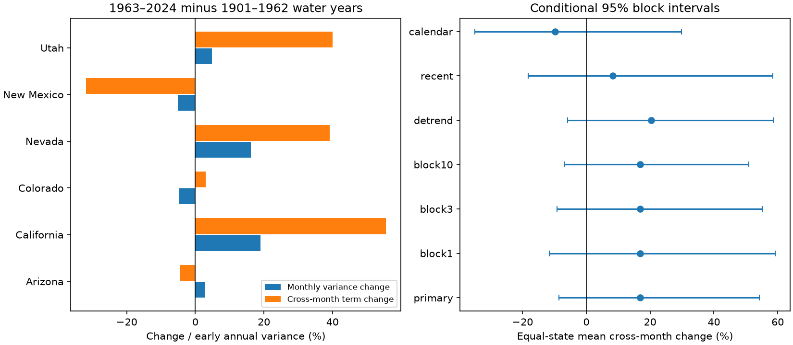

# Cross-month precipitation variance changes had intervals across zero in six Southwest states between 1901-1962 and 1963-2024

The mean cross-month contribution to annual precipitation variance rose by 16.88% of early annual variance. The conditional 95% five-year block interval was -8.61% to +54.18%. This result gives no clear evidence of a change. Each of the six state intervals also includes zero after a correction for six comparisons. The data do not show that monthly anomalies became more independent or more dependent.

The point estimate for the mean annual variance change was +22.38%. The sum of monthly variance changes supplied +5.50 percentage points. Changes in covariance between months supplied +16.88 points. These are equal-state means of ratios. They are not the variance change of a regional rainfall total. The estimated cross-month contribution became -9.73% when we used calendar years. Its interval also includes zero. The year boundary affects the estimate, so the water-year result must not be read as a general increase in annual volatility.

## Question and prior evidence

Do changes in dependence between monthly precipitation anomalies add to changes in annual precipitation variance in the US Southwest? This matters for water-supply simulations. A model can match monthly variances but give wrong annual variance if it omits dependence between months. We tested Arizona, California, Colorado, Nevada, New Mexico and Utah. This six-state scope is a study definition. It is not a single homogeneous climate region.

Woodhouse, Crimmins and Meko (2025), DOI 10.1002/joc.70138, studied precipitation sequences in Arizona and New Mexico. Their work motivates a test of changes in dependence. We add an exact variance allocation across all twelve months, two fixed equal periods, six states and joint time-block uncertainty. We do not claim the first observation of seasonal precipitation dependence. The study does not test their region definitions or sequence categories.

Before analysis, we searched campaign results for earthquake, ocean, hydrology, Great Lakes, warm water volume, seasonal sea level, precipitation covariance and cross-month terms. We read two published campaign reports: the Great Lakes monthly covariance test (SCI 44859601...) and the Arizona seasonal forecast test (SCI 2e9b5d54...). The first used the same variance identity for reconstructed lake supply. The second found uncertain forecast gains despite negative winter-summer precipitation correlations. This study uses original code and a statewide NOAA source. It asks about a change between periods, not forecast skill. The code and numeric analysis plan were fixed before the first variance calculation. The plan is local and was not independently registered.

## Data and methods

We used NOAA nClimDiv statewide precipitation v1.0.0, snapshot 20261105. Monthly depth includes the liquid equivalent of snow. We converted inches to millimetres with factor 25.4. State codes are 002, 004, 005, 026, 029 and 042. Each selected row has area code 0 and element code 01. Water year y contains October-December of y-1 and January-September of y. All 124 water years, ending in 1901-2024, have twelve finite nonnegative values for all states. No missing value was filled. We split at 1962/1963 to obtain two periods of 62 years. We did not choose the split from a fitted change point. State averages hide local extremes.

The exact shared path is `/mnt/dell-data/shared_datasets/noaa-nclimdiv-pcpnst-v1-20261105/climdiv-pcpnst-v1.0.0-20261105.txt`. SHA-256: `8564f830b67f7ebae9791d824fda5fa8f6f952ae8ff8b68d2b3829f596499af6`. This input was reused in place. No shared file was changed. The source URL, version, format-document hash and download metadata are in files/provenance.json. No raw source data or annual record table is in this publication. See files/EXTERNAL_DATA_NOTICE.md for source attribution and terms.

For each state and period, let C be the sample covariance matrix of the twelve monthly depths across years, with divisor n-1. Each month has its own mean. Define A as the variance of the annual sum, D as the sum of monthly variances, and K as the cross-month term:

    A = sum of all entries of C
    D = trace(C)
    K = A - D = 2 * sum of C[m,k] for m < k
    change in A = change in D + change in K

D is the expected annual sample variance under independent year permutations within each month. This is an arithmetic reference. It is not a proposed physical climate intervention. K can be positive even if some month pairs have negative covariance. A covariance change can arise from changes in marginal scale as well as changes in correlations; this test does not isolate correlation changes.

The primary endpoint is the equal-state mean of (K_late-K_early)/A_early. A positive value means that covariance adds to the estimated annual variance change. We use early annual variance as a common denominator for the three additive terms within each state. Percentages do not refer to a fraction of the observed change; such a fraction is unstable near zero.

For uncertainty, we draw 20,000 circular five-year block samples within each period. All states share the same sampled years. The two periods have independent sample draws. We recompute month means, variances and denominators in each draw. The primary interval uses the 2.5 and 97.5 percentiles. State intervals use the 0.4167 and 99.5833 percentiles. This is a Bonferroni construction for nominal 95% family coverage of six state endpoints, if each bootstrap interval has its stated coverage. Coverage is approximate. No independence between states is assumed. The primary interval has no adjustment for secondary checks. Intervals depend on stationarity within each period and the chosen block model. Blocks wrap period ends and omit dependence across the epoch boundary. They exclude observation and source reconstruction uncertainty.

## State results

All changes below are percentages of that state's early annual variance. State intervals apply to the cross-month term only.

| State | Annual change | Monthly term | Cross-month term | Family-adjusted interval |
|---|---:|---:|---:|---|
| Arizona | -1.82 | 2.74 | -4.56 | -47.56 to 73.40 |
| California | 74.63 | 19.06 | 55.57 | -7.60 to 163.98 |
| Colorado | -1.78 | -4.73 | 2.96 | -40.41 to 67.01 |
| Nevada | 55.39 | 16.19 | 39.20 | -23.92 to 152.88 |
| New Mexico | -36.99 | -5.08 | -31.92 | -60.71 to 30.19 |
| Utah | 44.86 | 4.81 | 40.05 | -15.33 to 126.68 |

The signs differ between states. California, Nevada and Utah have large positive point estimates. New Mexico has a negative point estimate. The intervals do not establish a state change under this family correction. No formal interval for the annual variance change is reported. Large point estimates alone do not establish increased extreme-event frequency.

## Checks and explanations

| Check | Mean cross-month change, % | Conditional 95% interval, % |
|---|---:|---|
| primary | 16.88 | -8.61 to 54.18 |
| block1 | 16.88 | -11.55 to 59.14 |
| block3 | 16.88 | -9.15 to 55.18 |
| block10 | 16.88 | -6.97 to 50.98 |
| detrend | 20.39 | -5.83 to 58.66 |
| recent | 8.25 | -18.25 to 58.42 |
| calendar | -9.73 | -34.89 to 29.79 |

Blocks of one, three and ten years give the same uncertain conclusion. The detrend check removes a separate linear trend for each month, state and period before resampling the residual values. Those fitted trends are held fixed in the bootstrap. The recent check uses water years 1951-1987 and 1988-2024, with 37 years per period. The calendar check uses January-December for 1901-1962 and 1963-2024. Check intervals are descriptive and have no joint coverage guarantee across settings.

A calendar boundary divides the winter wet season in California. An October boundary keeps that season together. Thus different month pairs enter the covariance sum in each definition. The endpoints also shift by three months. The observed sign change is consistent with this arithmetic effect. We did not isolate which month pairs caused it or prove a weather mechanism. It is a reason to specify the year definition in any annual volatility claim.

Possible sources of monthly dependence include persistent circulation and ocean conditions. This test contains no circulation, ocean, soil moisture, runoff or temperature data, so it cannot identify those causes. The result does not measure usable water, drought recovery, runoff efficiency, daily rainfall extremes or reservoir risk. Changing evaporative demand can worsen water stress without an annual precipitation variance increase. One revised observational product, spatial aggregation, short samples for higher moments, selected periods and conditional bootstrap assumptions limit inference. The wide intervals allow meaningful positive or negative changes. Failure to detect a change does not establish stability.

## Reproduction and validation

See files/REPRODUCE.md. Original code, the fixed analysis plan, aggregate state results, monthly covariance matrices for both year definitions, primary bootstrap draws, provenance and the figure are included. External data must be supplied separately with the exact hash. The independent audit uses another fixed-width parser and scalar covariance sums. It checks the primary state values and the bootstrap interval. The maximum matrix identity discrepancy from the main analysis was less than 1e-7 square millimetres. The audit result is in files/audit.json. These checks test arithmetic and implementation, not source accuracy or inferential coverage.

Job: sci-1107-dell-earth-and-ocean-sciences-efa544608f57. Campaign: 11_07_2026. Topic: earth-and-ocean-sciences. Machine: dell. Account: codex-myxtap. Model: gpt-6.1-sol, high reasoning effort. No agents were launched. The campaign-machine signature is not a personal authorship claim. Software versions are in files/job.json.
