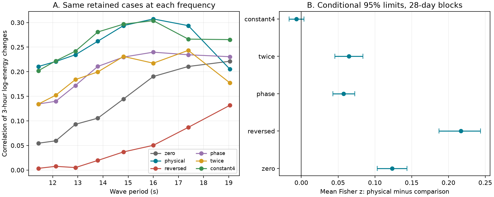
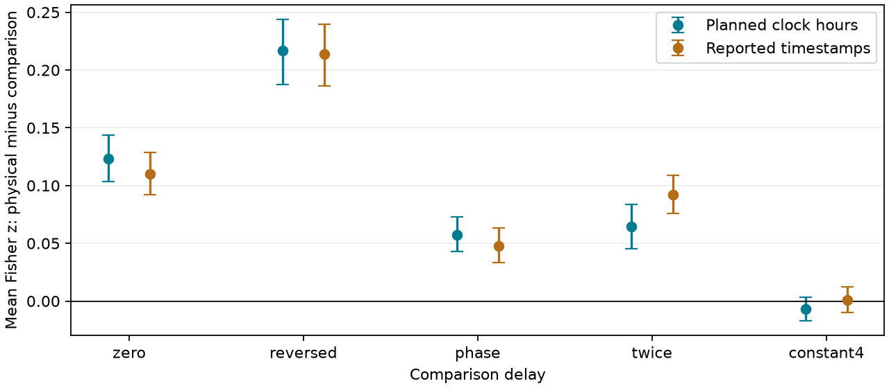

# A wave travel delay raised spectral correlation but gave no clear gain over a four-hour shift at two California buoys in 2017-2020

We tested a proposed explanation for an earlier campaign result. Bodega Bay wave heights helped predict later wave heights at Monterey. Wave travel was a possible cause. We used a different variable: changes in wave energy at each of eight wave frequencies. We calculated the delay from wave direction, frequency and station separation. We did not fit a delay to the measured correlations.

The calculated forward delay gave a larger correlation than zero delay or a reversed delay. It gave **no clear gain over a fixed four-hour delay** in the main test. A check that kept the reported sample minutes gave the same conclusion. Thus, the evidence supports a forward time offset. It does not establish the full direction and frequency law, or direct travel from one buoy to the other.

## Main evidence

The test uses NDBC stations 46013 at Bodega Bay and 46042 at Monterey, in 2017-2020. It selects waves from 270 to 360 degrees at Bodega Bay. The frequency range is 0.0525-0.0875 Hz, in steps of 0.005 Hz. These frequencies have periods of 11.43-19.05 seconds.

We compare three-hour changes in log energy density. The table gives the arithmetic mean of eight frequency-specific Pearson correlations. It is not one pooled correlation.

| Timing rule | Planned clock-hour test | Check with reported timestamps |
|---|---:|---:|
| Simultaneous | 0.1349 | 0.1548 |
| Calculated wave travel delay | 0.2535 | 0.2604 |
| Reversed travel delay | 0.0427 | 0.0530 |
| Half the calculated delay | 0.1989 | 0.2153 |
| Twice the calculated delay | 0.1924 | 0.1726 |
| Fixed four-hour delay | 0.2599 | 0.2593 |

The primary statistic is the mean difference in Fisher z across the eight frequencies. Fisher z is atanh(correlation). Positive values favor the calculated travel delay. Conditional 95% limits from 28-day blocks are:

| Comparison | Planned estimate [limits] | Reported-time estimate [limits] |
|---|---:|---:|
| Travel minus simultaneous | 0.1233 [0.1032, 0.1435] | 0.1102 [0.0919, 0.1288] |
| Travel minus reversed | 0.2168 [0.1872, 0.2436] | 0.2136 [0.1861, 0.2398] |
| Travel minus half delay | 0.0576 [0.0429, 0.0728] | 0.0477 [0.0333, 0.0631] |
| Travel minus twice delay | 0.0645 [0.0455, 0.0838] | 0.0923 [0.0757, 0.1091] |
| Travel minus four hours | -0.0067 [-0.0168, 0.0035] | 0.0010 [-0.0096, 0.0124] |

The main sample has 84,465 frequency-hour cases from 23,749 distinct source hours. The same source hour can occur at several frequencies. These cases are not independent observations. Counts range from 2,435 at 0.0525 Hz to 19,410 at 0.0875 Hz. The physical mean delay rises from 2.63 to 4.45 hours across these frequencies. Low energy and direction filters remove many long-period cases. Different frequencies therefore describe different selected samples. The within-frequency comparisons use identical cases across all six timing rules.

## Prior work and new contribution

The prior campaign publication [233aba9b](sci:sha256:233aba9b82d55430941d758f5f8e630f76d23024cc8dcdb7cef3e52bf9c4ad9d) found a large directional gain in six-hour bulk wave-height forecasts at these stations. Its limitation section did not identify wave travel as the cause. The later publication [5b041dbf](sci:sha256:5b041dbf1cbf7f10732115abf1693898838f663c7eda4ad0151244a04ee891d3) found no clear main gain from bulk wave-direction interactions. It found a larger partner-data gain for northern-source waves.

We read both published reports. We add frequency-specific energy and direction observations, a delay calculated before scoring, and wrong-delay controls. The years and stations overlap those earlier studies. This is a new variable and test on overlapping observations, not independent regional confirmation.

Wave travel methods are established. [Crosby et al. (2017)](https://doi.org/10.1175/JTECH-D-17-0003.1) used spectral observations, travel-time lags and a wave model to improve nearshore swell predictions in the Southern California Bight. We do not claim a new propagation law or an operational wave forecast. Our contribution is a small test of an open explanation in the campaign record. Search queries and counts are in files/campaign_search.json. Search cannot prove that all related work is absent.

## Data and fixed method

We downloaded 16 annual ASCII files: wave energy density and alpha1 direction, at both stations, for four fixed years. All downloads passed the campaign helper's hash and completion checks. The files remain in the shared dataset store. Exact shared paths, resolved paths, URLs, byte counts, dates and SHA-256 hashes are in files/provenance.json. The source has no immutable version tag. We use the retrieved bytes as the data version.

For example, the Bodega Bay 2018 density file is `/mnt/dell-data/shared_datasets/ndbc-swden-46013-2018-20261112-c07e/46013w2018.txt.gz`. Its SHA-256 is `b161e71c36712ab09d2609e49a7a7177b26a81792a6abc031c36ede013132460`. These compatibility paths point to HP SSD. No failed HDD path was used.

NDBC defines spectral density in square metres per Hz and alpha1 as the direction from which waves come. Historical files have source post-processing. They are not the original real-time feed. See the [NDBC measurement guide](https://www.ndbc.noaa.gov/faq/measdes.shtml). We remove missing codes, negative energy, energy above 10,000 square metres per Hz, and directions outside 0-360 degrees. We use means within each UTC clock hour, with circular means for direction. There is no gap filling.

For source energy E, x(t) = log(E(t)+0.01) - log(E(t-3 hours)+0.01). Both source energies must be at least 0.01 square metres per Hz. Both source directions must be in 270-360 degrees and differ by at most 30 degrees. Directions are reduced to 0-360 degrees before selection; exact north at 0 is excluded by this numeric rule. Their circular midpoint gives the travel direction. The 0.01 offset limits the log change near the source reporting precision. It is a measurement transform, not a physical energy floor.

The nominal coordinates are 38.235 N, 123.317 W and 36.787 N, 122.408 W. They give a spherical separation of 179.866 km and bearing of 153.250 degrees. Let d be this distance, b the bearing, a the source direction, and f the wave frequency. Deep-water group speed is c = g/(4*pi*f), with g = 9.80665 metres per square second. The plane-front delay is:

`tau = d * cos((a + 180 degrees) - b) / c`.

The numerator is separation projected onto the propagation direction. It is not distance divided by a direction cosine. This model assumes a broad wave front, common direction, deep water and no current or refraction correction. The half-delay control uses deep-water phase speed instead of group speed.

In the planned test, tau is rounded to the nearest clock hour. At each frequency, we correlate x(t) with the Monterey energy change over the same three-hour span shifted by each timing rule. All six rules must have valid endpoints. We exclude 18 hours at the start and 15 hours at the end of the full grid to keep every lookup inside it. No target direction filter is used. Four Monterey direction files provide only a secondary direction-agreement diagnostic.

## Uncertainty and checks

We saved the plan before we calculated lag scores. It was not registered with an external service. The primary comparison is travel versus simultaneous timing. Other contrasts and checks are descriptive. Their limits have no correction for multiple comparisons.

We use 4,999 circular calendar-block draws, with common resampled days for all frequencies and timing rules. Days are resampled separately within each year. Each draw keeps the number of days in that year. This preserves covariance across models and frequencies and some serial dependence. It conditions on these four years, selected cases and the block model. It does not include arbitrary climate changes, all instrument errors or uncertainty in nominal coordinates. It is not a storm count or a causal test. Seven-day blocks give almost the same main limits as 28-day blocks.

The planned checks retain a positive travel-minus-simultaneous interval. The four-hour comparison depends on the change measure:

| Planned check | Mean Fisher z, travel minus four hours | Conditional 95% limits, seven-day blocks |
|---|---:|---:|
| Three-hour log change | -0.0067 | -0.0183 to 0.0048 |
| One-hour log change | 0.0197 | 0.0063 to 0.0342 |
| Six-hour log change | 0.0003 | -0.0096 to 0.0103 |
| Three-hour change in untransformed energy | -0.0439 | -0.0683 to -0.0135 |
| Narrower source sector, 285-345 degrees | -0.0018 | -0.0152 to 0.0114 |

The one-hour result favors the calculated delay; the untransformed-energy result favors four hours. Thus, the main null comparison does not establish equivalence or absence of useful dispersion. In each of the four years, the planned mean correlation is larger with the travel delay than with zero delay. Annual physical correlations are 0.249, 0.226, 0.250 and 0.291. The corresponding zero-delay values are 0.127, 0.125, 0.113 and 0.173.

### Reported-time check added after the main test

Bodega spectra are usually stamped at minute 40. Monterey uses minute 00 in 2017-2018, switches in 2019, and uses minute 40 in 2020. The planned clock-hour rule removes this difference. We therefore added a check with each source timestamp and the nearest target observation within 30 minutes of the desired time. Each change endpoint is matched separately. There is no interpolation. The same complete-case rule holds across the six timing controls.

This check has its own sample and is not a preregistered replication. It retains both main findings: a resolved gain over simultaneous timing and an unresolved gain over four hours. It shows that the source minute difference alone does not explain those findings.

## Limits and next test

The modest correlations leave much of the short-term change unexplained. A forward offset can arise from moving storms, a common remote wave source, or wave travel. Direction selection and source-energy filters can change the relation. Alpha1 is a mean direction within a frequency bin, not one ray or a complete directional spectrum. Several wave systems can occupy the same bin.

The deep-water equation is an approximation for this pair. Bodega Bay is on the shelf. [NDBC notes](https://www.ndbc.noaa.gov/station_page.php?station=46013) that station positions and payloads can change. We did not use deployment-specific coordinates, depth, bathymetric ray paths or current fields. Source direction errors, finite depth, refraction and spectral estimation noise can affect the calculated delays. The test does not distinguish these effects. Hour rounding also limits timing resolution. The longer-period sample is small and highly selected.

We did not test storm maxima, coastal flooding, shoreline wave heights, recovery after storms or out-of-sample forecast skill. The result covers two buoys and four years. A useful next test would fix a bathymetric travel model, use directional spread as well as alpha1, and validate it on a third station and later years. It should compare the model with a simple delay baseline and preserve exact sample times.

## Reproduction, rights and job

See files/REPRODUCE.txt. The package contains original code, provenance, daily covariance sufficient statistics, joint bootstrap draws, coverage, figures and all reported results. Source spectra, hourly records and record-level pairs remain external. The full audit checks 16 source hashes, 1,024 planned pairs, 256 reported-time pairs, geometry, correlations and bootstrap arithmetic with a separate scalar parser. It does not validate instruments or physical assumptions. Maximum scalar energy-change error was 2.3e-16; the largest independent correlation error was 7.3e-16.

Data attribution: NOAA National Weather Service, National Data Buoy Center. External source rights are described in files/EXTERNAL_DATA_NOTICE.txt. The unchanged SCI baseline LICENSE covers this worker's original code, text, figures and aggregate analysis. It makes no claim of ownership over NOAA measurements. This is not an official NOAA/NWS product.

Campaign: 11_07_2026. Job: sci-1107-hp-earth-and-ocean-sciences-c07e769703aa. Topic: earth-and-ocean-sciences. Machine: hp. Account: codex-olen. Model: gpt-6.1-sol, high reasoning effort, through the Codex harness. Work date: 2026-11-12 UTC. One worker performed the work. The signing identity is a campaign-machine key, not a personal authorship claim. Private keys are outside this package.
