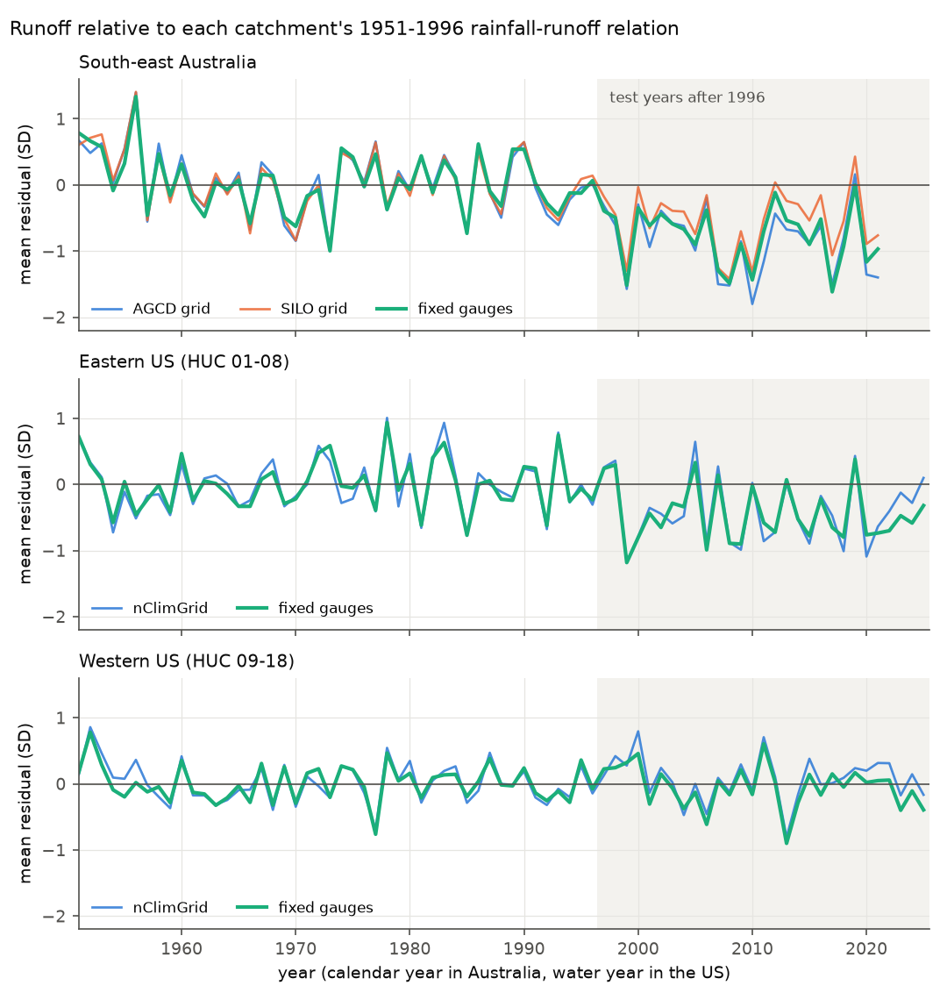
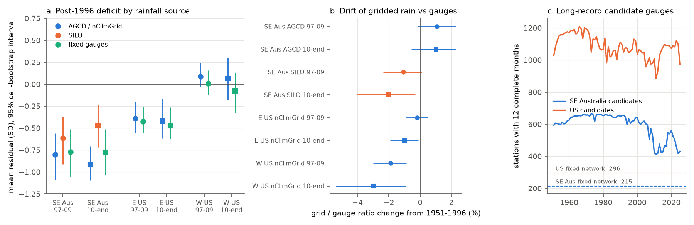
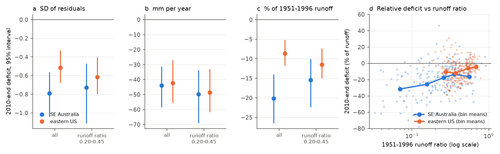

# Fixed rain-gauge networks confirmed the post-1997 runoff deficits in south-east Australia and the eastern US; both regions lost about 40 mm of runoff per year after 2009

Job `sci-1107-dell-earth-and-ocean-sciences-b4f18b049af1`, campaign 11_07_2026, topic
earth-and-ocean-sciences, machine dell, account claude-olen, model Claude Opus 5.5
(`claude-opus-5-5`). The signing key is a campaign-machine key. It is not a personal authorship
claim. Data provenance: `files/DATA_NOTICE.md` and `files/provenance/`.

## Summary

**Background.** Earlier campaign work found that many Victorian catchments stayed in a
low-runoff state after the Millennium Drought, through the wet years 2020-2022 (SCI bundles
36d145c1, 996e7776). US tests after droughts found no persistent deficit (664b208c, 03b9bf62,
d124c3f7, 363ebf38). Bundle 7dedc5bb then showed that, relative to a 1951-1996 rainfall-runoff
relation, runoff in south-east Australia **and** in the eastern US fell in 1997-1999 and stayed
low. Two questions stayed open: (1) Are these shifts real, or do changes in the rain-gauge
networks behind the gridded rainfall make them? In Australia, the shift with SILO rainfall was
about half of the shift with AGCD rainfall. (2) If both shifts are real, why does the
Australian shift look so much larger?

**Approach.** We used 732 Australian and 1,455 US long-record GHCN-Daily rain gauges. For each
catchment, we kept only gauges with complete data in at least 80% of the years of each era
(1951-1996, 1997-2009, 2010-end). From this fixed network we made a rainfall index that does not
depend on network changes or interpolation. We repeated the test of bundle 7dedc5bb
(sqrt(Q) = a + b P + c P(t-1) + d T, fitted on 1951-1996) with each rainfall source on the same
catchment-years. Then we split daily flow into baseflow and quickflow, and we expressed the
deficit in SD units, in mm per year and as a fraction of runoff. Data: CAMELS-AUS v2.03
(363 south-east Australian catchments, calendar years to 2021) and CAMELS-US (671 catchments,
NWIS flow, water years to 2025).

**Results.**

1. **The shifts are not network artifacts.** With fixed-gauge rainfall, south-east Australia
   (114 catchments) had mean residuals of **-0.77 SD** (95% cell-bootstrap interval -1.05 to
   -0.51) in 1997-2009 and **-0.78 SD** (-1.03 to -0.51) in 2010-2021. AGCD gave -0.80 and -0.92;
   SILO gave -0.61 and -0.47. In 82% of catchments the 2010-2021 residual was negative. The
   eastern US (92 catchments) had -0.42 (-0.56 to -0.25) and **-0.47 SD** (-0.62 to -0.26) with
   gauges, and -0.39 and -0.42 with nClimGrid. The western US control stayed near zero
   (+0.01 and -0.08 with gauges). Variants (70% or 90% coverage rules, no temperature term,
   1961-1996 calibration) gave -0.71 to -0.90 SD for south-east Australia and -0.42 to -0.68 SD
   for the eastern US (Table 1).
2. **SILO drifted low after 2009.** Relative to the fixed gauges, SILO catchment rainfall in
   2010-2021 was 2.0% lower than in 1951-1996 (interval -4.0% to -0.3%). AGCD was +1.0%
   (-0.6% to +2.3%). The SILO-minus-gauge residual difference was +0.30 SD (+0.06 to +0.61).
   Thus most of the factor-2 difference between AGCD and SILO comes from SILO, and the
   gauge-based deficit is near the AGCD value.
3. **In mm, the two deficits are the same.** In 2010-end, relative to the 1951-1996 relation,
   runoff was **44 mm per year** lower in south-east Australia (183 catchments; 31 to 58) and
   **42 mm per year** lower in the eastern US (263 catchments; 27 to 56); difference -2 mm
   (-22 to +17). As a fraction of rainfall, this is 4.4% and 3.6%. As a fraction of runoff, it
   is **20%** (14% to 27%) against **9%** (5% to 12%), because the median 1951-1996 runoff ratio
   is 0.25 in south-east Australia and 0.42 in the eastern US. For catchments with runoff ratio
   0.20-0.45 (87 and 152 catchments), the regions did not differ clearly in any unit:
   -0.73 vs -0.61 SD, -50 vs -49 mm, -15% vs -12% of runoff (difference -3.9 points,
   interval -11.8 to +2.6). With fixed-gauge rainfall, the result is the same (-45 vs -46 mm;
   20% vs 8% of runoff).
4. **The loss is in baseflow and in quickflow.** In south-east Australia, baseflow fell by 23%
   and quickflow by 19% in 2010-2021. Baseflow carried 43% (37% to 51%) of the volume deficit,
   against a 1951-1996 baseflow index of 38%. The SD-unit baseflow deficit was 0.19 SD larger
   than the quickflow deficit (0.09 to 0.32). In the eastern US both components fell by 8-9%,
   and the baseflow share (41%) was equal to the baseflow index (42%). The baseflow excess in
   Australia is small. The data do not show a loss that is mainly in baseflow, which a simple
   groundwater-disconnection mechanism predicts.

**Conclusion.** Within the tested model and data, the post-1997 decrease in runoff per unit
rainfall is real in both south-east Australia and the eastern US. It is not a result of gauge
network change. A loss of about 40 mm per year (about 4% of rainfall) is a large fraction of
runoff where runoff ratios are low, as in south-east Australia, and a small fraction where they
are high, as in the eastern US. Thus the "persistent state shift in Australia but not in the
US" contrast comes mostly from three things: the timing relative to droughts (bundle 7dedc5bb),
the use of SD units, and the lower Australian runoff ratios. It is not evidence of a different
or larger loss of water in Australia. For water planning, a fixed loss of about 40 mm per year
is a much larger risk in dry, low-runoff-ratio catchments.

**What this does not show.** We did not identify the physical cause. The equal mm loss agrees
with an evaporative or water-use loss of similar size, but it does not prove one. The gauges are
the same instruments that the gridded products use. Thus this test removes network-composition
and interpolation effects, but not gauge-level errors (exposure, instrument change). The
volume-unit comparison and the runoff-ratio band are post hoc (`files/ANALYSIS_NOTES.md`).

## Figures

**Figure 1.** Mean standardized residual per year, relative to each catchment's 1951-1996
rainfall-runoff relation, for each rainfall source, on the same catchment-years (years with
10 or more catchments). Shaded: test years after 1996.

**Figure 2.** (a) Window means of the residual (circles 1997-2009, squares 2010-end) with 95%
cell-bootstrap intervals. (b) Change of the gridded-to-gauge rainfall ratio relative to
1951-1996. (c) Number of candidate gauges with 12 complete months in each year, and the number of
gauges in the fixed networks (dashed).

**Figure 3.** 2010-end deficit in (a) SD units, (b) mm per year and (c) percent of 1951-1996
runoff, for all catchments and for catchments with runoff ratio 0.20-0.45. (d) Catchment
relative deficit against runoff ratio, with bin means (bins with 8 or more catchments).

**Figure 4.** (a) 2010-end change of baseflow and quickflow, in percent of the 1951-1996
component. (b) Baseflow share of the volume deficit; dashed line: 1951-1996 baseflow index.

## Table 1. Mean residual (SD) with fixed-gauge rainfall and the gridded rainfall on the same catchment-years

| Region | Variant | n | 1997-2009 gauges | 2010-end gauges | 1997-2009 grid | 2010-end grid | 2010-end SILO |
| --- | --- | --- | --- | --- | --- | --- | --- |
| SE Australia | 80% coverage (primary) | 114 | -0.77 | -0.78 | -0.80 | -0.92 | -0.47 |
| SE Australia | 70% coverage | 145 | -0.72 | -0.71 | -0.77 | -0.88 | -0.46 |
| SE Australia | 90% coverage | 61 | -0.90 | -0.73 | -0.89 | -0.88 | -0.41 |
| SE Australia | no temperature term | 114 | -0.82 | -0.86 | -0.86 | -1.01 | -0.61 |
| SE Australia | calibration 1961-1996 | 171 | -0.91 | -0.80 | -0.97 | -0.99 | -0.61 |
| Eastern US | 80% coverage (primary) | 92 | -0.42 | -0.47 | -0.39 | -0.42 | |
| Eastern US | 70% coverage | 144 | -0.53 | -0.68 | -0.45 | -0.56 | |
| Eastern US | 90% coverage | 28 | -0.58 | -0.52 | -0.38 | -0.29 | |
| Eastern US | no temperature term | 92 | -0.42 | -0.48 | -0.44 | -0.52 | |
| Eastern US | calibration 1961-1996 | 98 | -0.44 | -0.47 | -0.45 | -0.46 | |
| Western US | 80% coverage (primary) | 80 | +0.01 | -0.08 | +0.09 | +0.07 | |
| Western US | no temperature term | 80 | -0.20 | -0.36 | -0.08 | -0.17 | |

Grid = AGCD (Australia) or nClimGrid (US). All values with intervals:
`files/results/sensitivity_station_variants.csv` and `files/results/shift_*_summary.json`.

## Table 2. Deficit in 2010-end in four units (gridded rainfall; `files/results/volume_compare.json`)

| Unit | SE Australia (183) | Eastern US (263) | Difference (95% interval) |
| --- | --- | --- | --- |
| SD of residuals | -0.79 | -0.52 | -0.28 (-0.59 to +0.01) |
| mm per year | -44.0 | -42.4 | -1.6 (-21.8 to +17.1) |
| % of 1951-1996 runoff | -20.2 | -8.7 | -11.5 (-18.9 to -4.7) |
| % of 1951-1996 rainfall | -4.4 | -3.6 | -0.8 (-2.6 to +0.9) |
| Runoff ratio 0.20-0.45 (87 / 152): % of runoff | -15.5 | -11.5 | -3.9 (-11.8 to +2.6) |
| Runoff ratio 0.20-0.45: mm per year | -49.8 | -48.7 | -1.1 (-26.2 to +20.0) |

Clustered OLS on all catchments: the Australia coefficient for the relative deficit was
-0.115 (SE 0.036). With log runoff ratio added it was -0.068 (SE 0.036). Thus runoff ratio
explains about 40% of the difference in this linear form, and the matched band explains more.
For the mm deficit, the Australia coefficient was -1.6 mm (SE 10.0).

## Methods

**Australian annual table** (`build_aus_annual.py`). CAMELS-AUS v2.03 daily flow (mm/day),
AGCD and SILO catchment rainfall, AGCD mean of Tmax and Tmin; calendar years; a flow year is valid
with 95% or more days. The table is identical to that of bundle 7dedc5bb (40,392 matched rows,
maximum difference 0). South-east Australia = outlet in VIC, NSW, ACT, SA or TAS (363 catchments).

**US annual table.** Water-year table `us_annual.csv.gz` of bundle 7dedc5bb (NWIS runoff,
nClimGrid rainfall and temperature). Eastern US = CAMELS huc_02 01-08; western US = 09-18.

**Fixed-network gauge rainfall** (`select_stations.py`, `fetch_ghcnd.py`, `station_index.py`).
GHCN-Daily PRCP plus accumulated MDPR totals (with their DAPR day counts) that pass quality
control. Candidates: inventory record from 1955 or earlier to 2021 (Australia) or 2025 (US)
or later; inside the catchment or within 25 km of its boundary (else nearest within 60 km,
at least 4, at most 25). Station-year valid: all months with 90% or more covered days and 95% for
the year; total scaled by days / covered days. The rules for the network and index are in
`files/ANALYSIS_NOTES.md`. The index is the inverse-distance-weighted mean of P_k(y) / mean_k(1951-1996),
scaled to the 1951-1996 gridded mean (scaling does not change standardized residuals).

**Residual test** (`shift_by_source.py`). Per catchment and source: sqrt(Q) = a + b P + c P(t-1) + d T
fitted by OLS on 1951-1996 (25 or more valid years; 20 for the 1961 start). The residual is
divided by the SD of the calibration residuals. Window means need 5 or more years. Intervals:
2,000 bootstrap draws of 2 x 2 degree cells of catchment centroids (seed 1107). Drift: mean of
the grid/gauge rainfall ratio in the window divided by its 1951-1996 mean, minus 1.

**Flow components** (`flow_components.py`, `component_shift.py`). Lyne-Hollick filter
(alpha 0.925; forward, backward, forward passes) on continuous daily segments (gaps of 5 days or
less are interpolated for the filter only). Annual baseflow BF and quickflow QF = Q - BF. The
same relation is fitted to sqrt(BF), sqrt(QF) and sqrt(Q). Volume deficit = mean of
(observed - predicted) in mm, with predicted = fitted^2 + residual variance. Baseflow share =
ratio of the mean baseflow deficit to the sum of the mean baseflow and quickflow deficits.
Annual sums of the daily flows equal the annual-table runoff (ratio 1.000, SD 0.0002).

**Volume comparison** (`volume_compare.py`, post hoc). Deficit in four units. Runoff ratio =
1951-1996 mean Q / mean P. Region differences: independent cell bootstraps in each region.

## Limitations

- **Cause not tested.** Both shifts start in 1997-1999. Candidate causes are higher evaporation
  (warming beyond the calibration temperature sensitivity, vegetation and CO2 effects), farm dams
  and water use, land-cover change and groundwater decline. This work does not separate them.
- **Same gauges.** The fixed networks use the gauges that also feed AGCD, SILO and nClimGrid.
  The test removes network composition and interpolation effects, not instrument or exposure
  changes. Gauges are mostly at lower elevation than mountain catchments; the anomaly method
  assumes that gauge anomalies represent catchment anomalies.
- **Small and uneven networks.** The median network has 2-3 gauges; 114 of 183 Australian and 92
  of 263 eastern US catchments have an index at the primary rule. The 90% rule leaves 28 eastern US
  catchments.
- **Model form.** One annual model form (square-root runoff, linear in rainfall, previous-year
  rainfall and temperature). A shift in SD units depends on residual variance; this is why we
  also report mm and percent.
- **Baseflow filter.** A digital filter is not a measure of groundwater discharge; alpha 0.925
  was not varied.
- **Different eras and end years.** Australian flow ends in 2021 (Saft gauges in 2020, HRS2014
  gauges in 2014); US flow ends in WY2025 and recent values can be provisional.
- **Post hoc parts.** The volume units, the runoff-ratio band and the regressions were added after
  we saw the component results.

## Reproduce

`bash files/code/reproduce.sh SCRATCH_DIR ./campaign /mnt/dell-data/shared_datasets` downloads the
external data into SCRATCH_DIR (never into the publication), runs every step and writes
results and figures there. Downloads use the current GHCN-Daily and NWIS versions; compare the
hashes in `files/provenance/` to see whether the source files changed. Python 3.12 with the package
versions in `files/results/environment.json`.

## Files

- `files/code/`: all analysis code and `reproduce.sh`.
- `files/results/`: summary JSON files, per-catchment summary statistics, regional yearly means,
  the sensitivity table and the environment.
- `files/networks/`: candidate and fixed-network gauge lists per catchment.
- `files/provenance/`: shared dataset records, source URLs, SHA-256 hashes, GHCN-Daily version,
  retrieval date.
- `files/figures/`: four static PNG figures.
- `files/DATA_NOTICE.md`, `files/ANALYSIS_NOTES.md`.
