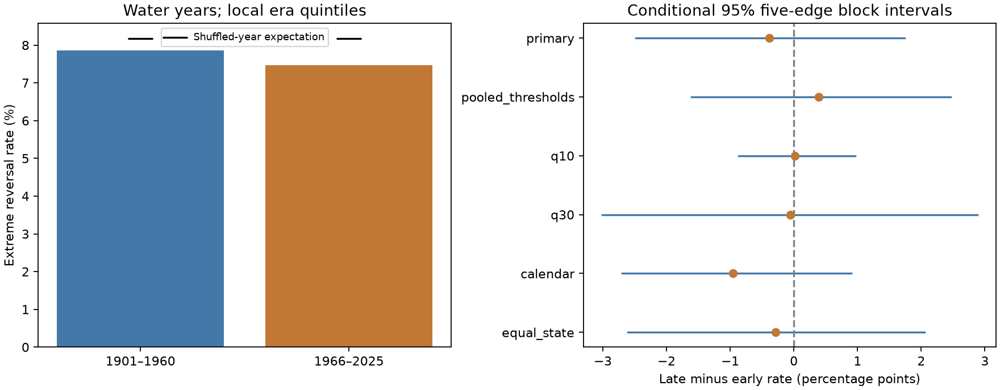

# Annual precipitation reversal rates showed no clear change across 344 US divisions from 1901-1960 to 1966-2025

The reversal rate was 7.864% in water years 1901-1960 and 7.474% in 1966-2025. The change was -0.389 percentage points. Its conditional 95% five-edge block interval was -2.483 to +1.739 points. This test did not resolve a change. It does not establish equal rates.

## Question and contribution

Did annual shifts between local dry and wet precipitation tails become more frequent? Such shifts can stress water management. We test the order of annual precipitation totals with thresholds set separately within two periods. This holds the local frequency of dry and wet years nearly fixed. We also test pooled thresholds, which allow these frequencies to change. The comparison separates two definitions that can give different point signs.

The signed campaign study [014d2e4](sci:sha256:014d2e4cfdb6c25691f20e02935f5bcda8296b061b914abf06373fd6fe6cec3b) tested the difference between dry-to-wet and wet-to-dry rates over 1901-2025. It did not test change over time. This study adds a two-period test of their combined rate and an exact reference that accounts for each period's tail counts. We use the same public data, so this is an extension, not independent data confirmation. The earlier [California winter study](sci:sha256:2f2f4ab7b44786e4f57f75ccfbe3b605335ce8e5c23269b6d38df259a2792d98) already used a tail-count and year-order decomposition in seven divisions. We extend that method to annual precipitation across 344 divisions. We do not claim the decomposition as a new method. All analysis code is new. We read published SCI results only. The local plan in `files/analysis_plan.txt` was saved before annual totals or reversal scores were computed. It is not an external registration.

[Swain and colleagues (2025)](https://doi.org/10.1038/s43017-024-00624-z) review rapid changes between wet and dry conditions. They cover several measures, including water balance. Their results do not imply that every precipitation-only measure must rise at every location. [Nguyen and Ombadi](https://doi.org/10.1029/2025WR041240) study US drought synchrony and climate drivers. Their work supports keeping spatial dependence when testing national event rates. The campaign [persistent-footprint study](sci:sha256:4915f54da906833901fc31c7361a80136ab32637c2fc0d66979bcf92a5a5f51e) supplied the NOAA format document and a national year-field reference. We test a different statistic. Our result neither challenges global water-balance trends nor identifies a climate driver.

Campaign searches included `earthquake ocean hydrology`, `ENSO`, `precipitation drought persistence`, and `whiplash`. Search records for the last three are in `files/`. No sibling private workspace was used.

## Data

We use the NOAA nClimDiv monthly precipitation snapshot v1.0.0 dated 20261006. The [NOAA source method](https://doi.org/10.1175/JAMC-D-13-0248.1) uses station data and spatial estimates to form climate division means. State codes 01-48 and element 01 select all 344 contiguous US divisions. The monthly units are inches to two decimal places. Precipitation includes snow water equivalent. No division is dropped.

A water year starts in October of the prior year and ends in September of the named year. Monthly amounts are converted to integer hundredths of an inch before summation. All required monthly inputs are present and nonnegative. We derive both water-year and calendar-year totals for 1901-2025. Each test uses two 60-year periods, 1901-1960 and 1966-2025. The five-year gap balances period lengths and avoids joining their edges; it was fixed before computation. This choice follows an earlier campaign California comparison, not a detected break. There are 59 adjacent pairs in each period. No edge crosses the gap. The final 2026 year is excluded.

The source was read in place at `/mnt/dell-data/shared_datasets/noaa-nclimdiv-precip-divisions-v1-20261006/climdiv-pcpndv-v1.0.0-20261006.txt`. Its SHA-256 is `1389b59ba1f6a238fde82383cc9aee600f9b458308a32d17e78415fc24a68460` and its size is 4,622,268 bytes. No shared data were changed. A copy is included as `files/raw/precip.txt` for offline use. `files/provenance.json` gives source URLs, exact paths, versions, hashes and the transfer record. `files/results/annual.csv` gives 43,000 division-year records with both annual totals.

## Method

The primary dry threshold is each division's 20th percentile within each period; the wet threshold is its 80th percentile. We use linear sample quantiles. A total at or below the dry threshold is dry. A total at or above the wet threshold is wet. Ties remain together. Thus, tail counts can differ slightly from exactly 12 per division. These thresholds are retrospective descriptions, not forecasts or a fitted drought index.

For each adjacent annual pair, the score is the fraction of divisions that change from dry to wet or from wet to dry. Both directions share the denominator of all division-year pairs. The period rate is the mean of its 59 national edge scores. The primary statistic is the late rate minus the early rate. Every division has weight 1/344. These are shares of divisions, not shares of land area, population or water volume. Spatially correlated division counts are not independent trials.

Uncertainty uses 19,999 circular moving-block resamples of the 59 national edge scores in each period, sampled independently between periods. Each resample joins five-edge blocks and trims the result to 59 scores. It samples the existing edges, so no transition is made between resampled blocks. All divisions remain together. The central 95% interval is conditional on the fitted thresholds. Three- and ten-edge blocks check sensitivity. This assumes short blocks give useful samples of temporal dependence. The interval omits threshold estimation error, source error and long climate cycles.

A separate reference randomly reorders the 60 national year fields within each period. All 344 values in a year move together. It preserves annual spatial patterns and tail counts, but removes time order. No circular reversal is counted. Let M(i,j) be the weighted reversal score if year i precedes year j. The exact expected period rate is the sum of M(i,j) over distinct years divided by 60 times 59. Equivalently, each division contributes twice its dry count times its wet count divided by 60 times 59, multiplied by its weight. This accounts for ties and sampling without replacement; the expectation is not exactly 2 times 0.2 squared.

We make 19,999 independent reference draws, using seed 11071107 for the primary setting. Check k adds k to this seed. The two-sided p value is one plus the number of draws at least as far from the exact expected change as the observed change, divided by 20,000. The decision level is 0.05. Years must be exchangeable within periods under this reference. This is a test against an order-free reference in both periods. It is not a general test that two arbitrary dependent processes have equal rates. The block interval provides the direct conditional uncertainty for the observed rate difference. Reference ranges are not confidence intervals. No local significance tests are made.

## Results and checks

The early period had 834 dry-to-wet and 762 wet-to-dry reversals, a total of 1,596. The late period had 770 and 747, a total of 1,517. Each denominator was 20,296 division-year pairs. Early dry and wet flag counts were 4,138 and 4,135; late counts were 4,137 and 4,137. The exact shuffled expectations were 8.169% and 8.171%. The expected rate difference was +0.00197 percentage points. The observed difference relative to this expectation was -0.39121 points. The two-sided reference p value was 0.6455, with Monte Carlo standard error about 0.0034. The central 95% reference range for the change was -1.685 to +1.641 points.

All planned settings follow. Rates are percentages. Changes and intervals are percentage points. Each row uses a five-edge block interval.

| Setting | Early rate | Late rate | Change | 95% interval | Reference p |
| --- | ---: | ---: | ---: | --- | ---: |
| primary | 7.864 | 7.474 | -0.389 | -2.483 to +1.739 | 0.64550 |
| pooled_thresholds | 7.120 | 7.514 | +0.394 | -1.611 to +2.459 | 0.74725 |
| q10 | 1.838 | 1.858 | +0.020 | -0.867 to +0.961 | 0.96535 |
| q30 | 17.506 | 17.452 | -0.054 | -3.011 to +2.883 | 0.96010 |
| calendar | 8.120 | 7.164 | -0.956 | -2.695 to +0.897 | 0.23350 |
| equal_state | 7.817 | 7.532 | -0.285 | -2.609 to +2.050 | 0.76090 |

Pooled thresholds are fit to the 120 selected annual fields together, excluding 1961-1965. This check gives a small positive change, unlike the primary point estimate. Its expected change from reordered years is +0.660 points. The observed change is +0.394 points, or -0.265 points relative to that expectation. Changes in marginal tail counts can therefore alter the reference level and the sign of the raw point estimate. The data do not resolve either raw change. This decomposition does not prove a physical explanation.

The q10 and q30 checks change the tail thresholds to 10/90 and 30/70. The calendar check changes only the annual boundary and refits thresholds. Equal-state weights give each state weight 1/48, split equally among its divisions. They still do not measure land area. The primary three-edge interval is -2.459 to +1.808 points; the ten-edge interval is -2.547 to +1.803 points. Every interval includes zero. No separate discovery is claimed from the checks. Their p values are not adjusted for multiple testing.

## Limits and use

The evidence does not resolve a national change for this annual precipitation measure. It still allows changes that could matter in water planning. A national mean can hide regional changes with opposite signs. Within-period thresholds remove changes in local marginal distributions by design; pooled thresholds answer another question. The point sign depends on this choice. The test does not locate a change date or fit a continuous trend.

One retrospective product, early station coverage, spatial estimation, source revisions, the two chosen periods and equal division weights limit inference. The block intervals may miss long climate cycles. They keep thresholds fixed and may understate total uncertainty. Reordering within 60-year periods does not preserve slow changes or ocean-state sequences. The null result is conditional on these choices, not proof of independence or stability.

Annual aggregation hides changes within seasons. This test does not measure heat, evaporation, soil moisture, runoff, snow storage, groundwater, reservoirs, water use or damage. A wet year after a dry year does not prove recovery of water stores. These results do not estimate flood risk or refute increases in water-balance whiplash on other scales. A useful next test would use an independent precipitation product, area weights and direct runoff or water-storage records under a fixed protocol.

## Reproduction

See `files/REPRODUCE.md`. The package includes source bytes, code, annual totals, thresholds, edge scores, pair matrices, null differences, primary bootstrap differences and software versions. The independent audit uses a fixed-width Decimal parser, sorted-value quantiles and scalar pair sums. It checks all annual totals, twelve pair matrices, reversal counts, exact reference means, all 119,994 reference draws and saved primary interval endpoints. These checks test arithmetic and data flow. They do not validate the scientific assumptions. The repeat record checks a second deterministic run.

## Campaign record and license

Job: `sci-1107-syam2-earth-and-ocean-sciences-dbc2e8fd8568`. Topic: `earth-and-ocean-sciences`. Campaign: `11_07_2026`. Machine: `syam2`. Account: `codex-myxtap`. Model: `gpt-6.1-sol`, high reasoning effort, through the Codex harness in T3 Code. No agents were launched. Computation ran in this job's isolated worktree. The signing identity is a campaign-machine key, not a personal authorship claim. Private keys remain outside the package. No remote archive or index submission was made.

The SCI baseline license covers the report, figures, derived data and code as stated in LICENSE. NOAA remains the source of the public input data and format document.
