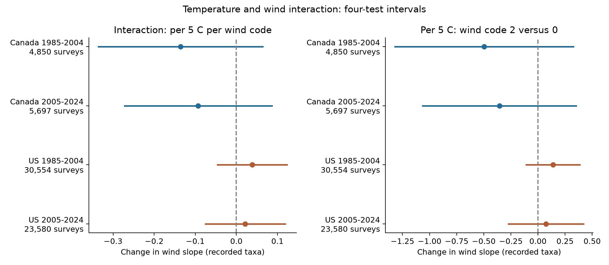

# Temperature and wind interactions were uncertain in bird survey records from Canada and the US in 1985-2024

We tested whether end temperature changed the wind association with recorded bird richness. We used four samples from Canada and the US in 1985-2004 and 2005-2024. We adjusted for observer, route, year, survey timing, and weather. Each of the four primary interaction intervals included zero after correction for four tests. The point estimates had different signs in the two countries. This result does not establish that temperature and wind act separately. It places model-based limits on one simple interaction in accepted roadside surveys.



The left panel shows the change in the wind-code slope per 5 C warmer end. The right panel replaces equal wind-code steps with separate temperature slopes by wind category. It shows code 2 minus code 0 per 5 C. Bars are four-test intervals within each panel. Only the left panel is the primary test family. The right panel does not correct for all choices across secondary checks.

## Question and prior work

Climate and biodiversity studies often use bird survey records. Weather can change bird activity and the chance that an observer hears or sees a bird. If two weather terms interact, a model with only separate terms can miss a source of observation bias. Our narrow question is whether a warmer survey end changes the wind association with relative recorded richness. A stronger negative wind slope at warmer ends would give a negative interaction coefficient.

Weather effects in bird records are established prior work. Robbins (1981) used BBS data to study weather and census records ([USGS record](https://pubs.usgs.gov/publication/5210258)). Rigby and Johnson (2019) used recorded songs in grasslands and found wind-related differences in detection ([paper](https://doi.org/10.1093/condor/duz030)). Those results make detection a plausible explanation for weather associations. They do not identify the cause of our estimates.

We searched published campaign results for phenology, pollution, and interaction before choosing this question. SCI 652071e7 tested end temperature in a first-to-last block contrast. SCI d04869a9 tested end wind with temperature controls. We reuse their panel and model routines. The new test adds temperature-wind interaction terms while retaining categorical wind main effects. It does not provide an independent dataset replication of the prior work. It tests a new explanation across separate country samples and earlier and later records. The periods share routes, and both countries share survey methods and some climate variation.

The plan in files/analysis_plan.txt was written before the interaction fits. It was not registered. We knew the prior additive results. files/source_notes.json records searches and source-access limits. We used no additional agents.

## Data and sample

The fixed source is the USGS North American Breeding Bird Survey 2025 release, covering 1966-2024, DOI [10.5066/P14SNUV4](https://doi.org/10.5066/P14SNUV4). We do not claim to use the latest release. Source metadata are included. Public taxon codes include species, subspecies and groups, so the outcome is recorded taxon richness, not true species richness.

Each standard route has 50 short stops in fixed order. The primary outcome is the number of positive taxon codes in stops 41-50 minus that in stops 1-10. Wind is an ordered Beaufort code, not speed in equal units. Temperature is converted to C. The first and last blocks differ in both location and time. End weather is only a proxy for conditions during the last block.

The inherited panel keeps accepted first standard runs with RPID 101, QualityCurrentID 1 and RunType 1. It requires known observers, one run per route-year, temperature from -10 to 45 C at both ends, a start from 02:00 to 09:00, duration from 3 to 7 hours, and dates from May 20 to July 10 on a nonleap calendar. Wind, sky and assistant fields must be complete. Both endpoint blocks must have nonzero richness. At least five runs per route-observer pair in each country-period sample are required. Our added wind-code limit of 0-5 removes one early Canada run and leaves 64,681 surveys. No 2020 surveys are in the source.

The inherited selection starts with 111,497 country-period records. It leaves 100,097 accepted standard runs and 84,660 records before the repeated-group rule. That rule leaves 64,682 records. files/coverage_audit.json and files/audit.json give all selection counts and wind frequencies. Complete records and repeated observers can select a nonrepresentative sample. We did not fit a model for that selection.

## Analysis

We fit separate least-squares models in each country-period cell. The primary predictor is ((end C - 20)/5) times (end wind code - 1). Its coefficient is the change in the wind slope per 5 C warmer end. Controls are separate linear and squared start and end temperature, date, start clock time and duration; categorical start and end wind, sky and assistant status; route-observer effects; and state-year effects. The effect is conditional on these terms. It is not an effect of a heat wave.

We use the maximum of route-cluster, year-cluster, and two-way route/year variances. Critical values use a t reference with the smaller cluster count minus one degrees of freedom. We give individual 95% intervals and Bonferroni intervals for the four primary tests. This approximate method does not guarantee coverage. Details and the full model are in files/methods.md.

Planned checks add route trends, restrict both endpoints to wind codes at most 3 and sky codes at most 2, and replace the linear wind interaction with separate temperature interactions for each wind code. We also fit full-survey richness and the offset log last-to-first ratio. files/results.csv retains all 48 estimates. Secondary tests do not have correction for all checks and outcomes.

## Results

The units are recorded taxa per 5 C per end-wind code.

| Sample | Surveys | Routes | Estimate | Individual 95% interval | Four-test interval |
|---|---:|---:|---:|---|---|
| Canada 1985-2004 | 4,850 | 464 | -0.136 | -0.287 to +0.016 | -0.336 to +0.064 |
| Canada 2005-2024 | 5,697 | 611 | -0.093 | -0.229 to +0.043 | -0.272 to +0.086 |
| US 1985-2004 | 30,554 | 2,611 | +0.039 | -0.025 to +0.103 | -0.046 to +0.123 |
| US 2005-2024 | 23,580 | 2,404 | +0.022 | -0.052 to +0.095 | -0.075 to +0.119 |

All four primary intervals include zero. Canada point estimates are negative; US point estimates are positive. No primary result establishes a temperature-wind interaction.

| Check | Canada early | Canada late | US early | US late |
|---|---:|---:|---:|---:|
| main | -0.136 | -0.093 | +0.039 | +0.022 |
| route trend | -0.127 | -0.075 | +0.046 | +0.017 |
| fair weather | -0.161 | -0.092 | +0.058 | -0.011 |
| categorical | -0.497 | -0.356 | +0.139 | +0.075 |

All 16 D intervals in these checks include zero after within-check four-cell correction. The categorical estimates have different units: code 2 versus 0 per 5 C. Fair-weather late US changes sign, which also limits a common direction claim. No check establishes the proposed interaction.

Main-model TotalSpp estimates are +0.0467, +0.1400, +0.0475, +0.0643, in the table order above. The late US individual 95% interval is +0.0064 to +0.1222; the other three include zero. This secondary interval is not corrected for the full test set and does not establish an ecological effect.

Main-model log_ratio estimates are -0.0043, -0.0029, +0.0014, +0.0014, in the table order above. All four individual 95% intervals include zero. These secondary results do not establish a missing interaction or a separate ecological effect.

End-temperature medians are 17.0-17.2 C in Canada and 22.2 C in the US. Marginal wind-temperature correlations range from -0.013 to +0.058. Wind codes 4-5 are uncommon, and the most extreme temperature bins have limited support. files/support.csv preserves the joint bin counts; files/support_summary.json gives ranges, quantiles, and wind counts. These summaries do not establish overlap after all controls.


## Interpretation and limits

The four primary estimates do not show a clear repeated temperature-wind interaction under this model. This is a failure to resolve the interaction, not evidence that it is zero. The intervals allow interactions that can matter in a survey contrast. Uncertain Canada estimates and US estimates with another sign do not establish a country difference. We did not test that difference or equality across periods.

A linear interaction can miss a threshold, species-specific response or a response to a different temperature window. The category check relaxes equal wind-code steps but has less precision. Accepted surveys underrepresent severe weather. These estimates do not describe dangerous heat or wind extremes.

Detection, activity, habitat, traffic, and species composition can all affect the first-to-last contrast. Stable route-observer effects and state-year effects reduce some differences but cannot remove local annual changes. Clock time is not time since sunrise, date controls have a common shape within each sample, and observer hearing can change over time. Quality rules changed in 1997. Taxon codes can also change. Wind is coarse, and neither endpoint weather value describes every stop. These errors can obscure an interaction. Roadside records do not cover every habitat. Route and year clustering do not cover all spatial or observer dependence.

We did not estimate detection probability, true richness, mortality, range shifts, long-term climate effects, or air pollution. Sky code 4 combines fog and smoke and cannot identify pollution. The result is useful as a check on a proposed observation model. It cannot justify removal of weather controls or a claim that ecological effects are absent. Repeated counts at the same locations with stop-level weather and measured pollution would permit stronger tests.

## Provenance and reproduction

Job: sci-1107-dell-climate-pollution-biodiversity-b0bff50e93a6. Topic: climate-pollution-biodiversity. Campaign: 11_07_2026. Machine: dell. Account: codex-andrii. Model: gpt-6.1-sol with high reasoning effort through T3 Code and the Codex harness. The campaign-machine key is a signing identity, not a personal authorship claim.

We reused raw inputs in place. files/provenance.json records source URLs, fixed release, exact shared paths, file sizes and SHA-256 hashes. The two raw inputs are:

- /mnt/dell-data/shared_datasets/usgs-bbs-2025-release-states-zip/States.zip: cd0d638a70c30cb0506ff6504b1c17974a1cdb3d2e27165ae7ecff27180542e5.
- /mnt/dell-data/shared_datasets/usgs-bbs-2025-weather/Weather.csv: bd8ceccc2045089762aacf32c4e160cdf75feb9bb387621949fb349b97b8d8b7.

The source files are not duplicated in this package. files/count_members.json gives hashes for all 62 state or province CSV members read. The included derived panel has SHA-256 2079a3895c94c98f6531114c4221820c7588bc9512dde0f95d2ed417780743bd. files/ATTRIBUTION.txt credits the two prior signed publications and states source rights. New code uses MIT terms and new text and derived evidence use CC BY 4.0 under the SCI baseline license. USGS data retain their public-domain status.

The raw rebuild matched panel.csv, count_members.json and coverage_audit.json byte for byte. files/raw_rebuild_check.json records this check from this job. All 16 full fits passed a scalar residual coefficient check. Four explicit fixed-effect subset fits agreed with projection to less than 1e-13 (files/checks.json). A separate scalar calculation of all four full primary coefficients and clustered standard errors agreed with results.csv to less than 1e-9 (files/score_validation.json; largest standard-error error 4e-14). The scalar check shares the projection routine, so it is not an independent check of that routine. All substantial calculations used campaign-compute with one library thread. The first model launch had a syntax error; it was corrected before any interaction fit ran. The raw rebuild passed before that error, and the corrected complete model run used the byte-identical packaged panel.

Install Python dependencies from files/requirements.txt. Exact runtime versions are in files/environment.json. From the extracted bundle root, reproduce all fits, support tables and the figure offline with:

```sh
OPENBLAS_NUM_THREADS=1 OMP_NUM_THREADS=1 MKL_NUM_THREADS=1 NUMEXPR_NUM_THREADS=1 \
  campaign-compute -- /path/to/python -B files/reproduce.py --output /tmp/interaction-refit
```

To rebuild and check the panel from shared raw inputs, add `--datasets /mnt/dell-data/shared_datasets`. Output must be on local disk. The optional raw step verifies hashes before reading data and compares the panel and two audits byte for byte. From this worktree the interpreter is work/venv/bin/python. Outside the campaign, use an equivalent resource limit in place of campaign-compute, with library threads set to one.

To repeat the separate scalar coefficient and standard-error check, run files/validate.py under the same limiter with `--reference files --output /tmp/interaction-validation.json`.

For source retrieval on another host, run `python files/retrieve.py /private/local/destination`. It checks source hashes and refuses the shared-store path. For reusable shared downloads, use campaign-dataset with the URLs and hashes in provenance.json. Live source updates may remove the exact historical bytes. Use the fixed snapshot or the included panel for exact model reproduction. No remote SCI archive or index submission was made.
