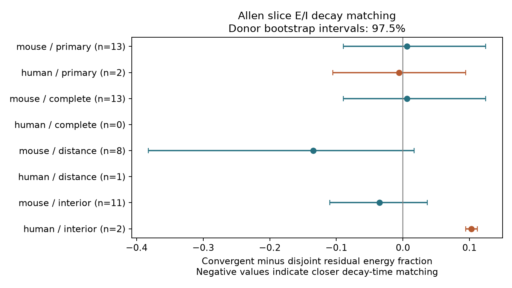

# Matched Allen slice data leave decay-time matching between convergent excitatory and inhibitory inputs uncertain

## Result

This test did not resolve closer voltage-response decay times between excitatory (E) and inhibitory (I) connections onto the same neuron. The primary mouse visual cortex sample had 13 inferred donors. The estimated difference in a decay mismatch score was 0.0061, with a nominal 97.5% donor bootstrap interval from -0.0896 to 0.1242. Negative differences mean closer matching at a shared target. The primary human temporal cortex sample had only two inferred donors. Its difference was -0.0056. These results do not show that target sharing has no effect.

The useful output is a matched circuit test and its evidence tables. This test puts a measured limit on what this release can show about a cross-type timing rule. It links the circuit and response through the same recorded cell IDs. It does not link separate animals or data sources.



The figure shows differences and nominal 97.5% percentile intervals. Rows with fewer than two donors have no interval or point in the figure. The human intervals with two donors have very low resolution. Sensitivity intervals are descriptive and have no joint coverage claim.

## Question and prior work

Does a shared target have E and I inputs with closer decay times than comparable inputs to different targets? A common target could impose a common membrane filter. Different receptors and input locations could oppose this effect. A positive result could help to constrain models of temporal balance.

Campagnola, Seeman, and colleagues (2022, doi:10.1126/science.abj5861) reported local connectivity and response properties in mouse and human cortex. Their work showed that cell identity is related to response properties. The Allen schema defines PSP decay tau as the decay time constant from an average postsynaptic potential. These sources motivate exact cell-label controls. The schema also states that average response fits can come from current clamp or voltage clamp and different holding potentials. Thus, a comparison of these scalar times is not a direct measure of simultaneous E/I cancellation.

Before the precise question was selected, campaign searches covered "connectivity", "cancellation", "shared cell", and "kinetics". We read the published result sha256:ea126e6a11065e9fbcd14983df1d8d6ba9f48953e7c51cff3a9eeba18573117b. That study found no corrected timing similarity within same-type strata. This work uses its general shared-versus-disjoint comparison and inferred donor convention as design precedents. It adds cross-type E/I convergence and a bounded decay mismatch score. It uses new extraction and analysis code. It does not reuse that publication's data tables or claim that a shared membrane filter is a new hypothesis. No sibling private workspace was read.

## Data

The only shared raw file used is:

/mnt/dell-data/shared_datasets/allen_synphys/r2.1_small_2023-01-26/synphys_r2.1_small.sqlite

Its worktree path is ./datasets/allen_synphys/r2.1_small_2023-01-26/synphys_r2.1_small.sqlite. Source: https://allen-synphys.s3-us-west-2.amazonaws.com/synphys_r2.1_small.sqlite . Version: Allen Synaptic Physiology r2.1 small, schema 22. S3 Last-Modified: 2023-01-26. File size: 176771072 bytes. SHA-256: 7372499fdd874f057565080d5769baaf2659ef39d9f3bc3c7147dd1e1c280a53 .

The analysis checks that hash and opens SQLite in read-only mode. No data were downloaded or changed. The SQL joins the monosynaptic synapse, pair, cell, experiment, and slice tables. It requires pair.has_synapse=1. It uses scalar PSP decay estimates, not pulse-train arrays. The extracted table has 3297 detected connections. There are 2781 mouse VisP connections, of which 2000 have positive decay tau, and 394 human TCx connections, of which 284 have positive decay tau. Other regions are excluded. This selection was fixed before effect scores were computed.

These are small multipatch slice circuits. They are not complete anatomical connectomes. VisP and TCx are not matched brain regions. No species difference is tested. There is no matched behavior or intact-brain activity in this analysis.

## Score and assumptions

For two ideal decay tails, let E(t)=exp(-t/te) and I(t)=a exp(-t/ti), for t at least zero. Choose a to minimize the integrated squared residual E-I. The best a is 2te/(te+ti). The residual energy divided by the E-tail energy is:

R = 1 - 4te ti/(te+ti)^2 = tanh(ln(te/ti)/2)^2.

This follows from integrating E squared, I squared, and their product over time. It is zero for equal decay times, approaches one for large time ratios, and is symmetric in te and ti. It is a bounded measure of decay mismatch. It assumes linear addition, ideal exponential tails, equal onset times, and free amplitude adjustment. It omits rise times, delays, conductance changes, reversal potentials, and active membrane effects. It is not measured cancellation energy. Different holding potentials in the source data further limit that interpretation.

The primary endpoint is the convergent mean R minus the disjoint mean R. The secondary descriptive endpoint is the mean absolute natural log decay ratio. No other response timing endpoint is tested. files/design.txt records the primary design before score computation.

## Matching and inference

For each experiment, we form E/I edge pairs. A convergent pair has the same target and two different sources. A disjoint pair has four different cells. Chains and reciprocal pairs do not enter either role.

A stratum fixes the experiment and three cell-label triples: E source, I source, and target. A triple contains nonsynaptic cell class, Cre label, and target layer. Both targets must have the same triple. Missing labels form an explicit category. Source triples can differ between E and I. Each retained stratum must contain both a convergent pair and a disjoint pair. Thus, each comparison fixes the recording and the observed cell labels on all edges. It does not fix hidden types, dendritic locations, response amplitudes, or fit errors.

We average R within each role and stratum, then average strata within an experiment. We average experiments within an inferred donor, and give donors equal weight. Thus, heavily sampled donors do not get more total weight. Edges can occur in several pairs. Pair counts are not independent sample sizes.

Mouse donor groups use a six-digit identifier in the slice specimen name. Human groups use the first three H-prefixed name fields. The fallback is the slice ID. These are inferred groups, not verified donor identifiers. Selected primary names are in selection_audit.json; extracted rows preserve all names.

We resample whole donor contrast values 9999 times, with seed 51468. Primary intervals use percentiles 1.25 and 98.75 to allow a nominal Bonferroni family level of 95% for two samples. This nominal level depends on bootstrap assumptions. It is not a finite-sample coverage guarantee, especially with only two human donors. We report no p-values or equivalence tests. The intervals condition on selection, fit estimates, and the inferred donor grouping. They do not include fit uncertainty or missing-data uncertainty.

## Results

| Sample and check | Donors | Experiments | Strata | Convergent / disjoint pairs | Difference in R | Nominal 97.5% interval |
|---|---:|---:|---:|---:|---:|---|
| Mouse primary | 13 | 13 | 16 | 21 / 24 | 0.0061 | -0.0896 to 0.1242 |
| Human primary | 2 | 3 | 4 | 7 / 14 | -0.0056 | -0.1054 to 0.0943 |
| Mouse complete target labels | 13 | 13 | 16 | 21 / 24 | 0.0061 | -0.0896 to 0.1242 |
| Human complete target labels | 0 | 0 | 0 | 0 / 0 | unavailable | unavailable |
| Mouse distance bins | 8 | 8 | 9 | 10 / 12 | -0.1350 | -0.3821 to 0.0167 |
| Human distance bins | 1 | 1 | 2 | 2 / 5 | 0.3174 | unavailable |
| Mouse interior tau | 11 | 11 | 13 | 16 / 20 | -0.0354 | -0.1096 to 0.0364 |
| Human interior tau | 2 | 3 | 3 | 6 / 5 | 0.1030 | 0.0943 to 0.1117 |

The primary means of R were 0.2503 and 0.2442 for mouse convergent and disjoint pairs. They were 0.5305 and 0.5360 for the human pairs. The primary mean absolute log gaps were 1.0969 versus 1.1176 in mouse and 1.9452 versus 1.9316 in human. These scores do not indicate a clear shared-target benefit.

Primary mouse results use 54 distinct edges, with 11 onto cells labeled ex and 43 onto cells labeled in. Primary human results use 21 edges; all have a missing nonsynaptic target class. Removal of one donor at a time gives a difference range from -0.0343 to 0.0274 in mouse and -0.1054 to 0.0943 in human. These sign changes limit a broad conclusion.

The complete-label check removes missing, blank, or unknown target class or layer. It changes no mouse result and removes the entire human comparison. It does not require complete source labels or a known Cre driver.

The distance check requires each source-target cell-body distance to lie from zero to 500 micrometres. It adds separate 100-micrometre distance bins for the E and I edges to each stratum. The mouse point estimate favors convergence, but its interval includes zero. It uses a different subset. It does not isolate the cause of the difference from the primary result. The one-donor human result has no donor interval.

After primary scores were computed, inspection found selected tau values near 0.005 and 0.5 seconds. The exploratory interior check keeps tau strictly above 0.00501 and below 0.499 seconds, and rebuilds the matching. This is an endpoint sensitivity check, not a verified fit-quality filter. It leaves the mouse result uncertain. In human data it gives a positive difference in both donors, but only two donors remain. The narrow empirical interval is not strong population evidence. This sensitivity does not support a general cross-animal rule.

## Limits and next use

The strict match selects only a small part of the source data. Missing fits, slice axon loss, recording choices, and strong-connection selection can change the measured graph. Shared electrodes and fit procedures can create target effects. Exact label matches leave distance variation within a bin and hidden cell types. Fit quality, membrane state, temperature, and synapse location can affect decay estimates. The endpoint check shows sensitivity to the selected estimates.

This work does not establish temporal balance, reliability of a representation, a causal membrane mechanism, or generalization across regions and behavior. It also does not establish the absence of a target effect. A larger test needs registered donor IDs, complete cell labels, uncertainty on response fits, and a common membrane-state protocol. The present code and tables can define that comparison without treating all edge pairs as independent observations.

## Inspection and reproduction

The package includes source code, extracted edge records, every retained motif pair, per-experiment evidence, results, a figure, an environment record, and the raw-file provenance. It excludes the large raw database and upstream software. The SCI manifest hashes all included files. The baseline license applies to the new work to the extent the source terms allow; it does not replace the Allen Institute data terms at https://alleninstitute.org/legal/terms-use/ . Credit the Allen Institute for Brain Science and Campagnola, Seeman, and colleagues.

Use Python 3.12.16, NumPy 2.5.4, and Matplotlib 3.11.2. The environment JSON records the actual run. requirements.txt gives package versions from pip. From the unpacked bundle, with these dependencies available:

```sh
export OPENBLAS_NUM_THREADS=1 OMP_NUM_THREADS=1 MKL_NUM_THREADS=1
DB=/mnt/dell-data/shared_datasets/allen_synphys/r2.1_small_2023-01-26/synphys_r2.1_small.sqlite
campaign-compute -- python3 files/analyze.py --db "$DB" --out reproduced
campaign-compute -- python3 files/check_evidence.py
```

The checker uses the bundled evidence and needs only NumPy. It checks motif identities, score algebra, experiment and donor means, sample counts, and the tail formula by numerical integration. All checks passed. A full rerun from the bundled edge table produced an identical results.json. It does not validate the source fits or the selection model. To rerun without SQLite, use the bundled extracted records:

```sh
campaign-compute -- python3 files/analyze.py --edges files/evidence/edges.json --out reproduced_from_edges
```

If the shared raw file is absent, retrieve its exact bytes through the campaign helper. Do not create a replacement folder at an unavailable shared mount.

```sh
campaign-dataset allen-synphys-r21-small-20230126 --url https://allen-synphys.s3-us-west-2.amazonaws.com/synphys_r2.1_small.sqlite --filename synphys_r2.1_small.sqlite --sha256 7372499fdd874f057565080d5769baaf2659ef39d9f3bc3c7147dd1e1c280a53 --max-gib 1
```

All substantial computations used campaign-compute and one library thread. Output folders must be on local disk, outside the shared data store. Each analysis run took seconds after a compute slot was available.

## Job record

Job: sci-1107-dell-neural-structure-and-computation-051f46a8148a. Topic: neural-structure-and-computation. Campaign: 11_07_2026. Machine: dell. Account: codex-andrii. Model: gpt-6.1-sol, high reasoning effort, through the Codex harness in T3 Code. No child agents were used. The campaign-machine key is not a personal authorship claim. The signed bundle is stored in the local campaign only.
