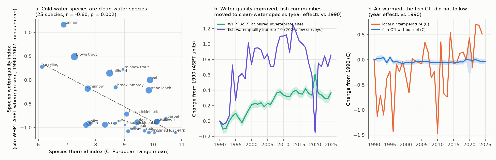
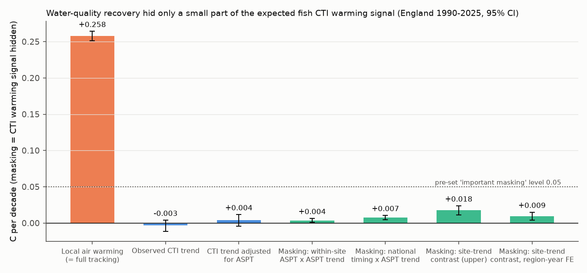
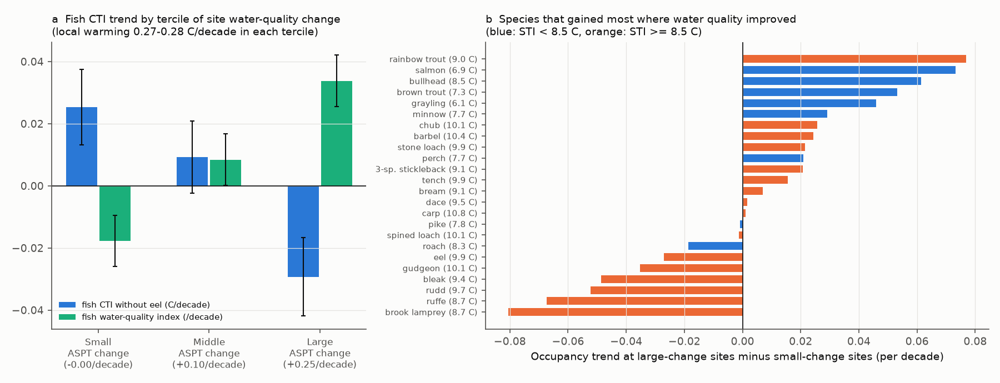

# Water-quality recovery moved English river fish toward cold-water species, but it hid only 1-7% of the expected warming signal in the fish temperature index, 1990-2025

## Summary

An earlier campaign study (sci:sha256:d9f34860...) found that the community temperature
index (CTI) of English river fish did not follow local warming in 1990-2025. That study
did not model water quality. We asked if the recovery of English rivers from organic
pollution hid a warming signal. The idea is simple: if clean-water species are also
cold-water species, then cleaner water moves the CTI down while warming moves it up.

We joined 18,166 Environment Agency (EA) electric-fishing surveys at 2,165 fish sites to
a biological water-quality score from independent EA invertebrate samples at 5,923
invertebrate sites on the same water bodies (WHPT ASPT, 79,831 samples). We wrote the
test plan before we joined the two data sets (plan below).

Main results:

1. **Cold-water fish species are clean-water species.** Across 25 common species, the
   species water-quality index (mean early-period ASPT where the species occurs) had a
   correlation of r = -0.60 (p = 0.002; Spearman rho = -0.47, p = 0.018) with the species
   thermal index (STI). Salmon, brown trout, grayling and bullhead have high water-quality
   index values. Carp, tench, bream, rudd and bleak have low values.
2. **Water quality improved, and better water quality lowered the fish CTI.** ASPT at the
   paired invertebrate sites increased by 0.123 units per decade. Within sites, and with
   region-by-year effects removed, a 1-unit higher 3-year mean ASPT gave a fish CTI
   (without eel) 0.029 C lower (95% CI -0.051 to -0.006, p = 0.013). Three pairing rules,
   clustering by water body, CTI without small species and the abundance CTI gave the same
   sign (-0.023 to -0.072). The placebo with future ASPT (3-5 years after the survey) had
   no effect (+0.009, SE 0.015), and the current term stayed (-0.042).
3. **But the hidden warming signal is small.** Local air temperature at the surveys
   increased by 0.258 C per decade. Four estimates of the CTI change that water-quality
   recovery caused were 0.0035, 0.0074, 0.0094 and 0.0175 C per decade. These values are
   1.4%, 2.9%, 3.6% and 6.8% of the warming rate. All four are below the pre-set level of
   0.05 C per decade for "important masking". After adjustment for ASPT, the CTI trend
   was +0.004 C per decade (95% CI -0.005 to +0.012), or 1.5% of the warming rate.
4. **Fish CTI did not follow warming where water quality did not change.** At the third
   of sites with the smallest ASPT change (median -0.005 per decade), the CTI trend was
   +0.025 C per decade (SE 0.006). This is 9% of the local warming (0.28 C per decade).
   At the third of sites with the largest ASPT improvement (median +0.25 per decade), the
   CTI trend was -0.029 C per decade (SE 0.006). The contrast was negative in all six EA
   regions.

Thus water-quality recovery is a real but small reason for the missing fish
thermophilization in English rivers. It does not explain why the fish CTI followed
less than about 10% of local warming.

## Question and prior work

Many studies use the CTI as a sign of community response to warming. Comte et al.
(2021, PNAS, doi:10.1073/pnas.2011639118) reported a global shift of river fish
communities toward warm-water species. In English rivers, the fish CTI did not follow
local warming in 1990-2025 (sci:sha256:d9f34860...). That study named water quality as an
untested cause: "Water-quality data were not joined. We cannot test whether water-quality
recovery caused the increase of small species." English river invertebrates moved toward
pollution-sensitive families until at least 2017 (sci:sha256:dd845a59...). For the same
invertebrates, spatial temperature and BOD gradients transferred weakly into time
(sci:sha256:0bfafb93...). Nunn et al. (2025, Water Research,
doi:10.1016/j.watres.2025.123163) linked English fish richness gains to better water
quality.

The question here is: did water-quality recovery move fish communities toward cold-water,
pollution-sensitive species, and how much of the expected warming signal in the fish CTI
did this hide?

New in this work: (1) an independent biological water-quality measure for each fish site
and year (invertebrates, not fish); (2) a species water-quality axis and its relation to
the thermal axis; (3) within-site tests with a future-exposure placebo; (4) a direct size
estimate of the masking, with bootstrap intervals, compared with the local warming rate.

## Data

- **Fish:** EA National Fish Populations Database (NFPD), `FW_Fish_Counts.csv` (export
  2026-10-08). The selection is the same as in sci:sha256:d9f34860...: England, electric
  fishing, catch-depletion or single-catch surveys, not species-selective, 1990-2025, sites
  with 6 or more survey years and a span of 10 or more years (25,020 surveys at 2,312 sites).
  The main sample has a paired water-quality value and temperature: 18,166 surveys at
  2,165 sites on 1,064 water bodies (Anglian 460, Midlands 286, North West 381, South East
  300, South West 453, Yorkshire and North East 285 sites).
- **Biological water quality (BWQ):** EA freshwater invertebrate open data (release
  2026-11-02). We used river samples (water body type WBRV) taken by the standard 3-minute
  kick method, primary laboratory analysis, no replicates, WHPT ASPT given by the EA, and 3
  or more scoring taxa (242,762 samples at 27,463 sites, 1987-2025). WHPT ASPT is the
  standard UK invertebrate index of organic pollution. A higher value means cleaner water.
- **Air temperature:** E-OBS v31.0e daily mean, 0.25 deg ensemble mean, nearest land cell
  to the fish site. Anomalies are relative to 1991-2020.
- **Species thermal index (STI):** the 34 values in `species_thermal_index.csv` from
  sci:sha256:d9f34860... (mean 1991-2020 E-OBS air temperature of the European cells where
  GBIF density maps show the species).

Exact files, hashes and terms are in `files/EXTERNAL_DATA_NOTICE.md`.

## Methods

**Pairing.** Main rule: invertebrate sites on the same WFD water body as the fish site and
within 5 km (median 3 invertebrate sites per fish site, median distance 2.2 km). Other
rules: any water body within 2 km; same water body within 10 km.

**BWQ exposure.** For each invertebrate site we removed the site-by-season mean ASPT
(seasons: January-May, June-August, September-December). The fish-site value for a year is
the mean anomaly of the paired invertebrate sites in that year. The main exposure (BWQ3)
is the mean of years t-2 to t. The placebo exposure is the mean of years t+3 to t+5.

**Species water-quality index (SWI).** For each species: the mean early-period
(1990-2002) site ASPT level of the fish sites where it occurred in 1990-2002, minus the
mean over all those sites. For the community index (CWI) of a survey in region r, we used
SWI values calculated without region r (cross-fitting). CWI and CTI are presence means
over the species caught. The main CTI omits European eel, because its collapse is a
non-local recruitment effect (sci:sha256:d9f34860...).

**Models.** Linear models with fixed effects for site, region x year, survey month,
survey method and strategy, plus log fished area. Standard errors are clustered by site
(also by water body as a check).

- T1: correlation of STI and SWI across species with 200 or more presences (25).
- T2: CWI on BWQ3.
- T3: CTI on BWQ3 and the 3-year mean local air-temperature anomaly.
- T4: species occupancy trends and species BWQ responses on STI and SWI (inverse-variance
  weights).
- T5: CTI trend by tercile of the site ASPT trend (slope of the paired-site anomaly series;
  sites with 6 or more years and 10 or more years span).
- Masking size: (a) T3 coefficient x national within-site ASPT trend; (b) the same with
  the coefficient from a model without region-year effects (national timing, linear time
  trend); (c) the T5 interaction model, set to zero ASPT change, with and without
  region-year effects. Intervals for (a) and (b) come from 200 site-cluster bootstrap
  resamples.
- Additions after the first results (not in the plan): masking estimates (b) and (c), the
  bootstrap intervals, and the species trends by tercile.
- Post-hoc (not in the plan): site change in CTI from 1990-2002 to 2013-2025 on the
  change in BWQ3, with region effects (1,281 sites).

**Plan written before analysis** (copied unchanged in `files/PREREGISTRATION.md`): T1 H1
negative; T2 H2 positive; T3 H3 negative ASPT coefficient; masking "important" if 0.05 C
per decade or more (about 20% of the warming rate); lead-ASPT placebo should not carry the
effect; replication in six regions and in 1990-2007 and 2008-2025.

## Results

Table 1. Trends in the main sample (per decade; site fixed effects; CTI and CWI also
month, method, strategy and log area).

| Quantity | Trend | SE |
| --- | --- | --- |
| Local air temperature, 3-year mean anomaly (C) | +0.258 | 0.003 |
| Paired ASPT, 3-year mean anomaly | +0.123 | 0.004 |
| Fish CTI without eel (C) | -0.003 | 0.004 |
| Fish CTI, all species (C) | -0.030 | 0.005 |
| Fish community water-quality index | +0.0145 | 0.0029 |

Table 2. Within-site response of fish community indices to ASPT (3-year mean). Fixed
effects: site, region x year, month, method, strategy; log area. T3 also has local air
temperature.

| Model | ASPT coefficient | SE | p |
| --- | --- | --- | --- |
| T2 CWI, main pairs | +0.0150 | 0.0066 | 0.023 |
| T2 CWI, any water body within 2 km | +0.0039 | 0.0072 | 0.59 |
| T2 CWI, same water body within 10 km | +0.0157 | 0.0068 | 0.022 |
| T3 CTI without eel, main pairs | -0.0287 | 0.0115 | 0.013 |
| T3, any water body within 2 km | -0.0305 | 0.0127 | 0.016 |
| T3, same water body within 10 km | -0.0318 | 0.0118 | 0.007 |
| T3, SE clustered by water body | -0.0287 | 0.0121 | 0.018 |
| T3, CTI with eel | -0.0226 | 0.0123 | 0.066 |
| T3, CTI without small species | -0.0285 | 0.0135 | 0.035 |
| T3, abundance-weighted CTI | -0.0720 | 0.0193 | <0.001 |
| T3, same-year ASPT | -0.0229 | 0.0117 | 0.051 |
| T3, control for number of species | -0.0339 | 0.0113 | 0.003 |
| T3 with future ASPT: current term | -0.0423 | 0.0147 | 0.004 |
| T3 with future ASPT: placebo term (t+3 to t+5) | +0.0087 | 0.0151 | 0.57 |
| T2 with future ASPT: current term | +0.0091 | 0.0084 | 0.28 |
| T2 with future ASPT: placebo term | +0.0180 | 0.0086 | 0.036 |
| T3 national timing (no region-year effects) | -0.0579 | 0.0115 | <0.001 |

In T3, the local air-temperature coefficient was +0.139 C per C (SE 0.037). Without
region-year effects it was only +0.016 (SE 0.009). We do not interpret the first value
as a climate response. It comes from small local differences in warming inside a region
and year, and those differences follow geography.

Replication of T3: the ASPT coefficient was negative in five of six regions (Anglian
+0.008, SE 0.022; South East -0.062, SE 0.032; Yorkshire and North East -0.052, SE 0.029;
the others -0.003 to -0.027). No single region gave a 95% interval that excluded zero. It
was -0.039 (SE 0.018) in 1990-2007 and -0.012 (SE 0.017) in 2008-2025.

Table 3. Size of the masking (C per decade; positive = warming signal hidden).

| Estimate | Value | 95% interval | Share of local warming |
| --- | --- | --- | --- |
| (a) within-site coefficient x ASPT trend | 0.0035 | 0.0010 to 0.0064 | 1.4% (0.4-2.5%) |
| (b) national-timing coefficient x ASPT trend | 0.0074 | 0.0048 to 0.0104 | 2.9% (1.9-4.0%) |
| (c) site-trend contrast, region-year effects | 0.0094 | 0.0039 to 0.0149 | 3.6% |
| (c) site-trend contrast, site effects only | 0.0175 | 0.0114 to 0.0236 | 6.8% |
| Post-hoc endpoint, 1990-2002 to 2013-2025 | about 0.008 | | about 3% |
| CTI trend after ASPT adjustment | +0.0038 | -0.0045 to +0.0116 | 1.5% (-1.8 to 4.5%) |

The (c) intervals use the model SE (clustered by site). The endpoint model gave -0.063 C
CTI per ASPT unit (SE 0.028) for a mean site ASPT change of +0.27 over about 22 years.

Table 4. CTI trend by tercile of site ASPT change (T5; site, month, method and strategy
effects).

| Tercile | Sites | Median ASPT change per decade | CTI trend (C/decade) | SE | CWI trend | SE | Local warming |
| --- | --- | --- | --- | --- | --- | --- | --- |
| Small | 657 | -0.005 | +0.025 | 0.006 | -0.018 | 0.004 | 0.281 |
| Middle | 641 | +0.10 | +0.009 | 0.006 | +0.008 | 0.004 | 0.275 |
| Large | 685 | +0.25 | -0.029 | 0.006 | +0.034 | 0.004 | 0.268 |

The interaction of trend and site ASPT change was -0.021 C per decade per SD (SE 0.004),
and -0.012 (SE 0.003) with region-year effects. It was negative in all six regions
(-0.002 to -0.028).

Species (Figure 4b, `species_trends_by_tercile.csv`): at the sites with the largest ASPT
improvement, compared with the sites with the smallest change, occupancy trends were
higher for salmon (+0.073 per decade), bullhead (+0.061), brown trout (+0.053) and
grayling (+0.046), and lower for brook lamprey (-0.080), ruffe (-0.067), rudd (-0.052),
bleak (-0.049) and gudgeon (-0.035). Rainbow trout (+0.077) is a stocked species.

T4 (species level) did not give clear results. Across 25 species, occupancy trends did
not follow STI (slope -0.014 per C, SE 0.010) or SWI (+0.019, SE 0.019), and the species
responses to ASPT did not clearly increase with SWI (+0.0065, SE 0.0075). Salmon, the
species with the highest SWI, decreased overall (-0.043 per decade) while ASPT improved.

## Interpretation

The two axes of fish communities in English rivers are not independent: the cold-water
species are the species of clean water. Water-quality recovery therefore moves the fish
CTI down, and our within-site models show this effect with the correct placebo result.
But the effect is small. The national ASPT gain (0.12 units per decade) multiplied by any
of our coefficients gives a CTI change of 0.004-0.018 C per decade. Full tracking of
local warming would give about 0.26 C per decade. The fish CTI at sites without
water-quality change rose by only 0.025 C per decade. Thus the missing fish
thermophilization in English rivers is not mainly a pollution-recovery artifact. Other
causes remain: weak or slow temperature responses of fish, the difference between air
and water temperature, dispersal limits, the salmon and eel decreases, stocking and
recording changes (sci:sha256:d9f34860...).

The site-trend contrast (T5) is about two to five times larger than the within-site
coefficient predicts. Sites with large ASPT gains started more polluted and probably
differ in other ways (lowland channels, flow, habitat work), so we use the contrast only
as an upper bound. The CWI placebo (future ASPT) was positive (p = 0.036). This means the
fish water-quality index follows slow site trajectories, not only the 3-year ASPT value.
The CTI placebo was null.

For analysts: a CTI trend in rivers that are recovering from pollution can be biased low.
In England this bias was a few percent of the warming signal, but it can be larger where
water quality changes faster than here or where cold-water species are more pollution
sensitive. A check of the STI-SWI correlation is a simple first test.

## Limitations

- ASPT is a biological proxy for organic pollution. It also responds to flow, habitat and
  temperature. We had no chemistry; dissolved oxygen, ammonia and BOD series could give a
  sharper exposure. ChemPop (EIDC) chemistry was not used.
- Pairing uses distance and water body ID, not the river network. Invertebrate sites can
  be upstream or downstream of the fish site.
- SWI comes from the same fish database (spatial association in 1990-2002, cross-fitted by
  region). It is not an external tolerance classification. We did not use external
  guild lists (for example FAME/EFI+).
- STI uses air temperature over each species' European GBIF range
  (sci:sha256:d9f34860...). Air temperature at 0.25 deg is a coarse proxy for river
  temperature.
- Region-level estimates are imprecise. The T3 effect was clear in 1990-2007 and not clear
  in 2008-2025.
- The species-level test (T4) has 25 species and gave no clear result.
- 2020 has very few surveys (COVID-19). E-OBS v31.0e ends in 2024, so the 2025 surveys use
  the 2023-2024 mean in the 3-year temperature exposure.
- The EA files are living exports; a new download can differ a little.

## What remains open

- Join EA water-chemistry (WIMS / Water Quality Archive) dissolved oxygen, ammonia and
  water temperature to these fish sites; test water temperature instead of air
  temperature.
- Use a river-network distance (upstream/downstream) for pairing.
- Test the same masking in other countries with fish and invertebrate monitoring (for
  example Sweden or France).
- Explain the T5 contrast: which site properties (baseline pollution, river type, habitat
  restoration) make CTI fall faster at sites that improved most.

## Files

- `files/code/01_eobs_uk.py` ... `07_figures.py`, `run_all.sh` (complete pipeline,
  including download), `environment_versions.txt`.
- `files/results/models.csv`: all T2/T3/placebo/replication coefficients.
- `files/results/T1_species_axes.csv`, `species_indices.csv` (STI, SWI, cross-fitted SWI).
- `files/results/T4_species.csv`, `T4_species_regressions.csv`.
- `files/results/T5_terciles.csv`, `tercile_counterfactual.csv`,
  `species_trends_by_tercile.csv`.
- `files/results/masking_size.csv` (bootstrap), `endpoint_posthoc.csv`,
  `year_effects.csv`, `panel_summary.csv`.
- `files/figures/*.png`.
- `files/EXTERNAL_DATA_NOTICE.md`: sources, hashes, licences, attribution.

## Reproduction

`bash files/code/run_all.sh SCRATCH_DIR ./files [CAMPAIGN_DIR]` downloads the EA and
E-OBS files into SCRATCH_DIR (or reuse the campaign shared copies named in the notice),
extracts the STI file from sci:sha256:d9f34860..., builds the scratch panel and rewrites
`files/results` and `files/figures`. Steps 05-07 need pyfixest 0.70.0. Run time on 2 CPUs:
about 25 minutes plus the E-OBS read (slow on network storage).

## Provenance

Job sci-1107-dell-climate-pollution-biodiversity-df7a71ea7e84, campaign 11_07_2026, topic
climate-pollution-biodiversity, machine dell, account claude-olen, model Claude Opus 5.5
(claude-opus-5-5). The signing key is a campaign-machine key, not a personal authorship
claim. Analysis date 2026-11-12.

Contains Environment Agency information (c) Environment Agency and/or database right.
We acknowledge the E-OBS dataset from the Copernicus Climate Change Service, and the data
providers in the ECA&D project (https://www.ecad.eu).
