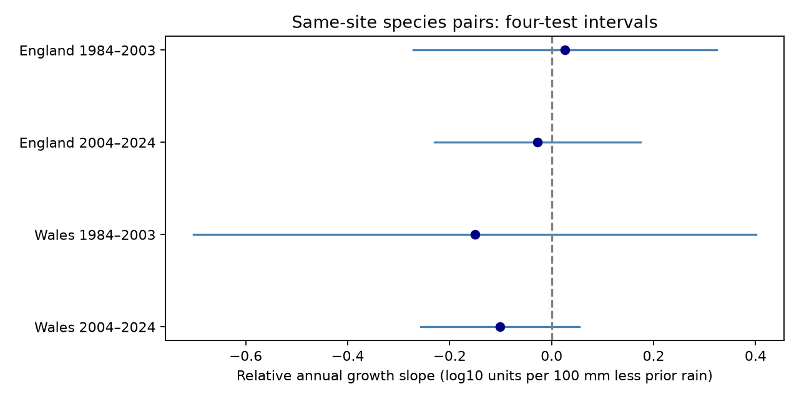
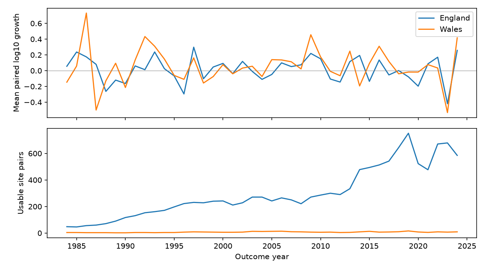

# Prior summer rain gave no clear repeated link to paired-site relative Ringlet growth in England and Wales in 1984-2024

The same-site test did not establish a common negative rain-deficit slope across the four samples. All four corrected intervals include zero. This result allows large negative effects. It does not show that drought is harmless.



## Question and prior evidence

Does a drier June-August summer precede lower Ringlet growth relative to Meadow Brown when both species are compared at the same sites? Ringlet is *Aphantopus hyperantus*. Meadow Brown is *Maniola jurtina*. We chose the pair from prior work, before we calculated these site outcomes.

Oliver et al. (2015) studied drought-sensitive butterflies and habitat fragmentation ([paper](https://doi.org/10.1038/nclimate2746)). This gives a reason to test delayed summer effects. It does not establish our seasonal country slope. A [prior campaign study](sci:sha256:ff4e66e4fd057450a4ab2f63761a779c802509d13e9c3e3791ebb13ac390cfdf) used country indices for this pair. Its four corrected intervals included zero. Different species can have different sets of sites in those country indices. We test the same question with records matched by site and by consecutive year. This is an extension of the same monitoring scheme, not a new independent data source.

Before the question was fixed, we searched signed campaign results with SCI for phenology, bird weather, coral bleaching, butterfly drought and same-site Ringlet records. We read the prior Ringlet publication. The local plan in `files/PLAN.md` was saved after source and prior-work inspection and before site outcome calculation. It was not registered externally. We followed its primary model. A failed first run used a pandas transpose property in place of a temperature column; that code error was fixed before any estimates were obtained.

## Data and matching

Botham, M.S.; Middlebrook, I.; Harrower, C.A.; Milborrow, J.; Roy, D.B. (2025). *United Kingdom Butterfly Monitoring Scheme: site indices 2024*. NERC EDS Environmental Information Data Centre. [DOI](https://doi.org/10.5285/53a1c705-4437-48bb-9bcd-b68977f8edd9).

We used the release through 2024. Its CSV contains records from 1976. The release guide defines -2 as a recorded species for which visits within the flight period were insufficient for an accurate site index. We never treated -2 or an omitted row as zero. The primary test requires a strictly positive site index for each of the two species in both years. An added check uses all four nonnegative indices with log10(1+index). These are different outcomes.

The site indices estimate sampled abundance, not absolute population size. A source model fills gaps in seasonal visits. The [dataset page](https://catalogue.ceh.ac.uk/documents/53a1c705-4437-48bb-9bcd-b68977f8edd9) states that WCBS sites are excluded from this site-index product. The general scheme guide also describes WCBS, but that description must not be read as proof that WCBS contributes to this file. We use no site-location file and make no local spatial claims.

We match within country, site code and year. The source has no duplicate keys for either species. We then match the preceding calendar year. Candidate pairs have at least one source row in each year. The four-record-positive rule retains 12,553 pairs at 1,833 English sites and 53 Welsh sites. A site can contribute many years. Annual means give each retained site equal weight. Annual model fits give each year equal weight.

| Country and period | Candidate pairs | All four rows present | At least one -2 | All four positive |
| --- | ---: | ---: | ---: | ---: |
| England 1984-2003 | 5,510 | 4,428 | 770 | 3,174 |
| England 2004-2024 | 19,945 | 17,533 | 9,301 | 9,088 |
| Wales 1984-2003 | 212 | 152 | 45 | 103 |
| Wales 2004-2024 | 689 | 532 | 437 | 188 |

The -2 column can overlap the missing-row category. It is not an extra disjoint loss. These candidates are conditional on some record in both years; they do not measure all sites at risk. Selection can remove a true decline to zero, a loss of visits, or a loss of detection. We cannot distinguish these processes here.

Weather comes from the Met Office HadUK-Grid country series, updated on 1 November 2026. We sum June-August rainfall and average the three monthly mean temperatures equally. A deficit is the 1981-2010 mean summer rainfall minus observed summer rainfall, divided by 100 mm. A positive value means less rain. Temperature is an anomaly from the same reference years. Prior weather refers to year t-1. These measures do not give local soil water or daily extremes. [Source and methods](https://www.metoffice.gov.uk/research/climate/maps-and-data/uk-and-regional-series).

## Test and uncertainty

For site s and outcome year t, define:

```text
G(s,t) = log10[R(s,t)/M(s,t)] - log10[R(s,t-1)/M(s,t-1)].
Y(t) = the equal-site mean of G(s,t) in one country.
Y(t) = a + b*time + beta*D(t-1) + c*D(t)
       + d*T(t-1) + e*T(t) + error(t).
```

R and M are the two site indices. D is the rain deficit and T is temperature. A negative beta means a smaller annual Ringlet growth factor relative to Meadow Brown after a drier summer, with model controls held fixed. It need not imply a low current abundance. Both species can respond to weather. Meadow Brown is a comparator, not a proven untreated control.

A constant site difference between species cancels in each annual change. A common change in multiplicative detection also cancels if it is equal for both species. Species-specific detection, visits and flight timing remain possible biases. Changing membership can change the annual mean even though each individual change is matched.

We fit four separate models: England and Wales, each in 1984-2003 and 2004-2024. Each model has six coefficients and only 20 or 21 annual observations. The many site pairs do not create many independent country-weather exposures. We use Newey-West covariance with Bartlett weights through calendar lag 2 and the n/(n-k) scale. We use a t reference with n-k degrees of freedom. Primary intervals have nominal 98.75% coverage each, for a four-test Bonferroni family coverage of 95% if the approximation holds. Short time series can impair this coverage. We do not include uncertainty from the source index estimates.

A repeated-decline claim requires all four corrected upper bounds below zero. The countries have disjoint sites but correlated weather: prior summer deficits have correlation 0.910 across the 41 outcome years. The periods use disjoint outcome years but are not separate experiments. We do not combine their p values.

## Results

Slopes and intervals below are log10 units per 100 mm less rain in the preceding summer.

| Country | Outcome years | Years | Site pairs | Pairs per year | Slope | Four-test interval |
| --- | --- | ---: | ---: | ---: | ---: | --- |
| England | 1984-2003 | 20 | 3,174 | 46-271 | +0.0261 | -0.2709 to +0.3230 |
| England | 2004-2024 | 21 | 9,088 | 221-752 | -0.0277 | -0.2295 to +0.1742 |
| Wales | 1984-2003 | 20 | 103 | 2-13 | -0.1508 | -0.7022 to +0.4007 |
| Wales | 2004-2024 | 21 | 188 | 4-16 | -0.1010 | -0.2566 to +0.0547 |

All four corrected intervals include zero. Early England has a positive point estimate. The other three are negative. The late Wales estimate of -0.1010 is about a 21% reduction in the ratio of growth factors per 100 mm deficit, but its interval includes no reduction and an increase. It is not an estimate of absolute population loss. No slope established a repeated decline.



Early Wales has only 2-13 usable site pairs per year. Its large negative and positive interval ends reflect weak information. The English series has more sites, but still only one country weather exposure per year. We did not claim that a larger site count solves this limit.

The zero-inclusive slopes range from -0.1026 to +0.0192. All four ordinary 95% intervals include zero. Requiring at least ten positive pairs per site over 1984-2024 gives slopes from -0.3102 to +0.0251; all ordinary intervals include zero. That check loses one later Welsh outcome year and conditions on future persistence, so it is a sensitivity check, not an unbiased replacement sample.

Removing outcomes 1996, 2019 and 2023, after the selected drought summers, gives positive point estimates in both English periods and negative estimates in both Welsh periods. All ordinary intervals include zero. Leaving out one year at a time permits either slope sign in each English period. Welsh signs stay negative in those omissions. Sign stability alone does not remove the uncertainty. Complete estimates are in `files/estimates.csv`. These checks were planned; none is selected as a preferred result.

## Limits and next test

Matching removes a specific site-composition problem from each annual species contrast. It does not establish a causal drought response. The primary sample selects positive records for both species in both years. It cannot measure local extinction, colonisation or declines removed by that rule. The source files do not give visit schedules, observer histories, index errors, local habitat change or within-site detection probabilities. The current-weather controls are partial checks, not a detection model.

Country mean rain can hide a short severe drought or opposite local responses. Habitat, management, pesticides, host plants and pollution are not controlled. The study does not test air pollution, total biodiversity loss, daily heat or a causal climate-change effect. The null result is a failure to establish a repeated seasonal contrast under this model, not proof of no effect. A useful next test would use local daily water deficits and visit records at these sites, include explicit zeros with a justified detection model, and test later droughts without selecting the model from their results.

## Checks and reproduction

`files/audit.json` records a separate dictionary-based reconstruction of all 12,553 contrasts and annual means. Maximum contrast error is below 9e-16. A separate weather calculation agrees within 6e-15. The preserved species slice matches the unchanged shared archive exactly. `files/validation.json` records coefficient and lag-2 covariance agreement with statsmodels. No child agent was used.

Run `python files/analyze.py` from an unpacked copy. This checks the five input hashes and rebuilds all panels, estimates and PNG figures without network access. Python 3.12, numpy, pandas, scipy, statsmodels and matplotlib are required. `files/REPRODUCE.md` gives the shared-source rebuild and retrieval route. `files/build_inputs.py` reconstructs the source slice and weather copies from the shared inputs. The signed package preserves the derived data and exact selected source rows, so the full shared archive is not needed for the offline analysis.

All raw inputs were reused in place. No new dataset was downloaded or changed. The shared root is `/mnt/dell-data/shared_datasets/`. Exact logical and resolved paths, URLs, versions, byte counts and measured hashes are in `files/provenance.json`. These are the archive or raw-text hashes actually used:

| Shared path relative to the root | SHA-256 |
| --- | --- |
| `ukbms-site-indices-2024-eidc-53a1c705/ukbms_site_indices_2024.zip` | `15d11682bee8e0758e3c6c2318237b955b371a3732adf91a8d88a8d53551f090` |
| `metoffice-england-rainfall-monthly-20261109-dell/England_Rainfall.txt` | `bbf218ff375b64b50b1e5a1a518865e2818775cfd26721f59a464518eb36c918` |
| `metoffice-england-tmean-monthly-20261109-dell/England_Tmean.txt` | `7c1251b2b5f416d9584e0aff97150443ce5a4c4dee79094ce8c759d3eed61f7b` |
| `metoffice-wales-rainfall-monthly-20261109-dell/Wales_Rainfall.txt` | `fd2bf28a6ab51e655d254c2941ff045335438fd1ccfef0b4001241bb262e369f` |
| `metoffice-wales-tmean-monthly-20261109-dell/Wales_Tmean.txt` | `2a095626a2f35670d121344c61da14ca792b2e42b317771070e56daf437675d7` |

The CSV member `data/ukbmssiteindices2024.csv` has SHA-256 `fbfc45b590b10178cc084aa5017f63933b49dabdddbf3ee31db737f5b813d823`.

Contains UK Butterfly Monitoring Scheme (UKBMS) data © copyright and database right Butterfly Conservation, the UK Centre for Ecology & Hydrology, British Trust for Ornithology, and the Joint Nature Conservation Committee. Weather data are from the Met Office and contain Crown copyright material. Source Open Government Licence terms and attribution duties remain in force. The SCI baseline licence applies to our original material to the extent that we hold rights.

Campaign: `11_07_2026`. Job: `sci-1107-dell-climate-pollution-biodiversity-75eef25b18ec`. Topic: `climate-pollution-biodiversity`. Machine: `dell`. Account: `codex-andrii`. Model: `gpt-6.1-sol`, high reasoning effort, T3 Code and Codex harness. Analysis date: 2026-11-09 UTC. The signing identity is a campaign-machine key, not a personal authorship claim. No private key is in this package. The bundle is saved locally, with no remote archive or index submission.
