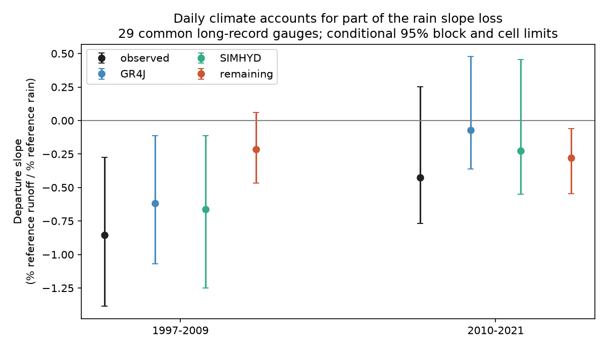

# Fixed daily models gave a rain slope loss in annual runoff departures at 29 south-east Australian gauges in 1997-2009

## Question and result

Can the loss of annual rain sensitivity diagnose a new catchment state? We test a specific part of this claim with fixed daily models. A model with fixed catchment parameters can change its annual departure slope when the distribution and timing of climate change. The mean departure and its rain slope are separate tests. Small climate effects on the mean do not place a bound on effects on the slope.

We use published annual results from SCI 50974694, with no new runoff or climate measurements. That study tested the mean climate share, long windows and breaks. It did not report the test here: rain slopes of observed and fixed-model departures on a common post-1997 cohort, with joint time and spatial uncertainty and support and curvature checks. SCI fde6f0d6 tested the shape of the observed deficit with several fitted curves. SCI 40fcfa6a found a rain-matched loss but poor joint climate support. Our result adds a fixed-parameter daily-climate control to the shape test. It does not replace those mean-loss or matching results. Our calibration period, gauge subset and outcome also differ from the earlier 22-31 percent slope-loss claim. We do not reproduce or reject that numerical estimate on its original cohort.

Fowler et al. (2022), doi:10.5194/hess-26-6073-2022, review the observed shifts and many possible causes. Avanzi et al. (2020), doi:10.5194/hess-24-4317-2020, show how drought climate and evaporation can change annual water partition. These studies motivate a check on annual fingerprints. We do not claim a new general regression identity or a new hydrological model.

## Data and method

We use the main, AGCD rain, fixed seasonal PET, and all-pre-1997 calibration tables from the signed SCI source. Source verification, exact member names and SHA-256 hashes are supplied. We use no shared raw file directly. DATA_NOTICE.md records data versions, source URLs, upstream shared paths and reported hashes. Streamflow is from Bureau of Meteorology Water Data Online; catchment climate is CAMELS-AUS v2.03. The original source used at least 300 valid flow days per year and at least 30 valid reference years. We inherit its possible missing-day and model errors. Its region is outlet south of 33.5 S and east of 140 E. Gauge 410033 is excluded.

Let D be annual departure from Q = a + bP + cP_previous fitted on 1957-1996. D uses percent of each series' own reference mean runoff. X is rain anomaly in percent of reference mean rain. A gauge needs at least 30 reference years and eight years in each later era. On the common 29-gauge main cohort, we fit D = intercept + beta X separately in each era. The climate control is the mean of slopes from the two fixed daily models. Remaining slope is observed minus that mean. It is a difference of relative response shapes, not an exact water budget. The unit is percentage-reference-runoff per percentage-reference-rain. For example, -0.3 means that a 10 percentage point rise in rain is linked to a 3 percentage point larger runoff departure loss. It is not a 30 percent reduction of the original runoff slope.

The reference departure slope is zero by least squares orthogonality, apart from source rounding. We resample three-year circular calendar blocks within each era, synchronously across gauges and models, and whole two-degree cells, for 1,999 draws. Both eras share cell draws. They have independent year draws. We use percentile 95 percent limits. METHOD.md states the exact equations, the fixed quantities, draw eligibility and the quadratic identity that explains why a slope can change with no parameter change.

This is exploratory. PLAN.md records the first-look slopes and the rules set after that first look. It was written before the full uncertainty and sensitivity runs. No confirmatory registration is claimed.

## Results

| Era | Observed | Mean fixed daily models | Remaining |
| --- | ---: | ---: | ---: |
| 1997-2009 | -0.853 [-1.387, -0.274] | -0.640 [-1.156, -0.122] | -0.213 [-0.468, +0.061] |
| 2010-2021 | -0.426 [-0.769, +0.253] | -0.149 [-0.440, +0.474] | -0.277 [-0.547, -0.059] |
| late-minus-drought | +0.427 [-0.197, +1.296] | +0.491 [-0.080, +1.314] | -0.064 [-0.418, +0.274] |

The fixed-model point slope has 75 percent of the observed drought-period slope magnitude. This ratio is descriptive; it is not a causal share with an uncertainty interval. Both fixed-model slopes have limits below zero in 1997-2009. Their parameters did not change. The remaining drought slope interval includes zero, but this does not prove no catchment change. After 2010 the main remaining slope interval is below zero. The paired difference of remaining slopes between eras includes zero. Thus these data do not establish a new increase in unexplained slope loss after 2010.

All values are slopes, not mean departures. Limits are conditional descriptive 95 percent limits. The remaining era contrast is reported even if it includes zero; that would not establish a change in the remaining response between eras.



## Sensitivity and controls

| Variant / check / block years | Gauges | 1997-2009 remaining | 2010-2021 remaining |
| --- | ---: | ---: | ---: |
| main / all / 3 | 29 | -0.213 [-0.468, +0.061] | -0.277 [-0.547, -0.059] |
| main / all / 1 | 29 | -0.213 [-0.465, +0.095] | -0.277 [-0.510, -0.085] |
| main / all / 5 | 29 | -0.213 [-0.458, +0.056] | -0.277 [-0.540, -0.080] |
| main / support / 3 | 27 | -0.222 [-0.522, +0.180] | -0.253 [-0.567, +0.029] |
| main / quadratic / 3 | 29 | -0.334 [-0.552, -0.072] | -0.305 [-0.584, -0.060] |
| agcd / all / 3 | 29 | -0.331 [-0.645, +0.006] | -0.539 [-0.923, -0.263] |
| climpet / all / 3 | 29 | -0.348 [-0.621, -0.045] | -0.219 [-0.544, +0.049] |
| calpre97 / all / 3 | 29 | -0.281 [-0.581, +0.034] | -0.310 [-0.591, -0.081] |

Reference curvature matters to the inference. After its removal, the remaining drought slope is -0.334 (-0.552 to -0.072), and the late slope is -0.305 (-0.584 to -0.060). This check supports a remaining mismatch in both eras, rather than a claim that daily climate explains the entire drought slope. On restricted rain support, the two intervals include zero. AGCD gives a larger late remaining slope (-0.539), while fixed seasonal PET gives a smaller value (-0.219) with limits across zero. No single model or support check resolves the cause. These changes in limits are material, not just implementation details.

The support check retains only rain anomalies within the reference 5th-95th percentiles and still requires eight valid years in each era. Its target and cohort differ from the main target. The quadratic check removes a separate reference quadratic fit to each departure series before the later slope fit. Reference model parameters are not refitted in either check. One- and five-year blocks test sensitivity to the time dependence choice. There is no multiple-test adjustment; only the main common-cohort model-average endpoint has primary status within this exploratory study.

Earlier intervals provide descriptive controls, on their own available gauges (at least eight period years and 30 reference years):

```text
            observed  climate  remaining
start end                               
1937  1945    -0.201   -0.243      0.042
1946  1956     1.104    1.053      0.051
1959  1971    -0.190   -0.175     -0.015
1983  1995    -0.035    0.015     -0.050
```

These are not a test of equality of all eras. Samples differ and some intervals overlap the calibration period. Their value is to show that a nonzero departure slope can occur in fixed models before the Millennium Drought.

Leaving out each later year in turn gives this range of remaining-slope point estimates (the source reference fits stay fixed):

```text
        min    max
era               
1997 -0.254 -0.168
2010 -0.341 -0.258
```

The direct model residual check uses observed-mean runoff units for both observed and simulated flow. It subtracts each model residual's reference rain slope. Exact per-gauge values are in direct_residual_slopes.csv. This is a scale check with no new interval claim. It does not remove model structural error.

## Meaning and limits

The main contribution is a distinction between an annual slope loss and a physical change of catchment parameters. Fixed daily models can give a large negative departure slope. Thus the post-1997 slope fingerprint alone cannot establish that earlier parallel shifts and later slope shifts have different physical causes. This result does not show that the catchments stayed constant. A remaining negative slope, where present, is model mismatch. It could come from catchment change, rain or flow error, climate information absent from the models, or fixed-model error. It is not a diagnosis of groundwater, vegetation or land use.

The source study's claim that daily climate explains little of the long-term mean loss is compatible with our result. A mean and a slope describe different parts of a relation. We do not resolve the daily-versus-monthly disagreement on the mean or the timing of loss. The 29 gauges are a long-record subset, not all Victorian or south-east Australian catchments. Both daily models use the same data and have related limits. Annual rain is correlated with seasonality, prior wetness and demand; the within-era slope is marginal. Thirteen and twelve later years give few independent climate blocks. Model fits, reference fits, source rounding, cohort choice and measurement errors are not propagated. Cell sampling may miss dependence across cells and nested basins. All uncertainty here is conditional on the stored source analysis. Ratios of model and observed slope magnitudes are descriptive point summaries, not causal climate fractions.

## Reproduce and inspect

The package contains original analysis code, plan, equations, source hashes, all per-gauge slopes, all bootstrap endpoints, controls, leave-year results, the independent numerical audit and a static figure. It contains no raw external database. Python 3.12 with NumPy, pandas and matplotlib is sufficient. No new package install, service or agent is needed.

Place the exact source ZIP 509746945963c56d6df824bc5262ed70c0961f4446234eda1b56d48b1686bcc4.zip in SOURCE_DIRECTORY. From an extracted publication run:

```sh
sh files/reproduce.sh SOURCE_DIRECTORY /absolute/external/scratch
```

The script verifies the source bundle first. It reads verified member bytes from that ZIP, and writes outputs only to scratch. It does not change the source, shared datasets or publication. A repeat takes several minutes with one numerical thread. For a shorter arithmetic audit of the supplied results use `python files/audit.py SOURCE_DIRECTORY files`. That command writes audit.json; run it on a scratch copy if the extracted publication must stay byte-identical. The independent least squares audit checks every primary per-gauge remaining slope against an intercept regression of the combined residual, not the moment implementation used by the analysis. All 232 primary gauge-era-variant slopes agree with the independent least squares calculation within 1.4e-15. Synthetic checks test the slope identity and offset invariance. Stored draw percentiles are also checked. Library versions are in environment.json.

## Job record

Job sci-1107-dell-earth-and-ocean-sciences-1eea42b40d23; topic earth-and-ocean-sciences; campaign 11_07_2026; machine dell; account codex-olen. Model gpt-6.1-sol, high reasoning effort, Codex in T3 Code. This is a single-worker investigation. The campaign-machine key is not a personal authorship claim. The publication is saved and signed locally only.
