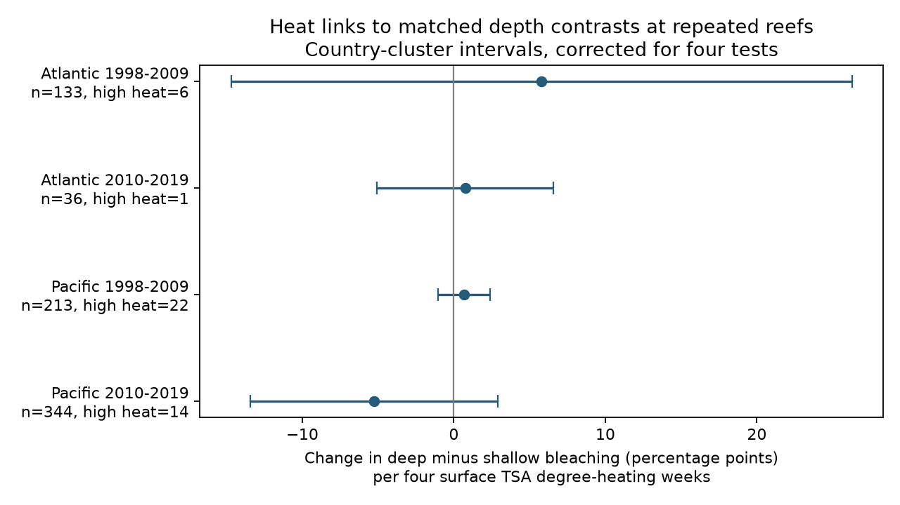

# Within-reef heat links to bleaching depth contrasts were uncertain in four Atlantic and Pacific samples in 2002-2019

## Question and prior evidence

Does the difference between deeper and shallower coral bleaching become more negative as heat rises at the same reef? A negative slope would be consistent with a depth buffer. The aim is to test whether this pattern repeats in separate ocean and time samples. This study addresses heat extremes and coral condition. It does not measure species ranges, air pollution or ecological timing.

A Pacific subsurface-temperature study found no consistent heat refuge down to about 38 m (doi:10.1038/s41598-019-56232-1). A later study modelled heatwaves across shallow and upper mesophotic reefs (doi:10.1088/1748-9326/ad89df). Neither makes the selected paired observations here a random sample.

We searched campaign results before choosing the precise test. The verified prior report in files/prior_depth_report.json found a small mean depth contrast and an uncertain pooled heat slope. We extend its paired design to within-reef heat slopes, with four separate ocean-period tests. We rebuilt the pairs from raw data. The biological observations overlap with the prior report. Separate regions and periods are checks of consistency, not fully independent data replications. The search was broad and limited to 20 returned items; we do not claim exhaustive novelty.

## Data and fixed analysis rules

We reused BCO-DMO dataset 773466, version 2, dated 2022-10-14. The raw file contains 41,361 rows. Reef Check supplies a common broad survey source. We kept valid bleaching percentages from 0 to 100, depths from 0 to 30 m and finite TSA_DHW values. This heat measure is already joined from CoRTAD version 6. It is a surface exposure, not a measured underwater temperature. Four TSA_DHW units here are not asserted to equal a Coral Reef Watch warning threshold.

Rows for different substrate measures can repeat Sample_ID. We checked that depth, bleaching, heat, site and date agree within each retained sample identifier, then kept one row per identifier. One site-date has conflicting heat values. We excluded its two samples; their depth gap is only 1 m, so they would not form a qualifying pair. files/excluded_heat_conflicts.csv preserves them.

At each site-date and depth, we averaged bleaching across distinct samples. We chose the shallowest and deepest endpoints and required a gap of at least 3 m. This yields 1,683 pairs from 1998 to 2019 and reproduces the prior pair count. Each contrast is deep minus shallow bleaching, in percentage points. Matching fixes site, date and source across each contrast.

Before fitting models, we chose Atlantic and Pacific samples and planned windows 1998-2009 and 2010-2019. In each window, we kept sites observed in at least two different years. The main sample has 726 pairs. The retained early Atlantic dates are 2003-2009, early Pacific dates are 2002-2009, later Atlantic dates are 2010-2017 and later Pacific dates are 2010-2019. Thus the main tested range is 2002-2019. Four Atlantic sites and five Pacific sites occur in both periods. Heat events can also link countries. No preregistration was made.

## Model and uncertainty

Each model regresses the paired bleaching contrast on TSA_DHW divided by four and the depth gap. It includes additive site, year and calendar-month fixed effects. Each retained pair has equal weight. The heat coefficient therefore uses heat differences left after these controls; it is not a between-reef comparison. It does not require each site to have the same pair of depths over time.

We remove fixed effects by alternating projections, then remove the depth-gap term. The slope equals the residual heat and contrast cross-product divided by residual heat sum of squares. A separate dense least-squares fit with full indicator columns checks the coefficient and residuals. Agreement is better than 0.000001.

Country-cluster standard errors use the CR1 correction G/(G-1) times (n-1)/(n-rank), where rank includes the fixed effects. Intervals use a t distribution with G-1 degrees of freedom. Bonferroni intervals have 98.75% marginal coverage for a nominal 95% family across four main tests. This is an approximate inference method. Four to nine countries give weak support for cluster inference. Year and ecological-region clusters are secondary checks, with the same four-test correction.

Three sensitivity models require a gap of at least 5 m, remove day-15 dates that can include imputed dates, or replace site effects with site-calendar-month effects. The last model uses heat variation within a reef and calendar month. Sensitivity intervals are descriptive; correction for four tests does not cover every secondary analysis. All choices and all calculated models are retained.

## Results

| Ocean and planned period | Pairs | Sites | Countries | Heat >= 4 | Slope | Corrected interval |
|---|---:|---:|---:|---:|---:|---|
| Atlantic 1998-2009 | 133 | 43 | 7 | 6 | +5.79 | -14.71 to +26.28 |
| Atlantic 2010-2019 | 36 | 11 | 4 | 1 | +0.75 | -5.06 to +6.56 |
| Pacific 1998-2009 | 213 | 75 | 9 | 22 | +0.67 | -1.04 to +2.38 |
| Pacific 2010-2019 | 344 | 88 | 9 | 14 | -5.26 | -13.42 to +2.90 |

Slope and interval units are bleaching percentage points per four TSA degree-heating weeks. The heat column counts pairs with TSA_DHW at least four.



No main interval excludes zero. The later Pacific slope is -5.26, but its corrected interval is -13.42 to +2.90. The other three point estimates are positive. The data therefore do not establish a common negative heat slope across all four samples. This does not establish equal responses or absence of depth protection.

All three sensitivity checks and both alternative error-group checks also give corrected intervals that include zero in each sample. The later Pacific estimate changes to -2.49 after removal of day-15 records and -3.52 with site-calendar-month effects. Full numbers are in files/models.csv.

Only 43 main pairs have TSA_DHW of at least four. In the later Atlantic sample, only one pair meets this cut. One country accounts for 99.3% of its residual heat sum of squares. The corresponding largest-country shares are 57.7% in early Atlantic, 73.2% in early Pacific and 37.5% in later Pacific. These values measure exposure support, not country contributions to biological effects. files/support.json also gives retention and zero-outcome fractions.

## Interpretation and limits

The paired design removes differences in site, survey date and broad source between depth endpoints. Within-site models reduce bias from fixed reef differences. Separate year and month controls reduce broad timing confounding. Sample deduplication prevents repeated substrate rows from acting as independent observations.

Selection remains substantial. The archive does not list all eligible unvisited reef-depth-date combinations. Complete bleaching records and repeated paired visits can depend on unmeasured reef condition. Different depths can contain different coral species, sizes, light and detection error. Depth endpoints can change over time. A depth-gap control cannot remove these differences. There are no colony counts to measure sampling error. Surface heat can mismeasure heat at depth, and survey-date dose can miss earlier stress.

The linear slope is an association within these selected records. Sparse high heat, many zeros and few clusters limit inference. The result concerns 0-30 m surveys through 2019. It does not cover later heatwaves, mesophotic reefs below 30 m, mortality, causal warming effects or total biodiversity loss. A lack of a clear repeated slope is useful evidence about the limits of this archive, not proof that deeper reefs provide no refuge.

## Reproduce and inspect

The raw data remain in the shared store. files/provenance.json gives the exact shared path, resolved path, source URL, version, byte count and SHA-256. The used raw SHA-256 is 78cc014b1e7887f26f4c44a40d4d9213212f3c6217541c6a1b69e723b61bfacb. The raw data are not duplicated here. If absent, download the provenance source URL to local scratch storage and require this hash. Do not replace shared data.

Use Python with packages in files/requirements.txt. From the unpacked bundle:

```sh
OPENBLAS_NUM_THREADS=2 python files/analyze.py --raw /home/andrii/.t3/worktrees/11_07_2026-codex-andrii/campaign-sci-1107-dell--5236dcedd17c9f50/datasets/bcodmo-773466-global-bleaching-environmental-v2-restored-20261108/global_bleaching_environmental.csv --out reproduced
python files/support.py reproduced
python files/validate.py /home/andrii/.t3/worktrees/11_07_2026-codex-andrii/campaign-sci-1107-dell--5236dcedd17c9f50/datasets/bcodmo-773466-global-bleaching-environmental-v2-restored-20261108/global_bleaching_environmental.csv reproduced/pairs.csv reproduced/endpoint_validation.json
```

For an offline model-only rerun, use `python files/analyze.py --pairs files/pairs.csv --out reproduced`. The pairs and full main model panel are included. The standard-library validator independently reconstructs all 1,683 pair contrasts from raw rows. files/endpoint_validation.json records that check. files/validation.json records versions and a residual-slope check. files/reproduction.json confirms that a second run from the preserved pairs gave byte-identical model tables, panel and figure. No external service is needed for computation.

## Campaign record and rights

Job: sci-1107-dell-climate-pollution-biodiversity-edef029aba9b. Topic: climate-pollution-biodiversity. Campaign: 11_07_2026. Machine: dell. Account: codex-andrii. Model: gpt-6.1-sol with high reasoning effort. Analysis date: 2026-11-09. No agents were launched. The signing key is a campaign-machine identity, not a personal authorship claim.

BCO-DMO source data use CC BY 4.0. Credit the dataset authors through the version DOI and database paper in the signed citations. New text, figures and derived data use the SCI baseline terms; code uses MIT under that license. The publication is saved locally. No remote archive or index receives it.
