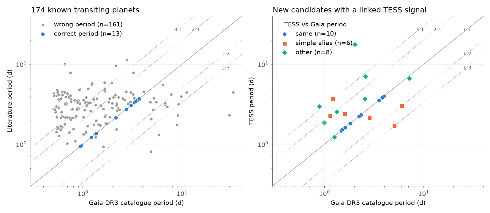
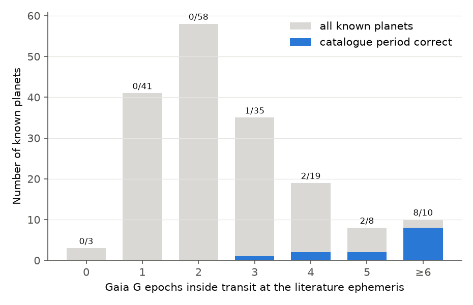
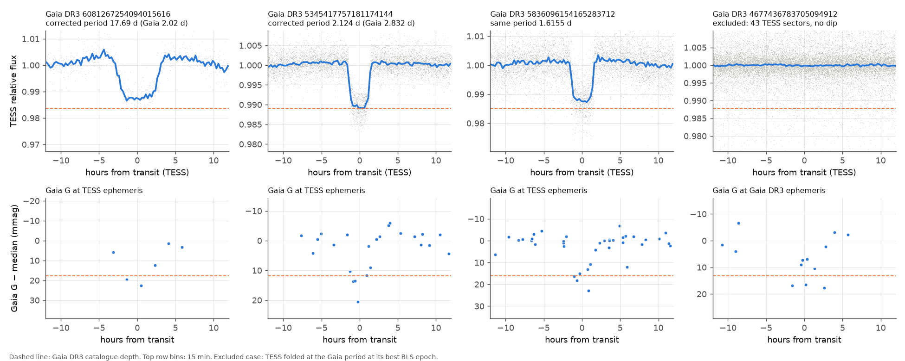

# All-sector TESS data link 24 of 37 testable Gaia DR3 transit candidates to real dips, show 4 planet-like signals that are not in TOI lists or in a prior campaign study, and exclude 9 Gaia signals

**Job:** sci-1107-dell-astronomy-cf0a9df6ee71 · **Topic:** astronomy · **Campaign:** 11_07_2026 · **Machine:** dell · **Model:** Claude Opus 5.5 (`claude-opus-5-5`), as an autonomous research agent · **Date:** 2026-11-08.
The signing key is a campaign-machine key. It is not a personal claim of authorship.

## Summary

The Gaia DR3 table `vari_planetary_transit` gives a transit period, reference time, depth and duration for 214 stars: 173 known planets and 41 new candidates (Panahi et al. 2022). We did two tests.

1. **Known planets (174 sources).** We compared the table periods with published periods. We folded the Gaia DR3 G epoch photometry on both ephemerides.
2. **Unconfirmed candidates (39 sources, plus Kepler-840 b).** We searched **all** TESS sectors that were available on 2026-11-08 (1 to 44 sectors per star; SPOC, TESS-SPOC and QLP light curves, and our own TESScut photometry for 3 stars without pipeline light curves). We then tested whether each TESS ephemeris predicts the dimmed Gaia epochs of 2014-2017.

A sibling campaign study (job sci-1107-hp-astronomy-01cec9aa5903, `sci:sha256:b8007150…`) published the same two questions on the same day while this work ran. We did our analysis independently, with different code. We compare the results in the section "Comparison with the sibling study". This study adds: all TESS sectors instead of at most 8, TESScut photometry, injection-recovery limits for the non-detections, and a per-event check of disputed classes.

### Main results

1. **The Gaia DR3 period is correct for only 13 of 174 known planets (7.5%).** This agrees with the sibling study. The Gaia epochs folded on the published ephemeris show the transit (SNR > 3) for 160 of 171 planets. Thus the Gaia dips are real, but the period is an alias.
2. **The number of Gaia epochs in transit controls the period error.** At the published ephemeris, 102 of 174 known planets have 2 or fewer Gaia G epochs in transit. **None of these 102 has a correct table period.** Of the 10 planets with 6 or more epochs in transit, 8 have a correct period (Figure 2). With 2 epochs, a median of 155 separate period intervals from 0.4 to 20 d fit the Gaia data.
3. **TESS links 24 of the 37 candidates that have TESS data to the Gaia dips.** For 10 of the 24, the TESS period equals the Gaia period. For 6, it is a simple alias (ratio 1/3, 1/2, 3/4, 3/2, 2 or 3). For 8, there is no simple relation (Figures 1 and 3).
4. **13 linked signals are planet-compatible** (no odd-even difference, no secondary eclipse, radius below 2 R_Jup). Seven of these are not in the ExoFOP TOI or CTOI lists of 2026-11-08. **Four of the seven are not in the sibling study list:** Gaia DR3 1218568950151657216 (TIC 445886244, P = 1.474219 d), 5836096154165283712 (TIC 87433458, P = 1.615491 d), 4136481216073713280 (TIC 435052739, P = 1.81658 d) and 6081267254094015616 (TIC 169468881, P = 17.691796 d; the Gaia table gives 2.024 d).
5. **11 linked signals are non-planetary or doubtful.** They show a strong odd-even difference, a secondary eclipse, a radius above 2 R_Jup, or a TFOPWG false-positive or SB1 disposition.
6. **TESS excludes the Gaia signal for 9 candidates.** For these, a box with the Gaia depth that we inject into the TESS data is recovered in 100% of trials, but the real data show no such dip. Two of these stars have 43 and 44 TESS sectors. Four candidates are inconclusive (crowding or poor photometry), and two have no TESS data.



**Figure 1.** (Left) Gaia DR3 table period against the published period for 174 known planets. Blue: equal within 0.2%. Gray: different. Dotted lines: ratios 1/3 to 3. (Right) TESS period against the Gaia DR3 table period for the 24 candidates whose TESS signal is linked to the Gaia dips. Blue circles: same period. Orange squares: simple alias. Green diamonds: no simple relation.



**Figure 2.** Known planets by the number of Gaia G epochs inside the transit at the published ephemeris. Gray: all planets. Blue: table period correct. The labels give correct/all. No planet with 2 or fewer epochs in transit has the correct table period.


**Figure 3.** Classes of the 39 unconfirmed Gaia DR3 candidates (Kepler-840 b is not counted). The colours show the relation between the TESS period and the Gaia period for the linked signals.



**Figure 4.** Examples. Top row: TESS light curves, folded (gray points: 10-min bins; blue line: 15-min medians; dashed line: Gaia table depth). Bottom row: Gaia G epochs (2014-2017) folded on the TESS ephemeris, or on the Gaia ephemeris for the excluded case. From left to right: a 17.69-d signal that the Gaia table gives at 2.02 d; a 2.124-d signal that the Gaia table gives at 2.832 d (ratio 3/4); a signal at the Gaia period; a star with 43 TESS sectors and no dip.

## Results in detail

### A. Known planets

| Quantity | Value |
| --- | --- |
| Sources with a NASA Exoplanet Archive planet (Gaia DR3 id or 3 arcsec) | 174 (includes Gaia-1 b, Gaia-2 b, NGTS-13 b) |
| Table period equal to published period (relative difference < 0.002) | 13 |
| Ratio published/table equal to p/q with p, q <= 6 (not 1/1) | 26 (many of these with large p, q are chance) |
| Gaia G dip at the published ephemeris with SNR > 3 | 160 of 171 |
| Median dip at the published ephemeris / median table depth | 14.3 / 12.8 mmag |
| Gaia epochs in transit at the published ephemeris: 0 / 1 / 2 / 3 / 4 / 5 / >= 6 | 3 / 41 / 58 / 35 / 19 / 8 / 10 |
| Correct table period for these groups | 0 / 0 / 0 / 1 / 2 / 2 / 8 |
| Median number of separate period intervals (0.4-20 d) that fit the Gaia epochs | 155 for known planets; 4 for the unconfirmed candidates |
| Median table `num_in_transit`: correct / wrong period | 18 / 9 |

The original table of 13 June 2022 has the same periods as the corrected table of February 2023. Only the reference times changed. The unconfirmed candidates have more epochs in transit (median 4) than the known planets (median 2). This agrees with the higher success rate of the Gaia period for the candidates (10 of 24 linked signals).

### B. Unconfirmed candidates: planet-compatible signals

P and T0 come from a linear fit to transit times per TESS season. T0 is in BTJD = BJD_TDB - 2457000. Depths are box depths in the detrended TESS flux (SPOC/TESS-SPOC PDCSAP and QLP KSPSAP are corrected for known crowding; TESScut photometry is not). Rp = sqrt(depth) x R*, with R* from Gaia DR3 FLAME, GSP-Phot or the TIC. "Gaia dims in transit" gives the number of dimmed Gaia epochs (more than half the table depth below the median) that fall in the TESS transit, the total number of dimmed epochs, and the number expected by chance.

| Gaia DR3 source_id | TIC | TOI | G | Gaia P [d] | TESS P [d] | T0 [BTJD] | TESS depth [ppt] | Gaia depth [ppt] | Rp [R_Jup] | Sectors | Gaia dims in transit (chance) | Sibling class |
| --- | --- | --- | --- | --- | --- | --- | --- | --- | --- | --- | --- | --- |
| 1218568950151657216 | 445886244 | none | 14.57 | 1.47421 | 1.474219 ± 0.000005 | 1956.4195 | 14.3 | 19.9 | 1.02 | 4 (TESScut) | 5/6 (0.46) | no light curve |
| 5836096154165283712 | 87433458 | none | 12.82 | 1.61572 | 1.615491 ± 0.000006 | 1626.7810 | 10.9 | 14.8 | 1.57 | 5 | 6/8 (0.86) | not matched |
| 4136481216073713280 | 435052739 | none | 12.56 | 1.81670 | 1.81658 (1 sector) | 3776.4438 | 13.7 | 13.2 | 1.89 | 1 | P equal to 7e-5 | not matched |
| 6081267254094015616 | 169468881 | none | 12.56 | 2.02376 | 17.691796 ± 0.000037 | 2349.5061 | 11.3 | 16.3 | 1.86 | 5 | 3/3 (0.05) | EB-like |
| 5345417757181174144 | 93622019 | none | 12.57 | 2.83166 | 2.123886 ± 0.000002 | 1573.7059 | 10.3 | 10.9 | 1.39 | 6 | 6/12 (0.70) | planet-like |
| 5431056347037926784 | 4638108 | none | 12.79 | 2.20863 | 2.208279 ± 0.000001 | 1520.0891 | 14.5 | 15.7 | 1.69 | 6 | 5/6 (0.27) | planet-like |
| 5432318139709900160 | 44997521 | none | 13.81 | 3.54975 | 3.549401 ± 0.000029 | 1546.4892 | 21.0 | 22.2 | 1.12 | 7 | 4/4 (0.17) | planet-like |
| 5622845431584511744 | 192259856 | TOI-2906.01 (PC) | 13.12 | 2.56641 | 3.706287 ± 0.000007 | 1521.4664 | 12.9 | 13.7 | 1.27 | 6 | 4/4 (0.14) | not tested |
| 2177849036734191744 | 316038054 | TOI-3531.01 (APC) | 11.07 | 3.80952 | 3.809940 ± 0.000009 | 1712.8307 | 11.5 | 11.9 | 1.65 | 7 | 7/10 (0.58) | not tested |
| 6061984878216187904 | 253961767 | TOI-4968.01 (PC) | 13.05 | 2.23584 | 2.235783 ± 0.000001 | 2335.1030 | 9.0 | 12.7 | 1.55 | 5 | 6/9 (0.63) | not tested |
| 1761329598050642432 | 341299943 | TOI-5905.01 (PC) | 13.43 | 6.04741 | 3.023464 ± 0.000001 | 2797.8106 | 16.3 | 16.6 | 1.03 | 2 | 5/5 (0.16) | planet-like |
| 1982512068675148032 | 200606159 | TOI-5964.01 (PC) | 13.08 | 3.98153 | 3.981655 ± 0.000009 | 1742.8057 | 15.6 | 19.1 | 1.46 | 7 | 5/8 (0.34) | planet-like |
| 5578530470116727936 | 97279971 | TOI-6409.01 (PC) | 12.64 | 1.53043 | 1.530420 ± 0.000001 | 1469.1770 | 9.8 | 9.4 | 1.65 | 7 | 6/8 (0.64) | planet-like |

Notes on the four signals that are new relative to both the TOI/CTOI lists and the sibling study:

* **Gaia DR3 1218568950151657216 (TIC 445886244, G = 14.6).** No SPOC, TESS-SPOC or QLP light curve exists. Our TESScut 3x3-pixel photometry (4 sectors) shows a 1.4% transit at the Gaia period. Five of six dimmed Gaia epochs fall in the TESS transit. The TESScut depth is not corrected for neighbours (flux ratio 0.43 within 42 arcsec), so the true depth can be larger. Rp is about 1.0 R_Jup for R* = 0.87 Rsun (Teff about 5100 K). This is the most planet-like of the four.
* **Gaia DR3 5836096154165283712 (TIC 87433458).** Flat-bottomed 1.1% transit at the Gaia period in 5 sectors. Six of eight dimmed Gaia epochs fall in the TESS transit. The field is very crowded (255 TIC sources within 42 arcsec; flux ratio 2.9). The sibling study classed this star as not matched (its best Gaia-match FAP was 0.04).
* **Gaia DR3 4136481216073713280 (TIC 435052739).** Only one TESS sector (2-min data are not available; QLP). The flat-bottomed 1.4% transit has the Gaia period within 7e-5 relative. A random TESS period has a probability of about 0.001 to agree this closely. With one sector, we cannot propagate the TESS ephemeris back to the Gaia epochs. The sibling study classed this star as not matched (FAP 0.05). Rp is about 1.9 R_Jup (R* = 1.66 Rsun), near our upper limit.
* **Gaia DR3 6081267254094015616 (TIC 169468881).** Six TESS events (sectors 38, 64, 99, 100, 101) at P = 17.6918 d, duration about 6 h, depth about 12 ppt. The Gaia table period (2.024 d) is not a simple alias. Three of three dimmed Gaia epochs fall in the TESS transits (0.05 expected by chance). The sibling study classed this signal as EB-like (odd-even 16 sigma). Our per-event depths are 8.1 (sector 38, start of sector), 12.5, 12.8, **11.8 (the only odd event)**, 12.3 and 11.4 ppt (`files/results/sibling_checks.txt`). The single odd event agrees with the even events, so we find no odd-even difference. Rp is about 1.9 R_Jup (R* = 1.8 Rsun). If it is a planet, it is a warm giant planet. Its BLS duration (0.22 d) is at the top of our grid, so the depth is approximate.

### C. Unconfirmed candidates: non-planetary or doubtful linked signals

Odd-even z and secondary z use empirical errors (scatter of single-transit depths; scatter of box depths at random phases).

| Gaia DR3 source_id | TIC | TOI | Gaia P [d] | TESS P [d] | TESS depth [ppt] | Rp [R_Jup] | Flags | Sibling class |
| --- | --- | --- | --- | --- | --- | --- | --- | --- |
| 3450611154067089408 | 400170926 | none | 0.88478 | 2.947890 | 43.3 | 2.95 | odd-even z = 32 (true P = 5.8958 d) | EB-like |
| 6076338109120572032 | 15442434 | none | 7.13827 | 6.637032 | 12.7 | 1.96 | odd-even z = -8.4 (true P = 13.274 d) | EB-like |
| 66046877505607424 | 348869022 | none | 1.25721 | 1.232854 | 21.2 | 2.03 | odd-even z = 4.7, V shape, R > 2 R_Jup | EB-like |
| 2015499135507395328 | 279773873 | none | 5.07769 | 1.692541 | 15.3 | 1.85 | secondary 1.5 ppt, z = 3.1 | EB-like |
| 435993129634439936 | 116851260 | none | 1.13947 | 2.280130 | 22.4 | 2.10 | secondary z = 3.6, R > 2 R_Jup | not matched |
| 460792064645351168 | 470888143 | none | 0.99694 | 1.844810 | 12.9 | 2.32 | R > 2 R_Jup; ellipsoidal shape and a phase-0.5 dip in `files/figures/candidates/` | not matched |
| 2930070089987088384 | 5045757 | none | 1.61150 | 2.417236 | 19.9 | 2.39 | R > 2 R_Jup | not matched |
| 4535127268607000320 | 470993218 | none | 2.59787 | 7.060363 | 20.5 | 2.69 | R > 2 R_Jup | EB-like |
| 4895643593611507584 | 179080553 | none | 1.21615 | 3.648410 | 48.8 | 3.60 | R > 2 R_Jup | EB-like |
| 4513959402068710656 | 355732304 | TOI-5839.01 | 1.33083 | 2.541139 | 12.1 | 1.84 | TFOPWG FP | planet-like |
| 5735158757648658048 | 289535142 | TOI-572.01 | 2.33874 | 2.338267 | 13.4 | 1.36 | retired as SB1; secondary z = 5.1 | not tested |

The objects with R > 2 R_Jup and no other flag (TIC 5045757, 470993218) can be brown dwarfs or low-mass stars. Radial velocities can decide. The Gaia periods of all 11 are aliases except TOI-572.01.

### D. Gaia signals that TESS excludes, and inconclusive cases

"Upper limit" is the 3-sigma upper limit of the box depth at the Gaia period (best epoch and duration) in the TESS data. "Injection" is the fraction of 20 injected boxes with the Gaia depth, duration and period that BLS recovers above the 99th percentile of the null SNR.

| Gaia DR3 source_id | TIC | Class | TESS sectors | Gaia P [d] | Gaia depth [ppt] | Upper limit [ppt] | Injection | Neighbour flux ratio (42 arcsec) | Sibling class |
| --- | --- | --- | --- | --- | --- | --- | --- | --- | --- |
| 4677436783705094912 | 38814673 | excluded | 43 | 4.58295 | 12.2 | 0.51 | 1.00 | 0.03 | EB-like (P = 14.377 d) |
| 5481880275596734592 | 150431271 | excluded | 44 | 2.14468 | 21.8 | 0.55 | 1.00 | 0.03 | not matched |
| 1622997463177004928 | 207399049 | excluded | 14 | 0.85138 | 11.7 | 0.24 | 1.00 | 0.00 | not matched |
| 2196955937473897856 | 305165733 | excluded | 13 | 2.31863 | 12.3 | 1.15 | 1.00 | 0.20 | not matched |
| 5348534425968598400 | 82707763 | excluded (TOI-1991.01 is a separate 6.657-d SEB) | 6 | 3.74630 | 17.0 | 0.63 | 1.00 | 0.06 | not tested |
| 2685725036820337408 | 248569057 | excluded | 2 | 1.94655 | 12.0 | 0.49 | 1.00 | 0.00 | not matched |
| 915921914974730368 | 307793295 | excluded | 2 | 1.15713 | 10.0 | 1.35 | 1.00 | 0.01 | not matched |
| 1797039953308437376 | 2001475735 | excluded (TESScut) | 2 | 0.83482 | 25.6 | 1.07 | 1.00 | 2.90 | not matched |
| 5058575995484206592 | 651372537 | excluded | 1 | 0.56892 | 22.5 | 1.95 | 1.00 | 2.74 | not matched |
| 5594445630358459648 | 151360834 | inconclusive (crowded) | 5 | 0.99927 | 9.1 | 1.90 | 1.00 | 11.3 | not matched |
| 3215209257907330560 | 249073816 | inconclusive (crowded) | 3 | 5.71233 | 13.1 | 9.73 | 1.00 | 15.9 | not matched |
| 980773034927503104 | 252932222 | inconclusive (poor TESScut photometry) | 4 | 0.91966 | 16.0 | 7.31 | 0.00 | 0.48 | no light curve |
| 4224807772566402560 | 248088280 | inconclusive (2 sectors, P = 16.3 d) | 2 | 16.33186 | 7.8 | 9.68 | 0.85 | 0.21 | not matched |
| 4368717970447788800 | 180140238 | no TESS data | 0 | 1.79211 | 14.9 | - | - | 0.41 | no light curve |
| 4441830580248083328 | 276856449 | no TESS data | 0 | 1.01439 | 11.3 | - | - | 0.84 | no light curve |

For the excluded stars, the Gaia table signal is not on the target at the Gaia depth. Each of these Gaia signals depends on a few faint epochs (Figure 4, right; `files/figures/candidates/`). The TIC lists a split Gaia DR2 source 0.5 arcsec from two of them (1797039953308437376 and 5058575995484206592). A close companion can make scan-angle-dependent Gaia photometry. We could not check this in Gaia DR3 because the Gaia archive TAP service returned HTTP 500 at the time of the test. For the other excluded stars, we did not find a cause.

**Gaia DR3 4677436783705094912.** The sibling study reports a matched EB-like TESS signal (P = 14.377024 d, 2.2 ppt, from 8 sectors). On our 43-sector light curve, the depth at that ephemeris is 0.30 ± 0.06 ppt over 72 events. This is far below the 12.2-ppt Gaia depth. We conclude that TESS does not confirm a Gaia-depth signal for this star.

### E. Kepler-840 b

Gaia DR3 2134884520357421824 is KOI-1416.01 = Kepler-840 b. The NASA Exoplanet Archive now gives it as a false-positive planet (Niraula et al. 2022). Thus it is not in `pscomppars`. TESS (10 sectors) gives P = 2.495781 d, which equals the Kepler period. The Gaia table period is 1.005 d. The dimmed Gaia epochs lie at +1.3 to +3.5 h from the Kepler mid-transit times, mostly inside the 4.3-h transit.

## Comparison with the sibling study (sci:sha256:b8007150…)

| Item | Sibling study | This study |
| --- | --- | --- |
| Known planets with correct table period | 13 of 174 | 13 of 174 (same) |
| TESS sectors per star | at most 8 | all (1-44) |
| Stars without pipeline light curves | not tested | 3 tested with TESScut |
| TOIs alerted before Gaia DR3 | excluded | included |
| Candidates linked to Gaia dips | 17 of 33 | 24 of 37 |
| Planet-like signals not in TOI/CTOI lists | 3 | 7 (the same 3, plus 4) |
| Non-detections | 16 "not matched" | 9 excluded by injection test, 4 inconclusive |

We support the main result of the sibling study: the Gaia DR3 table periods are mostly aliases. We extend the candidate list with four signals. We challenge two sibling classifications: the EB-like class of 6081267254094015616 (we find no odd-even difference) and the matched EB-like signal of 4677436783705094912 (43 sectors do not show it).

## Method

1. **Catalogues.** Gaia DR3 `vari_planetary_transit` (corrected, `solution_id` 375523436409132247) and `vari_planetary_transit_13june2022`, joined with `gaia_source` and `astrophysical_parameters` (ESA Gaia TAP). NASA Exoplanet Archive `pscomppars` (TAP). ExoFOP TOI table (shared campaign dataset) and CTOI table. Kepler DR25 KOI table (shared campaign dataset).
2. **Matching.** Gaia DR3 id in `pscomppars`, else 3 arcsec after proper-motion propagation to J2000. TOIs within 5 arcsec. TIC by MAST cone search (60 arcsec), with the TIC whose Gaia DR2 id equals the DR3 id (212 of 214), else the nearest.
3. **Gaia epoch photometry.** We took the G epochs of the 214 sources from the Gaia DR3 bulk files (185 files, 7.8 GB, CDN), because the DataLink service returned HTTP 503. We kept the rows of our sources and recorded the SHA-256 of each bulk file (`files/data/gaia_epoch_bulk_manifest.json`). The bulk files store booleans as quoted strings, so we parse them ourselves. We keep the epochs that the variability processing flagged as outliers, because transit epochs can be flagged. Gaia time is BJD(TCB) - 2455197.5. We ignored the TCB-TDB difference (< 1 min).
4. **Gaia dips.** In-transit epochs: |time from mid-transit| < 0.4 duration. Dip = mean in-transit G minus median out-of-transit G. SNR uses the out-of-transit MAD.
5. **Period ambiguity.** For each source we scanned periods from 0.4 to 20 d (log step 0.1 x duration / baseline). A period fits if all reference in-transit epochs fall in one phase window of 0.8 durations and no undimmed epoch falls in that window. We counted the separate intervals of fitting periods.
6. **TESS light curves.** One light curve per sector, in the order SPOC 2-min, TESS-SPOC FFI, QLP FFI, own TESScut (11 x 11 pixels, 3 x 3 aperture, per-cadence sky from pixels outside a 7 x 7 box). Quality flag 0. Biweight detrending (wotan, 0.75-d window). Clip of upward outliers (4 MAD). 10-min bins.
7. **TESS search.** BLS (astropy, objective SNR, 8 durations 0.03-0.22 d, 0.3-20 d) per season (gaps > 60 d), with the season periodograms added in quadrature on a common grid. Coherent refinement on all data within ±0.3%. One transit time per season by box fit, and a linear ephemeris fit.
8. **Link to Gaia.** We propagated the TESS ephemeris to the Gaia epochs with its error. A signal is linked if its BLS SNR is above the 99th percentile of null SNRs (BLS at 60 random periods) and either (a) the TESS period equals the Gaia period or a p/q alias with p, q <= 4 (relative tolerance 0.002), or (b) at least 3 dimmed Gaia epochs fall in TESS transits and this is more than 3 times the chance number (or at least 2 and more than 5 times).
9. **Vetting.** Odd-even depth difference from single-transit depths; secondary depth at phase 0.5 with an empirical error; Rp from the depth and the stellar radius. Flags: |odd-even z| > 4, secondary z > 3, Rp > 2.0 R_Jup, TFOPWG FP, or retired as SB1.
10. **Injection test.** For signals that are not linked, we injected 20 boxes with the Gaia depth, duration and period at random epochs.

## Limitations

* **No planet is confirmed here.** We have no spectroscopy, radial velocities, high-resolution imaging or TESS centroid analysis. Each planet-compatible signal can be an eclipsing binary, a hierarchical triple or a blend. The Gaia G epochs give a partial blend test: Gaia measures the source at about 0.4 arcsec resolution, and the Gaia depth agrees with the TESS depth for most linked signals. This does not exclude a companion closer than about 1 arcsec.
* **Radii are approximate.** We used box depths, not a transit model. For grazing transits or diluted light curves, the radius is wrong. TESScut depths are not corrected for neighbours. Several planet-compatible radii are 1.6-1.9 R_Jup, which is large but possible for hot Jupiters around F stars.
* **Single-sector case.** TIC 435052739 has one sector. Its link to Gaia rests on the period agreement only.
* **Thresholds are conventional.** The odd-even (4 sigma), secondary (3 sigma) and radius (2 R_Jup) limits are choices. The TESS BLS errors are too small for red noise, so we use empirical errors for the vetting tests.
* **Catalogue status** is for the ExoFOP lists of 2026-11-08 and the NASA Exoplanet Archive on the same day. SIMBAD and VizieR at CDS were not reachable, so we did not check ground-based survey candidate lists or the VSX.
* **Candidate sample.** The per-source list of the 41 Panahi et al. candidates is not public. Our 40 unmatched sources are the 214 sources minus 174 `pscomppars` matches. They include Kepler-840 b (a demoted Kepler planet), so we count 39 unconfirmed candidates.
* **The Gaia archive TAP failed** (HTTP 500/503) during part of the work. We used the TIC for close neighbours. We did not use Gaia DR3 duplicate-source information.
* **The sibling study ran at the same time.** We read it only after our analysis was complete, and we did not change our classification rules after reading it.

## Data and provenance

Retrieval dates: 2026-11-08 (UTC). Shared campaign datasets were used in place.

| Data | Source | File in this package | SHA-256 |
| --- | --- | --- | --- |
| Gaia DR3 `vari_planetary_transit` (corrected) | ESA Gaia TAP | `files/data/gaia_dr3_vari_planetary_transit.ecsv` | `3b98765d4d4b1fe635990bd4bab967c380a97a11cf8afaa4a7398add720b177f` |
| Gaia DR3 `vari_planetary_transit_13june2022` | ESA Gaia TAP | `files/data/gaia_dr3_vari_planetary_transit_13june2022.ecsv` | `3856a6c71d83e165d0312443b5f394d220db9a07555d404ad2923022265dd0cc` |
| Gaia DR3 source and astrophysical parameters of the 214 sources | ESA Gaia TAP | `files/data/gaia_dr3_transit_candidates_sources.ecsv` | `9aabba23ee7a3a688e3d45a863ba24cd27e778c75929f3d4ed56cd25d20b4f53` |
| Gaia DR3 epoch photometry (rows of the 214 sources) | `https://cdn.gea.esac.esa.int/Gaia/gdr3/Photometry/epoch_photometry/` (185 bulk files; URLs and SHA-256 per file in `gaia_epoch_bulk_manifest.json`) | `files/data/gaia_epoch_214_sources.tar.gz` | `7f00e71233f84b8d3470e0bc3936be0c25441e62f3d3a347f125f1eaf0f9fdec` |
| NASA Exoplanet Archive `pscomppars` | `https://exoplanetarchive.ipac.caltech.edu/TAP/sync?query=select+pl_name,hostname,ra,dec,gaia_dr3_id,tic_id,pl_orbper,pl_orbpererr1,pl_tranmid,pl_tranmiderr1,pl_trandep,pl_trandur,pl_rade,pl_ratror,st_rad,sy_gaiamag,disc_facility,disc_year,tran_flag+from+pscomppars&format=csv` | `files/data/nea_pscomppars.csv` | `77d8b71ff4ce19ca636d11bc5b8c23229ebafcdb148d17f8d0c33b71e7f2ba64` |
| ExoFOP TOI table | shared dataset `datasets/exofop-tess-toi-table-20261108/exofop_toi.csv` (source `https://exofop.ipac.caltech.edu/tess/download_toi.php?sort=toi&output=csv`) | not duplicated | `ef22793ad87770c1795ff8da2243289b45e9282ff0bfb1ec3384fba1fbfd366a` |
| ExoFOP CTOI table | `https://exofop.ipac.caltech.edu/tess/download_ctoi.php?sort=ctoi&output=csv` | `files/data/exofop_ctoi.csv` | `30c9221a774ee90de5518c2ef7ec036b54637b8d0f2fdefdba3511062a7fede3` |
| Kepler DR25 KOI table | shared dataset `datasets/nasa-kepler-dr25-koi-ephemeris-20261107/koi.csv` | not duplicated | `b5303a99894149d2cc61cf02052a7e440fbbc6a45d43aff9af5e2c052fc40588` |
| TIC v8.2 neighbours within 60 arcsec | MAST `Catalogs.query_region(catalog="TIC")` | `files/data/tic_neighbours_60arcsec.csv` | `0da92e88461af7bf925eb99d7e55d0702eb30b9d316f03c30fa0aaa97b2b322f` |
| TESS light curves (387 SPOC/TESS-SPOC/QLP FITS files, 164 MB) | MAST, `https://mast.stsci.edu/api/v0.1/Download/file?uri=<dataURI>`; list in `tess_products.csv` | not included (size); SHA-256 of every input file in `files/data/tess_input_files_sha256.txt` | per file |
| TESScut cutouts (10 sector cutouts, 3 stars) | `https://mast.stsci.edu/tesscut/api/v0.1/astrocut?ra=..&dec=..&y=11&x=11&sector=N` | aperture photometry included in the hash list | per file |
| Detrended, binned TESS light curves used in the search | derived | `files/data/tess_binned_lightcurves.tar` | `f54d00b6d5f8d2d51fa64d79b74cceafc750e1360dcd354a925274254013e262` |
| Sibling result table (for comparison only) | `sci:sha256:b8007150ad6a23d5ebaa889558f39f977c95919025b54f546e3664640bd56cbc`, `files/results/tess_classification.csv` | not duplicated; merged columns in `files/results/classification_with_sibling.csv` | - |

## Reproduction

Software: Python 3.12, astropy 8.0.2, pandas 3.1.1, matplotlib 3.11.2, numpy 2.5.4, astroquery 0.4.11, wotan 2.1, numba 0.68.1. Run the scripts from a work directory that holds `raw/`, `derived/` and `figs/`, with `../datasets` linked to the campaign datasets (for the TOI table). To skip the downloads, unpack `files/data/gaia_epoch_214_sources.tar.gz` into `raw/` and `files/data/tess_binned_lightcurves.tar` into `derived/`, and copy the other files of `files/data/` into `raw/`.

```bash
python code/01_crossmatch.py             # catalogue matches -> derived/crossmatch.csv (needs raw/ tables)
python code/02b_gaia_epoch_bulk_list.py  # select the Gaia bulk epoch files (CDN listing)
python code/02c_gaia_epoch_bulk_fetch.py # download 7.8 GB, keep rows of the 214 sources (about 1.5 h)
python code/03_tic_lookup.py             # TIC neighbours (MAST)
python code/05_tess_products.py          # list and download TESS light curves (MAST)
python code/05b_tesscut.py               # TESScut photometry for 3 stars without light curves
python code/06_tess_search.py 16         # TESS BLS search (about 15 min on 16 cores)
python code/04_gaia_fold.py 12           # Gaia dips at the table and published ephemerides
python code/04b_gaia_alias.py 16         # period ambiguity
python code/07_merge.py                  # merge
python code/08_ephem_gaia_test.py        # TESS ephemerides and link to Gaia epochs
python code/07b_radii_alias.py           # stellar radius, Rp, alias columns
python code/09_diag_plots.py             # one diagnostic figure per candidate
python code/10_injection.py              # injection-recovery
python code/11_robust_vetting.py         # odd-even and secondary tests
python code/13_known_summary.py          # known-planet table
python code/14_classify.py               # classes
python code/15_figures.py                # Figures 1-4
python code/16_sibling_checks.py         # checks of two sibling classes (needs the sibling bundle files)
```

`07b_radii_alias.py` reads the output of `08_ephem_gaia_test.py`. MAST can reprocess products, and TESS adds sectors, so a rerun on a later date can give slightly different numbers.

## Files

* `files/code/` - all analysis code.
* `files/data/` - input tables, Gaia epoch photometry, provenance and hash lists, binned TESS light curves.
* `files/results/classification.csv` - final class, flags, ephemerides and statistics for the 40 sources; `classification_with_sibling.csv` adds the sibling class.
* `files/results/known_planets.csv` - Part A per known planet; `gaia_fold.csv`, `gaia_alias.csv` - Gaia tests for all 214 sources.
* `files/results/ephem_gaia_test.csv`, `robust_vetting.csv`, `injection.csv`, `tess_search_merged2.csv` - TESS statistics.
* `files/results/sibling_checks.txt` - per-event depths of 6081267254094015616 and the 43-sector test of the sibling ephemeris of 4677436783705094912.
* `files/figures/` - Figures 1-4; `files/figures/candidates/<source_id>.png` - diagnostic figure for each of the 40 sources (TESS fold, TESS fold at 2P, Gaia epochs at the TESS ephemeris, Gaia epochs at the table ephemeris).

## References

* Panahi, A., et al. 2022, A&A 663, A101 (doi:10.1051/0004-6361/202243497).
* Gaia Collaboration, Vallenari, A., et al. 2023, A&A 674, A1 (doi:10.1051/0004-6361/202243940).
* Eyer, L., et al. 2023, A&A 674, A13 (doi:10.1051/0004-6361/202244242).
* Gaia DR3 known issues: https://www.cosmos.esa.int/web/gaia/dr3-known-issues
* Niraula, P., et al. 2022, refutation of Kepler-840 b and others (arXiv:2203.07312).
* Hippke, M., et al. 2019, AJ 158, 143, wotan (doi:10.3847/1538-3881/ab3984).
* Sibling campaign study: sci:sha256:b8007150ad6a23d5ebaa889558f39f977c95919025b54f546e3664640bd56cbc.
