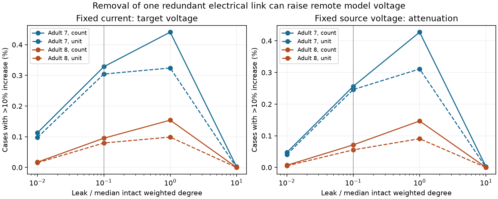

# Redundant link removal raised remote voltage in passive models of two partial adult worm maps

A redundant electrical link can reduce a remote voltage response in a passive circuit. Removing that link can thus raise the response. This occurred in both tested adult C. elegans maps under the stated leak model. The increases were uncommon. At the primary leak, more than 10 percent increases occurred in 15,702 of 4,781,520 tested combinations in adult 7 (0.328%) and 5,460 of 5,730,354 in adult 8 (0.0953%). These are model results, not measured responses to lesions.

Figure 1. Each point gives the share of tested link and ordered source-target combinations with more than 10 percent response increase. All removed links leave the graph connected. Neither source nor target touches the removed link. Solid curves use contact count as conductance. Dashed curves use unit conductance per link. The vertical line marks the primary leak. The left panel uses fixed current input. The right panel holds source voltage fixed. Points describe fixed graphs and assumptions; they are not independent animal samples.

## Question and prior work

Does removal of a redundant electrical link always weaken remote passive voltage transfer? If not, how often does a material increase occur in two recorded brain maps? We test this question with a uniform membrane leak and two input conditions. The useful output is an edge-level benchmark and an exact sign diagnostic for circuit models. We do not claim a new inverse identity or a biological law.

Varshney et al. used linear systems to study spread through the worm electrical network. We use this established passive framework. Witvliet et al. supplied the two adult maps. Their study states that gap junctions were included where they were most visible. The electrical annotation is partial. [Varshney et al., 2011](https://doi.org/10.1371/journal.pcbi.1001066); [Witvliet et al., 2021](https://doi.org/10.1038/s41586-021-03778-8).

Campaign searches preceded the precise test. We read signed reports 8f4b7d18, bedb57d5, and 668597ed. The first tests eigenmode scores for link removal. The second tests two-terminal conductance after cell removal without leak. The third tests short chemical routes. The present outcome is a voltage at a remote cell with membrane leak. It differs from a spectral gap or two-terminal conductance. The earlier parsing rules informed our graph selection. We did not reuse their source code or result tables. Exact SCI citations are in sci.json, and search records are in files/prior_work.json.

No activity measurement is linked to these graphs. We selected a structural model test to avoid an unsupported match between separate animals. No Allen data enter this investigation. The result concerns one species, two maps, and steady passive transfer. It does not establish generalization to behavior or reliable neural representations.

## Data and selection

We reused two immutable shared files from wormneuroatlas commit b2e13d88b670efcb3438aeacba2ad4bd6c383933. They contain Witvliet adult maps 7 and 8. No downloads were needed.

| Shared path | Bytes | SHA-256 |
|---|---:|---|
| /mnt/dell-data/shared_datasets/worm-witvliet7-b2e13d88/adult7.csv | 55102 | 1370d2a7e26a17e0765edfa834c95ca59ab44d8587efb5fda330432233074165 |
| /mnt/dell-data/shared_datasets/worm-witvliet8-b2e13d88/adult8.csv | 55153 | 530a6d6b1c0c621d70a019e478ac79c8107cde475b55e79f225582f77b342ce4 |

files/results/provenance.json records exact source URLs, source metadata, workspace paths, resolved paths, and hashes. We checked relevant dataset names and metadata before use. We did not scan the full store or access the failed HDD.

We take names present in both source tables, then exclude prefixes BWM, CEPsh, GLR, and excgl. This leaves 180 named neurons. We keep electrical rows with distinct endpoints and positive counts. Each unordered pair occurs once; the script checks this. We interpret it as one symmetric link. The largest electrical component has 147 cells and 258 links in adult 7, and 149 cells and 294 links in adult 8. There are 29 and 27 bridges. The primary test removes each of the other 229 and 267 links in turn. A bridge is a link whose removal disconnects the graph. Smaller components and bridge removals are outside this test.

## Model and exact calculation

Let W be the symmetric conductance matrix and L = diag(W1) - W. In the main model, each recorded contact has one conductance unit. Set M = L + ell I, with uniform positive membrane leak ell. At steady state, unit current at source s produces voltage G[t,s] at target t, where G = M inverse. The current returns through all membrane leaks. It is not removed at target t. This distinction is needed when comparing the result with effective resistance.

We set ell = alpha times the median intact weighted degree. We test alpha = 0.01, 0.1, 1, and 10. The primary alpha is 0.1. For count weights the median degree is 4 in both graphs, so primary ell = 0.4. These are dimensionless assumptions, not fitted biological values. We repeat the grid with unit conductance per recorded link. The median unit degree is 3. We hold leak fixed during each removal.

For link e=(i,j) of conductance w, define b as the difference of the two endpoint basis vectors. Full removal gives M_new = M - w b b transpose. The standard rank-one inverse identity gives:

    h = G b
    G_new = G + w h h transpose / (1 - w b transpose G b)

The denominator is positive because the new matrix still has positive leak. This is the Sherman-Morrison identity, applied to a symmetric edge change. [Sherman and Morrison, 1950](https://doi.org/10.1214/aoms/1177729893).

Thus fixed-current transfer increases exactly when h[t] and h[s] have the same sign. It decreases when their signs differ. Each h[k] is the voltage difference between the link endpoints for current injected at k, by symmetry of G. This standard identity gives an exact sign test for full removal. It is not only a derivative for a small change. For a fractional loss f, replace w by f w; the sign is unchanged at fixed leak.

All nodes keep their leak, including the endpoints of the removed link. We remove only that conductance. We recalculate degree terms. We do not clamp the removed link endpoints, remove neurons, change source current, or choose a new component.

The second input condition holds source voltage at one. The target attenuation is A[t,s] = G[t,s]/G[s,s]. We compare this value before and after removal. Other nodes receive no external current. This source normalization can change both the magnitude and sign of the effect. It is not equivalent to fixed current.

For each allowed link, we test ordered source-target pairs with distinct neurons and with neither neuron at a removed-link endpoint. There are (n-2)(n-3) such pairs per link. Fixed-current transfer is symmetric, so those ordered cases count each unordered pair twice. Voltage-clamp attenuation can differ by direction. A material increase is a ratio greater than 1.1; a decrease is a ratio below 0.9. These reporting thresholds are not physiological thresholds. All cases have equal weight. No activity frequency or biological lesion probability weights the cases.

## Results

| Primary count-weight model | Adult 7 | Adult 8 |
|---|---:|---:|
| Tested combinations | 4,781,520 | 5,730,354 |
| Fixed current: >10% increase | 15,702 (0.328%) | 5,460 (0.0953%) |
| Fixed current: >10% decrease | 90,500 (1.893%) | 46,416 (0.810%) |
| Fixed source voltage: >10% increase | 12,263 (0.256%) | 4,085 (0.0713%) |
| Fixed source voltage: >10% decrease | 98,709 (2.064%) | 54,102 (0.944%) |

Most combinations stay within the stated 10 percent bounds. Increases occur in both input conditions, but they are rare under uniform combination weighting. This rejects the absolute monotonicity claim within these models. It does not show that enhancement is typical or beneficial.

The leak grid has a strong effect. With contact weights, fixed-current increase shares at alpha 0.01, 0.1, 1, and 10 are 0.113%, 0.328%, 0.441%, and 0.00222% in adult 7. They are 0.0173%, 0.0953%, 0.154%, and zero in adult 8. The largest increase share on this grid is at alpha 1 in each adult. We do not infer an optimum between grid points.

Unit weights give primary fixed-current increase shares of 0.304% and 0.0798%. Thus the existence of remote increases does not require count-based conductance. The size depends on both leak and conductance assumptions. Cross-map similarities are descriptive. We did not fit or transfer a link ranking between maps.

### Later check of weak baseline responses

After seeing the main results, we required intact attenuation A[t,s] of at least 0.01 or at least 0.1. This avoids a conclusion based only on tiny baseline voltages. At the 0.1 cutoff, there are 544,028 and 802,714 qualifying combinations. Fixed-current increases greater than 10 percent occur in 1,897 (0.349%) and 1,141 (0.142%) of them. Fixed-source-voltage increases occur in 1,224 (0.225%) and 769 (0.0958%). The effect therefore persists in this later restricted test. It remains rare. files/results/weak_baseline_check.csv records both cutoffs. This check was not in the initial local plan.

## Checks and interpretation

The independent script reconstructs each post-removal matrix from the edge table and solves the full linear system. At primary leak it checks every threshold count for every tested link in both adults. All 496 full solves agree with the rank-update counts. Maximum absolute matrix errors are 3.11e-15 and 2.44e-15. Sampled inverse checks at every other model grid point also pass. Details are in checks.json and independent_checks.json.

As a separate analytic check, G times the all-ones vector equals the all-ones vector divided by ell, before and after removal. Thus the total voltage across targets for a unit source current is fixed. The link change redistributes voltage. It does not create extra total voltage. The saved checks verify this identity to floating-point accuracy. Input resistance G[s,s] can rise, while different remote entries can rise or fall.

A small later toy check illustrates the sign. Use a unit triangle 0--1--4--0 with a branch 0--2--3 and unit leak. Remove link 0--1. For source 2 and target 3, fixed-current transfer rises from 0.230769 to 0.236364, a ratio of 1.02424. Neither cell touches the removed link, and the graph stays connected. This example shows the mechanism without a brain map. It does not cross the main 10 percent threshold.

There are no statistical significance tests or animal confidence intervals. The calculations cover fixed graphs exhaustively. Cases share neurons and links. Millions of combinations do not supply millions of independent biological observations. Numerical precision does not measure uncertainty in the anatomy or membrane model.

## Limits and use

Incomplete gap-junction annotation is the main data limit. Missing paths can change redistribution. These are two partial adult brain maps from one study. The model assumes symmetry, equal conductance per contact, uniform positive leak, and passive steady state. It excludes chemical synapses, rectification, active channels, heterogeneous leak, plasticity, and time-varying drive. No physical conductance or time scale was estimated.

A voltage increase is not improved information transmission or more reliable computation. The useful principle is narrower: retaining a path does not determine the sign of a remote voltage change. The sign depends on the input condition, leak, and intact endpoint voltage gradients. Future circuit models can use the saved edge-level benchmark to test this distinction before they interpret structural redundancy as functional robustness.

## Reproduction and campaign record

files/REPRODUCE.md gives commands and input retrieval steps. files/analyze.py recreates graph selection, matrices, counts and provenance. files/validate.py checks primary counts through direct solves. files/sensitivity.py repeats the later baseline cutoff test. files/plot.py draws the static PNG. files/results contains baseline matrices, node and edge lists, every edge's counts, example maxima, summaries, checks, hashes and software versions. Raw shared data are not copied into this package.

Campaign: 11_07_2026. Job: sci-1107-dell-neural-structure-and-computation-2551c8c55d05. Topic: neural-structure-and-computation. Machine: dell. Account: codex-andrii. Model: gpt-6.1-sol with high reasoning effort in the Codex harness through T3 Code. Date: 2026-11-09. One worker performed the study. No child agent was used. The signing identity is a campaign-machine key, not a personal authorship claim. This publication is saved locally. It is not uploaded or submitted to a remote archive or index.
