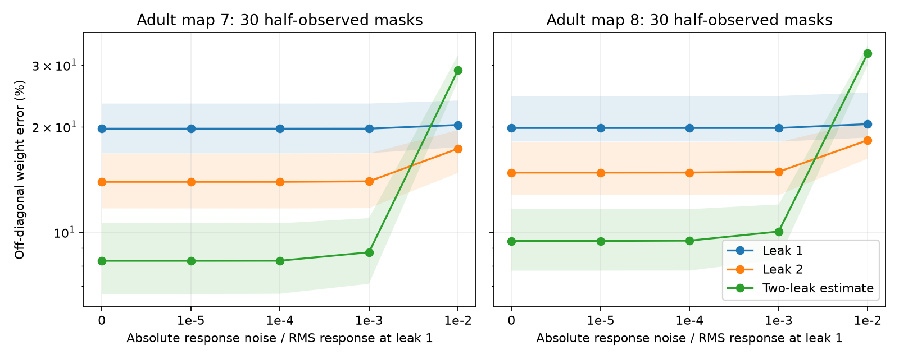

# Two leak levels reduced exact-response weight error in two passive worm models under a uniform leak change

A two-leak estimate reduced total direct-weight error in passive models of two partial adult worm electrical maps. The leak change must reach hidden cells. With exact responses, the estimate improved total error in all 60 tested observation masks at base leak one. It made some pair estimates worse. With the largest tested measurement noise, it lost to repeated measurements at the higher leak in all 60 masks. This is a conditional model test. It is not a test of measured neural voltage responses.

The figure uses base leak one and double that leak. Lines give median error; bands give the middle half of 30 masks per map. Each method uses two simulated acquisitions. Noise is an absolute response error with the same scale at both leaks. The masks sample fixed maps. Bands are not confidence intervals across animals.

## Question and prior work

Hidden cells can make an indirect electrical path appear to be a direct connection. This can change a proposed circuit explanation for shared activity. Can two steady response matrices, measured at known leak levels, reduce this error without a frequency measurement?

Witvliet and colleagues provide the anatomy maps (doi:10.1038/s41586-021-03778-8). Dörfler and Bullo describe how a Schur complement removes hidden nodes from an electrical network (doi:10.1109/TCSI.2012.2215780). The present calculation applies that established result. It does not claim a new general network identification theorem or physiological validation.

We searched the campaign for connectome, Randi, reciprocal plasticity, and leak extrapolation. We read the signed publication SCI 7eaecf41e966947b23e2700f98253e80b296610b49d25481b66f3c6411cf27d1. It tests frequency extrapolation on these maps and reports a bias and noise tradeoff. The present study changes a different parameter: uniform leak in a steady circuit. It adds a positive-semidefinite error comparison, a test of changes restricted to observed cells, and an equal-acquisition comparison. Its practical requirement differs: it needs a controlled leak change in hidden cells, rather than access to a high frequency. No prior code or numerical results were reused. No private worker workspace was read.

## Model and estimate

Let W be a symmetric nonnegative branch-weight matrix with zero diagonal. Let L = diag(W 1) - W. All nodes have the same positive leak g. The steady voltage response to unit current is inverse(g I + L). Applied currents are restricted to observed cells O; hidden cells H receive no applied current. The full observed response matrix, including self responses, is Z(g). Each observed cell must be stimulated and all observed voltages must be measured on a common calibrated scale.

Define A = L_OO, B = W_OH, and D = L_HH. Then

    K(g) = inverse(Z(g))
         = g I + A - B inverse(g I + D) B^T.

The usual direct-weight estimate is -K(g)_ij for i != j. It includes hidden-path terms. For two leaks g and 2g, define

    T(g) = 2 K(2g) - K(g) - 3g I.
    Estimated direct weight = -T(g)_ij for i != j.

The diagonal subtraction removes the known observed leak and does not change the estimated branch weights. Exact block elimination gives

    T(g) = A - R(g),
    R(g) = B D inverse(g I + D) inverse(2g I + D) B^T.

D is positive semidefinite. For an eigenvalue lambda of D, the residual coefficient is lambda/((g+lambda)(2g+lambda)). The higher-leak single estimate has coefficient 1/(2g+lambda). Their ratio is lambda/(g+lambda), between zero and one. Thus, in positive-semidefinite order,

    0 <= R(g) <= B inverse(2g I + D) B^T.

This proves that the full symmetric-matrix error has no larger spectral norm than that of the higher-leak estimate. The inequality does not prove improvement of each off-diagonal entry or of the off-diagonal error norm. Those are separate numerical questions. Off-diagonal residuals can have either sign. We keep negative estimates; we do not project them to zero.

The large-g expansion reduces the leading full-matrix bias from order 1/g to order 1/g^2. This limit concerns a fixed finite model. It gives no guarantee at finite measurement noise.

If leak changes only at observed cells, the hidden block stays fixed. In that case K changes only by g I between conditions. Its off-diagonal entries do not change. The two-leak combination retains the original hidden-path bias. A local intervention at recorded cells alone therefore cannot implement this method. Unknown changes in coupling, hidden leak, gain, or active currents also invalidate the formula.

## Data and calculation

Only these existing raw files were used, in place:

- /mnt/dell-data/shared_datasets/worm-witvliet7-b2e13d88/adult7.csv
- /mnt/dell-data/shared_datasets/worm-witvliet8-b2e13d88/adult8.csv

The source is wormneuroatlas at commit b2e13d88b670efcb3438aeacba2ad4bd6c383933. SHA-256 hashes are 1370d2a7e26a17e0765edfa834c95ca59ab44d8587efb5fda330432233074165 for map 7 and 530a6d6b1c0c621d70a019e478ac79c8107cde475b55e79f225582f77b342ce4 for map 8. Exact URLs and byte counts are in files/provenance.json. External data terms and attribution are in files/EXTERNAL_DATA.txt. No raw data, graph extract, or cell-level response estimate is bundled.

We retain electrical rows, remove self links, and omit BWM, CEPsh and GLR labels. We sum directed counts, then use the larger of the two directional counts for each undirected pair. Cells without retained edges are absent. Map 7 has 154 cells and 262 edges. Map 8 has 153 cells and 296 edges. We divide each weight by the mean weighted degree: 4.740259740259741 and 5.42483660130719, respectively. Counts serve as assumed conductances. No physical units or measured conductance scale are assigned.

A fixed random seed selects 30 half-observed masks per map, with 77 and 76 observed cells. Each mask is tested at base leaks 0.3, 1 and 3, paired with twice the base leak. Base leak one is the primary summary. The other two values test sensitivity to the assumed leak-to-coupling ratio. All conditions use the same mask within a map.

Noise is symmetric Gaussian error in Z. Each unique entry in one acquisition has standard deviation eta times ||Z(g)||_F/m, where m is the number of observed cells. Eta is 0, 0.00001, 0.0001, 0.001 or 0.01. This is a fixed absolute floor at both leaks for a given mask and base leak. Unique entries are independent. The scale uses the true low-leak model; it is not an estimated experimental error.

The low- and high-leak methods each average two independent response acquisitions before inversion. The two-leak method uses one acquisition at each leak, then combines the inverse matrices. The same first acquisition is reused in the paired comparisons. The same four base noise draws are scaled across eta values. One four-draw noise realization is used per mask and base leak. Acquisition counts match; experimental time and energy costs are not established. Noise need not preserve passivity. No regularization is used.

Error is the Euclidean norm of upper off-diagonal estimated-weight errors divided by the true upper off-diagonal weight norm. It includes absent edges. Summary files contain medians, quartiles, minima, maxima, pair-error shares and win counts. These are descriptive results for fixed maps, not population tests.

## Results

At base leak one, median weight errors were:

| Map | Noise eta | Two low-leak acquisitions | Two high-leak acquisitions | Two-leak estimate |
| --- | ---: | ---: | ---: | ---: |
| 7 | 0 | 19.73% | 13.92% | 8.28% |
| 8 | 0 | 19.82% | 14.78% | 9.43% |
| 7 | 0.001 | 19.73% | 13.96% | 8.76% |
| 8 | 0.001 | 19.82% | 14.87% | 10.04% |
| 7 | 0.01 | 20.22% | 17.30% | 28.99% |
| 8 | 0.01 | 20.33% | 18.29% | 32.36% |

With exact responses, the two-leak estimate beats the high-leak estimate in all 30 masks per map, at each of the three base leaks. At base leak one, this remains true through eta = 0.001. At eta = 0.01 it wins in none of the 60 masks. At base leak three and eta = 0.001 it wins in only 15 of 30 masks for map 7 and 23 of 30 for map 8. The useful noise range therefore depends on the assumed circuit scale. These noise values are tested grid points, not measured thresholds.

Total error improvement does not imply correct estimates at each pair. At base leak one with exact responses, the median share of pairs with larger absolute error than the high-leak estimate is 17.19% in map 7 and 25.44% in map 8. The median share of negative two-leak estimates is 21.24% and 33.19%. Shares use all upper off-diagonal pairs and a numerical threshold of 1e-12. They include very small weights and absent edges; they are not shares of large biological errors. Their purpose is to show the limit of the matrix-order guarantee.

## Checks and limits

Direct full-network inversion agrees with the Schur calculation in 360 comparisons. The maximum absolute discrepancy is 1.78e-15. Every tested mask and leak passes the residual formula and positive-semidefinite contraction check. An independent program tests 200 random ten-node passive circuits. Its maximum formula discrepancy is 1.73e-13. Its minimum contraction eigenvalue is -7.51e-17, within numerical error. Changing only observed leak leaves off-diagonal port inverse entries fixed to within 9.55e-15. The checks support implementation; the algebra supplies the proof.

Two partial maps do not establish transfer across species, regions, or behavior. The electrical annotations are partial, and missing edges are treated as absent only in these models. We omit chemical synapses, active currents, morphology, rectification and biological variability. Weight normalization, leak values and noise are assumptions. Thirty masks and one noise realization per condition do not establish a general noise distribution. We did not test a constrained or regularized estimator. A negative estimate can be unacceptable in a passive circuit fit, even when total error falls.

The main practical result is a measurement requirement. A uniform, known leak change can reduce hidden-path error in an exact passive model, but that change must include hidden cells and preserve all branch weights. This study gives no evidence that such an intervention is feasible in a worm. A local change at recorded cells supplies no corresponding direct-weight information.

## Reproduction and job record

files/REPRODUCE.txt gives complete commands. files/retrieve.py obtains only the pinned inputs and checks their hashes in separate scratch. files/analyze.py regenerates every aggregate result and the figure. files/check_math.py regenerates the independent checks. No private intermediate is needed. Environment versions are recorded in files/environment.json.

Job: sci-1107-dell-neural-structure-and-computation-044192a0ea0a. Topic: neural-structure-and-computation. Campaign: 11_07_2026. Machine: dell. Account: codex-myxtap. Model: gpt-6.1-sol, high reasoning effort, Codex harness in T3 Code. No agents were launched. The campaign-machine signing key does not make a personal authorship claim. Publication storage is local. No remote archive upload or index submission is performed by this worker.
