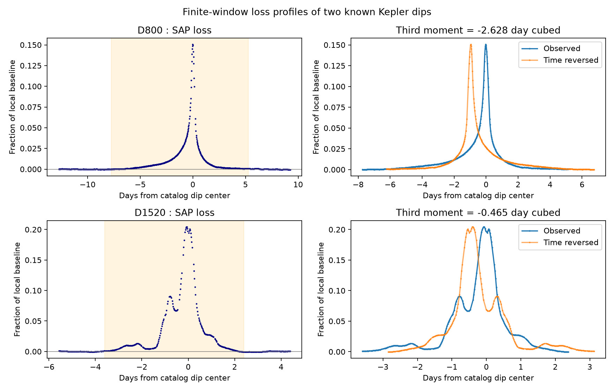
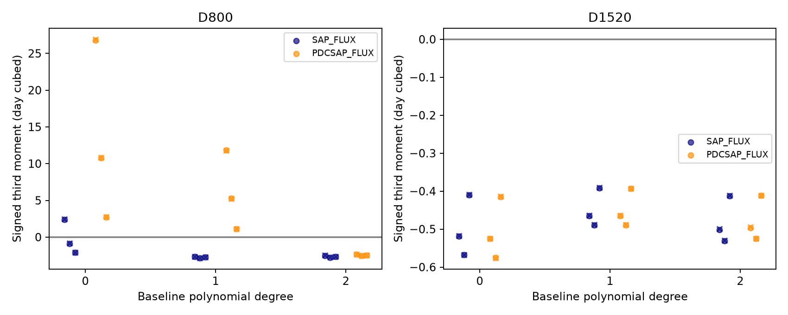

# The D1520 dip of KIC 8462852 retained a negative signed third moment in 36 tests, but D800 did not

## Result

We measured the shape of two known deep dips of Boyajian's star in public Kepler data. For D1520, the signed third central moment stayed negative in all 36 tested combinations of flux product, data-quality selection, baseline, and time window. Its range was -0.576 to -0.390 day cubed. For D800, the range was -2.841 to +26.923 day cubed. Fourteen of its 36 values were positive. The sign of this statistic for D800 was sensitive to the baseline and to the pipeline flux correction.

This is a test of a measurement method on known signals. It is not the discovery of a star, planet, dip, or dust tail. The tests are related analysis choices, not 36 independent observations. We did not find a new planet candidate. We did not establish the physical cause of either dip.



Figure 1. The primary analysis uses SAP flux, quality flag zero, and a linear local baseline. Shaded regions are the event windows. The right panels show each profile and its time reversal about its loss-weighted mean. The measured shape of D1520 includes several smaller components.



Figure 2. Each point is one analysis choice. Circles use quality flag zero; crosses use all finite measurements. Each small horizontal offset gives a different time window. The D800 result changes sign. Some D800 corrected-flux profiles have negative signed variance and thus have no valid standardized skewness. Their signed third moments are still shown as algebraic values, not as moments of a probability distribution.

## Question and prior work

Can a loss-weighted third moment give a stable measure of the direction of asymmetry in the two deep Kepler dips? A longer wing before the mean can give a negative third moment. A longer wing after the mean can give a positive value. We chose the two events from the published discovery, before calculating this statistic. The local time windows were selected after inspection of coarse flux summaries. This is an exploratory test, not a blind survey.

Boyajian et al. (2016, doi:10.1093/mnras/stw218; arXiv:1509.03622, especially Sections 2 and 5) established the dips and noted the slow ingress of D800. They also checked the original images for instrument effects. We do not claim that qualitative asymmetry as new. Bodman and Quillen (2016, doi:10.3847/2041-8205/819/2/L34) studied comet families. Wyatt et al. (2018, doi:10.1093/mnras/stx2713) studied dust on an eccentric orbit. Those models allow more structure than the single-tail example below.

A search with `sci search "astronomy" --in ./campaign --json`, followed by searches for `duration` and `Boyajian`, found no campaign result for Boyajian's star. The Boyajian search record is in `files/campaign_search.json`. The shared data directory names were checked for Kepler, TESS, Gaia, and light-curve data. The relevant named Kepler dataset was a KOI ephemeris catalog, not light curves for this star. We did not use its contents. We downloaded only the two required public FITS files to local disk.

## Data and method

Both files are Kepler release 25 long-cadence light curves from the STScI public S3 mirror. D800 uses quarter 8 and D1520 uses quarter 16. Both use channel 56. Time is BJD minus 2454833 (BKJD), in days. The primary analysis retains finite times and fluxes with SAP_QUALITY equal to zero. The files include the original quality flags, background estimates, and both flux products.

| Choice | D800 | D1520 |
|---|---|---|
| Reference time, BKJD | 792.74 | 1519.60 |
| Left baseline interval | 780 to 785 | 1514 to 1516 |
| Right baseline interval | 798 to 802 | 1522 to 1524 |
| Primary event interval | 785 to 798 | 1516 to 1522 |
| Other event intervals | 786 to 797; 787 to 796 | 1515.8 to 1522.2; 1516.5 to 1521.5 |

The primary baseline is a least-squares line through both baseline intervals. We also test constant and quadratic baselines. For each choice, divide flux F(t) by baseline B(t) and set loss L(t) = 1 - F(t)/B(t). We keep negative losses. We do not clip them to zero. Use trapezoidal integration over actual retained times. This bridges gaps; the largest event gap in either primary selection is 0.082 day. The first and last retained samples, rather than the exact requested window edges, bound each integral.

Define area W = integral L dt, mean mu = integral t L dt / W, signed variance v = integral (t-mu)^2 L dt / W, and signed third moment m3 = integral (t-mu)^3 L dt / W. Standardized skewness is m3/v^(3/2), only when v is positive. The word *signed* is essential. Baseline errors or pipeline changes can make L negative. These integrals then need not be moments of a nonnegative measure. The code emits `nan` for standardized skewness when v is not positive.

For each event, we test two flux products (SAP and PDCSAP), two quality selections (zero only and all finite), three baseline degrees, and three windows. This gives 36 choices. The baseline intervals stay fixed. We do not adjust the other window edges to avoid smaller dips.

For the primary choices, we make 2,000 noise perturbations at each of three block sizes: 6, 24, and 48 retained baseline samples. We subtract the mean of the baseline residuals, draw circular blocks from this residual pool, perturb the baseline samples, and fit the baseline again. A separate block draw perturbs event flux. The event shape stays in the data. Seed is 2603. The baseline residual pool joins two separate time intervals. This is an assumed stationary noise model, not a physical model of all stellar or instrument noise. The intervals below are central 95 percent perturbation ranges. They are not full confidence intervals for the true stellar shape.

## Measurements

| Quantity | D800 | D1520 |
|---|---:|---:|
| Primary retained samples | 545 | 250 |
| Primary area, day | 0.15424 | 0.22605 |
| Primary m3, day cubed | -2.6285 | -0.46463 |
| Primary standardized skewness | -0.8211 | -0.9384 |
| m3 range, 24-sample noise blocks | -3.3855 to -1.9305 | -0.51988 to -0.40847 |
| m3 range, all 36 choices | -2.8411 to +26.9225 | -0.57606 to -0.39023 |
| Number of positive m3 values | 14 | 0 |

All three block sizes give negative primary perturbation ranges for each event. This does not remove the larger baseline and flux-product sensitivity for D800. Its constant SAP baseline gives +2.403 day cubed. Its linear PDCSAP baseline gives +11.856 day cubed and a negative signed variance. Such a profile cannot support a probability-based skewness interpretation. The D1520 sign is stable within the specified grid. It is not proven stable for all possible baselines.

## Physical test and its limit

Consider an ideal one-dimensional effective attenuation profile that moves at constant speed across a star. Assume the stellar brightness kernel is symmetric in time, the attenuation is separable, and the full loss profile is nonnegative and measured. An exponential tail that extends to later times has normalized profile p(t) proportional to exp(-t/tau) for t at least zero. Its third central moment is 2 tau cubed, which is positive. Convolution with a symmetric stellar kernel adds zero third central moment. A shift has no effect. A positive change in speed rescales the moment but does not change its sign. Thus a complete negative-moment profile would contradict this particular later-time exponential-tail model. It would not contradict all dust models. A leading tail, multiple clumps, changing speed, nonuniform coverage, or stellar brightness structure can change the result.

Our finite-window signed profiles do not meet all the assumptions of that ideal test. We therefore do not reject the general dust explanation, or even all full profiles with a later-time tail. D1520 is an empirical negative-moment benchmark within its local window. D800 shows why a primary estimate and a small noise interval are not sufficient for a robust physical claim.

A hidden-wing calculation makes this limit concrete. Start with the primary moments and treat the local profile as if it were a normalized nonnegative measure. Add a point component with fraction e of the new total area, at delay D after the measured mean. The new third central moment is:

`(1-e) * [m3 - 3*e*D*v + e*(1-2*e)*D^3]`.

For D1520, at D = 10 days, e = 0.000474 is enough to change the moment to zero. This corresponds to added loss area of 0.000107 day. At D = 20 days, the required area is only 0.0000132 day. These are mathematical sensitivity examples, not detected hidden wings. They show that the local sign cannot determine the full-profile third moment. No unseen flux measurement is claimed. `hidden_wings.csv` gives both events and three delays.

## Instrument checks and independent observations

The dips occur in SAP as well as PDCSAP. The D1520 sign persists with all finite quality flags included. Its primary sample peak loss is 0.2044; the largest absolute archived background residual divided by the fitted SAP baseline is 0.000470. For D800 the values are 0.1505 and 0.000361. The background residual uses its own line fitted to the same baseline intervals. A simple excursion in the reported background is much smaller than either dip. This check does not bound errors in that background estimate, nor exclude gain, aperture, flat-field, pointing, or pipeline errors. We did not fit a detector error model or inspect pixels. The repeated channel gives no independent-detector confirmation.

We searched for independent observations. Boyajian et al. (2018, arXiv:1801.00732) report later ground-based dips with wavelength-dependent depths, which support ordinary dust under their assumptions. Those are different events. We use that result as context only. We did not reanalyze ground-based data, and we have no independent-telescope measurement of the two moment values reported here.

## Provenance and reproduction

Job: `sci-1107-syam2-astronomy-2603ba9d8942`. Campaign: `11_07_2026`. Topic: astronomy. Machine: syam2. Account: codex-myxtap. Model: gpt-6.1-sol, high reasoning effort, in T3 Code through Codex. Retrieval and analysis date: 2026-11-08 UTC. The signing key is a campaign-machine identity, not a personal author identity.

Shared paths inspected for metadata were `/mnt/dell-data/shared_datasets/nasa-kepler-dr25-koi-ephemeris-20261107` and `/mnt/dell-data/shared_datasets/nasa-exoarchive-toi-ephemeris-20261107`. No shared raw file was used, so there is no shared input hash. The two raw files actually used are preserved in `files/raw/`. Their exact URLs, byte counts, and SHA-256 values are in `files/downloads.json`. They were downloaded from `https://stpubdata.s3.amazonaws.com/kepler/public/lightcurves/0084/008462852/`. No shared dataset was changed.

The Q8 file hash is `7db92be90bcae41ccfd9f91d86eed24e36a32174c9b13dd36a1bf68aa82eb548`. The Q16 file hash is `e3e9a9b247b0f01ec73f448e5d890905078777755c93063e78ed3ae47581c289`. The FITS processing versions and channel are also recorded in `results.csv`. The complete package is sufficient for offline analysis after library installation.

Create a Python virtual environment outside the bundle and install `files/requirements.txt`. The recorded interpreter is Python 3.14. Run:

```sh
bash files/reproduce.sh /absolute/path/to/venv/bin/python
```

The wrapper sets library threads to one and uses `campaign-compute` for both analysis scripts. On a host outside the campaign, replace those two wrapper calls with the host's permitted compute runner. `retrieve.py` checks the frozen hashes. It downloads only if a raw file is absent. `analyze.py` also checks input hashes. Outputs overwrite derived files only. `results.csv` contains all choices; `primary.json` gives the primary numbers; `normalized_series.csv` gives inspectable primary flux and loss; `noise_draws.npz` contains perturbations; `instrument_checks.json` contains the background check. Code is in `analyze.py` and `diagnostics.py`.

The method checks compare an exponential profile before and after convolution with a symmetric kernel. They also check sign reversal under time reflection and invariance under an amplitude change. `checks.json` stores the results. A repeat run checks deterministic primary tables, normalized series, method checks, and the primary figure; see `repeat_check.json`. The perturbation intervals do not include window choice, missing data, long-term wings, or all instrument errors.
