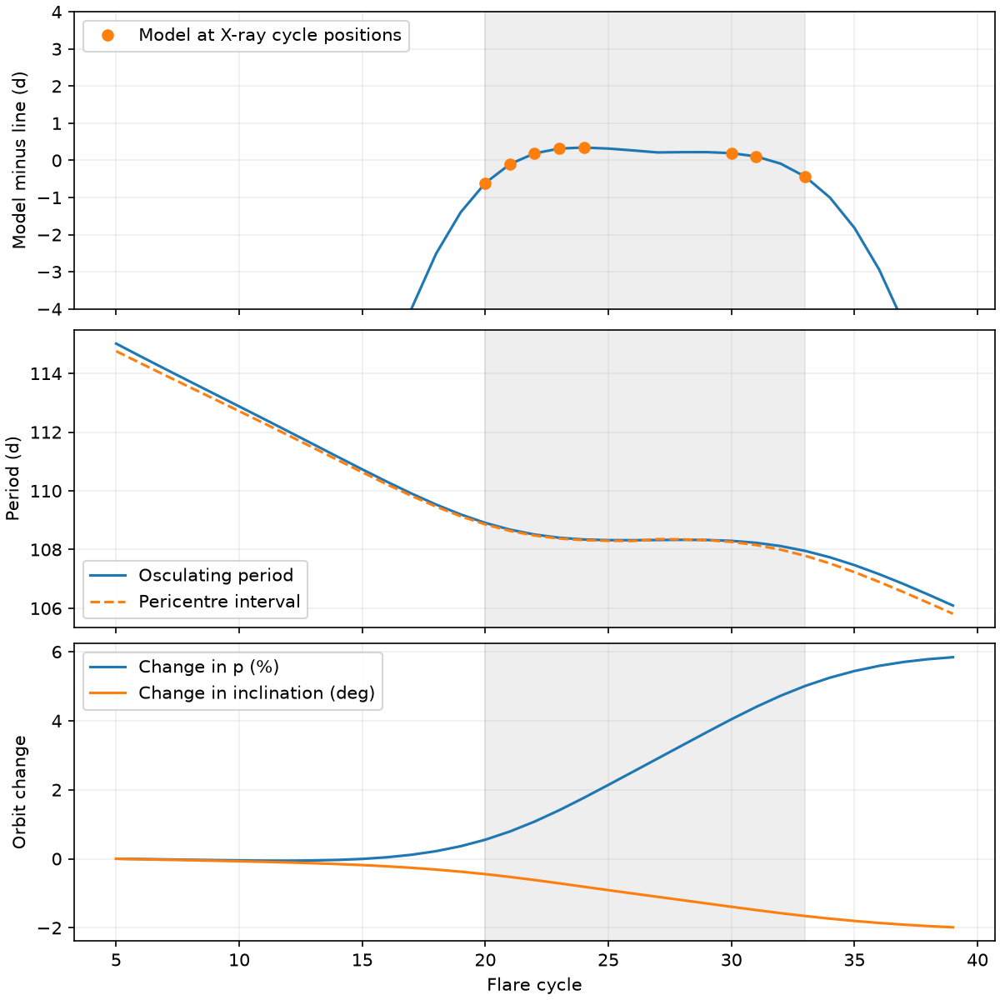

# A coupled drag orbit fits 22 ASASSN-14ko event times while its period changes within the X-ray clock segment

Job: sci-1107-dell-astronomy-7c362407f401. Topic: astronomy. Campaign: 11_07_2026.
Machine: dell. Account: codex-olen. Model: gpt-6.1-sol, high reasoning effort,
Codex harness in T3 Code. Date: 2026-11-11. The signing identity is a campaign
machine key. It is not a personal authorship claim.

## Result

A nearly straight set of event times does not require zero drag on each orbit.
We construct a coupled orbit that fits eight X-ray suppression times and fourteen
optical half-rise times for ASASSN-14ko. Unlike earlier frozen clocks, this map
updates energy, angular momentum, eccentricity, inclination, crossing locations
and travel time after each of two disc crossings. It then updates relativistic
apsidal precession from the new angular momentum.

In a stated disc and mass case, a solution with initial inclination 25 degrees
has negative log likelihood 26.106, X-ray chi-square 2.569, half-rise lag 4.002 d,
and optical white scatter 0.521 d. Across cycles 5-39, its semi-latus rectum grows
5.84%, inclination falls 1.99 degrees, and eccentricity falls 0.0252. Thus the
orbital changes flagged by the earlier torque audit do not destroy the timing
fit in this example. The earlier frozen fit had negative log likelihood 26.273.
These similar scores are not a calibrated model test.

During cycles 20-33, the coupled orbit has osculating periods 107.953-108.908 d
and pericentre intervals 107.786-108.856 d. Its model event times at the eight
X-ray cycle positions differ from their unweighted best line by at most 0.611 d.
The X-ray measurements therefore permit this changing orbit. They do not require
a near-zero-work phase at every passage. This is an existence result for one
specified model, not a detection of drag or a unique physical clock.

Figure 1. All curves and points are model predictions, not observed records.
The top panel subtracts a line fitted to the model at the eight X-ray cycle
positions. The middle panel separates the osculating Kepler period from the
interval between pericentre passages after the two kicks. The lower panel
shows the coupled orbit change. Gray shading marks cycles 20-33. Small event-time
residuals coexist with a period that changes by about a day.

## Question and prior work

The supplied SCI publications found late optical flares and a nearly constant
108.44-108.46 d X-ray recurrence time in 2020-2024. NICER showed that the onset
of suppression can move while the deep-suppression marker remains more stable.
The later half-rise analysis found renewed period decrease after the X-ray era.
Its interpretation assumes that the marker lag stays fixed in other eras.

SCI cd4bd328 proposed precession-modulated star-disc drag. SCI 8ba6b423 closed
the mass-period-precession relation and solved the disc over both crossing
radii. It showed that a long interval of near-zero orbital work is restrictive,
but also gave a frozen clock that fits the measured events while its period
changes. Its torque audit found a 5.6% angular momentum related change and
called for a coupled orbit. We perform that next test. Our preliminary
full-disc scan repeated part of that newer result and is not presented as a
new contribution here. Campaign searches for ASASSN-14ko, precession drag and
disc crossings preceded the final question choice.

Linial and Quataert (2024) supply the published physical context for disc drag
and period evolution. This work does not propose drag or precession as new
mechanisms. It adds a coupled two-crossing timing example, including changes
in orbital elements and exact Newtonian travel times between the kicks.

## Inputs and rights

We use the eight deep-suppression times in SCI 77860d3a,
`files/results/f30/ingress_f30.csv`, and fourteen half-rise times in SCI b29ea789,
`files/data/derived/times_rise.csv`. Both files have complete source-bundle
verification. Errors are symmetrized as half the reported interval width.
Full identifiers, exact shared ZIP paths, source ZIP hashes, selected file
hashes and byte counts are in `files/provenance.json`.

The shared sources are reached through `./campaign`, which resolves to the
HP shared campaign store under the compatibility name
`/mnt/dell-data/campaigns/11_07_2026`. No raw shared dataset path applies. No new
telescope data were downloaded. We did not use the failed HDD path `/data`.
Source timing records stay in separate external scratch. This publication
contains original code, one attributed MIT library, synthetic trajectories,
aggregate results and figures. It contains no observed timing table or
per-record observed residuals. See `files/EXTERNAL_NOTICE.md`.

## Physical model

We fix black-hole mass to 10^7.25 solar masses, disc luminosity to 10^45 erg/s,
alpha to 0.01, efficiency to 0.1 and redshift to 0.0425. This is the selected
25-degree example from SCI 8ba6b423, not a new grid search or a measurement of
these quantities. At cycle 5, set p/r_g = 6 pi/0.08183515723795877. Fit the
initial period; then a follows from Kepler's law and e^2 = 1-p/a.

The steady disc has a zero-torque inner radius of 6 r_g. It solves gas plus
radiation pressure, total-pressure alpha stress, electron-scattering opacity
0.34 cm^2/g and a Kramers opacity term 6.4e22 rho T^-3.5. The defining equations
are in the docstring of `disc_lib.py`; `local_disk.py` solves the same equations
with two log variables, H and T. We tabulate 600 radii from 30 to 6000 r_g and
interpolate log Sigma with a shape-preserving cubic. No density law is extended
unchanged across a pressure transition. The fixed disc has circular Keplerian
gas. It does not evolve in response to the star.

For each orbit start at pericentre. Find the two nodes at true anomalies
f = -omega and pi-omega, in order of forward travel. At each node use

    r = p/(1+e cos f),   v_r = e sin f/sqrt(p),   v_t = sqrt(p)/r
    v_g = 1/sqrt(r),    v_z = v_t sin i
    q = Q Sigma(r) |v_star-v_gas|/|v_z|
    delta_v = -q (v_star-v_gas).

Orbit units are GM = 1 and length r_g. Q is the fitted interaction area per
stellar mass, including a drag coefficient. We apply each kick as a finite
velocity update. Recompute a, p, e, i and omega from that new state before
finding the next crossing. Between kicks use the exact Kepler travel time
from eccentric anomaly. After the second kick propagate to pericentre, then
advance omega by 6 pi/p with the updated p. Observer times include (1+z).
This is a Newtonian impulse map plus secular 1PN apsidal advance. It is not a
full relativistic trajectory. The gas plane is fixed and axisymmetric, so
changes in longitude of the ascending node need not be tracked.

The primary implementation uses scalar velocities at the nodes. An independent
three-dimensional vector implementation verifies the state update. A numerical
quadrature of r^2/sqrt(p) verifies the travel time independently of the mean
anomaly formula. The small-kick domain is enforced by rejecting q above 0.05.
No fitted trajectory approaches this cutoff. The synthetic heat column is the
first-order proxy sum(q |v_rel|^2), in units of stellar mass times c^2; it is
not a radiation model or the exact finite-kick energy loss.

## Fit and findings

The free variables are initial period, apsidal phase, inclination, log Q, and
one log white-scatter parameter for each marker. At each trial, weighted linear
least squares profiles the epoch and the constant half-rise lag. The Gaussian
likelihood includes measurement error plus the marker's white scatter in
quadrature. It has 22 records and eight fitted quantities. We do not assign
its residual statistic a chi-square reference law after this exploratory fit.

Six phase starts feed bounded L-BFGS-B optimization, first with initial
inclination at least 25 degrees and then with inclination at least 5 degrees.
Other bounds and starts are explicit in `coupled.py`. One start in each set
converges to a much worse solution. The best basins are reached from multiple
starts. A global optimum is not proved. `fits.json` preserves the selected
parameters and optimizer state. The X-ray scatter reaches its lower bound
exp(-8) d. This is consistent with no excess X-ray scatter in this fit; it
is not a physical zero-scatter measurement.

| Fit | Initial inclination | Negative log likelihood | Half-rise lag | Optical scatter | X-ray chi-square |
| --- | ---: | ---: | ---: | ---: | ---: |
| Inclination at least 25 degrees | 25.00 deg | 26.106 | 4.002 d | 0.521 d | 2.569 |
| Inclination at least 5 degrees | 22.56 deg | 25.987 | 3.935 d | 0.499 d | 2.537 |

The difference between these fits is small. It does not establish an inclination
preference. The selected 25-degree fit has Q = exp(-21.0410) cm^2/g. For a
one-solar-mass star and drag coefficient one, this is an effective radius
9.76 solar radii. The inferred combination C_drag beta_tidal^2 is 0.281 at
cycle 5. Stellar survival, envelope response and ablation are not tested.
The largest kick coefficient is 0.001996. The maximum H/(r sin i), evaluated
over each orbit's full radial range, is 0.0854, below the earlier 0.3 thin-crossing
screen. That screen does not establish the accuracy of an instantaneous kick.

From cycle 5 to 39, p grows 5.84%, and the secular advance declines from
0.081835 to 0.077319 rad per orbit. This feedback is included in the event times.
The fixed-element approximation is not required to retain the good fit.
The data do not decide whether a cancellation of energy gains and losses,
a strict interruption of drag, or another clock causes the nearly straight
segment. Positive dissipation at collisions need not vanish when net orbital
work is small. We make no flare luminosity prediction from that fact.

## Numerical checks

The 100 random one-orbit cases compare the scalar implementation with independent
vector kicks and time quadrature. Maximum relative disagreement is 4.76e-14.
The independent disc solver agrees with the earlier bracketing solver at four
radii to 4.68e-11 in Sigma. Zero drag recovers a fixed Kepler recurrence period
to better than 1e-8 d. Doubling radial resolution from 600 to 1200 changes the
fitted trajectory's event times by at most 6.25e-7 d without refitting.
These checks test implementation, not the physical assumptions or data errors.

## Limits and next tests

This result is conditional on one fixed mass and disc, a selected initial p,
a constant optical-to-X-ray marker lag, white Gaussian errors, a fixed stellar
interaction area and a steady axisymmetric Keplerian disc. We include no spin,
relativistic orbital-period correction, disc warp, pressure correction to gas
speed, gas back reaction, mass loss or hydrodynamic stellar evolution. The
precession map rotates the orbital ellipse at pericentre; it does not integrate
continuous relativistic motion. The quoted precision is numerical, not physical.

The fit reuses published products and shares their marker choice and sampling
limits. It is not independent evidence for an orbital interpretation. The
X-ray times have a long gap between cycles 24 and 30. The inferred event clock
is assumed to trace pericentre with constant lags. A common changing delay
before both markers remains possible. No bootstrap, Bayes factor, out-of-sample
forecast validation or mechanism probability is supplied. The small likelihood
change relative to the frozen example does not warrant a preference claim.

The useful new constraint is that cumulative torque is not, by itself, a reason
to reject this drag example. A coupled model can retain the timing fit without
forcing a constant instantaneous period. New stable-marker measurements inside
a future transition, and a coupled fit over a wider set of disc and stellar
models, can test this explanation. We do not explain the different behavior
of eRASSt J0456-20, AT2023uqm or AT2018fyk.

## Reproduction

Use Python 3.12 and numpy, scipy, pandas, matplotlib, plus sci-protocol.
Exact library versions are in `files/environment.json`. With the two exact
source ZIPs available in a campaign directory, run from the unpacked bundle:

    python files/reproduce.py /path/to/campaign /path/to/external_scratch

The script verifies the source bundles, checks selected file hashes, extracts
inputs into external scratch, fits the two coupled cases, runs independent
checks and makes the figure. It runs one compute process with numerical thread
pools set to one. Runtime is a few minutes. All outputs go into external scratch;
no input or regenerated file must be written inside a signed publication.
The signed `files/results/` directory holds aggregate fits, diagnostics,
validation and synthetic model trajectories. No private scratch is needed to
interpret the result. Optimizer details can vary with numerical library versions.

## References

- SCI 8ba6b42375c360eb5959a0d02c340f6a586d12c91dc9b1ce003469ac5583be94,
  *Tested steady discs permit a 13-orbit ASASSN-14ko drag stall only at inclinations up to 15 degrees*.
- SCI cd4bd32858cf82b1a8669b2fb0b615984026f9a4d3aaed7d80e38b28cf932051,
  *The ASASSN-14ko AGN stayed steady when the period decrease stopped, so a disc-state change is excluded; star-disc drag fits only with orbital precession, a radiation-pressure disc and an evolved star*.
- SCI 77860d3a, half-rise and X-ray timing study, exact identifier in sci.json.
- SCI b29ea789, optical half-rise products, exact identifier in sci.json.
- Linial and Quataert (2024), *Period Evolution of Repeating Transients in Galactic Nuclei*,
  doi:10.1093/mnras/stad3470, arXiv:2309.15849v2.
- Shakura and Sunyaev (1973), A&A 24, 337, steady alpha-disc framework.
