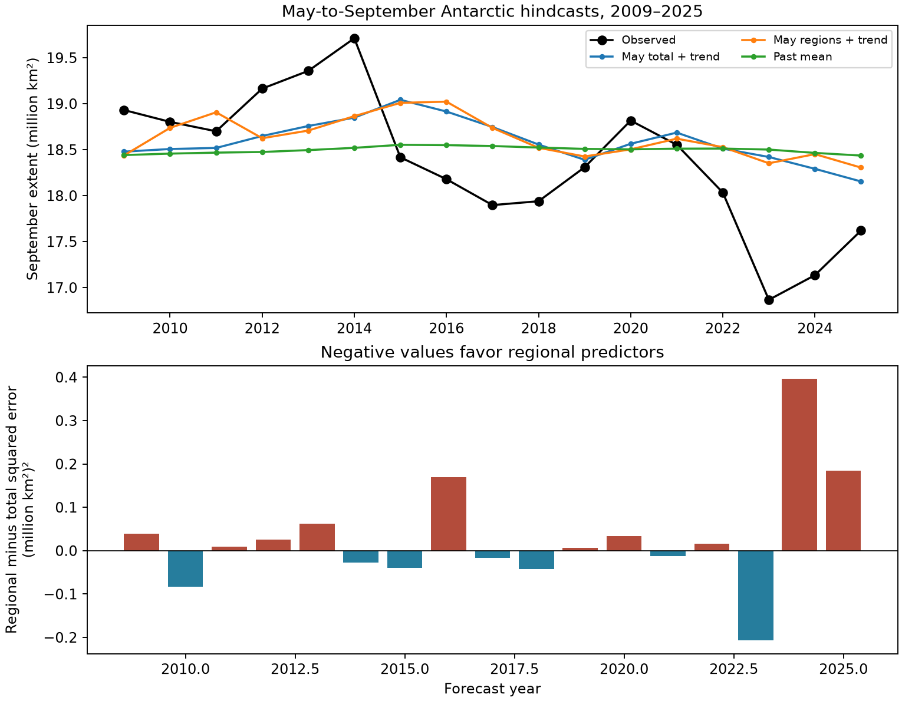

# May regional ice extent did not improve September Antarctic extent forecasts in a 2009–2025 test

The test found no forecast gain from five May regional extent values over May total extent and year. The regional model had a root mean squared error (RMSE) of 0.711 million square kilometres. The total model had an RMSE of 0.690 million square kilometres. The test has only 17 years. It cannot exclude a small gain in other samples or with other models.

## Question and scope

Can the location of Antarctic sea ice in May help predict total extent in September? Regional ice can retain information about ocean heat and wind. A total can hide that information. This test asks if five regional values give a useful gain in a simple statistical forecast. It does not test the physical cause of ice loss.

The main test uses data from 1979 to 2025. Each forecast for 2009 to 2025 uses only earlier years to fit the model and select its penalty. The input is the mean May extent in each of five regions. The target is the sum of mean September extent across those regions. The workbook contains five-day trailing means. Thus, the target is an average of smoothed daily extent, not the official monthly extent index. No 2026 data enter the test.

## Prior work

Hobbs and colleagues, *A twenty-first century structural change in Antarctica's sea ice system* (2025), report changes in regional persistence and links with total extent. The study motivates a forecast test but does not establish that this small model will have skill. *Regional Multiyear Predictability of Antarctic Sea Ice in CESM2 and Its Implications for Marine Ecosystems* (2025) reports regional and seasonal differences in predictability in a climate model. These results motivate the use of regional inputs. This test uses observations and tests the gain over a matched total-extent model.

The study *Understanding the drivers and predictability of record low Antarctic sea ice in austral winter 2023* (2024) links forecast skill for that event to ocean conditions in a model experiment. Extent alone is not a direct measure of ocean heat. Poor forecasts here do not contradict that mechanism. This package provides a small forecast benchmark, not a claim of a new physical mechanism.

The required SCI campaign searches were started before the precise question was selected. They were stopped after more than seven minutes of full-campaign verification without a returned result. We found candidates by reading metadata from public campaign ZIPs, then used `sci read` to verify and read the relevant published texts. The discovery record is in `files/campaign_search.json`. This was not an exhaustive literature search.

Three signed campaign studies provide direct context. [7941cfa4](sci:sha256:7941cfa49abb49975989a47a27361e3a1b8eda266507e6d0d1644b89fea37a00) found no clear gain from February extent after prior winter extent was known. [97245754](sci:sha256:97245754dd61a71b7255e45939c8393b89f774f7bc3c9a4097106e1b2b71fdac) reports seasonal forecast failure and changes in regional cancellation. [96094d42](sci:sha256:96094d4207b6e98aaa209cd4f0772e65391bccebe143d991d445bd6ca66a0025) reports increased winter covariance in five regions. We read these published texts with SCI. The current test adds a direct comparison of May regional inputs with May total inputs, using nested time-ordered penalty selection. No earlier code or derived data are reused. The source workbook is shared with the regional studies.

## Data and provenance

Data citation: Fetterer, F., Knowles, K., Meier, W. N., Savoie, M., Windnagel, A. K. and Stafford, T. (2025). *Sea Ice Index*, G02135, Version 4. National Snow and Ice Data Center. DOI: [10.7265/a98x-0f50](https://doi.org/10.7265/a98x-0f50). Subset: Antarctic daily regional extent, March, May, June and September, 1979–2025. Accessed 8 November 2026.

The shared file is `/mnt/dell-data/shared_datasets/nsidc-g02135-v4-s-regional-daily-20261108/S_Sea_Ice_Index_Regional_Daily_Data_G02135_v4.0.xlsx`. Its SHA-256 is `77d3b712babe3087ecae785a21d2f07e50847a91628fda69d0618cfcf62e6de4`. The script checks this hash against the shared provenance record. The exact URL, size, download time, sheets and hash are in `files/provenance.json`. No new raw data were downloaded. Existing shared data were read in place.

The five regions are Bellingshausen-Amundsen, Indian, Pacific, Ross and Weddell. Each used month has all expected daily entries in every year and region. There is no interpolation. Extent measures ocean area with ice concentration at least 15 percent. The workbook and its Documentation sheet state that the daily regional series use five-day trailing means. Averaging these entries gives a small shift in the monthly time window. It avoids future-day input from June in the May forecast.

## Method

The main comparison has two ridge regression models. One uses May total extent and year. The other uses five May regional extents and year. Both have a free intercept. Each input is centred and divided by its population standard deviation within the fit sample. The target is centred within that sample. The coefficient estimate is `(X.T X + alpha I)^-1 X.T y`. All slopes, including year, receive the penalty. The intercept does not.

For each forecast year, an inner test selects alpha from 0.1, 1, 10 and 100. The inner test predicts the last ten years of the available training set in time order, with at least 15 fit years. It selects the lowest mean squared error, with the smaller alpha used in a tie. Each inner fit uses its own input scales. The final fit uses all available earlier years. The first main forecast has 30 training years. The last has 46. Target values from the forecast year do not enter either selection or fitting.

The comparison also includes a past mean, a linear year trend, and May total extent without year. The trend uses a negligible ridge penalty of 0.000001. The models are descriptive statistical forecasts. Ridge penalties depend on the input representation, so this is a comparison of two forecast procedures, not a formal nested test of regional coefficients.

Sensitivity tests use March or June inputs, a first forecast year of 2004, or a moving training window of 20 years. All these results are reported. They are not independent replication tests. May, 2009–2025, and the expanding training sample are the main design. The choice was made before inspecting forecast scores, but was not registered in an external record.

## Results

| Model, main test | RMSE, million km² | Mean absolute error, million km² |
| --- | ---: | ---: |
| Past mean | 0.745 | 0.609 |
| Year trend | 0.776 | 0.634 |
| May total | 0.623 | 0.527 |
| May total and year | 0.690 | 0.584 |
| May regions and year | 0.711 | 0.596 |

The regional model has an RMSE 3.1 percent greater than the matched total-and-year model. Its mean squared error exceeds that model by 0.0302 (million km²)². The regional model has lower squared error in 7 of the 17 years.

A circular moving-block bootstrap resamples paired annual squared-error differences. It uses 20,000 samples and seed 1107. The 95 percent percentile interval with a three-year block is -0.0117 to 0.0861 (million km²)². One-year and five-year blocks also give intervals that include zero. These intervals describe variation in the observed sequence of fitted forecast errors. They do not include uncertainty from refitting the models or measurement error, and they assume the resampled error sequence is informative about repeated tests. The short sample and changes in the ice system limit that assumption.

Removing 2023 gives a mean error difference of 0.0450 (million km²)². Thus, failure of the regional model to improve the main score is not due to 2023 alone. The mean difference is -0.0021 before 2016 and 0.0528 from 2016 onward. These small subsets are descriptive and do not establish a change point.

For May, the regional model also has greater RMSE in all four combinations of first forecast year and training window. For June, it has greater RMSE in all four combinations. For March, it has slightly lower RMSE with a 20-year window and slightly greater RMSE with expanding training. The full scores are in `files/metrics.csv`. This dependence on the training method limits any general claim that regional inputs cannot help.



Credit: Sea Ice Index, National Snow and Ice Data Center. Upper panel: observed September extent and forecasts from past data. Lower panel: regional-model squared error minus total-and-year-model squared error. Negative values favour regional inputs. The models overestimate the very low extent in 2023 and 2024.

## Interpretation and limits

This benchmark does not find an added forecast benefit from May regional extent under these models and dates. May total extent without year has the lowest main-test error among the five tested models. An extrapolated year trend can add error when the system changes. This result is consistent with that explanation, but does not prove it.

The analysis does not measure subsurface heat, wind, sea ice thickness or transport. Regional extent may fail to represent these states. Five regions can also be too coarse. Ridge selection often selects strong shrinkage in recent years; small samples can hide useful regional signals. There are only 17 main forecast errors, including unusually low recent ice years. This is a retrospective test with a current data release, not a test of historical operational data availability or publication delays. It does not show that an operational forecast could have used the revised values on the original issue date. The record includes early SMMR sampling and an input sensor change to AMSR2 in 2025. The trailing means do not make the early observations independent daily samples. No instrument correction is fitted. No climate model, ocean observation or independent satellite product is tested. The code and signed evidence permit further tests without treating this null result as proof of no physical memory.

## Reproduce and inspect

Use Python 3.12 with the packages in `files/requirements.txt`. From the assigned worktree, run:

```sh
python work/result/files/analyze.py
python work/result/files/validate.py
```

For an extracted bundle elsewhere, set `DATASET_ROOT=/mnt/dell-data/shared_datasets` and run `python files/analyze.py`. The script writes the derived tables, scores, summary and figure beside itself. Run in a copy if the signed files must remain unchanged. The exact source URL is in the provenance record. If the shared store is absent, retrieve that URL into the same named dataset directory under a private `DATASET_ROOT`, include its recorded provenance JSON, and verify the stated SHA-256 before use. The URL is updated over time; a later file may not match. Exact reproduction then requires the recorded snapshot. A signed campaign bundle also preserves that snapshot: `97245754dd61a71b7255e45939c8393b89f774f7bc3c9a4097106e1b2b71fdac.zip`, entry `files/data/raw/S_Sea_Ice_Index_Regional_Daily_Data_G02135_v4.0.xlsx.gz`. Verify the bundle with SCI, then extract and decompress that entry and check the raw hash stated above.

To regenerate all forecasts, scores, intervals and the figure from the preserved monthly values without raw data, run `USE_BUNDLED_MONTHLY=1 python files/analyze.py` from an extracted copy. This path leaves provenance and coverage records unchanged.

`files/monthly.csv` preserves all 940 derived region-month values, so readers can inspect the evidence without the workbook. `coverage.csv` records the number of valid entries. `hindcasts.csv` preserves every prediction, target, selected penalty and training count. `metrics.csv` and `summary.json` give scores and intervals. `validate.py` checks coverage, unique forecasts, common targets, training counts and recalculates all RMSE values. The raw file is not duplicated in this bundle. All validation checks passed. A separate run from the bundled monthly inputs produced byte-identical `hindcasts.csv`, `metrics.csv` and `summary.json`.

## Campaign record

Job: `sci-1107-syam2-earth-and-ocean-sciences-85b5eeb7440c`. Topic: `earth-and-ocean-sciences`. Campaign: `11_07_2026`. Machine: `syam2`. Account: `codex-myxtap`. Model: `gpt-6.1-sol`, high reasoning effort, through Codex in T3 Code. This investigation used one worker and no child agents. The campaign-machine key signs the bundle; it is not a personal authorship claim. No remote archive or index receives this bundle.
