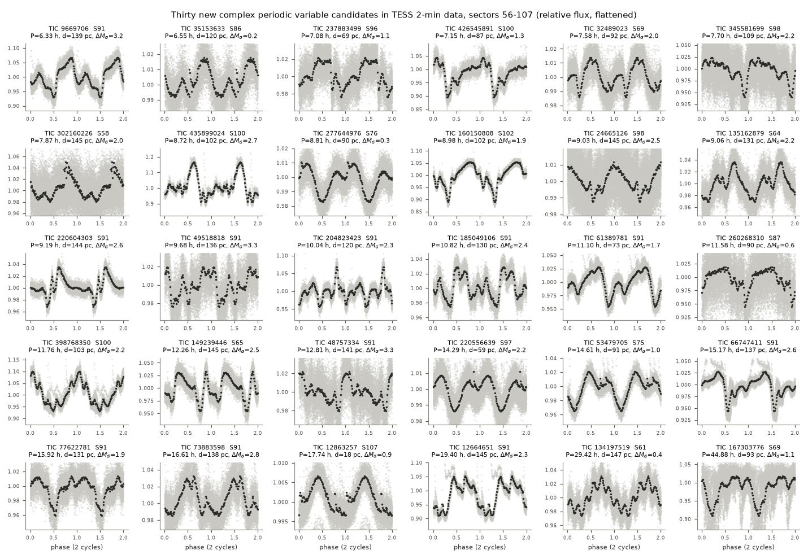
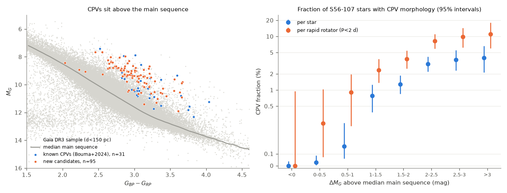
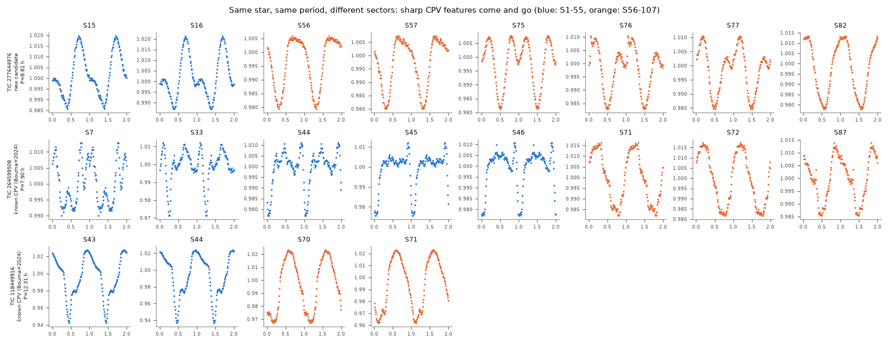

# New complex periodic variable candidates in TESS 2-minute data from sectors 56 to 107

**Job:** sci-1107-dell-astronomy-4697d10c380f. **Campaign:** 11_07_2026. **Topic:** astronomy. **Machine:** dell. **Model:** Claude Opus 5.5 (claude-opus-5-5), working as an automated research agent. The signing key is a campaign-machine key. It is not a personal authorship claim.

## Summary

Complex periodic variables (CPVs, also "scallop shells" or "complex rotators") are young, rapidly rotating M dwarfs. Their light curves show sharp dips that repeat at the rotation period. Bouma et al. (2024, AJ 167, 38) searched TESS 2-minute data from sectors 1 to 55 (2018 to 2022) and listed 50 CPVs and 13 candidates. We did the same type of search on TESS sectors 56 to 107 (September 2022 to about October 2026).

Main results:

1. We processed all 62,717 SPOC 2-minute light curves of 29,707 red dwarfs within 150 pc (Gaia DR3 BP-RP > 1.5, M_G > 4, T < 16). 4,091 stars rotate with P < 2 d.
2. Visual vetting gave 139 stars with clear CPV morphology. 32 are in the Bouma et al. table. 107 are not.
3. A centroid test puts the variable source within 5 arcsec of the target for 95 of the 107 new stars. We list these 95 stars as **new CPV candidates**. 41 of them have two or more sectors in S56-S107, and 37 show the same period in two or more sectors.
4. 89 of the 95 new candidates had no 2-minute data before sector 56. Only 6 had 2-minute data in sectors 1 to 55.
5. The CPV rate increases strongly with height above the main sequence (dM_G). It is 0 of 9,479 stars below the median main sequence, and 3.1% to 4.0% of all stars (8% to 11% of rapid rotators) at dM_G > 2 mag. 93% of all CPVs in the sample have dM_G > 1 mag. This agrees with the youth of known CPVs.
6. Stars that TESS observed before sector 56 and stars that it observed first in sector 56 or later have the same CPV rate when we compare stars of similar youth (dM_G > 1: 2.3% and 1.7%, Fisher p = 0.18; young rapid rotators: 4.9% and 5.5%, p = 0.60). The many new candidates thus come from the young stars that later TESS programs added. They do not show a higher rate of CPV formation.
7. CPV morphology is most frequent at P = 6 to 12 h (about 9% to 10% of rapid rotators) and rare at P = 1 to 2 d (0.3%).
8. The sharp features change between sectors. For example, TIC 277644976 changed from a smooth curve (S56, S57) to two or three sharp dips (S75 to S77) and back to a smooth curve (S82). The known CPV TIC 264599508 had sharp dips from S7 to S46, a smooth sinusoid in S71 and S72, and dips again in S87.

These are candidates. One person did the visual vetting. We did not get spectra or new ground-based data.

## Question

Do TESS 2-minute data taken after the Bouma et al. (2024) search contain new CPVs? If yes, are they young like the known CPVs? Does the CPV rate differ between stars that TESS saw before and stars that it saw first after 2022? A difference at the same youth could show that the CPV state appears and disappears on a time scale of years.

## Data

- **TESS light curves.** SPOC 2-minute PDCSAP light curves (Jenkins et al. 2016), sectors 56 to 107. File names come from the MAST download scripts `https://archive.stsci.edu/missions/tess/download_scripts/sector/tesscurl_sector_N_lc.sh`. We downloaded each file from `https://archive.stsci.edu/missions/tess/tid/sNNNN/TTTT/TTTT/TTTT/TTTT/<file>` on 2026-11-09. We did not store the 120 GB of FITS files. `files/data/target_lightcurve_files_s1_107.parquet` lists every file name. A SPOC file name includes the sector and the pipeline version.
- **TESS target lists.** `https://tess.mit.edu/public/target_lists/2m/all_targets_SNNN_v1.csv`, sectors 1 to 107. The coordinates in these lists are at the epoch of observation, not at J2000. We propagated Gaia DR3 positions to the epoch of each star's first sector before the 2-arcsec match.
- **Gaia DR3.** ESA Gaia archive, `gaiadr3.gaia_source`, query `parallax > 6.667 AND bp_rp > 1.5 AND phot_g_mean_mag < 18.5 AND M_G > 4` in 40 source_id ranges (660,545 sources). Gaia neighbours within 63 arcsec came from the AIP Gaia TAP mirror (`https://gaia.aip.de/tap`).
- **Known CPVs.** Table 1 of Bouma et al. (2024) (`table1_MRT.csv` in the arXiv source of 2309.06471).
- `files/provenance/input_file_sha256.csv` gives the SHA-256 hash of each target list, each MAST download script, each Gaia result chunk, and the arXiv source file that we used. No shared campaign dataset was used. The shared dataset store had no TESS or Gaia data for this question.

Our matched target sample has 65,397 stars with 2-minute data in sectors 1 to 55. Bouma et al. report 65,760 stars for the same cuts. This agreement shows that the selection is equivalent.

## Method

1. **Light-curve features** (`code/cpvlib.py`, `code/03_run_features.py`). We removed cadences with non-zero quality flags. We divided the PDCSAP flux by a 5-day running median. We used a Lomb-Scargle periodogram (0.08 to 15 d) on 10-minute bins. We then took the shortest of P, 2P and 3P whose phase-dispersion value was within 15% of the minimum. We folded the light curve into 100 phase bins. The "sharpness" score is the largest positive difference between a 3-harmonic and a 12-harmonic Fourier fit of the folded curve, divided by the binned noise. We also counted local minima of the 12-harmonic fit.
2. **Rapid rotators.** P < 2 d and folded amplitude > 20 times the binned noise in at least one sector (4,091 stars).
3. **Pre-screen.** Sharpness >= 5 or three or more local minima (1,560 stars). This rule keeps every Bouma et al. CPV and candidate (quality 1 and 0) that is a rapid rotator in its S1-S55 data, in at least one sector (test on 204 S1-S55 light curves).
4. **Visual vetting** (`files/vetting/pass1_thumbnails`). We showed the folded light curve of each star in its sector with the highest signal-to-noise. The order was random, and known CPVs were mixed in. The labels are C (clear CPV morphology: three or more dips, or sharp dips or shelves on top of a smooth modulation), A (ambiguous), or no label (eclipsing binary, smooth spot modulation, flare-dominated, or noise). The thumbnails did not show Gaia data. Thus the youth result in step 7 does not come from the vetting.
5. **Source location** (`code/06_centroid_source.py`). For each labelled star and up to two sectors, we regressed the folded, flattened column and row flux-weighted centroids on the folded, flattened SAP flux. The variable source is at c0 + dc/d(dF/F). We converted pixel positions to sky positions with the WCS of the APERTURE extension, and we propagated the target's Gaia position to the sector epoch. For the known CPVs (Bouma quality 1), the median offset is 2.3 arcsec and 90% are below 3.7 arcsec (58 sector fits). We call a star "on target" if its median offset is 5 arcsec or less (one quarter of a TESS pixel). We call it "off target" if all offsets are above 7 arcsec and above 3 times the error. In six pairs of neighbouring targets that showed the same period, the test chose the same star in both members of each pair.
6. **Other flags.** We flagged a star when the folded aperture background correlated with the folded flux (|r| > 0.7) and had more than 30% of its amplitude. We also flagged a star when another sample star within 3 arcmin had the same period and the smaller centroid offset. Eight new C stars are off target or flagged. Four have an unresolved location.
7. **Youth.** dM_G is the height of a star above the median main sequence of the Gaia sample (stars with RUWE < 1.2 and parallax/error > 20, in 0.05 mag bins of BP-RP; `files/data/ms_locus.txt`). Positive values mean overluminous stars (young stars or unresolved binaries).

## Results

### Recovery of known CPVs

37 Bouma et al. quality-1 CPVs have S56-S107 light curves. Blind vetting labelled 29 of them C and 2 of them A. The other 6 did not look like CPVs in their best S56-S107 sector. For example, TIC 118449916 lost its sharp dip in S70 and S71, and TIC 264599508 was smooth in S71 and S72 (see "Changes between sectors"). None of the three Bouma et al. "impostors" got the C label. The per-star recovery is thus 78% (29/37) for the sector with the highest signal-to-noise. Part of the loss is real change in the stars.

### New candidates

The table lists the 95 new on-target candidates. `files/data/candidates_visual_labels_tiers.csv` gives all 421 labelled stars with all flags, which includes the 276 new ambiguous stars and the 12 new C stars that failed a check. Most candidates are faint (T = 10.4 to 15.9) and distant (median 120 pc). The median dM_G is 2.2 mag, so they are strongly overluminous. The periods are 3.8 to 45 h (median 10.7 h). 68 of the 95 have CROWDSAP < 0.8. For these stars the centroid test is the main check against a neighbour as the source.

| dM_G bin (mag) | stars | rapid rotators | CPVs | CPV % of stars | CPV % of rapid rotators |
|---|---|---|---|---|---|
| < 0 | 9,479 | 386 | 0 | 0.00 | 0.0 |
| 0 to 0.5 | 10,229 | 840 | 3 | 0.03 | 0.4 |
| 0.5 to 1 | 3,650 | 664 | 6 | 0.16 | 0.9 |
| 1 to 1.5 | 2,044 | 677 | 16 | 0.78 | 2.4 |
| 1.5 to 2 | 2,107 | 709 | 27 | 1.28 | 3.8 |
| 2 to 2.5 | 1,270 | 473 | 39 | 3.07 | 8.2 |
| 2.5 to 3 | 600 | 225 | 22 | 3.67 | 9.8 |
| > 3 | 328 | 117 | 13 | 3.96 | 11.1 |

"CPVs" in this table are all on-target C stars (95 new and 31 known) among the 29,707 stars with S56-S107 data.

### Earlier and later TESS targets

| group | stars | rapid rotators | CPVs | median dM_G | CPVs with dM_G > 1 / stars with dM_G > 1 |
|---|---|---|---|---|---|
| 2-minute data in S1-S55 and in S56-S107 | 14,129 | 2,009 | 37 (31 known, 6 new) | 0.10 | 32 / 1,397 (2.3%) |
| 2-minute data only in S56-S107 | 15,578 | 2,082 | 89 (all new) | 0.33 | 85 / 4,952 (1.7%) |

The raw CPV rate per star is two times higher in the new targets (0.57% and 0.26%). But the new targets are younger. At the same youth the rates agree (Fisher p = 0.18 for dM_G > 1, p = 0.60 for rapid rotators with dM_G > 1). Thus the data do not show many CPVs that formed after 2022 among stars that were already observed. Six old-target stars are new candidates. Their S1-S55 light curves (`files/vetting/six_epochs.png`) show that four of them had complex shapes before (TIC 12863257 in S29, TIC 160150808 in S11, TIC 220556639 in S1-S30, and TIC 237883499 in S2, with weaker features). The earlier search probably did not select these four. TIC 277644976 shows a clear change in shape. TIC 167303776 (P = 44.9 h, 18 sectors) has a light curve that changes from sector to sector, and we are not sure that it is a CPV.

### Period

### Changes between sectors

## Interpretation

The new candidates agree with the main properties of known CPVs. They are rapid rotators, mostly with P < 1 d, and they are overluminous (young) M dwarfs. Proposed models put material (gas or dust clumps) near the corotation radius of a young, magnetically active star (Bouma et al. 2024; Gunther et al. 2022). Our data agree with a strong youth dependence. They also show that the sharp features can disappear and come back within one to a few years in the same star. They do not show a change in the population rate between 2018-2022 and 2022-2026 targets at fixed youth.

## Limitations

- One automated agent did the visual labels by inspection of PNG thumbnails at low resolution. We did not measure the agreement with a second vetter. The 276 "A" stars probably include more CPVs. Some C stars can be spotted binaries or blends.
- The centroid test cannot separate sources closer than about 5 arcsec. It does not exclude unresolved physical companions. 68 of the 95 candidates have CROWDSAP < 0.8.
- dM_G mixes youth and unresolved binarity (up to 0.75 mag). We did not compute kinematic group membership. BANYAN Sigma did not run on this host.
- We vetted only the sector with the highest signal-to-noise for each star. Thus a star that is a CPV only in other sectors can be missed. The per-sector persistence values are for the C stars only.
- TESS 2-minute targets are not a volume-complete sample. Later GI programs added more young stars, and this changes the raw rates.
- The periodogram method changed during the run (exact Lomb-Scargle with 60,000 frequencies for the first 2,914 light curves, then the fast method with 20,000 frequencies). The peak periods agree to the grid precision in our tests.

## Reproduction

1. `python code/01_gaia_nearby.py` (needs astroquery; ESA Gaia archive).
2. Download the TESS target lists and the MAST `tesscurl_sector_N_lc.sh` scripts into `raw/targets` and `raw/tesscurl`. Then run `python code/02_build_targets.py` and `python code/04_cmd_height.py`.
3. `python code/03_run_features.py derived/list_s56_107.csv runs/s56_107 48` downloads and processes all 62,717 light curves. It took about 2.5 h at 5 to 7 light curves per second on a shared 24-core host. It keeps FITS files only for rapid rotators.
4. `python code/score.py runs/s56_107/features.jsonl derived/score_s56.parquet`, then `code/plot_grid.py` for the thumbnails.
5. `code/05_flags.py`, `code/neighbors.py`, `code/06_centroid_source.py`, `code/07_tiers.py`, `code/09_population.py`, `code/10_figures.py`.

The derived tables in `files/data` let a reader check every number without new downloads. `lc_features_s56_107.parquet` has the features of all 62,717 light curves. `population_s56_107_stars.parquet` has one row per star. `folded_100bin_vetted_stars.json.gz` has the folded curves of all vetted stars in all their sectors.

## New on-target CPV candidates (95)

"same P" is the number of S56-S107 sectors with the same period (or 2x or 0.5x) within 0.5%. "earlier 2-min data" means 2-minute data in S1-S55.

| TIC | Gaia DR3 source_id | P (h) | d (pc) | BP-RP | dM_G (mag) | T (mag) | CROWDSAP | S56+ sectors | same P | earlier 2-min data |
|---|---|---|---|---|---|---|---|---|---|---|
| 265143793 | 6.347713968430779e+18 | 3.816 | 122 | 3.32 | 1.47 | 15.01 | 0.74 | 4 | 4 | no |
| 85690936 | 4.108002971564842e+18 | 5.197 | 114 | 3.28 | 2.64 | 13.58 | 0.25 | 2 | 2 | no |
| 34578030 | 1.1341074605054374e+17 | 6.062 | 134 | 3.06 | 2.26 | 13.62 | 0.78 | 1 | 1 | no |
| 97239026 | 6.027177088840456e+18 | 6.311 | 140 | 3.12 | 2.56 | 13.79 | 0.38 | 2 | 2 | no |
| 9669706 | 6.24708312521043e+18 | 6.330 | 139 | 3.66 | 3.23 | 14.09 | 0.97 | 1 | 1 | no |
| 35153633 | 7.169355690767309e+16 | 6.553 | 120 | 2.03 | 0.18 | 12.79 | 0.97 | 4 | 4 | no |
| 464819147 | 5.999508875138198e+18 | 6.812 | 136 | 3.23 | 1.63 | 14.87 | 0.32 | 1 | 1 | no |
| 439973455 | 5.858525783431826e+18 | 6.853 | 102 | 3.40 | 2.35 | 13.85 | 0.19 | 1 | 1 | no |
| 237883499 | 4.715353682706569e+18 | 7.078 | 69 | 3.30 | 1.13 | 14.06 | 0.97 | 5 | 5 | yes |
| 253250144 | 6.057329816508585e+18 | 7.079 | 108 | 3.13 | 3.08 | 12.65 | 0.44 | 1 | 1 | no |
| 426545891 | 5.781333985412426e+18 | 7.154 | 87 | 3.09 | 1.31 | 13.93 | 0.87 | 3 | 3 | no |
| 32489023 | 2.367992495952697e+18 | 7.581 | 92 | 2.81 | 2.04 | 12.52 | 1.00 | 1 | 1 | no |
| 345581699 | 3.2926560394698035e+18 | 7.697 | 109 | 3.66 | 2.22 | 14.56 | 0.80 | 1 | 1 | no |
| 302160226 | 4.3822359204753664e+17 | 7.872 | 145 | 3.05 | 1.99 | 14.24 | 0.85 | 2 | 1 | no |
| 11075214 | 5.700965664019978e+18 | 8.217 | 110 | 3.37 | 1.98 | 14.34 | 0.51 | 1 | 1 | no |
| 161734785 | 6.079297818307636e+18 | 8.375 | 146 | 2.89 | 1.94 | 13.84 | 0.42 | 2 | 2 | no |
| 251496897 | 4.610725088284618e+17 | 8.381 | 115 | 2.99 | 1.20 | 14.36 | 0.73 | 2 | 2 | no |
| 22739419 | 1.2766113830119117e+17 | 8.432 | 95 | 2.90 | 1.51 | 13.38 | 0.63 | 1 | 1 | no |
| 196904510 | 6.734979418518298e+18 | 8.464 | 143 | 3.18 | 2.63 | 13.88 | 0.28 | 3 | 3 | no |
| 341865260 | 5.844229349079518e+18 | 8.604 | 113 | 3.13 | 1.87 | 14.03 | 0.11 | 1 | 1 | no |
| 448002486 | 5.856059166484152e+18 | 8.622 | 110 | 3.18 | 2.63 | 13.31 | 0.35 | 3 | 3 | no |
| 203303875 | 6.27344745553202e+18 | 8.708 | 83 | 3.44 | 1.89 | 13.94 | 0.38 | 1 | 1 | no |
| 435899024 | 5.861945711251718e+18 | 8.720 | 102 | 3.01 | 2.66 | 12.68 | 0.64 | 3 | 3 | no |
| 277644976 | 2.1902447933767905e+18 | 8.813 | 90 | 2.23 | 0.26 | 12.63 | 0.94 | 7 | 7 | yes |
| 168507539 | 6.075057899621655e+18 | 8.844 | 124 | 3.12 | 1.86 | 14.35 | 0.11 | 1 | 1 | no |
| 453775307 | 6.087852332312179e+18 | 8.920 | 110 | 3.06 | 2.43 | 13.22 | 0.53 | 2 | 2 | no |
| 160150808 | 6.201473630541003e+18 | 8.975 | 102 | 2.70 | 1.90 | 12.53 | 0.86 | 2 | 2 | yes |
| 333822609 | 6.126193058690692e+18 | 8.983 | 119 | 3.02 | 2.88 | 12.99 | 0.38 | 1 | 1 | no |
| 994964138 | 6.126193127410169e+18 | 8.986 | 120 | 2.63 | 1.65 | 13.15 | 0.37 | 4 | 4 | no |
| 162701166 | 6.078170994992439e+18 | 9.021 | 110 | 3.09 | 2.57 | 13.16 | 0.16 | 1 | 1 | no |
| 24665126 | 3.014999288685707e+18 | 9.025 | 145 | 2.96 | 2.47 | 13.51 | 0.87 | 1 | 1 | no |
| 135162879 | 6.148164290302298e+18 | 9.057 | 131 | 3.00 | 2.23 | 13.62 | 0.90 | 3 | 3 | no |
| 243611773 | 6.108669214161312e+18 | 9.072 | 147 | 3.21 | 3.02 | 13.62 | 0.79 | 3 | 1 | no |
| 121840452 | 6.197960106773772e+18 | 9.089 | 118 | 2.98 | 2.90 | 12.66 | 0.78 | 2 | 2 | no |
| 243449997 | 6.107289533226214e+18 | 9.187 | 130 | 3.17 | 2.19 | 14.09 | 0.74 | 2 | 2 | no |
| 220604303 | 6.246938127111233e+18 | 9.191 | 144 | 2.67 | 2.57 | 12.71 | 0.96 | 1 | 1 | no |
| 342456426 | 5.31902322463403e+18 | 9.472 | 122 | 2.90 | 2.28 | 13.15 | 0.73 | 6 | 6 | no |
| 96889959 | 6.031008474546125e+18 | 9.550 | 126 | 2.88 | 3.26 | 12.30 | 0.77 | 2 | 2 | no |
| 144720670 | 6.152386758548981e+18 | 9.670 | 142 | 3.55 | 2.49 | 14.70 | 0.56 | 1 | 1 | no |
| 49518818 | 6.245595108015534e+18 | 9.676 | 136 | 3.56 | 3.30 | 13.80 | 0.96 | 1 | 1 | no |
| 143706101 | 6.000357732465734e+18 | 9.738 | 140 | 2.76 | 2.08 | 13.28 | 0.39 | 1 | 1 | no |
| 93952051 | 5.368703661111922e+18 | 9.780 | 110 | 2.90 | 2.86 | 12.49 | 0.19 | 2 | 2 | no |
| 320851615 | 5.332645589620289e+18 | 9.993 | 112 | 3.14 | 2.64 | 13.23 | 0.30 | 1 | 1 | no |
| 204823423 | 6.044760581836063e+18 | 10.042 | 120 | 2.92 | 2.31 | 13.14 | 0.94 | 1 | 1 | no |
| 121311155 | 6.197190482996179e+18 | 10.279 | 109 | 3.21 | 2.04 | 13.94 | 0.53 | 1 | 1 | no |
| 80123540 | 4.1082280665749335e+18 | 10.588 | 105 | 2.82 | 2.07 | 12.81 | 0.67 | 1 | 1 | no |
| 404387832 | 6.081508322019767e+18 | 10.612 | 112 | 3.02 | 2.66 | 12.92 | 0.60 | 1 | 1 | no |
| 392843486 | 6.217021996264543e+18 | 10.673 | 105 | 2.98 | 2.19 | 13.12 | 0.77 | 1 | 1 | no |
| 185049106 | 6.239040232010191e+18 | 10.822 | 130 | 2.86 | 2.39 | 13.07 | 0.94 | 1 | 1 | no |
| 207621404 | 6.064353054428529e+18 | 10.843 | 139 | 2.82 | 2.21 | 13.42 | 0.57 | 5 | 5 | no |
| 61389781 | 6.226294968100024e+18 | 11.099 | 73 | 2.84 | 1.72 | 12.42 | 0.99 | 1 | 1 | no |
| 328906141 | 6.089133916200094e+18 | 11.108 | 146 | 2.95 | 2.28 | 13.68 | 0.55 | 1 | 1 | no |
| 260268310 | 5.499528949050137e+18 | 11.584 | 90 | 3.13 | 0.60 | 14.82 | 0.87 | 9 | 8 | no |
| 59194168 | 5.99801703970481e+18 | 11.630 | 141 | 2.95 | 2.13 | 13.72 | 0.51 | 2 | 2 | no |
| 59192101 | 5.997773910190342e+18 | 11.726 | 128 | 2.89 | 1.90 | 13.59 | 0.77 | 2 | 2 | no |
| 465045649 | 5.242174749244076e+18 | 11.758 | 120 | 2.97 | 2.01 | 13.55 | 0.25 | 1 | 1 | no |
| 398768350 | 6.075429981240521e+18 | 11.758 | 103 | 2.63 | 2.25 | 12.22 | 0.72 | 1 | 1 | no |
| 148949324 | 6.006507404074352e+18 | 12.075 | 119 | 3.05 | 2.36 | 13.42 | 0.78 | 2 | 2 | no |
| 301432612 | 5.341919587915808e+18 | 12.116 | 108 | 2.73 | 2.11 | 12.58 | 0.62 | 1 | 1 | no |
| 149239446 | 6.006654566833431e+18 | 12.261 | 145 | 2.87 | 2.53 | 13.19 | 0.84 | 1 | 1 | no |
| 253973415 | 6.730847488150414e+18 | 12.635 | 128 | 2.67 | 2.30 | 12.73 | 0.62 | 1 | 1 | no |
| 303397755 | 5.914173578677771e+18 | 12.714 | 124 | 3.14 | 2.15 | 13.96 | 0.49 | 1 | 1 | no |
| 48757334 | 6.243321799012143e+18 | 12.811 | 141 | 3.67 | 3.32 | 14.05 | 0.81 | 1 | 1 | no |
| 179566059 | 6.117177578735315e+18 | 13.121 | 149 | 3.04 | 1.98 | 14.24 | 0.70 | 1 | 1 | no |
| 463248115 | 5.959774964460749e+18 | 13.161 | 126 | 3.20 | 3.35 | 12.94 | 0.45 | 1 | 1 | no |
| 9800625 | 6.243380141848159e+18 | 13.440 | 140 | 3.63 | 2.51 | 14.76 | 0.63 | 1 | 1 | no |
| 51345905 | 4.0531441102026916e+18 | 13.732 | 98 | 2.79 | 2.94 | 11.87 | 0.59 | 2 | 2 | no |
| 405970436 | 6.056701037640956e+18 | 13.860 | 104 | 2.93 | 2.14 | 13.04 | 0.56 | 1 | 1 | no |
| 151389132 | 5.980336416102111e+18 | 13.981 | 141 | 2.65 | 2.06 | 13.00 | 0.36 | 2 | 2 | no |
| 205960284 | 6.047020387471106e+18 | 14.119 | 115 | 2.81 | 2.08 | 12.97 | 0.72 | 1 | 1 | no |
| 220556639 | 4.721078629298086e+18 | 14.286 | 59 | 2.85 | 2.20 | 11.48 | 0.86 | 2 | 1 | yes |
| 175594111 | 6.045818685674326e+18 | 14.382 | 142 | 2.93 | 3.10 | 12.90 | 0.42 | 1 | 1 | no |
| 152631286 | 5.958092746085111e+18 | 14.605 | 119 | 2.90 | 2.02 | 13.30 | 0.33 | 1 | 1 | no |
| 53479705 | 8.495890656659816e+17 | 14.610 | 91 | 2.56 | 1.00 | 12.84 | 1.00 | 1 | 1 | no |
| 159754469 | 6.102197179481055e+18 | 14.627 | 129 | 2.86 | 1.87 | 13.57 | 0.77 | 2 | 2 | no |
| 973449111 | 5.868286560427916e+18 | 14.932 | 106 | 2.66 | 1.77 | 12.80 | 0.28 | 3 | 2 | no |
| 66747411 | 6.236217167189602e+18 | 15.173 | 137 | 2.55 | 2.58 | 12.28 | 0.99 | 1 | 1 | no |
| 309321971 | 5.901773217829655e+18 | 15.179 | 140 | 2.67 | 2.23 | 12.88 | 0.46 | 1 | 1 | no |
| 242166819 | 6.109555764128641e+18 | 15.197 | 137 | 3.01 | 2.57 | 13.42 | 0.76 | 1 | 1 | no |
| 211513644 | 6.091694403899674e+18 | 15.221 | 125 | 2.70 | 2.28 | 12.63 | 0.63 | 1 | 1 | no |
| 77622781 | 6.041052169632249e+18 | 15.924 | 131 | 2.86 | 1.95 | 13.54 | 0.80 | 1 | 1 | no |
| 273821594 | 6.07427975463263e+18 | 15.932 | 104 | 2.77 | 2.13 | 12.62 | 0.34 | 1 | 1 | no |
| 73883598 | 6.239616960216695e+18 | 16.609 | 138 | 3.23 | 2.79 | 13.77 | 0.91 | 1 | 1 | no |
| 61765848 | 5.377856472630301e+18 | 17.072 | 125 | 3.61 | 1.13 | 15.85 | 0.58 | 3 | 3 | no |
| 123386533 | 5.965543105526497e+18 | 17.171 | 139 | 2.74 | 2.15 | 13.14 | 0.56 | 1 | 1 | no |
| 12863257 | 2.368212771939557e+18 | 17.739 | 18 | 2.91 | 0.86 | 10.42 | 0.98 | 2 | 2 | yes |
| 92574021 | 5.372980314662467e+18 | 18.791 | 116 | 3.39 | 1.96 | 14.49 | 0.69 | 2 | 2 | no |
| 12664651 | 6.237118216966975e+18 | 19.397 | 145 | 2.46 | 2.27 | 12.39 | 0.75 | 1 | 1 | no |
| 93763678 | 5.345273648130814e+18 | 21.951 | 113 | 3.13 | 1.86 | 14.03 | 0.13 | 1 | 1 | no |
| 93275779 | 5.321581959996214e+18 | 21.969 | 148 | 2.92 | 0.95 | 14.96 | 0.37 | 3 | 3 | no |
| 243144355 | 6.088582408033507e+18 | 28.927 | 125 | 3.28 | 1.85 | 14.59 | 0.67 | 3 | 3 | no |
| 134197519 | 5.558500224415669e+18 | 29.419 | 147 | 2.31 | 0.42 | 13.78 | 0.80 | 2 | 2 | no |
| 329093980 | 5.843083383076335e+18 | 29.444 | 101 | 3.21 | 3.54 | 12.46 | 0.58 | 1 | 1 | no |
| 166447438 | 6.112208232854483e+18 | 40.161 | 144 | 3.21 | 2.10 | 14.49 | 0.77 | 2 | 1 | no |
| 167303776 | 5.280226578890455e+18 | 44.876 | 93 | 3.06 | 1.12 | 14.13 | 0.89 | 18 | 6 | yes |

## References

- Bouma, L. G., et al. 2024, AJ, 167, 38 (doi:10.3847/1538-3881/ad0c4c).
- Gunther, M. N., et al. 2022, AJ, 163, 144 (doi:10.3847/1538-3881/ac503c).
- Zhan, Z., et al. 2019, ApJ, 876, 127 (doi:10.3847/1538-4357/ab158c).
- Stauffer, J., et al. 2017, AJ, 153, 152 (doi:10.3847/1538-3881/aa5eb9).
- Gaia Collaboration, Vallenari, A., et al. 2023, A&A, 674, A1 (doi:10.1051/0004-6361/202243940).
- Ricker, G. R., et al. 2015, JATIS, 1, 014003 (doi:10.1117/1.JATIS.1.1.014003).
- Jenkins, J. M., et al. 2016, Proc. SPIE 9913, 99133E (doi:10.1117/12.2233418).
