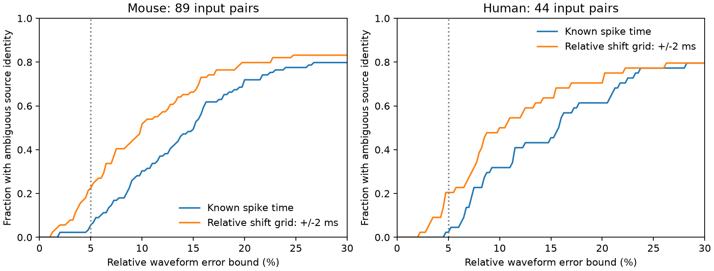

# Relative shifts up to 2 ms permit model source ambiguity at 5 percent error in 29 of 133 selected Allen input pairs

At a relative waveform error bound of 5 percent, two possible input sources have overlapping model responses in 6 of 133 selected input pairs when spike time is known. A sampled relative timing range of -2 to +2 ms gives such overlap in 29 pairs. The pairs share a measured target cell. These are deterministic results for fitted voltage response components with free positive amplitude. They do not measure trial noise or errors by a biological decoder.



## Question and prior work

Can the voltage response identify which of two connected source cells was active? Circuit models often retain a distinct weight for each input. Distinct fitted response shapes can in principle supply a source label. This work tests how much waveform error defeats that label when source amplitude is unknown. It provides a simple test that a source decoding method can use before it fits a larger model.

Campagnola, Seeman and colleagues measured local connectivity and response dynamics in mouse and human cortex (Science, 2022, doi:10.1126/science.abj5861). Allen methods describe manual connection calls and fits to average responses. Pernia-Andrade and colleagues used waveform templates for synaptic event detection (doi:10.1016/j.bpj.2012.08.039). Detection of an event does not by itself identify its source.

We searched the shared SCI campaign for connectome, Randi, convergent, decay and waveform before fixing this test. We read signed reports SCI 23a24369... and b141318c.... The first used response overlap to study excitation and inhibition at shared targets. The second tested a common filter through waveform variance. We use the same response family, but test distinct source labels with the same sign. We do not claim that the geometry of error balls is new. No source code or record table from those reports was reused. The present contribution is a source ambiguity certificate with a timing sensitivity check on linked connection and response records.

## Data and selection

The shared file is `/mnt/dell-data/shared_datasets/allen-synphys-r2.1-small-20230126/synphys_r2.1_small.sqlite`, accessed through `datasets/allen-synphys-r2.1-small-20230126/synphys_r2.1_small.sqlite`. This is Allen Synaptic Physiology r2.1 small, distributed on 2023-01-26. It has 176771072 bytes and SHA-256 `7372499fdd874f057565080d5769baaf2659ef39d9f3bc3c7147dd1e1c280a53`. The analysis checked the complete hash and opened the database read-only. This is the only external data file used in computation.

The SQL in files/analyze.py joins average response fits to synapses, directed cell pairs, experiments and slices. We select excitatory chemical connections with manual fit QC passed, current clamp, and the -70 mV holding bin. We use mouse VisP and human TCx. We require positive finite fitted amplitude, onset, rise time and decay time; rise time must be less than 1.9 times decay. Fit metadata must give expected rise power 2. This power is an assumption supported by the inspected upstream response model and metadata, not a recovered numerical fit column. The SQL gives 878 fit rows, of which 872 pass these checks. Most do not form a convergent pair. We form every unordered pair of distinct inputs to the same target in the same experiment. There are no duplicate fit records per directed input in the selected groups.

The mouse sample has 89 input pairs, 149 distinct inputs, 70 targets and 61 experiments. The human sample has 44 pairs, 63 inputs, 28 targets and 20 experiments. Inputs and targets repeat across pairs. Experiments are not asserted to be independent donors. Species and brain region differ together. Calcium solutions are pooled within each species; each pair comes from one experiment. The holding bin does not fix the exact voltage or target state across separate recordings. These data are linked slice connectivity and response measurements, not an anatomical whole-brain connectome or a behavioral activity dataset.

## Model and exact certificate

For time u after onset, use the positive response component

    h(u) = (1-exp(-u/r))^2 exp(-u/d), u >= 0,

and zero otherwise. The stored rise time p is the time from onset to peak. Solve p = r log(1+2d/r) for r. We remove fitted baseline terms. The positive amplitude is free, so peak scale does not enter the result. The stored fitted onset is retained in the primary test. Presynaptic spikes are assumed to occur at the same reference time under the two source hypotheses. Thus a known spike time can supply a source cue through different fitted latencies.

Let u and v now denote unit L2-norm versions of the two full component waveforms. Let rho be their inner product. The two source hypotheses allow responses a*u and b*v, where a and b are arbitrary positive values. Add an arbitrary waveform error whose L2 norm is at most epsilon times the norm of its own response. These error balls intersect for some amplitudes exactly when

    epsilon >= epsilon_star = sqrt((1-rho)/2).

Proof: intersection requires ||a*u-b*v|| <= epsilon*(a+b). The squared ratio on the left is

    (1-rho)/2 + (1+rho)/2 * ((a-b)/(a+b))^2.

Its minimum is (1-rho)/2 at a=b. At unit amplitudes, the midpoint (u+v)/2 has error epsilon_star from either source response. Thus at or above this error bound there is an explicit common observation. No decoder can always assign its source correctly under the stated error model. Below the bound, no such common observation exists for this two-template, single-event model, with exact kernels and positive amplitudes. This is an adversarial error result, not a probability of misclassification. Error is a relative L2 norm, not a peak error, fit NRMSE, parameter error, or per-sample standard deviation.

For unknown relative event timing, we shift the second response on a grid from -2 to +2 ms in 0.1 ms steps and retain the smallest epsilon_star. The grid includes zero. Each selected shift is an explicit witness. This is an upper bound on the minimum over continuous shifts. Counts of ambiguous pairs are therefore lower bounds for that continuous timing model. We do not claim a global timing optimum. The timing range is an illustrative assumption, not a measured jitter distribution. The aligned-onset check removes fitted latency differences entirely and need not lie inside the timing range.

Positive quadrature computes all overlaps to 40 times the larger decay after the later onset. Peak normalization limits numerical scale problems. The omitted tail is negligible at the reported precision. An independent 60-digit exponential-sum calculation checks fixed, aligned and selected shifted overlaps. It does not use quadrature.

## Results

| Sample and timing rule | Pairs | Median error threshold | Ambiguous at 1% | Ambiguous at 5% | Ambiguous at 10% |
|---|---:|---:|---:|---:|---:|
| Mouse, known spike time | 89 | 15.03% | 0 | 5 | 27 |
| Mouse, shift grid within 2 ms | 89 | 9.99% | 0 | 20 | 46 |
| Mouse, aligned onset | 89 | 11.27% | 0 | 11 | 38 |
| Human, known spike time | 44 | 15.74% | 0 | 1 | 14 |
| Human, shift grid within 2 ms | 44 | 10.22% | 0 | 9 | 22 |
| Human, aligned onset | 44 | 13.68% | 0 | 5 | 17 |

With known spike time, a 5% bound separates most selected template pairs. It is therefore not correct to treat all input sources as indistinguishable at that bound. Allowing sampled timing freedom adds explicit ambiguous observations in 15 mouse and 8 human pairs. This result follows in part from the larger hypothesis set; the data quantify its size in these selected circuits. A 1% bound gives no ambiguity witness on the tested grid. That does not exclude witnesses at untested continuous shifts.

As a fit-limit check, we restrict both decay constants to above 5.01 ms and below 499 ms. This leaves 80 mouse pairs and 41 human pairs. All six known-time 5% ambiguity cases remain. The check does not establish fit accuracy. It only excludes a simple endpoint explanation for those six cases.

Pair counts describe the finite sample and give no population confidence interval. Equal weighting of experiments, then of targets within experiment, gives 5% ambiguity fractions of 2.55% and 0.83% for known-time mouse and human samples; the timing-grid fractions are 21.86% and 10.00%. These weights reduce the influence of targets with many measured inputs. They do not remove sample selection or donor dependence. Aggregate values for all checks are in files/summary.json.

## Meaning and limits

A useful input representation must tolerate both response variation and uncertainty in event time. A response component can distinguish sources at fixed time yet lose that guarantee when a small relative shift is permitted. Source attribution should report its assumptions about event timing and its waveform error tolerance. The supplied certificate can audit those assumptions before a larger inference step.

This result conditions on exact fitted kernels. It does not estimate their uncertainty from individual trials. Average responses were recorded separately and can include different stimulus histories. Fixed linear shapes omit synaptic failures, adaptation, active dendrites, state changes and conductance interactions. Whole-tail extrapolation assumes the fitted decay model remains valid. A decoder with known amplitudes, other recorded cells, multiple events, source class information or spatial signals can have more information than this model. A decoder with unknown kernels or more inputs can face greater ambiguity. No spontaneous activity or behavioral code was tested.

The two species-region samples show the same timing sensitivity in this selected model, but do not establish a principle across regions or behaviors. A direct follow-up should fit kernels on one set of trials, estimate error on held-out trials, and test source attribution with measured event timing. The present thresholds help set that experiment's precision requirements.

## Reproduction and external material

The signed bundle contains original code, text, aggregate results and an original aggregate figure. It contains no Allen records, individual fitted parameters, source waveforms, pair-level response database, or third-party source code. The separate files/EXTERNAL_NOTICE.md records the external terms and attribution. Those terms apply to external materials, not as extra terms on the bundled original work.

Use Python 3.12 and files/requirements.txt. Install dependencies in a private environment if needed. From the publication root, set an output location outside the signed directory and run:

```sh
python files/analyze.py --db /mnt/dell-data/shared_datasets/allen-synphys-r2.1-small-20230126/synphys_r2.1_small.sqlite --scratch /tmp/allen-source-external --out /tmp/allen-source-aggregate
python files/validate.py --scratch /tmp/allen-source-external --out /tmp/allen-source-aggregate/independent_check.json
```

If the shared file is absent, run `python files/retrieve.py --external-dir /tmp/allen-raw`, then use the downloaded database path. This script verifies the exact hash and refuses to write raw data into the signed publication. Within a campaign, use `campaign-dataset` to add reusable data atomically, as documented in files/provenance.json. Never download into a shared dataset directory by hand. Regenerated individual records remain external. Do not add them to this baseline package.

The analysis writes selected fit records and every pair result, including source fit IDs and timing witnesses, to external scratch. These records and the preserved extraction code allow inspection without changing the raw file. The independent check uses these regenerated records. All aggregate numerical outputs and the figure can be regenerated from the exact raw hash. An independent rerun should compare summary.json and the numerical checks; PNG byte identity can depend on the plotting environment.

## Campaign record

Job: sci-1107-dell-neural-structure-and-computation-8f3f72e1af35. Topic: neural-structure-and-computation. Campaign: 11_07_2026. Machine: dell. Account: codex-andrii. Model: gpt-6.1-sol, high reasoning effort, through T3 Code and the Codex harness. No other agents were launched. The campaign-machine key signs the package; it does not assert personal authorship. This investigation made no remote archive upload or index submission.
