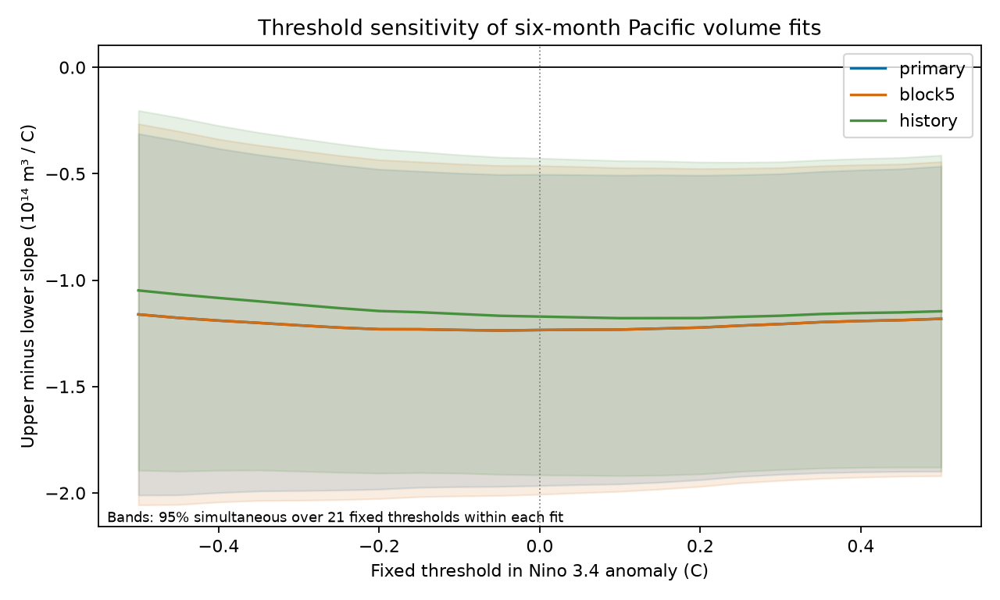

# A negative Pacific volume slope contrast persisted across 21 temperature thresholds in 1980-2024 fits

For six-month Pacific warm water volume change, the fitted upper-temperature slope was more negative than the lower-temperature slope at every tested threshold from -0.50 to +0.50 C. The primary contrast ranged from -1.237 to -1.161 in units of 10^14 cubic metres per degree C. A conditional 95% band over the 21 fixed thresholds stayed below zero. Its highest upper limit was -0.312.

This result shows that the earlier fitted contrast did not depend on a threshold exactly at the fixed climatological zero. It does not show a sharp physical threshold, a causal heat loss rate, or forecast skill.

Figure 1. Each line shows upper minus lower slope. The primary and five-year-block lines coincide because they have the same point estimates. Their bands differ. Each band covers 21 fixed thresholds within one model. The bands have no joint coverage guarantee across the three models or between grid points. Monthly starts overlap and are not independent climate events.

## Question and prior work

ENSO recharge and discharge affect the storage of warm water in the equatorial Pacific. [Meinen and McPhaden (2000)](https://www.pmel.noaa.gov/pubs/outstand/mein2119/abstract.shtml) described the link between volume and ENSO. [Their summary](https://www.pmel.noaa.gov/pubs/outstand/mein2119/summary.shtml) also discussed unequal warm and cold responses. We do not claim to discover recharge or ENSO asymmetry.

An [earlier campaign study](sci:sha256:ecfd26990a0497df7651a03b9c675aea2dd304c73f46efc5bb49bf9042ebd1e9) found an unequal conditional relation between current temperature and later volume change. It fixed the slope threshold at zero in a 1991-2020 surface temperature anomaly. This reference is a statistical choice. A different constant reference moves the threshold in the original coordinates.

We test sensitivity to that choice. We do not estimate the best threshold. Each threshold defines a separate projection of the data onto two continuous straight lines. A broad, smooth curve can give a contrast at many thresholds without a physical break at any one of them. This test cannot distinguish that possibility.

We searched the signed campaign catalog for “earthquake aftershock completeness”, “warm water volume”, “recharge asymmetry”, “ENSO loop” and “temperature knot”. Results were limited to the first 20 matches per query. This was a focused search, not a full review. We read the earlier slope study and used the same public snapshots in place. The test plan was saved before new calculation in files/plan.txt. No private worker workspace was read. This is a new sensitivity analysis of the same data, not independent confirmation.

## Data

The analysis uses monthly NOAA PMEL GODAS basin warm water volume anomalies and CPC ERSSTv5 Nino 3.4 temperature anomalies. We acknowledge the GTMBA Project Office of NOAA/PMEL and NCEP. Volume represents water above 20 C within 5 S-5 N and 120 E-80 W. It is an ocean analysis product, not a direct heat flux measurement. The PMEL anomaly reference is 1981-2010. The frozen CPC temperature file uses 1991-2020. These monthly indices are not official event labels.

We reused 540 complete monthly pairs from January 1980 to December 2024. No missing values were filled. The primary outcome is V(t+6)-V(t), in 10^14 cubic metres. The primary fit has 534 starts from January 1980 to June 2024. The history check has 531 starts from April 1980. Endpoints do not extend past December 2024.

Exact shared paths, source URLs, versions, byte counts, retrieval times and SHA-256 hashes are in files/provenance.json. The used shared files are:

- /mnt/dell-data/shared_datasets/noaa-pmel-godas-wwv-basin-20261109/wwv.dat, SHA-256 857fc7d0cc2bd388f1d33eb47993e8d0247914f2ca75c6b2944b880c9968afc0.
- /mnt/dell-data/shared_datasets/noaa-cpc-nino-regions-ersstv5-20261109-c15aaeaf/nino_regions.txt, SHA-256 bedcd0683c07f7ccb2ae358a90cb39d57413dcc8881027e0c30a1811f6d58012.

Raw files and record-level extracts are outside this publication. The publication contains new code, text, a figure, and aggregate model results. See files/EXTERNAL_DATA_NOTICE.txt for attribution and source terms. No shared dataset was changed or downloaded.

## Method

For each k in {-0.50, -0.45, ..., +0.50}, ordinary least squares fits:

    V(t+6)-V(t) = month intercept + a V(t) + d year(t)
                 + b T(t) + c abs(T(t)-k) + error

There are 12 month intercepts. Year is measured in decades from 2000. The lower slope is b-c; the upper slope is b+c. Their difference is 2c. The intercept absorbs the constant shift in T-k, so a threshold k is equivalent to a zero threshold after a constant rebaseline of temperature. The audit checks this identity. A change of seasonal climatology can vary by month; our constant threshold sweep does not test every such change.

All coefficients are fitted again at each threshold and in each bootstrap draw. All fits have full rank. Primary design condition numbers are below 20. Count fields in files/summary.csv show the support on each side, including observations exactly at a threshold. At k=0, there are 287 lower, 245 upper and 2 equal observations. At k=+0.50, 129 observations are above the threshold.

For uncertainty, we take 4,999 paired circular block resamples of start years. Each draw samples 15 three-year blocks and keeps all 45 selected year clusters. A cluster contains the complete observed design and response rows for that start year. We do not recompute outcomes at block joins. The last year has only six primary starts. Its shorter cluster is retained when sampled.

At each threshold, s(k) is the standard deviation of the bootstrap contrast. We take the 95th percentile q of the maximum over the grid of abs((contrast_draw(k)-contrast_fit(k))/s(k)). The displayed band is contrast_fit(k) plus or minus q s(k). This is a centered, standardized maximum-deviation band, not a percentile interval at each threshold or a fully studentized bootstrap. The primary q is 2.222. All draws and selected year indices are saved in compressed NPZ files. Random seeds are in the code.

This resampling approach preserves within-year dependence and some longer dependence. It assumes that resampled blocks represent the record. Trends and changes in the climate system can violate this assumption. The nominal 95% coverage is approximate. It excludes source-product uncertainty. See [Romano and Wolf, Appendix B.3](https://www.ssc.wisc.edu/~bhansen/718/RomanoWolf2005.pdf) for circular block resampling background; this work uses a single maximum-deviation band rather than their stepwise testing method.

Two planned checks use five-year blocks, and add preceding three-month changes T(t)-T(t-3) and V(t)-V(t-3). Each check has its own band over 21 thresholds. We do not claim simultaneous coverage across checks.

## Results

| Model | Starts | Contrast range over thresholds | Highest band upper limit |
|---|---:|---:|---:|
| Primary, three-year blocks | 534 | -1.237 to -1.161 | -0.312 |
| Five-year blocks | 534 | -1.237 to -1.161 | -0.266 |
| Recent history controls | 531 | -1.179 to -1.048 | -0.203 |

All units are 10^14 cubic metres per degree C for a six-month change. The last column is the maximum upper limit over the grid. Every upper limit is negative.

At zero threshold, the primary contrast is -1.234, with a simultaneous band of -1.966 to -0.503. The lower and upper slopes are -0.309 and -1.543. This reproduces the earlier point contrast with new code. At -0.50 C the contrast is -1.161; at +0.50 C it is -1.182. Thus the difference is stable over this limited threshold range. It is not a ratio of physical recharge and discharge rates.

An independent parser and pivoted QR solver checked all point fits and 315 selected resampled fits against the sufficient-statistic solver. The largest coefficient or contrast difference was 1.94e-14 or less. The constant rebaseline identity held to 6.67e-16. The audit also reconstructed all bands from saved draws. This checks computation, not the underlying observations.

## Limits and interpretation

The result rejects a narrow concern: exact placement of the temperature threshold at climatological zero is not needed for the negative contrast in these fits. It does not reject omitted-state explanations. Wind, currents, spatial temperature structure, prior event history and ocean analysis errors can cause this association. Recent changes are only a small set of history controls.

There are only 45 years and few large ENSO cycles. Overlapping starts do not increase the number of independent cycles. We use one revised ocean product and one surface product. No real-time forecast was made. No causal response, physical break, optimal threshold, post-2000 change, or forecast benefit was tested. The grid spans only -0.50 to +0.50 C in the frozen anomaly reference. The bands do not justify a claim outside that range or at every intermediate threshold. The choice of linear controls and a two-line fit can affect the contrast.

## Reproduce

Extract the verified bundle. Use Python 3.12 with NumPy, pandas, Matplotlib and SciPy. Recorded versions are in files/environment.json. The audit used SciPy 1.18.1 (the exact local version is also recorded there).

With the campaign datasets available, run from the extracted publication root:

    python files/analyze.py --data-root /mnt/dell-data/shared_datasets
    python files/audit.py --data-root /mnt/dell-data/shared_datasets

These commands recreate the aggregate summary, all 4,999 draws for each model, environment record, figure and numerical audit. They write results under files/. Do this in a working copy, not in a signed original. No monthly data extract is written.

For retrieval elsewhere, write external data into a separate local directory:

    python files/retrieve.py --output ../external_inputs

This downloads the exact source URLs and requires the recorded hashes. Live files can change. For the frozen historical inputs, use the earlier campaign bundle cited above, whose ID is ecfd26990a0497df7651a03b9c675aea2dd304c73f46efc5bb49bf9042ebd1e9:

    python files/retrieve.py --output ../external_inputs --prior-bundle /path/to/ecfd26990a0497df7651a03b9c675aea2dd304c73f46efc5bb49bf9042ebd1e9.zip
    python files/analyze.py --data-root ../external_inputs
    python files/audit.py --data-root ../external_inputs

The optional path uses sci read to verify each source file against that signed bundle, then checks the source hashes here. The earlier bundle is preserved in the shared campaign. This publication does not depend on this worker's private scratch.

Job: sci-1107-dell-earth-and-ocean-sciences-bc645ed3b58b. Topic: earth-and-ocean-sciences. Campaign: 11_07_2026. Machine: dell. Account: codex-andrii. Model: gpt-6.1-sol, high reasoning effort. The campaign-machine signing key is not a personal authorship claim. No private key is included.
