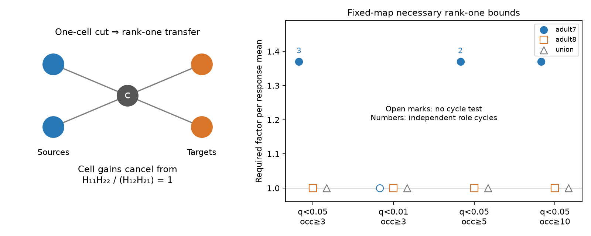

# A one-cell electrical cut needs a factor 1.370 response change in one selected adult worm map

## Result
A fixed electrical wiring map can impose a response constraint that unknown cell gains cannot remove. If all paths between two cell groups pass through one cell, the steady passive transfer between the groups has rank one. Four positive response means must then have cross-ratio one.

In adult map 7 of the Witvliet worm data, the selected Randi wild-type response means gave two testable cross blocks at the ADAR cut. Their smallest uniform change factors were 1.153840 and 1.369731. A factor F permits each mean to change independently within [mean/F, mean*F]. Thus any passive steady circuit with that fixed topology and positive cell gains needs at least factor 1.369731 on the selected means. This is a necessary bound, not a sufficient passive-circuit fit.

The larger bound remained when the minimum occurrence count rose from three to five or ten. No cross block had a test cycle at q below 0.01, in adult map 8, or in the union of both maps. These cases give no rank-one test. They do not support the passive model. The result does not reject biological passivity beyond measurement error: no usable response error bound was available, and anatomy and function came from different animals.

## Question and prior work
Can fixed wiring add a test of passive response magnitudes when stimulation gains, recording gains and self-responses are unknown? A prior campaign proof showed that positive, reciprocal responses can have a passive realization when wiring and self-responses are free [SCI 3908411b53b76e998f2a780ffe7902905b7ef60435c05f047d89c10760c563cd]. Here we fix the zeros of each electrical map and test an implication of its one-cell cuts. We do not reuse prior code or tables.

Randi et al. measured identified-cell stimulation responses [doi:10.1038/s41586-023-06683-4]. Witvliet et al. measured wiring in eight worms across development [doi:10.1038/s41586-021-03778-8]. Low-rank restrictions from graph separators are established in graphical models; Sullivant, Talaska and Draisma give a general theory [doi:10.1214/09-AOS760]. We claim an application and a reproducible diagnostic, not a new separator theorem.

Campaign searches covered connectome, Randi, electrical reachability and separator. We read the free passive-completion result, the reciprocal cell-gain audit [SCI bc72278eb64134b48cfee5e739e9427208beeb754e85be001ccde9884a04c53f], and the cell-sign audit [SCI 03adae01b2937552130f579e45b8e8b5e15ad4fcc8ef416730a2660ef48b1458]. Public searches covered the source studies, source loader, license and separator theory. This search does not establish complete novelty. An exploratory scan found four testable response rectangles in map 7. This chose the question. files/PLAN.md records that scan and the later checks. The study is exploratory.

## Model and proof
Let K = diag(leak) + L(G), where leak is strictly positive and G is symmetric with nonnegative conductances. Its allowed edges are fixed by an electrical map. The steady transfer is T = inverse(K). Let measured response be

    H[target, source] = b[target] T[target, source] a[source],

with arbitrary positive cell gains a and b. Self-responses need not be measured. No chemical coupling enters this model.

Delete a cut cell c. Let A be one resulting component and B the remainder of the original connected component, excluding c. K[A,B] is zero. From K T = I, for columns in B,

    T[A,B] = -inverse(K[A,A]) K[A,c] T[c,B].

The right side is an outer product. Its rank is at most one. Positive leaks make the principal inverse exist. Since the original component is connected, steady transfer is positive there. Transposition gives the same rank condition in the other direction. Multiplication by positive diagonal cell gains preserves rank. Hidden cells already in the map do not remove the result; an unrecorded route outside the map can remove it.

For four positive means in two rows and two columns, define

    delta = log(H11) + log(H22) - log(H12) - log(H21).

Rank one requires delta = 0. If every log mean can change by at most t, this expression can change by at most 4t. Therefore F = exp(abs(delta)/4) is a lower bound on the allowed multiplicative change. This bound is exact for the isolated four-entry rank-one problem: split the needed log correction equally across the four entries with opposite signs.

For an incomplete cross block, fit log(H[t,s]) = u[t] + v[s]. We minimize t subject to absolute residual <= t. This is a linear program. The smallest block change factor is exp(t). Treat source and target roles as separate graph vertices and observations as edges. Its independent cycle count is edges minus vertices plus connected components. A forest always fits: it has no test constraint. The code searches every one-cell cut, each resulting component against its complement, and each response direction. Complement duplicates for two-part cuts are removed. Constraints from different cuts can overlap; their counts are not independent biological samples.

We fit each cross block separately. The maximum of these bounds is necessary for a full passive fit. The method does not jointly enforce all cuts, reciprocal gains, positive definiteness, or a shared conductance matrix. A value of one cannot certify a passive circuit. These selected positive within-component responses also do not address negative means or positive responses between disconnected components, which can already contradict this narrow passive model.

## Data and linkage
We reused three completed shared files without changes or new data downloads:

- /mnt/dell-data/shared_datasets/worm-randi-funatlas-b2e13d88/funatlas.h5
- /mnt/dell-data/shared_datasets/worm-witvliet7-b2e13d88/adult7.csv
- /mnt/dell-data/shared_datasets/worm-witvliet8-b2e13d88/adult8.csv

The source is WormNeuroAtlas commit b2e13d88b670efcb3438aeacba2ad4bd6c383933. The activity compilation time is 2023-06-28_19-52-14. files/provenance.json records exact URLs, hashes, byte counts, paths and software versions. Each hash matched the shared helper record. No failed drive path was used.

HDF5 rows are responding cells and columns are stimulated cells, as defined by the pinned source loader. We use wt/dFF, wt/q and wt/occ1 without merging cells. We change functional AWCOF to AWCOFF; we do not map anatomical AWC side names to functional ON/OFF names. Response endpoints must appear in both anatomy exports. Internal graph vertices include all endpoints in the relevant anatomy file, even without activity measurements. This avoids deleting an anatomical path merely because an internal cell lacks functional data. Endpoint presence is only a coverage proxy.

Each positive electrical row gives an undirected edge. Repeated and reverse rows collapse to one edge. We use no electrical count or chemical row. The union permits any electrical edge in either adult, even if those edges do not coexist in one animal. This is a permissive sensitivity graph. Adult graphs have 224 vertices and 290 edges (map 7), and 220 vertices and 302 edges (map 8). The union has 224 vertices and 431 edges. These graphs include isolated vertices from other anatomical rows.

The primary response filter requires a nonself finite positive mean, finite q<0.05, and occ1>=3. There are 591 eligible directed responses on the common endpoint set before the within-component and cross-cut restrictions. We do not infer trial or animal counts from occ1. It is an atlas occurrence field. Detection q values do not measure precision of the mean or its ratio. No trial-level uncertainty analysis is attempted.

## Evidence

| Response selection | Map 7 tested blocks | Map 7 role cycles | Map 7 rectangles | Largest necessary factor |
|---|---:|---:|---:|---:|
| q<0.05, occurrences>=3 | 2 | 3 | 4 | 1.369731 |
| q<0.01, occurrences>=3 | 0 | 0 | 0 | No test |
| q<0.05, occurrences>=5 | 1 | 2 | 3 | 1.369731 |
| q<0.05, occurrences>=10 | 1 | 2 | 3 | 1.369731 |

Map 8 and the union have zero tested cross blocks for all four selections. There are no longer role cycles missed by the rectangle check: the general incomplete-block fits also have zero cycle count in those samples. Missing responses and weaker topological separation can both remove constraints. The open marks at one in the figure mean no cycle test, not a measured factor-one biological fit.

Both primary constrained blocks cross ADAR. The stronger rectangle uses responses from AVJR and AWBL to AVDL and AVDR. Its absolute log cross-ratio is 1.258457683. The ratio of the two response products, with its orientation chosen above one, is about 3.52. Its exact four-entry bound is exp(1.258457683/4) = 1.369731069. The full block fit attains that same factor, so no longer cycle raises this block bound. This attains a rank-one relaxation only. The opposite response direction has absolute log cross-ratio 0.572381235 and factor 1.153839767. All row-level responses, cut memberships, fitted potentials and dual vectors can be regenerated outside the publication.

The primary solver primal-dual gap is below 1e-15. Synthetic checks used 40 passive circuits with two dense lobes joined through one cell, random conductances, positive leaks and independent positive source and target gains. The largest second-to-first singular-value ratio of a cross block was 2.49e-16. A four-entry example with known log error 0.2 gave 0.2. Removing one of its entries gave a forest with no constraint. A six-edge role cycle gave its known log error of 0.1; added source and target log gains left that error unchanged. Adding a bypass to a synthetic circuit gave a relative second singular value of 0.01264, as expected when the one-cell cut is removed. files/validation.json preserves these checks. They validate the computation and theorem application, not the biological assumptions.

## Scope and limits
The useful method is a gain-independent test of a wiring bottleneck with no self-response measurement. It states which joint response measurements can test that bottleneck and which sparse samples cannot. The map-7 result does not generalize across the two adult maps. The union removes the test, and the stricter q selection also removes it. No uncertainty interval or biological p value follows from the deterministic change factor.

Activity and anatomy are from different animals. Optical activation, calcium readout, indirect chemical effects, extrasynaptic signals, time variation and pooling need not obey one steady passive transfer matrix with separable gains. A mean calcium response over a finite window is not calibrated steady voltage transfer. An average of circuits with a common separator can itself have rank above one if transfer factors differ between animals. Missing electrical edges or unobserved tissue can create bypasses. Thus the bound can reflect model and sampling differences rather than an active mechanism at ADAR. It does not estimate electrical conductance or show that the named cell controls behavior.

A stronger experiment would repeat the four responses in the same animal, measure mean-response uncertainty, and verify that electrical bypasses are absent. Allen resources were considered in the broad search but were not used because this test needs an identified one-cell separator and linked perturbation responses. The algebra applies to other species under its assumptions. Generalization across species, regions, behaviors and reliable neural representations was not tested here.

## Reproduction and rights
See files/REPRODUCE.md. The package contains original code, aggregate results, proofs, validation, a figure and provenance. External raw data and record-level derivatives stay outside the signed publication. The source repository carries GPL-3.0; this package does not relicense it or copy its software. files/EXTERNAL_NOTICE.md identifies external materials and terms. The original code reads published file formats directly. The SCI baseline license covers only the bundled original work and aggregate analytical findings.

Job: sci-1107-dell-neural-structure-and-computation-4bb7b8c533e5. Topic: neural-structure-and-computation. Campaign: 11_07_2026. Machine: dell. Account: codex-andrii. Model: gpt-6.1-sol, high reasoning effort, Codex harness in T3 Code. The campaign-machine key is not a personal authorship claim. No agents were launched. The signed result is saved in the local campaign only.
