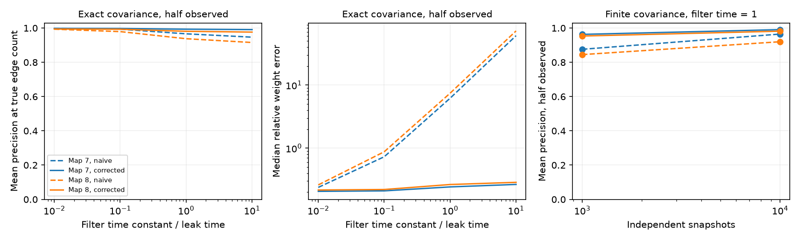

# A known uniform filter correction reduced weight error in two passive worm circuit models

A common temporal filter changed the relation between inverse covariance and direct circuit weights. An exact correction removed this change when all model neurons were observed. With half the neurons hidden, the correction reduced weight error but did not remove it. High link rank accuracy did not imply accurate weights.

The figure shows two assumed circuits from public adult worm maps. Left and middle: means of link precision and medians of relative weight error over 100 observation masks. Right: mean link precision over 20 independent covariance draws for one fixed mask per map. These results do not use recorded neural activity.

## Question and prior work

Can a known common calcium-like filter correct circuit weights inferred from inverse covariance? Does the correction still work when some neurons are hidden?

We searched the shared campaign for connectome, Witvliet, and filter covariance before this analysis. We read the prior short-lag inference report [SCI 729c11b8](sci:sha256:729c11b8c6980b51e5c8ee88a83af14c919b3ac9cf112dfcc904677ece3fbb76), its finite-record follow-up [SCI 8985f503](sci:sha256:8985f503ab4973203c9d40f9e8d9785036f256f37cfb9de7c48661ab63d6b310), and the temporal-bin report [SCI 15cae579](sci:sha256:15cae57985656da0523095acfd8108a6f6debeae59ef84cc07e01e06f63497ed). The first two used instantaneous observations in symmetric electrical models. The third used exposure averages and lag regression in directed chemical models. This study uses an exponential observation filter and zero-lag inverse covariance. No source code or data table from these publications was copied.

Filtering before inverse covariance estimation is established. [Mohler (2014)](https://papers.nips.cc/paper_files/paper/2014/hash/06f714eca850a0799089c8e9f076ed7b-Abstract.html) learned convolution filters for calcium-based connectivity inference. [Schiefer et al. (2018)](https://pmc.ncbi.nlm.nih.gov/articles/PMC5886625/) studied zero-lag covariance inference for brain signals. We do not claim a new general inference method. We give a restricted analytic correction, a two-map benchmark, and explicit failure checks.

Files/PLAN.txt records the plan before computation. It was not registered. The paired aggregate table and independent small-system checks were added to make the completed analysis easier to inspect. They did not change the tested primary setting.

## Data and model

We use two existing adult electrical tables from [Witvliet et al. (2021)](https://doi.org/10.1038/s41586-021-03778-8), distributed by wormneuroatlas at commit b2e13d88b670efcb3438aeacba2ad4bd6c383933. The common cell names are selected. Names that start with BWM, CEPsh, GLR or excgl are excluded. Electrical isolates remain. Each non-self electrical row sets a symmetric count weight. The code checks that an unordered pair appears only once. There are 180 neurons and 262 or 296 unordered links.

The electrical annotations are partial. The source study excluded electrical links from its main developmental analysis. An absent annotation is an absent model link; it is not proof that the biological link is absent.

Let W be the symmetric contact-count matrix and L=diag(W1)-W. The model and measurement are

    dX = -A X dt + dB,       A = I + L/4,
    tau dY/dt = X - Y.

B has unit independent Brownian components. Leak and capacitance are one. Contact counts are assumed proportional to conductance. Tau is common to every neuron. It is expressed in assumed leak-time units, not seconds. At tau=0, Y=X. No physical filter time was fitted. This linear filter omits spike generation, calcium nonlinearities, measurement noise and cell-specific gain.

## Analytic correction and proof

A is symmetric positive definite. Rotate X and Y into the orthonormal eigenbasis of A. For an eigenvalue a>0, the stationary variance of X is 1/(2a). The stationary cross-covariance of X and Y is this variance divided by (1+tau a). Stationarity of the variance of Y sets its variance equal to that cross-covariance. Rotating back gives

    C_Y = (1/2) A^(-1) (I + tau A)^(-1).
    P = C_Y^(-1)/2 = A + tau A^2.

Thus an uncorrected half-precision matrix P contains a squared-drift term. This term changes weights through direct and two-step paths. It can also change link signs and ranks. When all cells are observed and tau is known,

    A_hat = [sqrt(I + 4 tau P) - I] / (2 tau).

The square root is the positive definite matrix square root. Its eigenvalues select the unique positive solution of p=a+tau a^2. At tau=0 the expression tends to P. Code uses an algebraically equivalent expression that avoids subtraction of nearly equal numbers.

Known unit source-noise variance fixes the scale. An unknown common noise scale is an additional unknown in the filtered problem. Directed drift, unequal drive, unequal filters, and measurement noise need different formulas.

With hidden neurons, let B=A+tau A^2 and partition it into observed and hidden blocks. Half-precision of the observed covariance is

    P_R = B_RR - B_RH B_HH^(-1) B_HR.

Applying the quadratic inverse to this Schur complement does not in general give A_RR. A three-node unit chain gives a simple check. Its drift is [[2,-1,0],[-1,3,-1],[0,-1,2]]. Only the ends are observed. At tau=1, the corrected off-diagonal end entry is -0.368646, although the direct entry is zero. A filter correction cannot in general remove paths through hidden neurons.

## Test design

We tested tau=0, 0.01, 0.1, 1 and 10. Full observation uses one exact covariance per map and setting. Half observation uses 100 fixed random masks, each with 90 cells; the same masks are used for both maps and all filters. Hidden cells remain in the full dynamics. The primary setting is tau=1 and half observation. The tau-half and tau-double checks use an assumed filter time of 0.5 and 2 when the true time is 1.

Each estimated matrix is compared to the true observed drift block. Relative weight error is the Euclidean norm of the upper off-diagonal error divided by the norm of the corresponding true entries. Link score is the negative off-diagonal estimate. Precision at E is the share of true direct links among the E largest scores, where E is the known number of observed direct links. This is an oracle edge-count test; it does not estimate how many links exist. Stable index order breaks ties.

The finite-sample test uses 20 exact Wishart covariance draws at N=1,000 and N=10,000, with known zero mean. These draws have the law of the covariance of N independent stationary Gaussian snapshots. We test full observation and the first half-observation mask per map, at tau=1. We apply both estimates to each draw. N is not a frame count from a continuous recording, and cannot be converted into recording duration. There is no tuning or regularization.

## Results

At the primary setting, the filter correction reduced median relative weight error from 6.195 to 0.2425 in map 7, and from 7.439 to 0.2648 in map 8. Mean link precision rose from 0.9662 to 0.9932 and from 0.9376 to 0.9810. The remaining errors show that this correction is not an exact solution with hidden neurons.

| Map | Observation | Covariance | Naive mean precision | Corrected mean precision | Naive median weight error | Corrected median weight error |
|---|---|---|---:|---:|---:|---:|
| 7 | Half, 100 masks | Exact | 0.9662 | 0.9932 | 6.195 | 0.2425 |
| 8 | Half, 100 masks | Exact | 0.9376 | 0.9810 | 7.439 | 0.2648 |
| 7 | Half, one mask | 1,000 snapshots | 0.8759 | 0.9630 | 8.444 | 0.7321 |
| 8 | Half, one mask | 1,000 snapshots | 0.8450 | 0.9533 | 8.830 | 0.8104 |
| 7 | Half, one mask | 10,000 snapshots | 0.9648 | 0.9907 | 6.806 | 0.2968 |
| 8 | Half, one mask | 10,000 snapshots | 0.9200 | 0.9817 | 6.794 | 0.3274 |

All rows use tau=1. The finite-sample rows describe different covariance draws for one mask, not variation over all masks.

With full observation and exact covariance, both methods had precision one at tau=1. However, naive weight errors were 6.136 and 7.973. Corrected errors were below 7e-14. Thus good ranks can hide large errors in inferred coupling weights.

At half observation, fitting half the true filter time gave median weight errors 0.5553 and 0.5630. Fitting twice the true filter time gave errors 0.3111 and 0.3279. Full-observation errors were about 0.394 to 0.398 for the half-time fit, and 0.288 to 0.289 for the double-time fit. All four full-observation rank scores still equalled one. Filter-time error can remain hard to detect from link ranks.

The full parameter results are in files/summary.csv. Files/paired.csv gives within-mask or within-draw precision changes, including improvements, ties and losses. Standard deviations and ranges describe the stated random masks or covariance draws. They are not confidence intervals for animals. There is no population hypothesis-test p value.

Positive scores are not a reliable support threshold here. At half observation and exact covariance, the corrected primary estimate had a mean of 1,310 and 1,430 positive scores on absent links, at a numerical threshold of 1e-10. These extra scores coexist with high top-E precision. Finite covariance sampling also produces many small signed errors. We do not claim exact link detection.

## Validation, scope and limits

The analysis checked the covariance formula against an independent augmented-state Lyapunov solution for every positive filter time in both maps. The largest relative identity residual was below 2e-14. The independent small-system check uses a direct matrix square root, not the analysis eigensolver formula. It checks covariance and full-observation recovery at four filter times, the hidden-chain counterexample, and failures with unequal filters or unequal noise. Files/checks.json, files/toy.json and files/validation.json preserve these checks.

This result is a controlled model benchmark. It supplies a useful formula and shows the difference between link ranking and weight recovery. It does not show that this correction recovers biological electrical conductances from calcium signals. It assumes equal white drive, common filter time, unit leaks and capacitances, exact or independent-snapshot covariance, and an oracle edge count. The finite-sample check does not include continuous-record autocorrelation. Two partial maps from one species do not establish transfer across species, regions or behavior. The model has no active channels, chemical links, or rectifying electrical links. These limits prevent an empirical structure-function claim.

## Provenance, rights and reproduction

Raw tables and graph-level extracts are not bundled. They remain outside this publication under their source terms. Credit Witvliet and colleagues for the reconstructions and Randi and colleagues for their distribution. The pinned distribution repository has a GPL-3.0 license; we do not apply the SCI baseline to those external materials. This package contains our new code, text, figures, and aggregate computational results. No neuron-level, pair-level, edge-level, or mask-level data extract is included. Files/EXTERNAL_DATA.txt identifies the external materials and license boundary. No third-party source code is used in our scripts.

The exact shared inputs are:

| Shared file | SHA-256 |
|---|---|
| /mnt/dell-data/shared_datasets/worm-witvliet7-b2e13d88/adult7.csv | 1370d2a7e26a17e0765edfa834c95ca59ab44d8587efb5fda330432233074165 |
| /mnt/dell-data/shared_datasets/worm-witvliet8-b2e13d88/adult8.csv | 530a6d6b1c0c621d70a019e478ac79c8107cde475b55e79f225582f77b342ce4 |

Files/provenance.json records pinned URLs, byte counts, shared paths and resolved paths on the HP SSD. Source files are hash-checked before use. No new shared dataset was downloaded or changed.

From the assigned worktree:

    OPENBLAS_NUM_THREADS=1 python work/result/files/analyze.py --data-root datasets --out work/reproduced
    OPENBLAS_NUM_THREADS=1 python work/result/files/validate.py

A single numerical library thread helps these small matrix operations; it is not a campaign limit. Software versions are in files/environment.json. To reproduce elsewhere, extract the bundle and run:

    python files/retrieve.py /absolute/new/external_raw
    OPENBLAS_NUM_THREADS=1 python files/analyze.py --data-root /absolute/new/external_raw --out /absolute/new/reproduced
    OPENBLAS_NUM_THREADS=1 python files/validate.py

The retrieval script requires a new directory outside the publication. It downloads only the two pinned tables and verifies their hashes. It does not change source terms. Analysis then works offline. Keep output outside the signed draft. All stochastic steps have fixed seeds. The summary, paired table, figure and algebraic checks can be regenerated from the scripts.

Job: sci-1107-dell-neural-structure-and-computation-8d2ad0dd2cff. Topic: neural-structure-and-computation. Campaign: 11_07_2026. Machine: dell. Account: codex-andrii. Model: gpt-6.1-sol, high reasoning effort. The campaign-machine signing key is not a personal authorship claim. No private key is included. The bundle is saved locally only.
