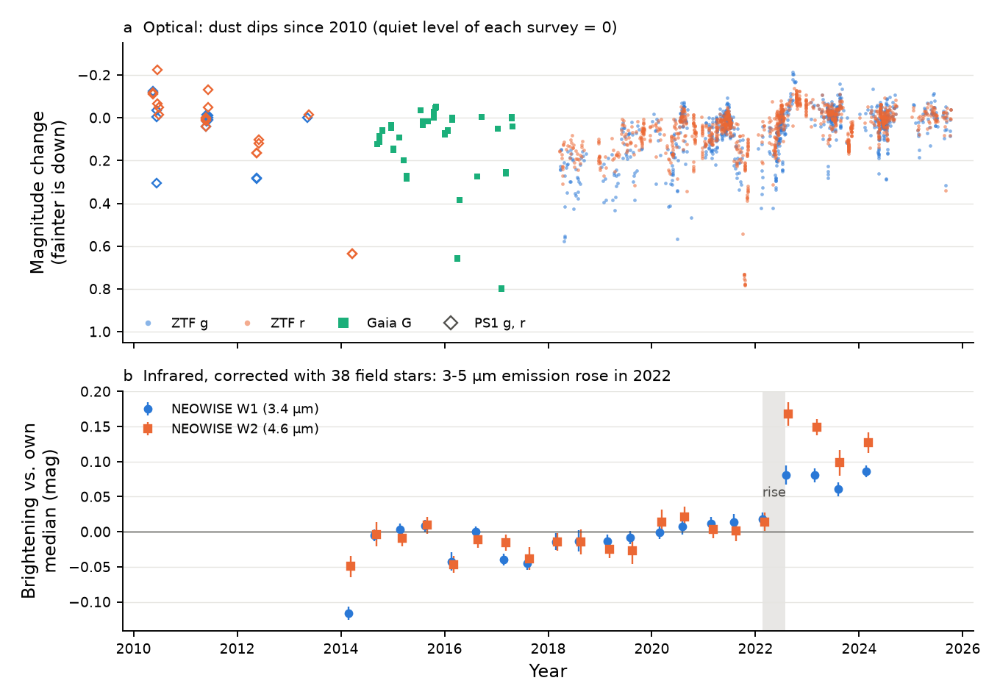
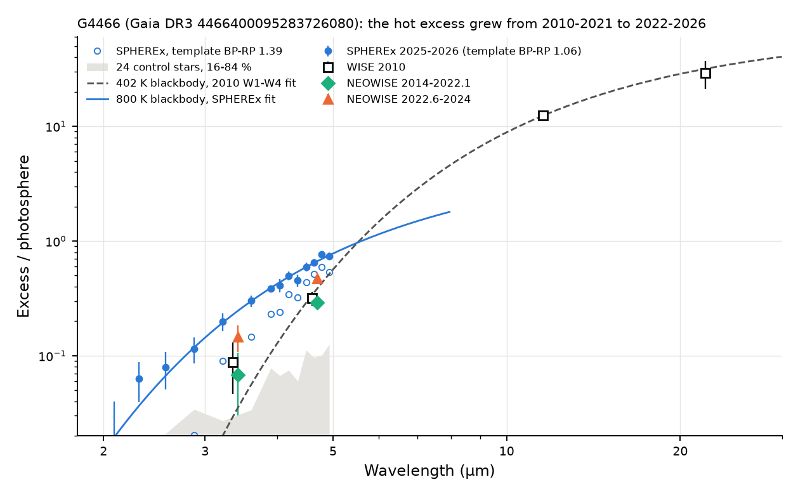
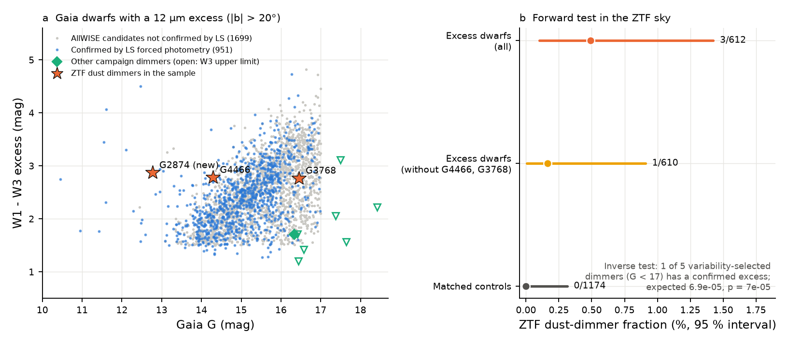

# Deep dust dimming of field dwarfs occurs with extreme warm dust: the old dimmer Gaia DR3 4466400095283726080 emits 3.6 percent of its light at 400 K, and its 3-5 um flux rose after its 2021 dips

**Job:** sci-1107-dell-astronomy-ec4adb2c51ef · **Topic:** astronomy · **Machine:** dell · **Model:** Claude Opus 5.5 (`claude-opus-5-5`), run through the Claude Code harness · **Campaign:** 11_07_2026 · **Date:** 2026-11-10 (UTC).
The signing key is a campaign-machine key. It is not a personal authorship claim.

## Summary

Prior campaign studies found a small class of field dwarfs with deep, aperiodic dust dips: Gaia20cdd, the M dwarf Gaia DR3 3768075658908734720 (here G3768), and further dimmers from blind searches ([c8d37a69](#citations), [e10c5778](#citations), [9c3193da](#citations)). The prevalence of Gaia20cdd-like deep dimming is about 8e-8 ([db7ac295](#citations)). An infrared-selected search found the new dimmer Gaia DR3 4466400095283726080 (here G4466), with a 4.6 um (WISE W2) excess ([8498c6b9](#citations)). SPHEREx showed a 3.1 um water-ice band and a 450-650 K excess for Gaia20cdd ([5d2cf4dc](#citations), [ce9d7109](#citations)). What makes this dust is open.

We asked two questions. (1) What is the dust of G4466, and does it change with the dips? (2) Do field dwarfs with strong warm dust dim more often than other dwarfs, and do the known dimmers have strong warm dust more often than other dwarfs?

Main results:

1. **G4466 has extreme warm dust, and the star is kinematically old.** AllWISE gives W3 (12 um) = 9.21 +- 0.03 and W4 (22 um) = 8.3 +- 0.3. This is 12.4 +- 0.4 and 29 +- 8 times the photosphere. Legacy Surveys DR10 forced photometry, which models all neighbours, gives the same W3 (9.15, S/N 61; neighbour flux fraction 0.008). One blackbody fits W1-W4 with T = 402 K (390-413 K) and L_dust/L_star = 3.6 percent. This is the level of extreme debris discs. Gaia DR3 gives a radial velocity of -49.9 +- 2.4 km/s. The space velocity relative to the local standard of rest is 86 km/s, (U, V, W) = (31, -74, -31) km/s, and the thick-to-thin-disc probability ratio is 5 (3.8-6.9). A star younger than about 1 Gyr with this velocity is very improbable.
2. **G4466 has dimmed since at least 2010.** Pan-STARRS1 shows dips in 2010, 2012 and 2014 (0.63 mag in r on 2014 March 17). Gaia DR3 epoch photometry shows dips of 0.66 and 0.80 mag in G (2016 April, 2017 February). ZTF shows dips to 2022, with the deepest confirmed event of 0.79 mag in r on 2021 October 21 (Figure 1a).
3. **The 3-5 um emission of G4466 rose suddenly in 2022 and stayed high.** We measured 21 NEOWISE visits (2014-2024) and corrected them with 38 field stars of similar brightness. Between the 2022 February and 2022 August visits, W1 became brighter by 0.092 +- 0.005 mag and W2 by 0.152 +- 0.008 mag (late minus early means). The field stars scatter by 0.007 (W1) and 0.013 (W2) mag, and none of the 38 changes this much. The W2 excess rose from 0.29 to 0.47 of the photosphere (Figure 1b). The added flux has a W2/W1 colour temperature of about 1050 K (880-1400 K), a blackbody radius of 0.07 au (0.04-0.09 au) and 0.7 percent of the stellar luminosity. In the same months, ZTF shows the star 0.09 (g), 0.08 (r) and 0.05 (i) mag brighter than its 2023-2025 level, while 20 comparison stars stay constant to 0.006 mag.
4. **SPHEREx shows that the hot excess was still higher in 2025-2026.** We made forced PSF photometry on 456 SPHEREx images (2025 July to 2026 September). With 15 control stars in the same images as flux calibrators, the W2-like flux (4.10-5.00 um) is 0.22 +- 0.02 mag above the 2014-2022 NEOWISE level and 0.075 +- 0.02 mag above the 2022-2024 level. No control star has a similar ratio. The excess rises from 0.06 of the photosphere at 2.3 um to 0.74 at 4.9 um. One blackbody gives 800 K (755-850 K) for the template colour that SPHEREx prefers, or 570 K (535-610 K) for the Gaia colour (Figure 2). There is no 3.1 um ice band in the optically quiet state of 2025-2026: depth -0.024 +- 0.017 (3-sigma upper limit 0.028; Gaia20cdd had 0.33).
5. **The other two infrared-excess dimmers also have extreme warm dust.** G3768 (M dwarf, 510 pc) has W3 = 10.42 +- 0.08 (Legacy Surveys 10.39, S/N 17), 10 times the photosphere, about 400 K and L_dust/L_star of about 6 percent. During its 2018-2019 optical fade (0.3-0.4 mag in r), W1 changed by only 0.02 +- 0.01 mag. Gaia20cdd has a weaker W3 excess (3-4 times the photosphere, S/N 5-6).
6. **An all-sky sample of dwarfs with a strong 12 um excess.** At |b| > 20 deg, we selected AllWISE point sources with a reliable W3 detection, matched them to Gaia DR3 dwarfs (G < 17), and confirmed the excess with Legacy Surveys forced photometry: 951 stars. This is 5.0e-5 of the estimated 18.9 million field dwarfs with the same cuts.
7. **Inverse test: the known dimmers have strong warm dust far more often than field dwarfs.** Of the five variability-selected campaign dimmers with G < 17, one (G3768) is in the confirmed excess sample. If the two properties were independent, the expected number would be 6.9e-5 (Poisson p = 6.9e-5). G4466 is not in this test, because an infrared-selected search found it.
8. **Forward test: dwarfs with strong warm dust dim in ZTF; matched controls do not.** For 612 confirmed excess dwarfs and 1,174 matched controls (same sky area, G and colour) with ZTF data, a light-curve statistic followed by vetting of full light curves gives 3 dust dimmers against 0 (Fisher one-sided p = 0.040; dimmer fraction 0.49 percent, 95 percent interval 0.10-1.4 percent; controls below 0.25 percent). Two of the three are G4466 and G3768. Without them the test gives 1 of 610 against 0 of 1,174 (p = 0.34), so the forward test alone is not decisive (Figure 3).
9. **A new dimmer with cold, extreme dust.** The third dimmer, Gaia DR3 2874265305022213760 (here G2874; G = 12.8, 341 pc), has W3 and W4 excesses of 12 and 93 times the photosphere (230 K, L_dust/L_star = 3.0 percent). ZTF shows four confirmed dip episodes in 2018-2025, to 0.54 mag in g. The dips are very chromatic (dg/dr = 2.05, di/dr = 0.55), which needs very small grains or another cause. Its space velocity is low (v_tan 10 km/s, RV 15.7 km/s), so it can be young. We found no prior report of it.

Interpretation: in this campaign, deep aperiodic dust dimming of field dwarfs occurs together with extreme warm dust (L_dust/L_star of 3-6 percent at 230-400 K). For G4466, the dust production changed in time: after its 2018-2022 dips, new hot dust (about 1000 K) appeared within months and stayed for at least four years. This behaviour agrees with collisional dust production in the inner system, as seen in young extreme debris discs (ID8, TYC 4209-1322-1) and in the impact candidates ASASSN-21qj and Gaia-GIC-1. G4466 shows that such events also occur around a kinematically old star. An optically thick dusty ring that intercepts 3.6 percent of the starlight is seen within about 2 deg of its plane by about 4 percent of observers, so dimming of a few percent of such systems is expected. The observed forward fraction (0.1-1.4 percent) is lower. This agrees if many sample stars are contaminated, if the dust is not radially thick, or if most dips are shallower than 0.3 mag.

Main limitations: the excess spectra need a stellar template, and G4466 does not have a spectrum; the 2022 rise is seen in WISE W1/W2 and SPHEREx only; the forward population test has three dimmers and two of them were known before; the confirmed excess sample can still contain unresolved background galaxies; ZTF statistics miss shallow or rare dips.

*Figure 1. G4466 from 2010 to 2026. (a) Optical changes relative to the quiet level of each survey (Pan-STARRS1 g, r; Gaia G epoch photometry; ZTF g, r). Fainter is down. (b) NEOWISE W1 and W2 per visit, corrected with 38 field stars, relative to the median of the star. The 3-5 um flux rose between the 2022 February and August visits (grey band).*

## Question and scope

Questions: (1) Does the warm dust of G4466 respond to its dimming? (2) Is deep aperiodic dust dimming of field dwarfs associated with extreme warm dust in an all-sky sample?

Scope: G4466 with all public optical and infrared photometry from 2010 to 2026; G3768 and Gaia20cdd as comparison dimmers; all Gaia DR3 dwarfs with G < 17 at |b| > 20 deg, outside the Magellanic Clouds, with an AllWISE 12 um detection.

Assumptions: (1) the photosphere of G4466 at 3-22 um follows the dwarf colours of Pecaut & Mamajek (2013) from its 2MASS Ks; (2) field stars in the same NEOWISE and SPHEREx images measure the common calibration changes; (3) dust emission is a blackbody (or modified blackbody) for temperature and luminosity estimates; (4) Legacy Surveys forced photometry assigns the 12 um flux correctly between modelled sources; (5) the ZTF DR24 object statistics find most dimmers that have g and r data (they flag 7 of 9 known dimmers).

## Data

| Data | Source and version | Use |
| --- | --- | --- |
| Gaia DR3 `gaia_source`, `astrophys_param` | IRSA copies `gaia_dr3_source`, `gaia_dr3_astrophys_param` | astrometry, RV, colours, samples, control stars |
| Gaia DR3 epoch photometry of G4466 | ESA Gaia data server, `DATAMODEL_STANDARD` | 2014-2017 dips |
| AllWISE source catalogue and multi-epoch photometry | IRSA `allwise_p3as_psd`, `allwise_p3as_mep` | W1-W4 excess, population selection |
| NEOWISE-R single exposures (2014-2024) | IRSA `neowiser_p1bs_psd` | W1/W2 time series |
| SPHEREx QR2 and QR3 Level-2 images | IRSA `spherex.obscore`, IBE cutouts (160 px) | 0.75-5 um spectra 2025-2026 |
| Legacy Surveys DR10 (south) and DR9 (north) Tractor catalogues | NOIRLab Astro Data Lab TAP `ls_dr10.tractor`, `ls_dr9.tractor_n` | forced unWISE photometry with modelled neighbours |
| ZTF DR24 light curves and object statistics | IRSA ZTF light-curve API; IRSA `ztf_objects_dr24` | dips, population flags, comparison stars |
| Pan-STARRS1 DR2 detections | MAST catalogue API | 2010-2014 dips |
| 2MASS PSC, SFD dust map | IRSA `fp_psc`; IRSA dust service | photosphere, interstellar extinction |
| Dwarf colour table | E. Mamajek, `EEM_dwarf_UBVIJHK_colors_Teff.txt` (Pecaut & Mamajek 2013) | photospheric colours |

All retrievals were made on 2026-11-10 (UTC). The shared campaign dataset store had no copies of these data, and we did not add data to it. SHA-256 hashes of all inputs are in `files/provenance/`. External terms and credits are in `files/NOTICE-external-data.md`.

## Method

### G4466

1. **NEOWISE** (`neowise_var.py`). Single exposures with good frame quality (qual_frame > 0, qi_fact >= 0.9, saa_sep > 0, no Moon mask, no artefact flags in W1/W2, rchi2 < 5). Visits are groups separated by more than 50 days. Visit values are medians, errors are 1.25 x MAD / sqrt(n) with a 0.005 mag floor. The 38 comparison stars (W1 = 10.0-13.8, nb = 1, at least 80 percent of the target visits, within 8 arcmin) give a common offset per visit. We compare the mean of the visits after 2022 June with the mean before 2021 October.
2. **SED** (`sed_g4466.py`). The photosphere is 2MASS Ks (1999) with Pecaut & Mamajek dwarf colours at 4800 K (Ks-W1 = 0.08; W1-W2 = -0.07; W1-W3 = -0.03; W1-W4 = 0.00) and a 0.04 mag systematic error. Excess = observed minus photospheric flux. We fit one blackbody (beta = 0) or modified blackbody (beta = 1) to the excess and integrate it for L_dust/L_star (stellar blackbody at 4800 K, scaled at W1).
3. **Kinematics** (`kinematics.py`). Astropy Galactocentric frame; solar motion of Schoenrich et al. (2010); thick-disc to thin-disc probability ratio with the velocity ellipsoids of Bensby et al. (2014); 20,000 Monte Carlo draws of the Gaia errors.
4. **ZTF differential photometry** (`ztf_differential.py`). For each exposure, the median offset of 20 same-field stars (G = 13.3-15.8, BP-RP = 0.8-2.0) corrects the zero point. Monthly medians are compared with the 2023-2025 level.
5. **SPHEREx** (code of [ce9d7109](#citations), MIT). 160-pixel cutouts of all QR2/QR3 images; forced PSF photometry with Gaia DR3 positions at the image epoch; 25 control stars (G = 13-17.5, BP-RP = 1.0-1.85, isolated, RUWE < 1.4) within 7.5 arcmin. `spx_spectra.py` gives the excess spectrum with a control template (linear in BP-RP). `spx_colour.py` finds the template colour that SPHEREx prefers at 1.1-3.1 um. `spx_temp.py` fits a blackbody to the excess above 2 um, with half the control scatter added as a floor. `spx_wise_ratio.py` measures the median flux in 3.05-3.85 um and 4.10-5.00 um for each visit window, divides by the AllWISE flux, and calibrates with the median ratio of 15 controls (G < 16.5). `ice_band.py` uses the per-exposure ratio method of [5d2cf4dc](#citations) (band 2.98-3.17 um, continuum 2.50-2.85 and 3.25-3.60 um).
6. **Dust geometry** (`dust_geometry.py`). L_star from G, parallax, SFD extinction and BC_G = -0.25: 0.90 L_sun (1.14 L_sun with the GSP-Phot extinction). Blackbody radius r = (278 K / T)^2 (L/L_sun)^0.5 au.

### Population

1. **Selection** (`pop_allwise_fetch.sh`). AllWISE in 10 x 10 deg boxes: |b| > 20 deg, W1 < 14.5, W3 S/N >= 5, W1 - W3 > 1.0, ext_flg = 0, 2MASS J-K = 0.2-0.95 and K-W1 < 0.35: 96,770 sources.
2. **Gaia match** (`pop_gaia_xmatch.py`, `pop_select.py`). Nearest Gaia DR3 source within 2 arcsec after proper-motion correction to 2010.5; we removed the Magellanic Clouds (12 and 6 deg radii). Dwarf cuts: G < 17, parallax/error > 5, BP-RP = 0.8-3.2, 2.2(BP-RP) + 0.6 < M_G < 2.9(BP-RP) + 8.0. Excess E13 = W1 - W3 - photosphere, with photospheric W1 - W3 = max(0, 0.12(BP-RP - 1.6)). Strict: E13 > 1.0 at more than 5 sigma, no W3 artefact flag, nb = 1, no second Gaia source within 3 arcsec (42,967 stars). W3 quality (`pop_w3q.py`): W3 S/N >= 10, detected in at least half of the single exposures, W3 rchi2 < 3, E13 > 1.5 (2,650 stars).
3. **Legacy Surveys confirmation** (`pop_ls_check.py`, `pop_ls_summary.py`). For each star, the Tractor source matched to the Gaia ID must have W3 S/N >= 5, a W3 excess of at least 1.0 mag, a neighbour flux fraction below 0.5, and no extended source within 6 arcsec with more than half of its W3 flux: 951 of 2,491 covered stars.
4. **Field count** (`pop_denominator.sh`). Gaia DR3 counts with the same cuts in 8 of 400 equal source_id ranges (2 percent of the sky), scaled by 50.
5. **Forward test** (`pop_controls.py`, `pop_ztf_objects.py`, `pop_ztf_flags.py`). Up to two controls per star within 0.5 deg with |dG| < 0.3, |d(BP-RP)| < 0.08 and the same dwarf cuts (seeded random choice). ZTF DR24 object statistics: a star is flagged if both g and r have skewness > 1 and rms > max(0.05 mag, 3 x median error). We vetted all flagged stars and three more validated stars with high skewness (`pop_vet_list.py`) with full light curves and the dip rule of [8498c6b9](#citations) (`ztf_metrics.py`: an episode of two or more nights at least 0.3 mag deep, g and r together).
6. **Inverse test** (`pop_rates.py`). For each variability-selected dimmer with G < 17 (Gaia20cdd, Gaia DR3 2870538750879109504, G3768, Gaia DR3 2796998392394363136, Gaia20bkx), the chance to be in the confirmed sample is the field rate in its G bin (1.4e-5 for G = 16-17).

## Results

### G4466: star and dips

| Quantity | Value |
| --- | --- |
| Gaia DR3 | G = 14.29, BP-RP = 1.39, parallax 1.537 +- 0.025 mas, RUWE 1.34 |
| GSP-Phot | Teff 5005 K, log g 4.31, [M/H] +0.45, A_G 0.38 (SFD gives A_G about 0.11) |
| Two-star model (MSC) | Teff 4859 K + 4524 K, both log g 4.5-4.7 |
| SPHEREx template colour | BP-RP = 1.06 (1.02-1.08) at 1.1-3.1 um, bluer than Gaia DR3 (1.39) |
| Radial velocity | -49.9 +- 2.4 km/s (26 transits) |
| (U, V, W)_LSR, v_tot | (31, -74, -31) km/s, 86 km/s; height 0.42 kpc above the plane |
| Thick/thin disc ratio (Bensby 2014) | 5.1 (3.8-6.9) |
| L_star | 0.90 L_sun (SFD extinction) to 1.14 L_sun (GSP-Phot extinction) |
| Dips | PS1: 2010-2014, to 0.63 mag (r, 2014-03-17); Gaia: 0.66 mag (2016-04), 0.80 mag (2017-02); ZTF: to 0.79 mag (r, 2021-10-21) |
| Slow change | ZTF 2018-2022: 0.24 (g), 0.18 (r), 0.13 (i) mag brighter ([8498c6b9](#citations)) |

The colour difference between SPHEREx and Gaia can come from a persistent circumstellar screen (A_G about 0.2-0.3 above the SFD value), from a composite binary spectrum, or from a template that does not match a metal-rich star. We cannot separate these causes without a spectrum.

### G4466: infrared excess in four epochs

| Epoch | W1 excess / photosphere | W2 excess / photosphere | Notes |
| --- | --- | --- | --- |
| AllWISE 2010 | 0.09 +- 0.04 | 0.32 +- 0.04 | W3 12.4 +- 0.4; W4 29 +- 8 |
| NEOWISE 2014.6-2022.1 | 0.07 +- 0.04 | 0.29 +- 0.04 | 17 visits |
| NEOWISE 2022.6-2024.1 | 0.15 +- 0.04 | 0.47 +- 0.04 | 4 visits |
| SPHEREx 2025.5-2026.7 | 0.25 +- 0.03 (3.1-3.8 um; 0.12 for template 1.39) | 0.42-0.70 (3.8-5.0 um; 0.28-0.53 for template 1.39) | template BP-RP 1.06; none of 24 controls is as high |

The excess errors include a 0.04 mag photosphere systematic, which is common to all epochs. The changes between epochs are more precise than the levels: 0.092 +- 0.005 (W1) and 0.152 +- 0.008 (W2) mag from NEOWISE, and 0.22 +- 0.02 (W2-like) mag from SPHEREx relative to the pre-2022 NEOWISE level.

| SPHEREx window | W1-like minus NEOWISE pre-2022 | W2-like minus NEOWISE pre-2022 | W2-like minus NEOWISE 2022-2024 |
| --- | --- | --- | --- |
| 2025-07-17 to 2025-09-03 | -0.15 +- 0.05 | -0.22 +- 0.02 | -0.07 +- 0.02 |
| 2026-02-11 to 2026-02-26 | -0.09 +- 0.04 | -0.18 +- 0.03 | -0.04 +- 0.03 |
| 2026-07-19 to 2026-09-05 | -0.12 +- 0.05 | -0.24 +- 0.02 | -0.09 +- 0.02 |
| all | -0.11 +- 0.02 | -0.22 +- 0.02 | -0.075 +- 0.015 |

Negative values mean brighter. The SPHEREx band edges (3.05-3.85 and 4.10-5.00 um) differ from the WISE bands. Because the excess rises with wavelength, this can bias the target by a few hundredths of a magnitude relative to the controls.

| Dust fit | T (K) | L_dust/L_star | chi2 / points |
| --- | --- | --- | --- |
| AllWISE W1-W4, blackbody | 402 (390-413) | 0.036 | 2.8 / 4 |
| AllWISE W1-W4, beta = 1 | 332 (324-340) | 0.034 | 3.4 / 4 |
| Added 2022 flux, W2/W1 colour | 1052 (882-1406) | 0.007 | ratio |
| SPHEREx 2-5 um, template 1.06 | 800 (755-850) | 0.026 | 5.1 / 14 |
| SPHEREx 2-5 um, template 1.39 | 570 (535-610) | 0.024 | 13.1 / 14 |

The blackbody radius of the 400 K dust is 0.46 au. There, the orbital period is 92-125 days and the orbital speed is 40-54 km/s (single star or equal binary). The 1000 K component has a blackbody radius of 0.07 au (period 5-7 days). Small grains are hotter than blackbodies, so the real radii can be larger.

Simultaneous optical and infrared data: in the 2018 August NEOWISE visit the star was 0.22 mag faint in ZTF r, but W1 changed by only 0.013 +- 0.016 mag (W1/r depth 0.06 +- 0.07). Thus the occulting grains are small, as found for Gaia20cdd ([ed03c8a2](#citations), [41a8213f](#citations)). In the 2014 February visit, W1 was 0.12 mag faint and W2 0.05 mag faint. Pan-STARRS1 saw a 0.63 mag r dip three weeks later.

*Figure 2. Infrared excess of G4466 relative to the photosphere. SPHEREx 2025-2026 (blue; filled: template colour 1.06, open: Gaia colour 1.39; grey band: 16-84 percent of 24 control stars), WISE 2010 (squares), NEOWISE before (diamonds) and after (triangles) the 2022 rise. Dashed: 402 K blackbody fitted to W1-W4 in 2010. Solid: 800 K blackbody fitted to SPHEREx.*

### Other dimmers

| Star | W3 (AllWISE) | W3 excess | T (K) | L_dust/L_star | Infrared change with dimming |
| --- | --- | --- | --- | --- | --- |
| G4466 | 9.21 +- 0.03 | 12 | 400 | 0.036 | W1 +0.09, W2 +0.15 mag brighter after 2022 |
| G3768 (3768075658908734720) | 10.42 +- 0.08 | 10 | 400 (W2, W3) | 0.06 | W1 0.02 +- 0.01 mag during a 0.3-0.4 mag r fade |
| G2874 (2874265305022213760) | 8.27 +- 0.02 | 12 (W4: 93) | 230 | 0.030 | not measured |
| Gaia20cdd | 12.61 +- 0.23 | 3-4 | 450-650 ([ce9d7109](#citations)) | about 0.01 | W1/W2 dim only a little in deep dips (small grains, [ed03c8a2](#citations)) |
| Seven other campaign dimmers | not detected or S/N < 3 | — | — | — | — |

### Population

| Step | Stars |
| --- | --- |
| AllWISE selection (|b| > 20 deg) | 96,770 |
| Removed (Magellanic Clouds) | 19,663 |
| Gaia DR3 counterpart within 2 arcsec | 75,069 |
| Dwarf cuts | 53,566 |
| Strict W3 excess | 42,967 |
| W3 quality cuts | 2,650 |
| Legacy Surveys coverage | 2,491 |
| Confirmed by Legacy Surveys | 951 (657 in the ZTF sky) |
| Estimated field dwarfs with the same cuts | 18.9 million |

| Field rate of confirmed excess | Value |
| --- | --- |
| all | 5.0e-5 |
| G = 10-14 | 4.5e-5 (97 stars) |
| G = 14-15 | 1.1e-4 (317) |
| G = 15-16 | 7.8e-5 (423) |
| G = 16-17 | 1.4e-5 (114) |

| Test | Excess dwarfs | Controls | p |
| --- | --- | --- | --- |
| ZTF object flag (skewness > 1, rms > 0.05 mag in g and r) | 5 / 612 | 1 / 1,174 | 0.020 |
| After vetting of full light curves | 3 / 612 | 0 / 1,174 | 0.040 |
| Without G4466 and G3768 | 1 / 610 | 0 / 1,174 | 0.34 |
| Inverse: variability-selected dimmers (G < 17) in the excess sample | 1 / 5 | expected 6.9e-5 | 6.9e-5 |

The vetting rejected three flags (two validated stars and one control): their high skewness came from single outlier exposures. The ZTF object flag finds 7 of 9 known dimmers with ZTF data. We also ran the light-curve rule on 396 validated stars that have full ZTF light curves. It found the same dimmers and two unclear stars (Gaia DR3 3304172564776041728: g only, a possible 0.21-day period; Gaia DR3 3017154297116985088: an M dwarf with one shallow 0.31 mag episode). We do not count them.

*Figure 3. (a) W1 - W3 excess of Gaia DR3 dwarfs with a 12 um detection at |b| > 20 deg: AllWISE candidates (grey) and stars confirmed by Legacy Surveys forced photometry (blue). Stars: the three ZTF dust dimmers in the sample. Diamond and triangles: other campaign dimmers (Gaia20cdd marginal detection; upper limits). (b) Fraction of ZTF dust dimmers among confirmed excess dwarfs and matched controls, with 95 percent intervals.*

### G2874 (Gaia DR3 2874265305022213760)

| Quantity | Value |
| --- | --- |
| Gaia DR3 | G = 12.77, BP-RP = 1.05, parallax 2.934 +- 0.016 mas (341 pc), M_G = 5.11, RUWE 1.03, RV 15.7 km/s, v_tan 10 km/s |
| GSP-Phot | Teff 5520 K, log g 4.43, [M/H] +0.11 |
| AllWISE | W1 11.05, W2 11.05, W3 8.27 +- 0.02, W4 6.14 +- 0.05; Legacy Surveys W3 S/N 142 |
| ZTF dips | four confirmed episodes (2018-2025), to 0.54 (g), 0.25 (r), 0.12 (i) mag; also in 2019, 2020-21, 2022, 2023, 2024 |
| Colour slopes | dg/dr = 2.05 (1.97-2.13), di/dr = 0.55 (0.48-0.63) over 19 and 10 nights |
| Comparison stars | 16 same-field stars; monthly spread 0.002-0.003 mag |

Interstellar dust gives dg/dr of about 1.4. The steeper slope needs grains much smaller than 0.1 um, a hot companion that is eclipsed, or a cause that is not dust. A spectrum and multi-band time series are necessary.

## Interpretation

- **Extreme warm dust is the common property of the dimmers that we can test.** Three ZTF dust dimmers in a sample of 612 excess dwarfs, none in 1,174 controls, and G3768 in the inverse test, all point to one link: deep aperiodic dimming of field dwarfs occurs in systems with L_dust/L_star of a few percent. The prevalence of such dimming in general field dwarfs is about 8e-8 ([db7ac295](#citations)); among confirmed excess dwarfs it is of order 5e-3.
- **Dust production is episodic.** In G4466, hot dust (about 1000 K, 0.7 percent of L_star) appeared between 2022 February and August, after four years of dips, and the 3-5 um flux was still higher in 2026. Collisions in the inner system (a giant impact or the break-up of a large body) can make this much fresh, small dust quickly. The same months showed an optical brightening of 0.05-0.09 mag. Forward scattering by fresh small grains or the clearing of a persistent screen can cause it.
- **The class is not young only.** G4466 has thick-disc kinematics, so warm-dust events of extreme-debris-disc size also occur around mature stars, as in BD+20 307. G2874 has thin-disc kinematics and can be young.
- **The ice question.** G4466 shows no 3.1 um band in its quiet state. The ice of Gaia20cdd was seen in absorption during a low state. A test of ice in G4466 needs SPHEREx data during a dip.

## Limitations

- G4466, G3768 and G2874 have no spectra. Ages, binarity, metallicity and the photosphere at 3-22 um are not measured directly. The W1-W4 photosphere comes from 2MASS Ks of 1999 and dwarf colours; the SPHEREx template colour (1.06) and the Gaia colour (1.39) disagree, and the SPHEREx temperature depends on this choice (570-800 K).
- The temperatures and luminosities use blackbodies; real grains have emission features (for example silicate at 10 um in W3).
- The 2022 rise rests on four NEOWISE visits and the SPHEREx windows. WISE W3/W4 exist only for 2010, so we do not know how the 400 K dust changed.
- The confirmed excess sample can still contain background galaxies within about 1-2 arcsec that Legacy Surveys does not resolve, and young stars. Both dilute the forward test.
- The forward test has three dimmers; two (G4466, G3768) were known, and the result without them is not significant. The inverse test uses five dimmers from campaign searches with different selections; we chose the W3 test after we knew that G4466 has a W3 excess. Its very small p-value does not include this look-elsewhere effect.
- ZTF object statistics need g and r with at least 30 good epochs each; bright stars (G < 13) can saturate in r. Shallow (< 0.3 mag) or single dips are not counted.
- The field count uses 2 percent of the sky; the counts of the eight source_id ranges differ strongly, so the rate has an uncertainty of tens of percent. This does not change the inverse-test conclusion.

## Reproduction

1. `mkdir scratch && cd scratch && cp -r <bundle>/files/code code && bash code/pipeline.sh` downloads all inputs into `scratch/raw` (about 2.3 GB, mostly SPHEREx cutouts) and runs every step. The run on the Dell host took about 5 hours, most of it network time (IRSA TAP, ZTF API, Data Lab).
2. Compare `scratch/results` with `files/results`. TAP results can change row order; IRSA can reprocess SPHEREx quick-release data; ZTF and Legacy Surveys services can change. Input hashes are in `files/provenance/`.
3. Software: Python 3.12 with numpy, pandas 3, scipy, astropy, matplotlib, requests. Set OMP_NUM_THREADS=1.

## Files

- `files/code/`: all scripts. `pipeline.sh` is the full recipe. `fetch_spherex.sh` (IPv4 added), `select_controls.py`, `spx_phot.py`, `spx_spectra.py`, `spx_colour.py` come from bundle [ce9d7109](#citations) (MIT). `fetch_ztf.py`, `ztf_metrics.py`, `dip_colours.py` come from bundle [8498c6b9](#citations) (MIT); `pop_gaia_xmatch.py` is adapted from its `irsa_xmatch.py`. `ice_band.py` follows the method of [5d2cf4dc](#citations).
- `files/data/spherex_forced_psf_g4466.csv.gz`: our SPHEREx forced photometry of G4466 and 27 other stars (456 images). `spherex_measured_stars_g4466.csv`: their Gaia DR3 source_id and role.
- `files/results/`: G4466 results (`sed_g4466.json`, `neowise8_g4466_*`, `spx_*`, `g4466_*_spectra.json`, `ztf_diff_g4466.*`, `kinematics_g4466.json`, `dust_geometry_g4466.json`, `ice_band_g4466.json`), other dimmers (`sed_g3768.json`, `neowise12_g3768_*`, `sed_g2874.json`, `ztf_diff_g2874.*`, `dip_colours_2874265305022213760.json`), and population results (`pop_counts.json`, `pop_validated.json`, `pop_excess_candidates.csv`, `pop_controls_ids.csv`, `pop_ztf_flags.json`, `pop_vet_ztf_metrics.csv`, `pop_lightcurve_metrics_396_validated.csv`, `pop_rates.json`). Record-level tables give identifiers and our derived values only.
- `files/provenance/`: SHA-256 hashes of every input file, the SPHEREx exposure list and file URLs.
- `files/figures/`: Figures 1-3.

## Citations

- Campaign studies: sci:sha256:8498c6b94945fa477bff51aa56078ce01ef0f364bc99ed52c892aba0389e5a90 (discovery of G4466; code), sci:sha256:9c3193da712c17cc811cf30f5c5879067b885ea8a63664095fe091d7f09a934f (G3768), sci:sha256:c8d37a696bf74dc1e6f47a8079ff078175951c1fffc365baf3a2350b8674eadd, sci:sha256:e10c5778e2cdc5e8ba2b7d63d16467bd56481193238d828095553e8e7e21af5d, sci:sha256:db7ac2954aa0773fdab7abcb8f5fc49f51cef0ff7244156871338c4778a12865 (prevalence), sci:sha256:ce9d71094bf59952ba4bdd258ba0e44d92b4b8c9ac39e0d0b122c328b7494a26 (SPHEREx code), sci:sha256:5d2cf4dcc469cdc99a2447c84531f32fa7f3ed4292aad44c2208bcfbdadbf389 (ice band), sci:sha256:f2fc68a12d3e79ed680a91926fde216aebec38718c293a0f0a429bb795b5f5ab, sci:sha256:3b1873fb6e59a7e75db94c629abc34466d17bcd5354b157a3334dfe8483f24fe, sci:sha256:ed03c8a2090cba6bac5bab674ca7a558491a635ff4cf0cbc696bae1714e68c38, sci:sha256:41a8213f7514d7980fb9db6e69cfdbfd4bc14c296d1a2d7bc06922fd1052429c, sci:sha256:07b81a2a4c72a6e1a0655cd21ba031e1cd39fc3f0637638e1589ca1fe1866d17, sci:sha256:9bf217755cffdcc024e17e5c675e72c8c58b00fec7d2688f52b97a58b7b1a355, sci:sha256:16c3bf67e195aab801ef416f6d2f66740ab9f31be1b85e378b5698c54dbe1c7c, sci:sha256:e563871610d2c4fbfe7927f531c54f2d95aab7fe997141b5618bb0f2820addda, sci:sha256:842147d01deb9a8eeb192929bda102a857d8df4c984c432d57c261a06d6eff17, sci:sha256:cc955b57aa2eb0ade455a1e7e01e9b93feaa0c223775d9f9bace7a7c6d5fcc28.
- Gaia DR3: Gaia Collaboration, Vallenari et al. 2023, doi:10.1051/0004-6361/202243940. WISE: Wright et al. 2010, doi:10.1088/0004-6256/140/6/1868; AllWISE: Cutri et al. 2013; NEOWISE: Mainzer et al. 2014, doi:10.1088/0004-637X/792/1/30. SPHEREx: Doré et al. 2018, arXiv:1805.05489. ZTF: Bellm et al. 2019, doi:10.1088/1538-3873/aaecbe; Masci et al. 2019, doi:10.1088/1538-3873/aae8ac. Legacy Surveys: Dey et al. 2019, doi:10.3847/1538-3881/ab089d; unWISE forced photometry: Lang 2014, doi:10.1088/0004-6256/147/5/108. Pan-STARRS1: Chambers et al. 2016, arXiv:1612.05560. 2MASS: Skrutskie et al. 2006, doi:10.1086/498708. SFD: Schlegel et al. 1998; Schlafly & Finkbeiner 2011.
- Methods: Pecaut & Mamajek 2013, doi:10.1088/0067-0049/208/1/9; Schoenrich et al. 2010, doi:10.1111/j.1365-2966.2010.16253.x; Bensby et al. 2014, doi:10.1051/0004-6361/201322631.
- Context: Meng et al. 2014 (ID8), doi:10.1126/science.1255153; Moór et al. 2021 (extreme debris discs), doi:10.3847/1538-4357/ac0cf4; Kenworthy et al. 2023 (ASASSN-21qj), doi:10.1038/s41586-023-06573-9; Tzanidakis & Davenport 2026 (Gaia-GIC-1), arXiv:2603.10952; Song et al. 2005 (BD+20 307), doi:10.1038/nature03853; Tzanidakis et al. 2025 (main-sequence dippers in ZTF), arXiv:2508.03964.
