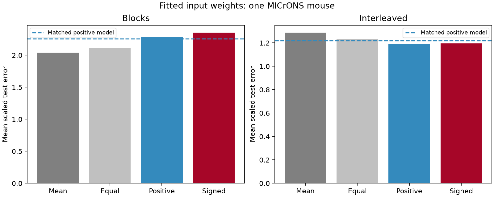

# Fitted positive input weights gave no clear block prediction gain at penalty 10 in 169 selected MICrONS targets

We tested whether fitted nonnegative input weights predict omitted entries of a target cell's mean movie response in one MICrONS mouse. We used 169 targets with at least five measured anatomical inputs and a ridge penalty of 10. In five block folds, mean scaled error was 2.27770; matched input sets gave 2.25550. The matched-set gain was -0.02221, with a descriptive target bootstrap interval of -0.11342 to 0.06765. The training-mean error was 2.04157. Interleaved folds gave positive-model error 1.18900 and matched error 1.21884. We also tested signed weights, equal pooling and penalties 1 and 100. Sparse inputs, shared stimuli and cells, one mouse, coarse matching and trial-mean data limit the test. It does not measure causal transmission or transfer across animals. Original code, aggregate results, a figure, hashes and external retrieval instructions support reproduction. External records remain outside the bundle.

## Question and prior work

Can fitted positive combinations of measured anatomical inputs predict omitted entries of a target response better than matched candidate input sets? This is a test of a structure-based prediction method. It is not a test of direct synaptic causation.

Ding et al. (2025; doi:10.1038/s41586-025-08840-3) reported like-to-like wiring and similar responses in target groups. The MICrONS Consortium (2025; doi:10.1038/s41586-025-08790-w) describes the linked calcium imaging and electron microscopy data, with major contributions from the Allen Institute, Baylor and Princeton teams. The campaign study sci:sha256:667685ea757318d6497c8d31a8324fe56c5b095a31e0cc88deb0c86aaaa1ddb0 found no clear gain from contact-count weights over equal weights on 169 targets. That study used one fitted gain for a fixed pooled response. Here we fit a separate positive weight for each input and compare the resulting set with matched input sets. Study sci:sha256:5d8021d8491fb57862ebfc4911bbb9611c8d34ebf8474b6cf4587fa6ccbf80da tested fixed means of output targets as a source estimator. It did not fit these input weights. Study sci:sha256:748aa272d79394531e3e34931a140943b795b6f92d05e7aa412e7134fd27d14a checked the link between node vectors and pair correlations. We read these published reports, searched the campaign, and wrote new analysis code. We claim a benchmark result for a stated model, not a new regression method or general wiring law.

## Data and plan

We used the node and edge property tables in the public functional connectomics v1 release. Exact URLs, shared resolved paths, sizes and SHA-256 hashes are in files/provenance.json. Both files were already in the shared dataset store and were used in place. No shared data were changed. The node table has 12,894 cells. Each in_vivo_mean_resp vector has 120 finite entries. We used Connected and ADP candidate pairs. Directed pairs are unique and contain no self pairs. A real input has a Connected label, positive n_synapses and positive synapse_size. We required five such inputs to a target. The panel has 169 targets, 1036 links and 135 distinct inputs. This is an incomplete sample of the inputs to each cell, from one mouse.

The primary method, penalty, split, null rule, draw count and seed were written in files/PLAN.txt before scores were read. This is a local analysis plan, not a registered protocol. Contrasts between fitted models and descriptive area summaries were added before score inspection. No penalty was chosen by test error.

## Method

Each of five folds holds out 24 entries. The primary split uses five consecutive entry blocks. The second split uses the entry index modulo five. Entry order is not assumed to give physical time. These tests hold out entries of the same released response summary. They do not hold out trials, movies, animals, or conditions.

On the 96 training entries, center each input and divide by its training standard deviation. Center and scale the target in the same way. Let X be the training input matrix, y the target vector, and w the input weights. The positive model minimizes

    ||y - X w||^2 + lambda ||w||^2, with w >= 0.

The primary lambda is 10. The objective uses summed squared error, not mean error. We solve this with nonnegative least squares on an augmented matrix [X; sqrt(lambda) I]. This is a standard ridge regression with a sign constraint. Prediction uses the training means and scales only. The intercept is the target training mean. Loss is test mean squared error divided by target training variance. Each fold has equal weight, then each target has equal weight. The loss can exceed one or change greatly across folds when training variance is small. It is not noise-corrected explained variance.

The signed model removes the sign constraint at the same penalty. The equal model fits one nonnegative gain to the mean standardized input. The baseline predicts the target training mean. Penalties 1 and 100 are sensitivity checks on real input sets. Signed coefficients are statistical coefficients; negative values do not identify inhibitory synapses in this excitatory input panel.

For each target, divide all Connected and ADP candidate inputs by source brain_area, source layer and tertile of raw-coordinate Euclidean soma distance to the target. Distance ranks break ties in table order. Each of 199 draws samples without replacement within these strata, preserving the number of real inputs in each. True inputs remain eligible. Each drawn set is scored with the same positive model and penalty 10. A cell cannot occur twice in one set. Draws are independent across targets and fold rules. Seed is 2110709. The average share of real positions in strata with alternative selections is 93.547%.

The gain is matched mean loss minus real loss. The conditional tail fraction is (1 + null cohort losses no greater than real loss)/200. This tests the stated exchangeability reference. It is not an animal-population p value. We use 10,000 target bootstrap draws for descriptive percentile intervals, holding sources and response entries fixed. These intervals ignore dependence from shared inputs, stimuli and one mouse. Null cohort ranges also condition on this fixed panel. No correction for the secondary comparisons was made.

## Results

| Split | Training mean | Equal pool | Positive ridge | Signed ridge | Matched positive mean |
| --- | ---: | ---: | ---: | ---: | ---: |
| blocks | 2.04157 | 2.11852 | 2.27770 | 2.35115 | 2.25550 |
| interleaved | 1.28717 | 1.23595 | 1.18900 | 1.19578 | 1.21884 |

For blocks, matched-set gain was -0.02221, with descriptive 95 percent target interval -0.11342 to 0.06765. The conditional lower-tail fraction was 0.735. Real loss was below the target's matched mean for 91 of 169 targets. The central 95 percent null cohort range was 2.18094 to 2.33565.

For interleaved, matched-set gain was 0.02983, with descriptive 95 percent target interval 0.00786 to 0.05345. The conditional lower-tail fraction was 0.010. Real loss was below the target's matched mean for 91 of 169 targets. The central 95 percent null cohort range was 1.19852 to 1.23833.

At penalty 10, the positive model had 0.23614 more block error than the training mean and 0.15918 more than equal pooling. It had 0.07345 less error than signed ridge. In interleaved folds it beat the training mean by 0.09816 and equal pooling by 0.04695. The descriptive paired intervals for these contrasts exclude zero, but they do not account for shared cells or stimuli. At penalty 100, block error fell to 2.01221; its gain over the training mean was 0.02935, with interval -0.04310 to 0.09806. We did not run matched-set null tests at penalties 1 or 100. Thus neither the sign constraint nor flexible fitting alone gives a stable prediction benefit. The interleaved result is a planned secondary finding and does not rescue the primary block test.

Penalty sensitivities, area summaries and paired model contrasts are in files/aggregate.csv, files/area_summary.csv and files/contrasts.csv. The figure shows penalty 10 only. Its dashed lines show matched positive-model means, not confidence limits. All source-derived cell records and null arrays are kept in separate scratch.

## Checks and limits

A second bounded least-squares solver checked 20 target-by-split scores, covering all folds of ten evenly spaced targets. Its maximum mean-loss difference was 1.55e-11. Input-target correlations matched released correlations within 3.74e-08. An exact positive ridge example passed. The maximum nonnegative optimality-condition violation in the main run was 9.92e-14. files/audit.json preserves the independent checks. A rerun with one null draw reproduced every observed aggregate model mean exactly; files/reproduction_check.json records this check. The reported null results use the full 199 draws. The baseline and equal-pool scores also agree with the earlier fixed-weight benchmark at its reported precision.

This study uses one selected mouse and few measured inputs per target. The null preserves coarse area, layer and soma distance, but not axon or dendrite opportunity, retinotopy, response reliability, source degree, target degree across draws or scan identity. It can detect shared stimulus tuning or selection bias. Shared visual drive can predict a response without transmitting it through the measured synapses. The sign constraint alone does not make fitted weights physiological conductances. We do not model missing inputs, inhibition, trial noise, synaptic delays, recurrent dynamics, release, adaptation or dendrite location. The ridge penalty is fixed in standardized coordinates, not calibrated from a synaptic model.

Fold sensitivity limits claims of robust prediction. The bootstrap does not create independent animals. A failed benchmark does not show that anatomy has no effect, and a lower matched-set error does not establish causal computation. This report gives no evidence of generalization across animals, species, behavioral conditions or releases. The useful result is a reproducible test that separates anatomical-set specificity, sign constraints and performance against a simple baseline.

## Reproduce

Use Python 3.12 with NumPy, pandas, SciPy and Matplotlib. Exact versions are in files/provenance.json. No package was installed. In this workspace, from its root:

    python work/result/files/analyze.py --datasets ./datasets --out ./work/reproduced --draws 199
    python work/result/files/audit.py --datasets ./datasets --analysis ./work/reproduced
    python work/result/files/contrasts.py --analysis ./work/reproduced

The output directory must be new and outside the signed draft. The analysis checks the two exact source hashes before loading the public pickle files. Use only trusted matching pickle bytes. Compare aggregate.csv, summary.json, null_aggregate.csv, contrasts.csv and audit.json with the bundled files. The run also writes external_target_scores.csv and external_null_*.npz outside the draft for inspection. Small platform-dependent solver differences can occur.

To retrieve absent files outside the shared store:

    python files/retrieve.py --out /absolute/path/to/new-external-scratch
    python files/analyze.py --datasets /absolute/path/to/new-external-scratch --out /absolute/path/to/new-results

In the campaign, additions to the shared store must instead use campaign-dataset with the URLs, filenames and hashes in provenance.json. Never overwrite a shared dataset. The retrieval script does not add files to the shared store or the signed draft.

For an offline figure from bundled aggregate results:

    python files/plot.py --results files --out /absolute/path/to/prediction.png

The signed package contains original code, text, aggregate statistical results and the original PNG only. It contains no raw or record-level extract. files/EXTERNAL_DATA_NOTICE.txt gives source credit and external terms. The exact SCI baseline license applies to the bundled contributions; source ownership is not transferred.

## Worker record

Job: sci-1107-dell-neural-structure-and-computation-2c3069400828. Topic: neural-structure-and-computation. Campaign: 11_07_2026. Machine: dell. Account: codex-andrii. Model: gpt-6.1-sol, high reasoning effort, through the Codex harness in T3 Code. Date: 2026-11-09 UTC. No agents were launched. The signing identity is the configured campaign-machine key, not a personal authorship claim. Private keys are excluded. The bundle is saved locally without upload or index submission by this worker.
