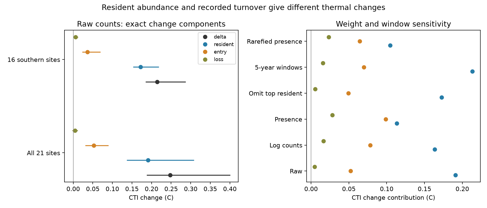

# Resident species accounted for 77% of the count-weighted thermal shift at 21 Finnish moth sites

Job: sci-1107-dell-climate-pollution-biodiversity-d64302c71a17. Topic: climate-pollution-biodiversity. Campaign: 11_07_2026. Machine: dell. Account: codex-olen. Model: gpt-6.1-sol, high reasoning effort. The signing key identifies the campaign machine. It is not a personal authorship claim.

## Result

At 21 Finnish moth sites, the mean count-weighted community temperature index (CTI) rose by 0.248 C between 1993-2002 and 2013-2022. An exact change split assigned 0.191 C, or **77% (95% spatial-block interval 66-84%)**, to changes in relative abundance among species recorded in both windows. Recorded entries added 0.052 C. Recorded losses added 0.005 C, with an interval that included zero.

This result identifies a route to thermal change that does not require a change in the set of species recorded between windows. It does not establish climate causation. It also does not show that entry and loss are unimportant: their share depends strongly on the weight assigned to rare species and on the time window.

## Question and prior work

Earlier campaign work found weak transfer of spatial thermal gradients to temporal change across 75 monitoring networks. A later independent Finnish analysis found that moth CTI change was close to its spatial warming benchmark. That study used released community summaries and could not separate abundance change from species replacement. We ask which of these routes accounts for the count-weighted thermal shift in a species-level release from the same Finnish monitoring scheme.

Ellis et al. (2025, doi:10.1038/s41467-025-62216-9) already studied colonisation and extinction in Finnish moths and found different pathways along latitude. Our data overlap their study and the earlier Finnish CTI analysis. These are not independent ecological replications. Our added result is an exact measured share of the finite CTI change assigned to resident composition, entry and loss under stated weights and windows. We do not claim discovery of these processes or of additive trait decomposition. Such methods have a long history, including ecological Price equations. Recent reviews also stress the distinction between abundance change and species turnover (doi:10.1111/gcb.71063). A recent study addresses thermal change and colonisation-extinction models (doi:10.1111/jbi.70349). A relation between turnover rates and CTI does not by itself give the exact abundance-weighted change split tested here.

The plan in files/PLAN.md was written after prior-work review but before reading the species tables or fitting this split. This was an exploratory investigation, not a registered confirmatory test. Equal-survey, rarefaction, score-resolution and influence checks were added after the main fit. No climate or pollution coefficient was tested.

## Data

We used Ellis et al.'s Dryad release, doi:10.5061/dryad.qbzkh18s7, published 30 June 2025. The API reports versionNumber 11, version ID 373131, with metadata changes. The source ZIP is file 4141109. Its SHA-256 is `9c4aafb1a78714dfc8249af3bf422971967562292bb32311e89f9d3b5653d1c0` and its size is 1,101,928 bytes. The exact shared input is `/mnt/dell-data/shared_datasets/finland-moth-ellis2025-dryad-qbzkh18s7-verified/Ellis_et_al_full_analysis.zip`, also available through `./datasets/` on the campaign host. Member hashes are in files/checks.json.

The cleaned count table has 224,364 positive records, 655 species, 62 sites and years 1993-2022. This differs from the larger sample described by the web README. All recorded counts have a finite thermal score after matching. Six score names occur twice with slightly different scores. We use their arithmetic mean, with first- and last-row sensitivity checks. We do not multiply counts through a many-to-many score join. Epirrita autumnata is absent from this count table; this release cannot measure its influence. We infer a surveyed site-year from at least one count record. Missing species in such a year are treated as zero; wholly missing years are not zero surveys.

We use only the count, thermal-score and site-metadata CSV files. No source scripts, maps, raw records or site-level derived tables are bundled. The extraction and analysis code is our own. Dryad metadata state CC0-1.0. External materials, attribution and the failed HTML download are described in files/EXTERNAL_NOTICE.md.

## Method

For each surveyed year at a site, let p be the vector of species weights divided by their sum, and let s be the fixed thermal-score vector. Main weights are counts. We average annual p vectors separately over 1993-2002 and 2013-2022. Thus every surveyed year within a window has equal weight, and annual catch totals do not weight years. Retain sites with at least five surveyed years in each window. Give each retained site equal weight in the final mean.

Let p0 and p1 be the window vectors. Let R be the species with positive weight in both windows, E those positive only in the late window, and L those positive only in the early window. These are recorded statuses, not known demographic states. Let r0 and r1 be the total weights of R, and m0 and m1 the thermal means within R. Set c = (m0+m1)/2. Then the exact identity is:

    CTI1 - CTI0 = A + Eterm + Lterm
    A = (r0+r1)/2 * (m1-m0)
    Eterm = sum over E of p1 * (s-c)
    Lterm = -sum over L of p0 * (s-c)

The identity follows by expanding r1*m1-r0*m0 and using r1-r0 = loss_mass-entry_mass. A is the symmetric split of within-resident composition change. It averages the two orders in which resident mass and resident composition can change. The entry and loss terms include the effect of dilution of resident weight. They are measured relative to the midpoint resident mean, not an arbitrary zero C. A positive loss term means that recorded losses were colder than this mean. A positive entry term means that recorded entrants were warmer. All terms have CTI units. They are invariant to a common shift of thermal scores. Terms can be negative, and their fractions need not lie between zero and one in general.

This accounting convention is explicit rather than a unique causal allocation. A species in R may have left and returned during the unobserved interval. A includes changes in the frequency of annual occurrence as well as changes in count when present. It therefore must not be interpreted as a measured birth or survival rate. Species may also change abundance after arrival; the split assigns each species by window status.

Intervals resample 100 km spatial blocks, retain full site records and refit the equal-site mean, with 1,999 draws and seed 20261111. There are 11 main blocks. We take percentile intervals, including the ratio of mean A to mean total change. These are descriptive intervals conditional on the observed years, source scores and selected sites. They do not include common temporal shocks, detection errors or thermal-score estimation error. Regional intervals are suppressed with fewer than three blocks. We do not interpret latitude differences with this small sample.

## Estimates

| Main component | CTI change, C | 95% block interval |
|---|---:|---:|
| Total | 0.248 | 0.187 to 0.401 |
| Resident composition A | 0.191 | 0.137 to 0.308 |
| Recorded entry | 0.052 | 0.031 to 0.090 |
| Recorded loss | 0.005 | -0.002 to 0.011 |
| Entry plus loss | 0.057 | 0.035 to 0.095 |

The mean site had 303 resident species, 71 recorded entrants and 37 recorded losses. Entrants held 5.1% of late-window count weight, whereas lost species held 1.0% of early-window count weight. Many changes in species lists therefore had little weight in the count-based mean.

Sixteen sites were in the south boreal zone, three in the middle and two in the north. Southern sites alone had a total change of 0.214 C and a resident share of 80%. The middle group has only one spatial block. The northern group is too small for the reported regional fits. This study does not replicate the source study's north-south mechanism contrast.

| Check | Sites | Total change, C | Resident share |
|---|---:|---:|---:|
| Main count weights | 21 | 0.248 | 77% |
| Five evenly spaced survey years per window | 21 | 0.240 | 71% |
| log(1+count) weights | 21 | 0.258 | 63% |
| Annual presence weights | 21 | 0.240 | 47% |
| At least three surveys per ten-year window | 34 | 0.231 | 70% |
| Five-year endpoint windows, at least three surveys | 17 | 0.299 | 71% |
| Two adjacent 15-year windows, at least five surveys | 43 | 0.155 | 85% |
| Expected presence after rarefaction to 1,000 individuals/year | 19 | 0.192 | 54% |
| Remove largest positive resident contributor | 21 | 0.227 | 76% |

The rarefaction check uses exact hypergeometric expected presence, followed by annual normalization. It removes site-years with fewer than 1,000 counts; it is not a detection model. First- and last-row choices for duplicate scores give resident shares of 76.93% and 77.08%. The largest positive resident contributor was Entephria caesiata, at 0.0186 C averaged over the main sites. Removing it leaves a clear positive shift. All estimates and nominal intervals are in files/results.csv. Overlapping windows, weights and sites make these sensitivity checks dependent, not independent replications.

## Meaning and limits

The count-weighted CTI shift at these sites was mainly an abundance redistribution among species already represented in both windows. Entry and loss alone would omit most of this index change. This gives a concrete constraint for models intended to explain why Finnish moths differ from weak-tracking networks: such models should reproduce resident abundance changes as well as species occupancy dynamics. It does not demonstrate which ecological process caused those changes.

Presence weighting gives a different answer, with about half the shift assigned to turnover. This is not a contradiction. The two estimands weight common and rare species differently. In particular, we average annual presence vectors, not one pooled binary species list per decade. Resident occurrence frequency can therefore change even with presence weights.

These data cannot identify how much of the bird climate-response gap is caused by dispersal, habitat, pollution, biotic interaction or demography. We did not use local climate to estimate a new tracking ratio. We do not infer a no-dispersal counterfactual from the accounting identity. The sites are selected long-running traps, mainly in southern Finland. Thermal scores are geographic associations. Trap design, activity, effort and phenology can change counts. Recorded absence can be non-detection, especially for rare species. Ten-year pooling reduces some transient absences but labels more species as resident. Missing survey years, source filtering and the small number of spatial blocks limit inference. Shared year shocks may make the reported intervals too narrow. Further independent taxa and observation models are needed before any general process claim.

## Reproduction

Use Python 3.12 and files/requirements.txt. From the extracted publication root, set SCI_REBUILD to an absolute scratch path outside the publication and run `sh files/reproduce.sh`. The retrieval step checks the full archive hash and rejects HTML or changed versions. If the source is unavailable, use the exact shared snapshot above and call files/analyze.py with --archive, --scratch and --out, all output paths outside the signed publication. Compare results.csv, checks.json, influence.json and validation.json with the bundled files. The site-level inspection table is written only into external scratch.

The full analysis was run against the shared verified archive with one numerical thread. files/validate.py independently tests the identity, score-origin invariance and time reversal in 1,000 artificial communities. Numerical errors were below 1e-12. The real-data decomposition also sums to the observed CTI difference to numerical precision. These checks validate the accounting; they do not validate causal interpretation or detectability assumptions.
