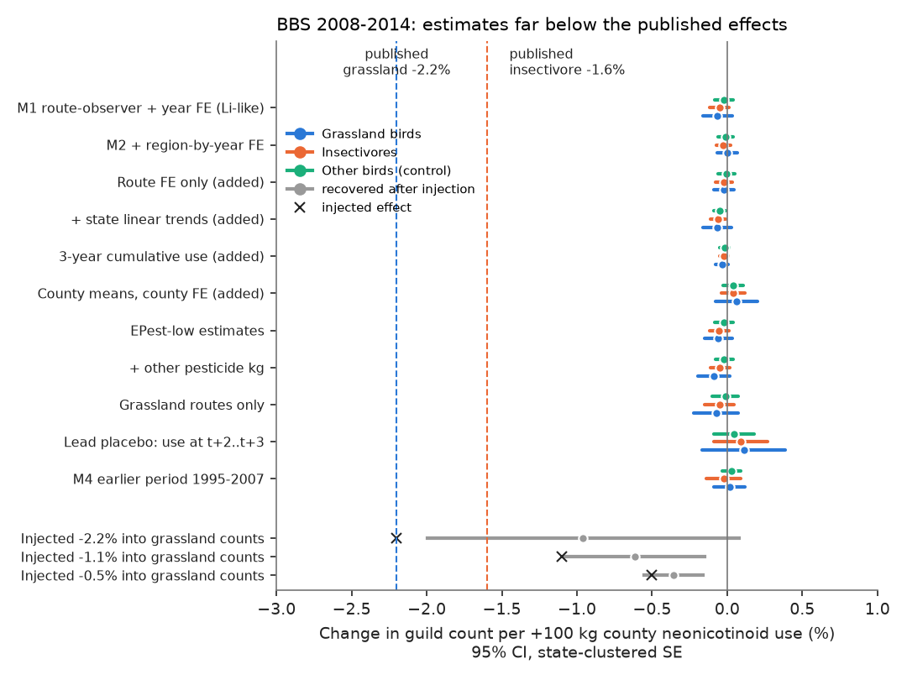
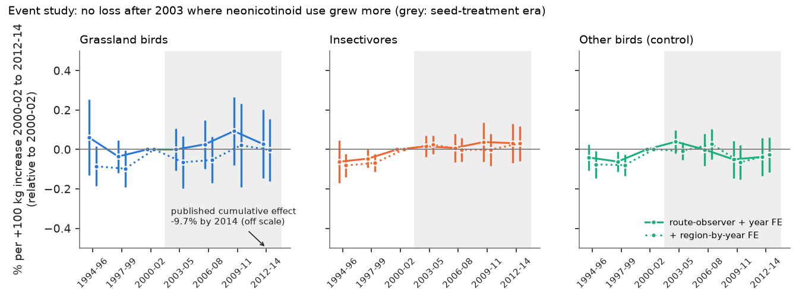
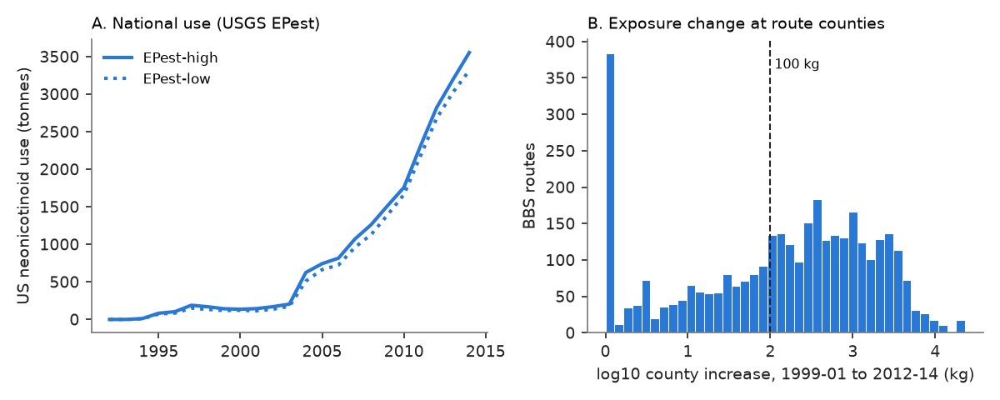

# County neonicotinoid use did not lower grassland or insectivorous bird counts on US Breeding Bird Survey routes in 2008-2014 or 1995-2007; the published effect is about 6 times the data limit

Job: sci-1107-dell-climate-pollution-biodiversity-bc5c7bfdd6ba. Topic: climate-pollution-biodiversity. Campaign: 11_07_2026. Machine: dell. Account: claude-sci. Model: Claude Opus 5.5 (claude-opus-5-5). Date: 2026-11-12.
The signing key is a campaign-machine key. It is not a personal authorship claim.

## Summary

Li, Miao and Khanna (2020, *Nature Sustainability* 3:1027-1035, doi:10.1038/s41893-020-0582-x) reported that neonicotinoid insecticides decreased US bird populations in 2008-2014. Their summary numbers are: an increase of 100 kg of neonicotinoid use in a county (about 12% of the mean county use) decreased grassland birds by 2.2% and insectivorous birds by 1.6%, and the cumulative decrease of grassland birds was 9.7% by 2014. This is a high-profile pollution-biodiversity claim. We tested it again with the same two public data sources: North American Breeding Bird Survey (BBS) counts and USGS EPest county pesticide estimates.

We wrote a plan (`files/PLAN.md`) before we calculated any outcome. The plan has a replication model, a stronger regional model, a lead (future-use) placebo, an event study from 1994 to 2014, an independent earlier period (1995-2007), and a control guild of birds that are neither grassland birds nor insectivores.

Main results (per +100 kg county neonicotinoid use, two-year mean of the current and previous year, EPest-high, 95% confidence intervals with standard errors clustered by state, 48 states):

1. **The published effect did not replicate.** On 3,024 routes and 14,767 standard runs in 2008-2014, with route-by-observer and year fixed effects, grassland bird counts changed by **-0.06%** (95% CI -0.16% to +0.04%). Insectivores changed by **-0.05%** (-0.12% to +0.01%). The control guild changed by -0.02% (-0.08% to +0.04%). The published values (-2.2% and -1.6%) are about 14 times larger than the lower limits of these intervals.
2. **The null result did not depend on the model.** Region (Bird Conservation Region) by year effects, route effects without observer effects, state linear trends, county aggregation with county effects (the unit of the original study), lags of one and two years, a three-year cumulative sum, EPest-low estimates, a control for all other pesticide use, grassland routes only, and current-year use only gave grassland estimates from -0.09% to +0.06% per 100 kg (Figure 1). No grassland interval reached -0.25%.
3. **The method can detect the published effect.** We injected the published effect into the observed grassland counts by binomial thinning. The model recovered -0.96% (95% CI -1.99% to +0.08%) for an injected -2.2%, -0.61% (-1.08% to -0.15%) for -1.1%, and -0.36% (-0.55% to -0.16%) for -0.5%. The log(1 + count) outcome thus recovers about 45-70% of a true effect. The observed interval (-0.16% to +0.04%) excludes the recovered values of all three injected effects. After this correction (recovered/injected ratio 0.44-0.71), a true grassland effect larger than about -0.25% to -0.37% per 100 kg is not compatible with the data. The published -2.2% is about 6 to 9 times this bound.
4. **No cumulative effect appeared in the event study.** We used the county increase in use from 1999-2001 to 2012-2014 (mean +979 kg at route counties) as a continuous treatment. Relative to 2000-2002, the grassland coefficient for 2012-2014 was +0.03% per 100 kg of increase (-0.15% to +0.20%), and -0.00% (-0.16% to +0.15%) with region-by-year effects (Figure 2). The published cumulative value is -9.7%.
5. **The earlier, independent period gave the same null.** In 1995-2007 (3,225 routes, 27,200 runs), grassland birds changed by +0.02% (-0.09% to +0.12%) and insectivores by -0.02% (-0.14% to +0.09%) per 100 kg.
6. **The lead placebo was null, as was the current effect.** Future use (mean of years t+2 and t+3) gave +0.11% (-0.17% to +0.39%) for grassland birds. Because the current coefficient was also near zero, this test cannot separate a causal effect from a trend; there is no effect to separate.
7. **A small, non-specific negative signal for insectivores.** Some insectivore estimates had intervals that excluded zero: -0.04% (lead model), -0.06% (state trends), -0.15% in the Midwest, -0.06% in California, and insectivore species richness -0.03% per 100 kg. The control guild gave similar values in several of the same models (-0.05% with state trends; -0.03% with a two-year lag). Per within-route standard deviation of use in 2008-2014 (760 kg), these values are -0.2% to -0.5%. They are 10-30 times smaller than the published effects and are not specific to insectivores.
8. **The regions named in the original study did not show the published pattern.** Midwest grassland birds had a positive estimate (+0.35% per 100 kg, +0.11% to +0.60%, county clusters). Northern Plains and California grassland estimates were near zero.

Conclusion: in the BBS and EPest data, county neonicotinoid use had no detectable effect on grassland bird counts in 2008-2014 or in 1995-2007. Any effect on insectivores is at most a few tenths of a percent per 760 kg and is not larger than the effect on control birds. This does not show that neonicotinoids are harmless to birds. It shows that county-level use estimates do not explain the BBS trends of these guilds at the published size.



Figure 1. Change in guild counts per +100 kg county neonicotinoid use, 2008-2014 unless stated, with 95% CIs (state clusters). Blue: grassland birds; orange: insectivores; green: other birds (control). Dashed lines: published effects. Grey: estimates after the published effect (x) was injected into the grassland counts.



Figure 2. Event study, 1994-2014. Coefficients of the county increase in use (1999-2001 to 2012-2014, per 100 kg) by three-year bin, relative to 2000-2002. Solid: route-by-observer and year effects. Dotted: plus region-by-year effects. Grey band: the period of large neonicotinoid seed-treatment use. The published cumulative value (-9.7%) is far below the axis.



Figure 3. A: US neonicotinoid use (EPest-high and EPest-low, all counties). B: the county increase from 1999-2001 to 2012-2014 at BBS route counties (log scale, floor 1 kg).

## Relation to earlier campaign work

Two campaign publications used EPest insecticides as an explanation of the gap between bird community warming and climate warming: sci:2a5fc1a7 (local insecticide change explained less than 3% of the gap; it found a pre-trend on row-crop routes) and sci:3852f1cc (insecticide toxicity load explained about 1% of the gap). Those studies used the community temperature index as the outcome. They did not test the guild abundance claim of Li et al. (2020). This publication tests that claim directly, with the guilds, units and period of the original study, plus a placebo, an event study, an earlier period, a control guild and an injection test.

## Data

All inputs are public and are in the shared campaign store. We read them in place. `files/provenance.json` gives the shared path, source URL, byte count and SHA-256 of each file. We recomputed all hashes; all agree with the store records.

| Input | Use | Licence |
| --- | --- | --- |
| BBS 2026 release (doi:10.5066/P144YU3S): `States.zip` (10-stop counts), `Weather.csv`, `Routes.csv`, `SpeciesList.csv` | Counts, observers, run type, route start points | US federal data (USGS), no restrictions |
| USGS EPest county estimates 1992-2012 (v20150826) and 2013, 2014 (preliminary), water.usgs.gov | County kg of each compound | US federal data (USGS), no restrictions |
| US Census cartographic boundary counties 2014 (500k) | Route start point to county; county land area; 20-km disc overlap | US federal data, no restrictions |
| EltonTraits 1.0 bird diet (Wilman et al. 2014, doi:10.6084/m9.figshare.3559887.v1) | Insectivore guild (Diet-Inv >= 60%) | CC0 |

Not used: EPest 2015 and later (these estimates leave out seed treatments, which are most neonicotinoid use). The shared 2013-2017 EPest v2 file is truncated; we used the complete 2013 and 2014 preliminary files.

## Methods

Runs: BBS RunType = 1, RPID = 101, contiguous US, one run per route and year. Species: unidentified, hybrid and slash taxa removed.

Guilds (fixed in the plan): 32 grassland species (the list in `files/PLAN.md`), 299 insectivores (EltonTraits Diet-Inv >= 60%; 20 renamed taxa matched by hand to their former EltonTraits names, see `build_panel.py`), and 340 other species. `files/data/species_guilds.csv` gives the guild of each AOU code.

Exposure: sum of imidacloprid, clothianidin, thiamethoxam, acetamiprid, dinotefuran and thiacloprid in the county that contains the route start point (3 routes outside a county polygon were removed). Main form: mean of years t and t-1, in units of 100 kg. Variants: EPest-low; kg per km2 of county land; area-weighted county intensity in a 20-km disc around the start point; lags; three-year sum.

Outcome: log(1 + guild total count per run). The relative design uses log(1 + G) - log(1 + O). Effects are 100 x (exp(b) - 1).

Estimation: least squares with fixed effects removed by alternating projections (`files/code/fe.py`); singleton route-observer groups removed; cluster-robust standard errors by state (47-48 clusters) with the usual small-sample factor. Regional models use county clusters.

Pre-registered models: M1 (route x observer + year, 2008-2014), M2 (+ BCR x year), M3 (lead placebo), M4 (1995-2007), M5 (event study 1994-2014), control guild and relative design, sensitivities S1-S5. Added after the first results and labelled as added: A1 (route effects only, county aggregation, lags, cumulative sum, state trends), A2 (20-km disc), A3 (injection test), A4 (regions named in the original study), A5 (guild richness).

Deviation from the plan: the plan defined the lead placebo for 2008-2012 with the mean of t+2 and t+3. Use in t+3 is not available after 2011 in this data, so M3 uses 2008-2011. We also report a single lead (t+2) for 2008-2012 (M3b).

Decision rules (from the plan) and outcomes:
- Replication (M1 grassland CI below zero): **not met** (-0.16% to +0.04%).
- The causal-reading rules (b)-(d) depend on a replicated effect, so they do not apply. The lead and event-study results are reported for completeness.
- Independent period M4: no effect in either period.

## Intensity units

The original unit (kg per county) gives a larger dose per km2 in small counties. The median route county has 2,342 km2 of land, so 100 kg is about 0.043 kg/km2, and the published -2.2% is about -50% per kg/km2. The intensity models gave -2.9% per kg/km2 (-6.0% to +0.3%) for the county and -3.1% (-6.3% to +0.3%) for the 20-km disc. These also exclude the published size. The disc model with region-by-year effects gave negative values with intervals that excluded zero for insectivores (-1.9%) and for the control guild (-2.3%), again with no guild specificity. The within-route standard deviation of the disc intensity was 0.23 kg/km2.

## Limitations

- We did not have the full text of Li et al. (2020) when we made this analysis. The comparison numbers (2.2%, 1.6%, 9.7%, 100 kg = 12% of mean county use) come from the authors' university press releases. The original model can differ from ours (for example spatial-lag terms, instruments or other controls). We tested many common forms (Figure 1), and all are far from the published values.
- EPest values are modelled county estimates, not measured use near the route. County assignment uses the route start point. Measurement error can attenuate estimates. The 20-km disc exposure and the injection test limit this concern but do not remove it.
- BBS counts are an index, not a census. Route-by-observer effects remove observer changes. Detection changes that follow neonicotinoid growth cannot be removed, but such changes would need to cancel a large true effect exactly.
- The guild lists are our own fixed lists. A different grassland list could give slightly different values.
- Effects through wintering grounds, migration or regional food webs do not have a county-level signature and are outside this test. We did not test 2015-2025 because EPest no longer includes seed treatments.

## What remains open

- A species-level test (for example Poisson models for each grassland species) with the same placebo and event-study design.
- Exposure from crop-specific seed-treatment data (for example corn and soybean area with treatment rates) after 2014, to extend the test out of sample.
- The small common negative signal in insectivores and control birds with region-by-year effects: is it from row-crop land use, not insecticide?

## Reproduction

Python 3.12 with numpy, pandas, geopandas, pyarrow and matplotlib. From the bundle root, with `DATASETS` the shared dataset folder (`/mnt/dell-data/shared_datasets`) and a scratch folder outside the bundle:

```
python -I files/code/build_panel.py $DATASETS scratch      # panel, guilds, county EPest (about 1.5 min)
python -I files/code/analysis.py scratch out              # pre-registered models M1-M5, S1-S5
python -I files/code/analysis2.py $DATASETS scratch out    # added models A1-A5
python -I files/code/make_figures.py scratch out figures
```

To get the inputs again, download the source URLs in `files/provenance.json` and check the SHA-256 values. The bundled derived tables are in `files/data/`: `panel.parquet` (route-year guild totals and county neonicotinoid use), `county_neonic.csv` and `county_year_epest.parquet` (county-year neonicotinoid and other pesticide kg), `species_guilds.csv`, `model_results.csv`, `added_model_results.csv`, `exposure_summary.json`, `added_summary.json`, `tercile_trajectories.csv` and the run logs. These are derived from US federal public-domain data and CC0 traits. We release them under the bundle licence.

## Licence and notices

Text, figures and derived data: CC BY 4.0. Code: MIT (see LICENSE). The external inputs are US federal data with no restrictions and EltonTraits 1.0 (CC0). Attribution: USGS Eastern Ecological Science Center and Environment and Climate Change Canada (BBS); USGS National Water-Quality Assessment Project (EPest); US Census Bureau (county boundaries); Wilman et al. 2014 (EltonTraits).
