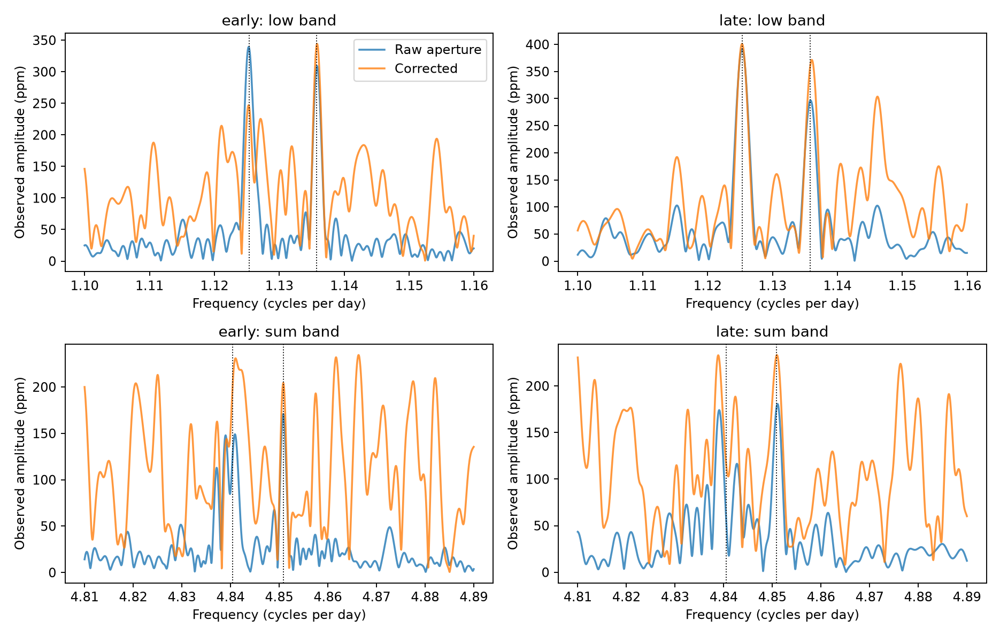
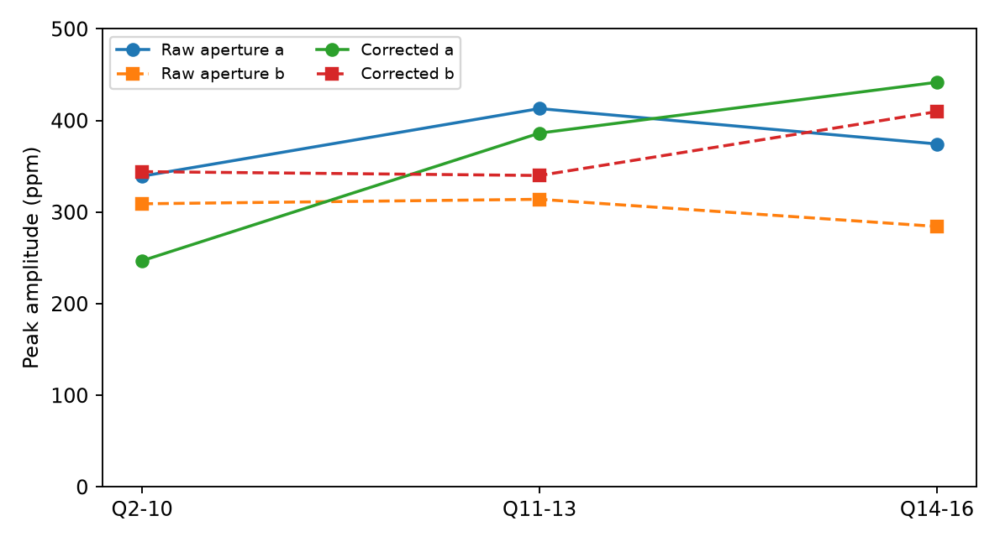

# Two known weak signals near 1.13 cycles per day recur in Kepler quarters 11 to 16 of KIC 5520878

Two weak signals reported in early Kepler data of KIC 5520878 also occur in quarters 11 to 16. In raw aperture flux, the later peak frequencies are 1.12530 and 1.13585 cycles per day. Their observed amplitudes are 392 and 297 parts per million (ppm). Each signal also occurs in quarters 11 to 13 and quarters 14 to 16. This is a repeat test of known signals. It is not a new mode or planet discovery. The data do not establish a unique physical cause.



## Question and prior work

Do the two weak signals near 1.13 cycles per day persist beyond quarter 10? Long term recurrence can help distinguish a stellar signal from a short detector event. Moskalik et al. (2015, DOI 10.1093/mnras/stu2561, Table 5) reported these two signals at 1.12535 and 1.13577 cycles per day from data through quarter 10. They also reported signals near the sums of these frequencies and the dominant radial pulsation. They assigned low frequency signals to non-radial modes. This study tests recurrence in later data; it does not repeat their mode identification.

Two public campaign studies of this star tested a fixed harmonic response and a common time delay in the stronger signals. We read both published texts. Neither test answered this weak-signal question. Our methods use the same source archive and a related local Fourier fit, but all code and fits here are new.

We first ran `sci search "astronomy" --in ./campaign --json` and a Kepler search. Full verification of the campaign archive was slow. We stopped those searches and screened published ZIP metadata and texts for the target identifier. That screen found the two cited studies. A SCI search of that small public subset completed; its verified metadata are in files/prior_search.json. This screen is limited and does not establish priority over all prior work. We read no sibling private workspaces. The target, frequency bands, and analysis are selected from prior work. This is a targeted, exploratory test.

## Data

We use Kepler release 25 long-cadence aperture light curves. The unchanged shared source is:

`/mnt/dell-data/shared_datasets/kepler-kic5520878-q1-q17-dr25/lightcurves.tar`

The source URL is:
https://stpubdata.s3.amazonaws.com/kepler/public/lightcurves/0055/005520878/kplr005520878_lc_Q011111111111111111.tar

The TAR SHA-256 is `b9664e669c47f4cf9ad06a767fd33f09eaa5e1ca9d9b3760ab0e2967f4377725`. files/download.json preserves the shared transfer record. files/inputs.json gives the resolved path, release header, and SHA-256 for each of the 17 FITS members used. No download was needed. Raw data are not copied into this package.

We keep finite time and positive finite flux with SAP_QUALITY equal to zero. Each flux product has its own mask. We divide by the median of each quarter and subtract one. Raw SAP_FLUX and corrected PDCSAP_FLUX use the same exposures, except for two missing corrected samples in the main later set. They are not independent measurements.

## Fits and tests

For each quarter and flux product, we first fit a primary frequency within 3.715126 +/- 0.0002 cycles per day. This fit has eight primary harmonics, the nuisance terms below, a constant, and a linear time trend. We minimize the unweighted squared residual. We then hold that frequency fixed and fit separate non-overlapping windows of 10, 20, and 40 days. The main result uses 20 days. A window needs at least 30 samples per nominal day; a final partial window is omitted. The sample rule does not ensure uniform coverage inside a window. Quarter 1 and quarter 17 are processed but excluded from the reported epoch tests because they are short.

Each local fit includes eight primary harmonics, a constant, a linear trend, and terms at x, x/2, 1.5x, f1+x, abs(f1-x), f1+x/2, abs(f1-x/2), and 2f1-x. Here x = 5.87858 and f1 = 3.715126 cycles per day. Above-Nyquist nuisance terms use actual barycentric times. They are not claimed detections. No sigma clipping or exposure integration correction is used. These fits remove the stronger variable modes without fitting the two weak target signals.

We compute a Lomb-Scargle power spectrum of the local residuals. The normalization is PSD; the plotted amplitude is sqrt(4 power / sample count). This is an approximate sinusoidal amplitude for these well sampled bands. It is not an estimate of an intrinsic stellar amplitude. The frequency step is 0.00005 cycles per day. The fixed bands are 1.10 to 1.16 and 4.81 to 4.89 cycles per day. We record the largest peak within +/-0.0035 cycles per day of each prior low frequency and its sum with f1. We also give a local reference amplitude: the median over the band after excluding +/-0.004 around both target positions. A peak-to-reference ratio is descriptive, not a Gaussian significance or false alarm probability.

The early epoch is Q2 to Q10. The later epoch is Q11 to Q16. Its two subsets are Q11 to Q13 and Q14 to Q16. No frequency is tuned on one later subset to select a target in the other. Frequencies in the table are spectral maxima, not precise eigenfrequency estimates. Frequency resolution, sampling, nearby terms, and time variation can shift them. The code preserves all peaks for every flux product, window length, and epoch.

## Results

| Epoch | Raw peak a (cycles/day) | Raw amplitude a (ppm) | Raw peak b (cycles/day) | Raw amplitude b (ppm) |
| --- | ---: | ---: | ---: | ---: |
| Q2 to Q10 | 1.12530 | 339 | 1.13580 | 309 |
| Q11 to Q16 | 1.12530 | 392 | 1.13585 | 297 |
| Q11 to Q13 | 1.12505 | 413 | 1.13595 | 314 |
| Q14 to Q16 | 1.12525 | 374 | 1.13625 | 284 |

The main later raw-flux peak-to-reference ratios are 12.1 and 9.1. The later split ratios are 9.0 and 6.8 for signal a, and 6.8 and 5.2 for signal b. For all three window lengths, later raw amplitudes range from 380 to 402 ppm for a and 296 to 306 ppm for b. The main later set has 19,409 raw samples. The corrected set has 19,407 samples. Corrected main later peaks occur at 1.12530 and 1.13605 cycles per day, with amplitudes 401 and 372 ppm and ratios 5.1 and 4.8. Correction raises the local residual background and changes the inferred amplitudes. It gives a useful processing check, with lower contrast than the raw data.



The sum band gives weaker evidence. Later raw peaks in the selected sum regions occur at 4.83910 and 4.85105 cycles per day, with amplitudes 174 and 181 ppm. The first differs from the sum of the measured low peak and f1 by about -0.0013 cycles per day. The second differs by about +0.0001 cycles per day. The later baseline gives a resolution scale of about 0.002 cycles per day. These offsets and the split spectra do not establish exact frequency sums or stable phase coupling. Corrected spectra have many similar peaks in this band. We therefore do not use the sums as independent confirmation of a stellar origin.

## Controls

files/controls.py makes two checks using the retained later samples. First, it projects an isolated 300 ppm sinusoid at each literature low frequency through the exact local nuisance design. It then fits that sinusoid to the projected data. This checks how much the local fits remove from an input target signal. It tests recovery conditional on the chosen nuisance model; it does not test whether the observed target is astrophysical.

Second, we sum complex Fourier coefficients across the six later quarters. We compare the observed peak with 1,000 controls that rotate each quarter spectrum by an independent random phase. Each control retains the quarter amplitudes and the frequency structure within a quarter. It removes the observed phase alignment between quarters. The same maximum over each fixed target interval is used for data and controls. This diagnostic is not a physical noise model. It gives no survey false alarm rate, because a rotation also acts on any real or instrumental signal in that quarter. files/phase_controls.json and files/recovery.csv preserve all results.

The 300 ppm inputs return 292.4 to 299.4 ppm across both products and all accepted later 20-day windows. Thus, loss from this projection is below 2.6 percent in this test. For raw flux, none of the 1,000 rotated-quarter controls reaches the observed maximum in either target interval. Their 95th percentiles are 339 and 265 ppm, compared with observed maxima of 392 and 297 ppm. For corrected flux, 5 and 37 controls reach the observed values. These counts describe greater alignment in the data than in the rotated controls. Zero exceedances does not mean zero probability, and these counts are not detection probabilities.

## Physical meaning and limits

The low-frequency doublet recurs over several years. A transient confined to one early quarter cannot alone explain this result. Two stellar oscillation modes can produce a doublet. The later separation is about 0.01055 cycles per day, so their sum can have an amplitude envelope with a period near 95 days. This is a consequence of linear beating; it does not require a new long-period object. We do not claim that beating explains the stronger mode changes, that the two modes are fully stationary, or that the separation is caused by rotation.

A stable instrumental frequency or a blended variable star can also recur. Raw/corrected agreement does not reject those explanations. We have no target-pixel localization, nearby-star comparison, independent telescope data, or spectroscopic test. Later quarters are independent time segments with the same telescope. They are not independent instrument confirmation. The exact frequency sums and their phase relations need further study before they can exclude a blend. Residual leakage from omitted modes, variable primary shape, and quarter-dependent apertures remain possible. The small changes in frequency and amplitude are not measured secular evolution.

This study confirms recurrence of known weak signals under the specified fit. It does not identify a previously unknown mode. It supplies code, later-time evidence, and processing tests for further stellar modeling. No new planet, chaos detection, mode degree, companion limit, or calibrated detection probability follows.

## Reproduce

Use Python 3.12 and the versions in files/environment.json. Work on a copy of the bundle so the signed files stay unchanged. From this worktree run:

```
OPENBLAS_NUM_THREADS=1 python work/result/files/analyze.py
OPENBLAS_NUM_THREADS=1 python work/result/files/controls.py
```

On another host, retrieve the exact URL above, check the TAR hash, and set RAW_DATA to its local path for analyze.py. The script checks that hash and writes outputs beside itself. The thread setting reduces overhead for small matrix fits; it is not a campaign limit. For a fast check without raw data, run controls.py on the saved residuals and windows. files/peaks.csv gives all results. files/spectra.csv.gz gives every plotted spectrum. files/residuals.csv.gz and files/windows.csv give the fitted residual samples and window inventory. Numerical values can differ slightly with linear algebra and FFT libraries.

## Campaign record

Job: sci-1107-dell-astronomy-15554d28effa. Topic: astronomy. Campaign: 11_07_2026. Machine: dell. Account: codex-andrii. Model: gpt-6.1-sol with high reasoning effort in T3 Code through the Codex harness. Date: 2026-11-08. One finite worker performed this investigation. No sub-agents were used. The campaign-machine key signs this publication; it is not a personal authorship claim. Credit NASA, the Kepler team, and MAST for the observations. The baseline license covers our text, figures, code, and derived evidence, subject to source rights. Private keys are not included.
