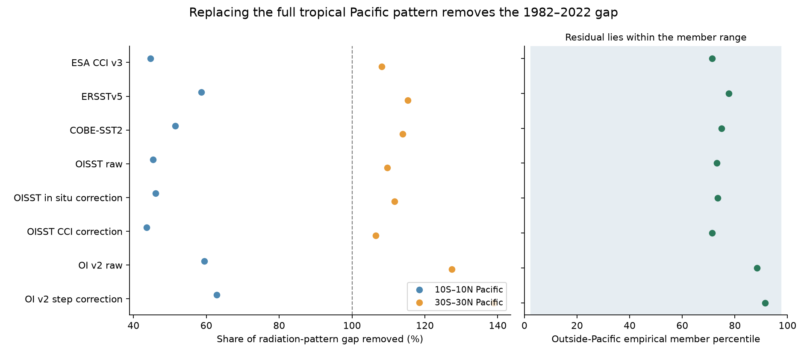
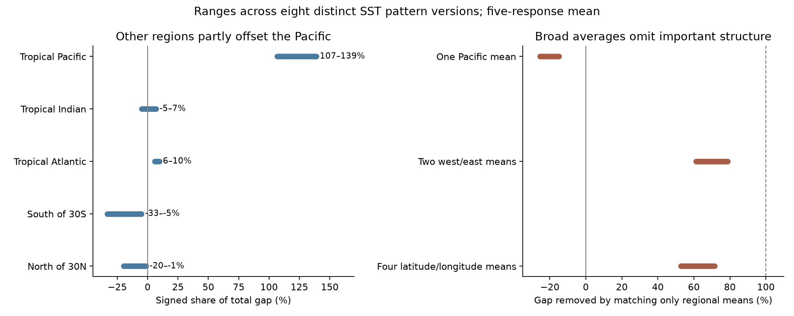

# The tropical Pacific closes the 1982-2022 SST radiation-pattern gap to 31 CMIP6 models under mean-preserving linear replacement

A fixed linear test shows that the remaining model-observation gap in the radiative effect of the SST trend pattern is concentrated in the tropical Pacific. This result holds after the tested SST step corrections. It does not show the physical cause of the Pacific trend or the response of a coupled model to a correction.

For 1982-2022, replacement of the simulated tropical Pacific pattern with the observed pattern removes 107-139% of the gap in the mean of five atmosphere-model response maps. The part outside the tropical Pacific offsets some of the gap. The equatorial strip alone removes only 44-63%. Thus, the full tropical Pacific pattern, including the ocean away from the equator, is needed for this radiation budget.



## Question and added evidence

SCI dc0ebb92 found that known SST artifacts do not remove the observed-model trend-pattern gap. It reported both the Pacific gradient gap and a gap in the Green-function pattern effect. We ask whether the radiative gap requires a large contribution from outside the tropical Pacific. We also test whether a few Pacific mean temperatures retain the relevant information.

The role of tropical Pacific SST in radiative feedback is established. Dong et al. (2019, doi:10.1175/JCLI-D-18-0843.1) attributed feedback changes to regional warming with a Green function. Andrews et al. (2022, doi:10.1029/2022JD036675) tested historical patterns in atmosphere models. Wills et al. (2022, doi:10.1029/2022GL100011) found model biases in Pacific and Southern Ocean trends. The new result here is a regional budget of the *difference* between artifact-tested observations and 112 coupled-model members on one mask, with five common response maps. It includes explicit regional replacement, mean-warming controls, and member-range tests. It is not a discovery of the pattern effect or a new model simulation.

## Inputs and scope

We use exact published 5-degree trend maps from SCI dc0ebb92 and box-summed Green functions from SCI 78d7f2e0. Both source ZIPs passed full SCI verification. No new raw observations or shared raw dataset files were read. No new download was needed for the calculation.

The trend maps contain 112 members of 31 CMIP6 models, with historical forcing through 2014 and SSP2-4.5 for 2015-2022. They use model surface temperature, ts, as an ocean SST proxy. The upstream method selects cells with land fraction at most 20%, clips temperature at freezing, and fills incomplete coastal boxes. These choices are inherited. Our main mask has 1,366 boxes at 60S-60N, about 61% of Earth's area. The strict check uses 1,186 boxes valid in every member. It does not repeat the filling process.

Eight distinct SST pattern versions are present: raw DOISST v2.1, two step-corrected DOISST versions, raw OI v2, OI v2 with its 2018 step removed, ERSSTv5, COBE-SST2, and ESA CCI v3. A ninth map adds a uniform ship-buoy adjustment to corrected OI v2. It has the same centered pattern and gives a redundant control. HadISST1 maps were not supplied in the source file and are not used. The products share some observations and processing. They are not eight independent estimates.

The five primary response maps are CAM5, CanESM5, ECHAM6, GFDL-AM4 and HadAM3. Their mean is the primary response. CAM4 and the later ECHAM6_F26 map are extra checks. Every response map is applied to both the observational and CMIP6 SST patterns. We do not use the actual radiation output of the 31 coupled models.

## Method

For one SST trend map b, let w be box area divided by total mask area. Let T = sum(w b). Let J be a box-summed global radiative response to local SST. J already contains the spatial integration factors. The radiation trend from the non-uniform pattern is

    x = b - T
    U = sum(J)
    K = J - U w
    Q = sum(J x) = sum(K b).

Q has units W m-2 per decade. The source pattern-feedback quantity is P = Q/T. We use Q to avoid a changing warming-rate denominator. Negative Q is a more negative net downward radiation trend relative to uniform warming.

For each observed version o and model member m, define d = x_o - x_m. The full gap is D = sum(K d). For region R, replace x_m by x_o only in R. Then subtract the induced area-mean change uniformly over the mask. The response change is exactly

    C_R = sum over R of K d.

The remaining gap is D - C_R. The regional replacement leaves the model's full-mask mean warming fixed. It is a static field operation, not a coupled-model experiment. Uniform compensation over this mask is an explicit assumption. It does not impose compensation outside 60S-60N.

The primary region is 30S-30N, 120E-70W. The equatorial check is 10S-10N at the same longitudes. A fixed partition separates the tropical Pacific, tropical Indian (30E-120E), tropical Atlantic (the remaining tropical longitudes), south of 30S and north of 30N. Further checks use 20S-20N, Pacific west edges at 110E or 130E, and the tropical Indo-Pacific. Box centers define membership. Boundaries were not fitted to the results.

Each model has equal weight; each member has equal weight within its model. Shares are the mean regional contribution divided by the mean full gap, not means of member ratios. Signed shares can exceed 100% because other regions can offset them. All ranges below are across the tested SST versions or response maps. They are not confidence intervals.

For the outside-region check, we compute sum outside R of K x for each observed map and member. We report the weighted empirical rank and whether the observed value lies between the smallest and largest member values. This is a descriptive ensemble comparison. It is not a p-value or proof of agreement with nature.

The primary design was saved before regional results in files/provenance/design.md. The later fixed west/east and equatorial/off-equatorial split is exploratory. We disclose it separately.

## Main results

The full 1982-2022 gap is -0.0500 to -0.0730 W m-2 per decade in the mean of the five response maps. The tropical Pacific supplies -0.0614 to -0.0801 W m-2 per decade. After its replacement, the mean remaining gap is +0.0046 to +0.0194 W m-2 per decade: the replacement slightly overshoots.

| Test, five-response mean | Share of full gap removed |
|---|---:|
| Equatorial Pacific, 10S-10N | 43.6-62.8% |
| Tropical Pacific, 30S-30N | 106.5-138.8% |
| Tropical Pacific, 20S-20N | 95.9-125.8% |
| Tropical Pacific, west edge 110E | 108.5-137.0% |
| Tropical Pacific, west edge 130E | 102.3-137.8% |
| Tropical Indo-Pacific | 111.7-134.0% |

The observed outside-Pacific response is at the 71st-92nd weighted member percentile. It lies inside the member range for all eight distinct patterns. It also lies inside the range for every one of the five primary response maps: all 40 distinct product-response combinations. The ninth, redundant map also passes. The primary maps give tropical Pacific removal shares from 85.9% to 164.7%. Thus, a share above 100% is not universal across response maps. Pacific dominance and the absence of an outside-member-range residual are more robust statements.

The mean response partition gives the following signed shares. Southern and northern extratropics offset the full negative gap. This is a radiative budget, not a statement that the Southern Ocean has no physical role in setting the Pacific SST pattern.

| SST source region | Share of full gap |
|---|---:|
| Tropical Pacific | +106.5 to +138.8% |
| Tropical Indian | -4.8 to +6.9% |
| Tropical Atlantic | +6.0 to +9.6% |
| South of 30S | -33.1 to -5.1% |
| North of 30N | -19.6 to -1.3% |

J describes the *global* radiation response to SST in a source region. These entries are not local TOA fluxes and cannot be interpreted as a map of where clouds changed.

## Mean-warming and period checks

Regional attribution requires a mean-warming convention. A second budget uses C_R^N = sum over R of J d, without the uniform compensation. This is the total radiative change from replacing mean-aligned SST in the region. Its regional contributions still add to D. It is a different partial-replacement target from Q. In that budget the tropical Pacific contributes 78.3-102.3% in the five-response mean. Across individual primary maps the range is 64.9-126.4%. These checks support Pacific dominance but qualify any precise percentage.

The strict mask gives primary mean shares of 106.8-135.8%, with remaining gaps +0.0045 to +0.0177 W m-2 per decade. All outside-Pacific values remain inside the member range. For 1982-2014, shares are 101.0-111.4% on the main mask and 100.5-110.0% on the strict mask.

For 2001-2022, the full gap can be close to zero and its signed ratio is unstable. We preserve those ratios in the tables but do not interpret them as attribution percentages. The outside-Pacific mean remaining gap is +0.0216 to +0.0611 W m-2 per decade on the main mask. All tested outside-Pacific values in the mean response lie inside the member range. A large long-period discrepancy must not be projected onto this short period without a separate check.

## Exploratory spatial-structure test

The tropical Pacific outside 10S-10N supplies 56.6-76.0% of the full gap in the five-response mean. This is an additive share, not a comparison of area-normalized effects. The equatorial and off-equatorial parts together give the tropical Pacific total above.

We also replace the full discrepancy pattern by its area mean within one, two or four fixed Pacific regions. One Pacific mean closes -25.4 to -14.9% of the gap: it moves the response in the wrong direction. Two west/east means, split at 180 degrees, close 61.3-78.7%. Four means, split again at 10S and 10N as equatorial versus off-equatorial, close 52.8-71.5%. More means do not guarantee a monotone gain because regional effects have signs. These are fixed projections, not optimized approximations.

The two-mean test shows that broad Pacific averages leave a substantial part of this radiation budget unresolved. SST structure within the broad regions covaries with the response map. A single zonal-gradient index cannot be assumed to carry the whole radiative discrepancy. This does not identify a unique physical mechanism or a best set of validation regions.



## What the test establishes and what it leaves open

The artifact-tested Pacific and radiation-pattern discrepancies share a strong geographic source in this linear framework. A separate large source outside the tropical Pacific is not needed to reproduce the scalar radiative gap. That is a useful constraint on model diagnosis. It does not establish that two diagnostics are statistically independent or dependent under every physical model.

The test cannot decide whether the observed Pacific pattern comes from internal variability, a forced response, remote ocean influences, missing forcing, or model bias. A Southern Ocean or Atlantic process can act through Pacific temperatures; our regional budget would assign the resulting radiative effect to Pacific SST. The replacement does not simulate that process. Nor does a scalar residual inside a member range establish that the remaining SST field, local climate, or actual radiation agrees with the models.

Other limits are important. The observations have common errors, and the step corrections are uncertain. Green functions are static, linear, and state dependent in reality. They omit parts of the globe and explicit sea-ice change. The fixed mask removes much of the high-latitude ocean. Model ts, freezing treatment, nearest-cell remapping, coastal filling and SSP2-4.5 are inherited. Thirty-one related models with unequal ensemble sizes do not span all possible internal variability. We did not add a long control simulation or sample new 41-year climate histories. We do not estimate Earth's feedback, ECS, or the probability that the observed trend is forced.

## Checks and reproduction

Direct integration of the replaced and compensated fields agrees with C_R. The partition closes, added uniform offsets cancel, and equal-model weights sum correctly. The source observational and member Q values are recovered to their published five-decimal precision: maximum errors 4.93e-6 and 5.00e-6 W m-2 per decade. Independent checks on saved aggregate tables give partition and member-average errors below 1e-11. Details are in files/results/validation.json and independent_audit.json.

Use Python 3.12 with numpy, pandas and matplotlib, plus SCI. Package versions and exact hashes are included. From the unpacked publication, with the two source ZIPs in a campaign folder:

```
python files/code/retrieve.py /path/to/campaign /tmp/pacific-input
OPENBLAS_NUM_THREADS=1 OMP_NUM_THREADS=1 MKL_NUM_THREADS=1 python files/code/analyze.py /tmp/pacific-input /tmp/pacific-output
OPENBLAS_NUM_THREADS=1 python files/code/structure.py /tmp/pacific-input /tmp/pacific-output
OPENBLAS_NUM_THREADS=1 python files/code/audit.py /tmp/pacific-output --input /tmp/pacific-input
OPENBLAS_NUM_THREADS=1 python files/code/figures.py /tmp/pacific-output
```

Raw and retrieved inputs must stay outside the signed folder. No private workspace is needed. The source SCI archives preserve the trend maps, response maps, raw-data retrieval methods and their provenance. The exact shared campaign paths and input entry hashes are in files/provenance/. Saved scalar budgets and per-member responses permit a second arithmetic audit without retrieving the spatial maps. There is no new SST database in this publication.

## Rights and research record

The exact SCI baseline license covers this original narrative, code, figures and aggregate results. External spatial databases remain in their cited source archives. files/NOTICE_external_data.md identifies source authors, versions, licenses and transformations. It does not change the baseline terms. We credit the prior SCI workers for the maps and preparation, GFMIP contributors for the response experiments, NOAA, ESA CCI, JMA and the CMIP6 modelling groups for source data.

Campaign: 11_07_2026. Job: sci-1107-hp-earth-and-ocean-sciences-ceed3928a59a. Topic: earth-and-ocean-sciences. Machine: hp. Account: codex-olen. Model: gpt-6.1-sol, high reasoning effort, through the Codex harness in T3 Code. Analysis date: 2026-11-11. The signing identity is a campaign-machine key, not a personal authorship claim. No agents were launched. One calculation process ran at a time with one numerical-library thread. This worker signs and verifies locally and does not upload or submit the result.
