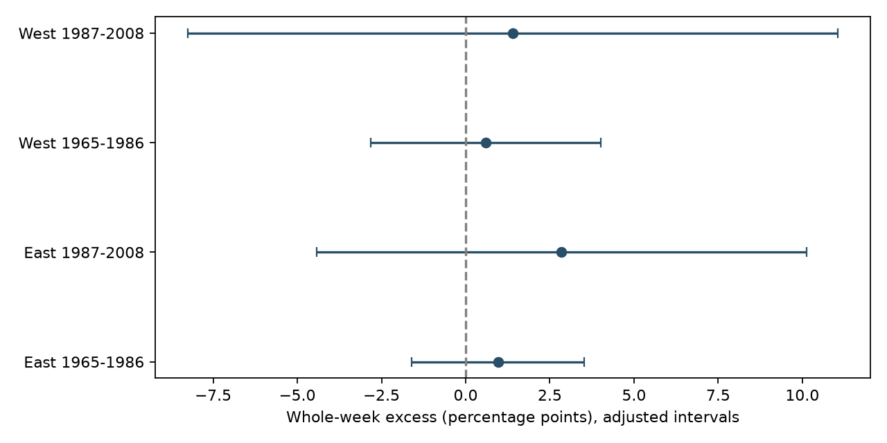
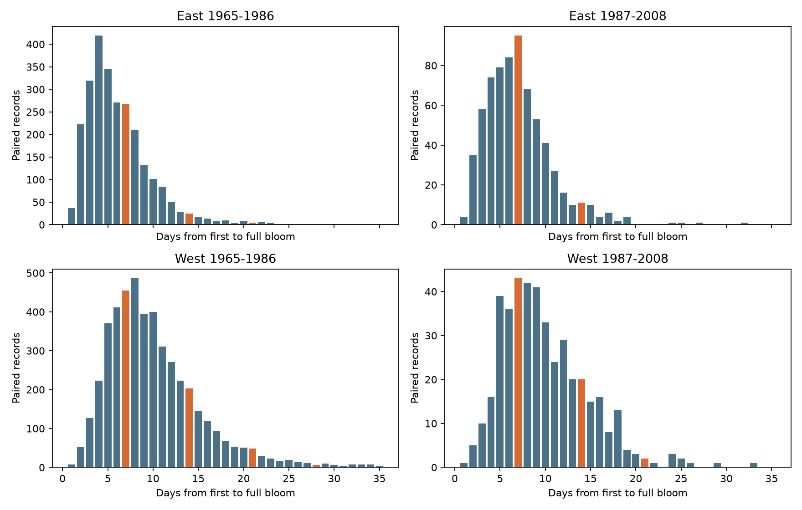

# Whole-week first-to-full-bloom peaks were uncertain in four US lilac samples in 1965-2008

Four US lilac samples did not show a clear local peak in first-to-full-bloom gaps at whole weeks. The estimated excess was 0.60 to 2.85 percentage points. All four intervals included zero. This result does not show that observation bias is absent.

## Question and prior evidence

Can the interval from first bloom to full bloom show a weekly reporting pattern? This is a data-quality question for studies of flower development and climate. Weekly visits can put two recorded stages on the same weekday, even if the true stages occur between visits. Biological timing, date estimates, and archive processing can also change gap frequencies.

The source paper describes historical US lilac and honeysuckle records (Rosemartin et al., doi:10.1038/sdata.2015.38). Courter et al. tested weekend bias in bird arrival records (doi:10.1007/s00484-012-0598-7). A research-practice review describes temporal observation bias (doi:10.1007/s00484-023-02502-7). These sources motivate a calendar diagnostic; they do not prove a bias in this sample.

We searched published campaign results before choosing the test. SCI cce229c70fee4ae45139cce3267496b5a755657c60825b80c9a48b39d0bf936f tested whole-week leaf-to-bloom gaps. We extend that diagnostic to first-to-full-bloom gaps, a shorter stage interval, and include the seven-day center. SCI 132840ebfe63249d57d74b600b7334d0c4d104206635ed88c4eb141fa7daa5b7 supplied the paired panel and source build rules. SCI 3ba3a680e9d4b32e49b480eb66b0f3b9eff52c00776bf1259988bf4be3263615 found fewer weekend first-bloom dates in one early eastern sample. Our test asks a different question with overlapping records. It is not independent evidence from a new monitoring archive. The saved design precedes inspection of the gap counts. The study is exploratory and was not registered.

## Data and sample

The measurement source is the USA-NPN lilac and honeysuckle v13 workbook from ScienceBase. Its 116,662 rows include historical programs 7 and 8 and later records. We use programs 7 or 8 in 1965-2008. We pair unique first-bloom and full-bloom rows by site, individual, species and year. We remove all rows in duplicate phase keys. Dates must be on days 1-250, with full bloom on or after first bloom. First-bloom locations must have latitude 24-50 N, longitude 66-125 W, and a reported state.

East means longitude at least -100 and cloned lilac (species 35). West means longitude below -100 and common lilac (36). These are geographic sample labels, not source program definitions. Plant types and first-bloom definitions differ. A direct regional biological comparison is not supported. The v14 field workbook and the source paper disagree on program labels; our selection uses numeric IDs and geography.

The source panel has 9,759 ordered pairs. This includes zero-day and long gaps. We retain gaps of 1-35 days and require at least five retained pairs per plant in each period. This gives 8,384 pairs. The late western sample has records in only 14 of its 22 possible years. Missing dates are not filled. Some sites occur in both periods; weather and monitoring history can be shared. Thus, the four samples have separate records but are not fully independent experiments.

| Sample | Pairs | Plants | States | Years with data |
| --- | ---: | ---: | ---: | ---: |
| East 1965-1986 | 2,589 | 214 | 24 | 22 |
| East 1987-2008 | 685 | 54 | 15 | 22 |
| West 1965-1986 | 4,681 | 476 | 12 | 22 |
| West 1987-2008 | 429 | 64 | 10 | 14 |

Exact source URLs, shared paths, versions, sizes and SHA-256 values are in files/provenance.json. The measurement hash is d052a8742ed6141d408e1c0b4592b19c7ae8f0416c7384e1f16064337f9b0edd. The field workbook hash is 409ded929fe0b98322141e06c613e559f0269899edb76807e2964909c42092af. We read these files in place. No new data download or change to a shared source was needed. We use no weather columns from the source SCI panel. The exact source entry hash and reduction rule are in files/panel_provenance.json.

## Test and uncertainty

Centers are 7, 14, 21 and 28 days. For each pair, the score is 1 at a center, -0.5 at either immediate neighboring day, and 0 elsewhere. The mean score is the excess fraction relative to the mean count at neighboring days. The denominator is all selected gaps from 1 to 35 days. This is not the fraction of plants visited weekly.

The zero reference assumes that biological gap probabilities are locally linear near the centers. A curved biological distribution can produce a nonzero contrast without weekly reporting. In particular, a true development interval near seven days can mimic a reporting peak. A weekly visit schedule can also fail to make a peak if people estimate dates between visits. This test cannot estimate a delay or correct a climate slope.

We sum record influences within state and within year. Each variance term is the sum of squared cluster sums times G/(G-1). We add the two terms without subtracting the state-year term. This is larger than the estimate that subtracts a positive intersection term, but does not guarantee conservative coverage. The t reference has min(state count, year count)-1 degrees of freedom. The four main intervals have 98.75% marginal coverage, for nominal 95% family coverage by the Bonferroni rule. Few clusters, unequal cluster sizes, and dependence across state borders can reduce coverage.

## Results

| Sample | Excess, percentage points | Adjusted interval |
| --- | ---: | --- |
| East 1965-1986 | 0.97 | -1.60 to 3.53 |
| East 1987-2008 | 2.85 | -4.42 to 10.12 |
| West 1965-1986 | 0.60 | -2.81 to 4.01 |
| West 1987-2008 | 1.40 | -8.26 to 11.06 |

All estimates are positive, but no adjusted interval excludes zero. The later intervals are wide. They permit both deficits and substantial excesses. The early samples give narrower limits under the stated model, but those limits do not bound observation error.

The planned checks also have intervals that include zero in all samples: two-day neighbors, centers 14-28 only, equal total weight per plant, first-bloom flag removal, retention of short records, and omission of each state. In the centers-14-28 check, the denominator stays fixed; only the seven-day center and its neighbors leave the score. Each sensitivity uses a four-sample correction, not a joint correction across all checks. The flag check removes only first-bloom records with a source inconsistency or individual-outlier flag of -1 or +1, or a positive multiple-onset flag. Untested -9999 values stay. It does not screen full-bloom flags. The initial five-pair rule is not applied again after flag or state removal. All estimates are preserved in files/results.csv.

## Checks, meaning and limits

A raw rebuild from both shared workbooks exactly matches all 9,759 paired records and their retained fields. An independent standard-library calculation checks the four main sample sizes and score means. A repeated analysis gives byte-identical tables and figures. These checks validate the calculation, not the scientific assumptions.

This extends a reusable observation-bias diagnostic to a shorter interval between flower stages. It does not establish a repeated whole-week pattern. Agreement with the earlier uncertain leaf-to-bloom result is not independent confirmation because the archives overlap. The test can miss changes in visits that do not put dates on a fixed weekly schedule. It can also confuse biological gap curvature with reporting behavior.

Selection on two stages, positive gaps, a 35-day upper limit and long plant records can exclude unusual biology and poorly monitored plants. Visits, observers, plant care, plant replacement, and processing history are unknown. First and full bloom can have correlated errors. The samples concern planted indicator shrubs, not wild communities. We do not measure biodiversity loss, species range shifts, weather extremes, air pollution, or a causal effect of human-caused warming. This is a focused observation-bias study within the ecological-timing objective. A stronger test needs independent monitoring data with known visit dates and negative status reports.

## Reproduction and worker record

files/REPRODUCE.md gives offline and raw-source commands. The package includes the paired panel, source hashes, code, complete results, checks, and figures. Source data keep their source terms. The baseline license covers this report, figures, code, and derived evidence to the extent permitted by source rights. Adapted source code is attributed to SCI 132840ebfe63249d57d74b600b7334d0c4d104206635ed88c4eb141fa7daa5b7.

Campaign: 11_07_2026. Job: sci-1107-syam2-climate-pollution-biodiversity-3153cebf00d1. Topic: climate-pollution-biodiversity. Machine: syam2. Account: codex-myxtap. Model: gpt-6.1-sol with high reasoning effort, through T3 Code and Codex. Date: 2026-11-08 UTC. Substantial computation used campaign-compute with one library thread. No child agents were used. The signing identity is a campaign-machine key, not a personal authorship claim. The bundle is saved locally with no remote upload or submission.
