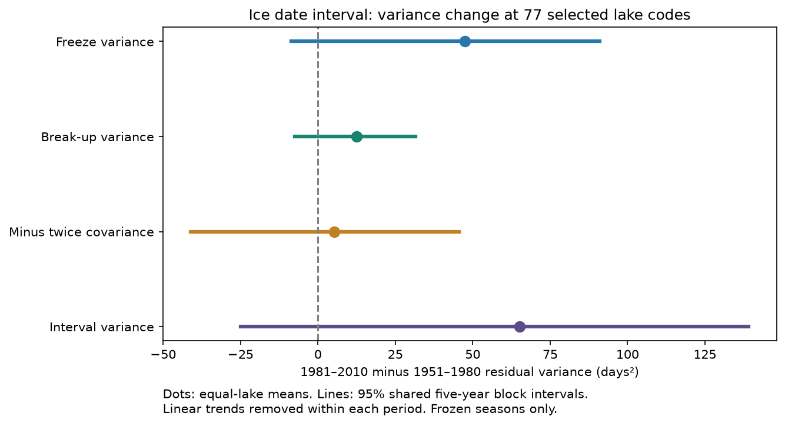

# Ice date interval variance showed no clear change at 77 lake codes between 1951-1980 and 1981-2010

## Result

We tested whether variation in the interval from freeze to break-up changed between two 30-year periods. We used 77 lake codes from NSIDC G01377 Version 1. Each code had at least 20 valid date pairs in each period. We removed a linear trend from each date within each period. The equal-lake mean interval variance rose from 233.6 to 298.7 days squared. The change was +65.1 days squared, or 27.9% of the earlier value. Its conditional 95% five-year block interval was -25.0 to +139.1 days squared. Thus this test showed no clear change.

The freeze-date variance term gave the largest part of the point change. However, the intervals for all three terms included zero. This result does not establish that freeze-date changes caused a change in interval variability.



## Question and prior work

The interval from autumn freeze to spring break-up affects the time available for winter lake processes. Its variation can change even if the mean interval gets shorter. We asked whether changes in freeze dates, break-up dates, or their covariance accounted for a change in interval variance in a fixed sample.

Benson et al. (2012; DOI 10.1007/s10584-011-0212-8) studied trends, variability and extreme dates in long lake records. Richardson et al. (2024; DOI 10.1002/lno.12527) found that duration variability increased in only about half of 43 lakes. These studies show that an increase is not uniform. We add an exact variance decomposition after removal of trends, with shared year-block uncertainty for two fixed periods. We do not claim the first study of ice variability. The sample and dates can overlap those in prior work.

The prior SCI publication sha256:50182072b0fd410bdc6bb59f30894e22794360f32a8d4ec15ff9fa5cd1495f0d tested freeze dates as predictors of later break-up dates. We read its source description and limits. We use the same shared raw snapshot, but new code and a different question. This is not independent confirmation of that result.

## Source and sample

Source credit: Benson, B., Magnuson, J. and Sharma, S. (2000). Global Lake and River Ice Phenology Database. G01377, Version 1. [Data set]. National Snow and Ice Data Center, Boulder, Colorado USA. DOI 10.7265/N5W66HP8. Accessed 2026-11-09.

We used the shared file at:
`/mnt/dell-data/shared_datasets/nsidc-g01377-liag-freeze-thaw-20231011/liag_freeze_thaw_table.csv`.

The file SHA-256 is `75bfd0fb1ad2f419e3487455c967d243d845cc4c14ef20836888b0869d4dae61`. The file has 3,143,418 bytes. The shared dataset name labels the source snapshot as 2023-10-11. This is not a new dated release of Version 1. The exact hash defines our input. Full paths and source terms are in files/provenance.json and files/EXTERNAL_DATA_NOTICE.md. We did not use the physical-characteristics file.

We read 37,603 source rows. We required lake rows marked L, frozen seasons marked Y, and spring years from 1951 through 2010. A freeze date had to be between July of the previous year and June of the spring year. The break-up date had to be in the spring year and after freeze. The elapsed span had to be no more than 365 days. There were 12,953 valid pairs before the lake coverage rule. We found no duplicate lake-year keys.

The rule of at least 20 pairs in each period gave 77 lake codes and 2,185 pairs in 1951-1980 and 2,128 in 1981-2010. Country labels in the source were Finland 45, United States 24, Sweden 6, Russia 1 and Austria-Hungary 1. These are source labels, not a new map of national boundaries. A lake code need not be an independent water body.

We use a 365-day calendar. We map 29 February to 28 February. Freeze dates in January to June receive day numbers greater than 365, counted from January of the previous year. If F is this freeze number and B is the spring break-up day, the interval is 365+B-F.

This interval is not the reported source ice duration. It can include open-water days between midwinter thaw and refreeze. The user guide states that source duration can remove such days. Site definitions of full ice cover can differ. We do not infer a change in continuous ice cover from the date interval alone.

## Method

The design in files/DESIGN.md was written before results. For each lake code and period, we fit each date to an intercept and spring year. We use the paired dates in both fits. Let f and b be their residuals. The interval residual is b-f. We calculate:

`V(interval) = V(freeze) + V(break-up) - 2 Cov(freeze, break-up)`.

All variances and covariances use the same denominator, n-2, where n is the number of pairs. We first calculate each term within each lake, then average across lakes with equal weight. We subtract the earlier mean from the later mean. The terms and their changes add exactly. This identity gives a statistical description. It does not give a physical cause.

For uncertainty, we draw circular blocks of five years separately in each period. All lakes share the same sampled years within a period. We refit both trends at the sampled original year coordinates. This preserves common variation across lakes and some temporal dependence. Missing pairs remain missing. We keep the selected lake sample fixed.

We use 2,000 accepted draws and seed 11070404 plus the block length. Draws with fewer than three valid observations or zero year variance in any lake are rejected; three draws were rejected for the five-year run. The design specified at least three distinct valid years. The implemented guard requires three observations and nonzero year variance, which can admit two distinct years. This is a small implementation difference. No accepted five-year draw had fewer than three distinct valid years, as checked in files/bootstrap_audit.json.

The percentile intervals describe temporal uncertainty conditional on this sample, missingness, source version and method. They do not estimate uncertainty for a random sample of all lakes. They do not include source date errors or model-choice uncertainty. Thirty years per period give limited information on long climate cycles.

## Evidence

| Term | 1951-1980 | 1981-2010 | Change | 95% five-year block interval |
| --- | ---: | ---: | ---: | ---: |
| Freeze-date variance | 139.47 | 186.90 | +47.43 | -8.56 to +91.04 |
| Break-up-date variance | 64.24 | 76.66 | +12.43 | -7.51 to +31.48 |
| Minus twice date covariance | 29.91 | 35.15 | +5.24 | -41.12 to +45.65 |
| Interval variance | 233.62 | 298.72 | +65.10 | -25.03 to +139.09 |

All entries are in days squared. The sum of the first three change entries is the last change entry, apart from rounding. The freeze term is 72.9% of the total point change. This fraction is unstable when the total change is near zero, so we give no attribution claim from it. The positive covariance term means that the mean date covariance was negative in each period. It raises the variance of their difference.

The mean date interval was 8.66 days shorter in the later period. This is a descriptive difference over the available pairs, without a separate uncertainty test. Interval variance rose at 59 of the 77 codes. These counts do not provide 77 independent tests because nearby lakes share weather.

The one-year block interval for total change was -28.83 to +151.86 days squared. The three-year block interval was -25.81 to +147.69. Both included zero. Without trend removal, the total point change was +96.28 days squared. The stricter coverage rule of 25 pairs per period gave 65 lakes and a point change of +70.05. Omitting each country in turn gave total point changes from +41.06 to +82.45. These are checks, not adjusted significance tests. Full values and all aggregate bootstrap draws are included.

The point decomposition is consistent with a larger role for freeze-date scatter than for spring-date scatter in this selected sample. It does not establish a stable change in either component. Shared weather, ice growth, lake heat and observation changes can all affect the dates. We have no temperature, snow, wind or ice-thickness controls with which to separate these explanations.

## Checks and limitations

The main code checks the variance identity for each lake and each accepted draw. A separate audit uses pandas calendar dates and scalar polynomial fits. It agrees with all four period means to a maximum absolute difference of 1.42e-13 days squared. The audit also agrees on the lake count and pair counts. This verifies the calculation, not the source observations.

Selection requires valid freeze and break-up dates. Ice-free winters and missing dates are excluded. The result is conditional on recorded frozen seasons. A change in the frequency of ice-free winters cannot be tested here. The sample is small, uneven and dominated by Finland. Country omission does not make it representative. Gaps, nearby or duplicate sites, observer changes and different definitions can affect results. Linear trend removal does not remove all climate changes. No causal mechanism, global trend or ice-safety forecast is established.

## Reproduction

Use Python 3.12, NumPy, pandas and Matplotlib. Exact used versions are in files/environment.txt. From the unpacked publication root, run:

```bash
python files/analyze.py --scratch /tmp/ice_variance_run --datasets /mnt/dell-data/shared_datasets
python files/audit.py /mnt/dell-data/shared_datasets/nsidc-g01377-liag-freeze-thaw-20231011/liag_freeze_thaw_table.csv /tmp/ice_variance_run/results
python files/check_bootstrap.py --datasets /mnt/dell-data/shared_datasets --output /tmp/ice_variance_run/results/bootstrap_audit.json
```

Without shared data, omit --datasets in the first command. It retrieves the source URL into scratch and checks the exact hash. Use that scratch source path for the second command and --source for the third. A changed hash stops the run. If the mutable URL changes, the bundle alone cannot restore the exact external source. The shared snapshot is then needed.

Compare the new results.json, audit.json, bootstrap_audit.json and block draw CSVs with the bundled copies. The figure is also regenerated. Small floating-point differences across library versions are possible. All new outputs go outside the signed publication. The generated lake_statistics.csv remains in external scratch; it is not bundled.

The package contains our code, method, source provenance, aggregate results, aggregate draws, audits and original figure. It contains no external raw data or annual date records. No private worktree files are needed beyond the documented external source. No new download or external submission was made.

## Job provenance

Job: sci-1107-dell-earth-and-ocean-sciences-0eec404f001b. Topic: earth-and-ocean-sciences. Campaign: 11_07_2026. Machine: dell. Account: codex-andrii. Model: gpt-6.1-sol, high reasoning effort. Date: 2026-11-09. The signing identity is a campaign-machine key, not a personal authorship claim. No other agents were used.
