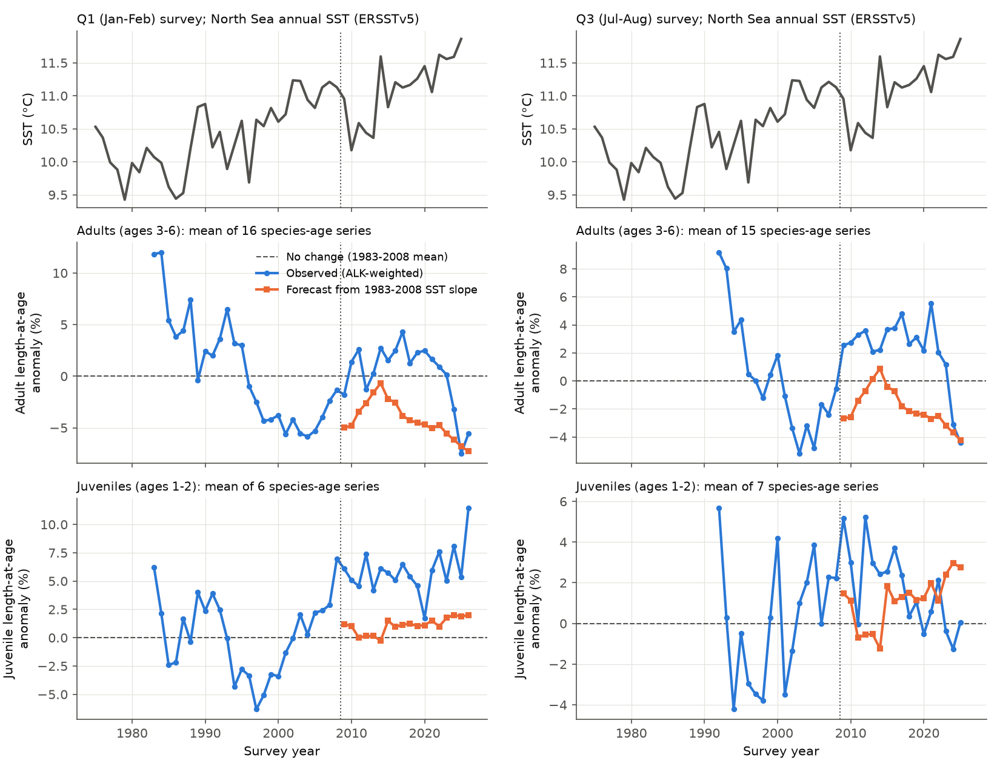
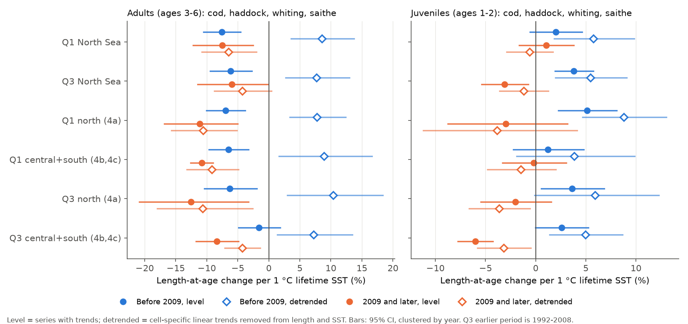
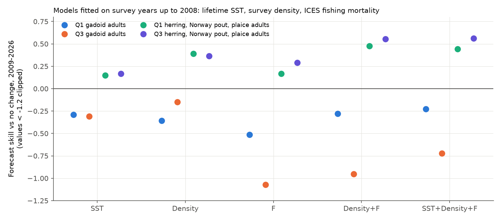

# A 1983-2008 sea-temperature slope did not forecast 2009-2026 adult length-at-age of North Sea gadoids

**Job:** sci-1107-dell-climate-pollution-biodiversity-9dea323b2b95 · **Topic:** climate-pollution-biodiversity · **Machine:** dell · **Model:** Claude Opus 5.5 (claude-opus-5-5) · **Date:** 2026-11-09.
The signing key is a campaign-machine key. It is not a personal authorship claim.

## Summary

Two published studies report that North Sea fish became smaller at age as the sea became warmer.
Baudron et al. (2014, data to 2008) found a synchronous decrease of maximum length in six of eight commercial species.
Ikpewe et al. (2021, data 1970-2017) found that adult cod, haddock, whiting and saithe became shorter at age and that juveniles became longer at age, and they linked both changes to warmer bottom water.
We did a forward test of this "bigger juveniles, smaller adults" claim with the ICES North Sea International Bottom Trawl Survey (NS-IBTS).
We used survey years after the end of each study as the test period.

We calculated mean length-at-age with an age-length key (ALK) that we weighted by the survey length frequencies in four fixed areas.
This removes the length-stratified otolith sampling bias. The raw otolith mean was 2-4 cm too long for adult haddock and whiting.
We used the lifetime mean North Sea sea surface temperature (SST) of each cohort as the temperature exposure.

Main results for cod, haddock, whiting and saithe (16 Q1 and 15 Q3 species-age series of adults, ages 3-6):

1. **The published direction repeated in the training period.** In 1983-2008 (Q1), adult length-at-age decreased by 7.6% per 1 °C of lifetime SST (95% CI -10.5 to -4.5). In Q3 (1992-2008) the slope was -6.1% (-9.4 to -2.7).
2. **The slope did not forecast 2009-2026.** The 1983-2008 slope predicted a mean adult decrease of 4.2% relative to the 1983-2008 mean. The observed mean change was +0.3% (Q1). The temperature forecast had a larger squared error than a "no change" forecast: skill -0.30 (-0.72 to -0.02) in Q1 and -0.31 (-0.59 to -0.14) in Q3. Adults were on average 4.4% (Q1) and 4.1% (Q3) longer than the forecast. The result was the same with ERSSTv5 instead of HadISST (skill -0.41 and -0.44).
3. **Before 2009, the adult link came from common trends only.** After we removed a linear trend from each series, warmer-than-trend years gave *longer* adults: +8.5% per °C (3.6 to 13.7) in Q1 and +7.7% (2.7 to 13.0) in Q3. All four regional series (north and central-south, Q1 and Q3) gave the same positive sign. After 2008, the detrended slope was negative (-6.5% per °C in Q1). Thus the sign of the year-to-year link changed between the two periods.
4. **Density and fishing did not rescue the forecast.** For gadoid adults, no model that we fitted to 1983-2008 survey years beat "no change" in 2009-2026. This included models with survey density, ICES fishing mortality (F) or both, with or without SST (Q1 skill -0.23 to -0.51; Q3 -0.15 to -1.07).
5. **Juveniles gave a weak and survey-dependent result.** Juveniles (ages 1-2) became longer after 2008 in Q1 (+5.9% relative to 1983-2008). The SST forecast predicted only +1.1%, but it was better than "no change" (skill +0.16, 0.08 to 0.21). In Q3 the SST forecast was not better than "no change" (skill -0.05). With lifetime F in the model, the juvenile SST slope was zero (Q1 -0.5%, -2.9 to +1.9).
6. **Other species followed density more than temperature.** For herring, Norway pout and plaice adults, which became smaller after 2008 (mainly plaice), the SST forecast had skill +0.15 (Q1) and +0.17 (Q3). A survey-density forecast had skill +0.39 and +0.37. SST did not improve a density + F model.
7. **Adult gadoids became shorter after 2018.** Adult length-at-age decreased by 10.9% per decade in Q1 2018-2026 (6.2 to 15.4) and reached the level of the SST forecast only in 2024-2026. Nine years are not sufficient to identify the cause.

**Conclusion.** The warming-linked decrease of adult gadoid length-at-age that the earlier studies described was a common trend in 1983-2008. It did not continue as a temperature response in 2009-2017, when the North Sea stayed warm and adults became longer. Year-to-year warmth gave longer adults before 2009. Thus the 1983-2008 survey data do not identify a temperature effect on adult size. The recent decrease (2018-2026) agrees in sign with the temperature-size rule, but the short period and the change of sign do not let us attribute it to temperature.

**Figure 1.** Top: North Sea annual SST (ERSSTv5; the analysis uses HadISST, r = 0.99). Middle and bottom: mean length-at-age anomaly of gadoid adults and juveniles relative to the training-period mean (1983-2008 for Q1, 1992-2008 for Q3). Blue: observed (ALK-weighted). Orange: forecast with the training-period SST slope. Dashed line: "no change" forecast.

## Question and prior work

- Baudron, A. R. et al. (2014). Warming temperatures and smaller body sizes: synchronous changes in growth of North Sea fishes. *Global Change Biology* 20: 1023-1031. doi:10.1111/gcb.12514. Data to 2008.
- Ikpewe, I. E., Baudron, A. R., Ponchon, A., Fernandes, P. G. (2021). Bigger juveniles and smaller adults: changes in fish size correlate with warming seas. *Journal of Applied Ecology* 58: 847-856. doi:10.1111/1365-2664.13807. IBTS data 1970-2017.
- Campaign prior work on the same survey: sci:sha256:bab49b78... and sci:sha256:91ce877c... (fish latitude shifts, Perry et al. 2005 re-tests). We used their DATRAS download recipe. No earlier campaign publication tested fish body size.

We did not have the full text of Ikpewe et al.; we used the abstract. Thus our age groups, temperature series and statistical model are not the same as theirs. Our test is a test of the published direction and of its forecast value, not an exact replication.

## Data

| Source | Use | Version / access | Licence |
| --- | --- | --- | --- |
| ICES DATRAS NS-IBTS exchange data (HH, HL, CA) | Hauls, length frequencies, otolith ages | Web service `getHH/HL/CAdata`, Q1 1977-2026, Q3 1991-2025, downloaded 2026-11-09 (DateofCalculation 2026) | CC BY 4.0 (ICES Data Policy) |
| ICES Stock Assessment Graphs (SAG) summary tables | Fishing mortality F per stock and year | 2025 advice assessments (keys in `files/provenance/other_sha256.txt`); cod = mean of three substocks | CC BY 4.0 (ICES Data Policy) |
| HadISST1 monthly SST | Primary temperature | Campaign shared dataset `datasets/hadisst1-sst-nc-20261108-olen/HadISST_sst.nc.gz`, sha256 eb0a402520ec4a9f0089a0c5471d7a04e4fc83dbdcb5e2d624de9fcd60670d45, to 2026-09 | Crown copyright, Met Office; terms are not clear (see NOTICE) |
| NOAA ERSSTv5 monthly SST | Check temperature; Figure 1 | Campaign shared dataset `datasets/ersst-v5-psl-sst-mnmean-20261108-olen/sst.mnmean.nc`, sha256 952fad739abab3e3c33c955b168f298b9884d2fe48ab259ebf19ac531d8d8386 | NOAA, no restriction |

The URL and SHA-256 of each of the 255 DATRAS files are in `files/provenance/datras_downloads.csv`.
DATRAS recalculates its files, so a new download can give different bytes.

## Methods

The analysis plan (`files/analysis_plan.md`) was written before the length-at-age results were calculated.
We added two checks after the first results: the detrended slopes and the forecast with density and F (`06_covariate_forecast.py`). We also added the regional series as a spatial replication. We label these as added checks.

**Hauls.** Valid GOV hauls (HaulVal V), 13-66 min. Q1 1983-2026 (16,371 hauls) and Q3 1992-2025 (10,055 hauls). A fixed survey frame: ICES rectangles with hauls in at least 80% of years (171 rectangles in Q1, 158 in Q3). Four strata: 4a (north of 57.5°N), 4b, 4c (south of 53.5°N) and 3a (Skagerrak).

**Length-at-age.** For each species, year and stratum: rectangle-mean catch per hour at each 1 cm length class (from HL, with zero catches), times the stratum area weight (number of frame rectangles). We multiplied these numbers by the proportion at age for each length class from the otoliths (CA) of the same stratum and year. If a stratum had no otoliths at a length, we used the year-wide key, then the nearest length within 2 cm. The weighted mean length at age is the population estimate. We used only species-age-year cells with at least 10 aged fish. Juveniles are ages 1-2 and adults ages 3-6. Saithe juveniles have too few otoliths in Q1. The naive comparison is the raw mean length of the aged fish.

**Temperature.** Annual mean SST in 51-61°N, 4°W-9°E. Exposure of age *a* in survey year *y* = mean of years *y-a* to *y-1*. Regional series use 57.5-61°N (north) and 51-57.5°N (central-south).

**Models.** log length = cell fixed effect + b × SST. Cells are species-age series. Standard errors are clustered by year. Forecast: fit b with the training years (to 2008, or to 2017), then predict the later years from the cell training mean plus b times the SST departure. Skill = 1 - MSE(model) / MSE(reference). References: the cell training mean ("no change") and the extrapolated cell linear trend. Intervals are percentiles of a moving-block bootstrap (block 3 years, 2,000 draws) over test years. With 9-18 test years these intervals are approximate and can be asymmetric. Detrended slopes remove a linear trend from each cell for both length and SST. Density = log mean survey catch per hour of the species over the lifetime years. F = mean ICES F over the lifetime years.

## Results

### Temperature slopes by period (% length change per 1 °C, 95% CI)

Primary species (cod, haddock, whiting, saithe). "Detrended" removes a linear trend from each series. Q3 "before 2009" is 1992-2008.

| Series | Group | Before 2009 | Before 2009, detrended | 2009 and later | 2009 and later, detrended |
| --- | --- | --- | --- | --- | --- |
| Q1 North Sea | adult | -7.6 [-10.5, -4.5] | +8.5 [+3.6, +13.7] | -7.5 [-12.2, -2.5] | -6.5 [-10.8, -2.0] |
| Q1 North Sea | juvenile | +2.0 [-0.6, +4.6] | +5.8 [+1.8, +9.8] | +1.0 [-1.7, +3.8] | -0.6 [-2.9, +1.7] |
| Q3 North Sea | adult | -6.1 [-9.4, -2.7] | +7.7 [+2.7, +13.0] | -6.0 [-11.5, -0.1] | -4.3 [-8.8, +0.5] |
| Q3 North Sea | juvenile | +3.8 [+1.9, +5.7] | +5.5 [+2.0, +9.1] | -3.1 [-5.4, -0.7] | -1.2 [-3.6, +1.3] |
| Q1 north (4a) | adult | -7.0 [-10.0, -3.8] | +7.8 [+3.4, +12.4] | -11.1 [-16.8, -5.0] | -10.6 [-15.7, -5.2] |
| Q1 north (4a) | juvenile | +5.1 [+2.3, +8.1] | +8.8 [+4.7, +13.0] | -3.0 [-8.7, +3.2] | -3.9 [-11.2, +4.1] |
| Q1 central+south (4b, 4c) | adult | -6.5 [-9.6, -3.3] | +8.9 [+1.6, +16.6] | -10.8 [-12.6, -8.9] | -9.2 [-13.2, -4.9] |
| Q1 central+south (4b, 4c) | juvenile | +1.2 [-2.2, +4.8] | +3.8 [-1.9, +9.9] | -0.2 [-3.3, +3.0] | -1.5 [-4.8, +2.0] |
| Q3 north (4a) | adult | -6.3 [-10.4, -2.0] | +10.4 [+3.0, +18.4] | -12.5 [-20.9, -3.3] | -10.6 [-18.0, -2.6] |
| Q3 north (4a) | juvenile | +3.6 [+0.6, +6.8] | +5.9 [-0.1, +12.3] | -2.0 [-5.5, +1.5] | -3.7 [-6.7, -0.6] |
| Q3 central+south (4b, 4c) | adult | -1.6 [-4.9, +1.8] | +7.2 [+1.4, +13.5] | -8.4 [-11.7, -4.9] | -4.3 [-7.1, -1.4] |
| Q3 central+south (4b, 4c) | juvenile | +2.6 [-0.0, +5.3] | +5.0 [+1.4, +8.7] | -6.0 [-7.7, -4.2] | -3.2 [-5.8, -0.5] |

The "2009 and later" level slopes are negative because adults became longer in 2009-2017 and shorter in 2018-2026, while SST was highest in 2022-2025. This within-period link is not the same as the training slope: the mean level after 2008 did not follow the training slope (next table).

**Figure 2.** Temperature slopes of length-at-age for gadoid adults and juveniles, by period, survey and region. Filled circles: slope with trends. Open diamonds: slope after removal of a linear trend from each series.

### Forecast tests (pooled cells; skill vs "no change", 95% bootstrap interval)

| Set | Train to | Group | Train slope (%/°C) | Skill vs no change | Skill vs trend | Mean error of SST forecast (%) | Cells / test points |
| --- | --- | --- | --- | --- | --- | --- | --- |
| Q1 gadoids | 2008 | adult | -7.6 | -0.30 [-0.72, -0.02] | +0.73 | +4.4 | 16 / 285 |
| Q1 gadoids | 2008 | juvenile | +2.0 | +0.16 [+0.08, +0.21] | +0.29 | +4.6 | 6 / 108 |
| Q1 gadoids | 2017 | adult | -5.4 | +0.07 [-0.39, +0.42] | +0.04 | +2.0 | 16 / 141 |
| Q1 gadoids | 2017 | juvenile | +3.0 | +0.27 [+0.18, +0.28] | +0.01 | +2.5 | 6 / 54 |
| Q3 gadoids | 2008 | adult | -6.1 | -0.31 [-0.59, -0.14] | +0.84 | +4.1 | 15 / 255 |
| Q3 gadoids | 2008 | juvenile | +3.8 | -0.05 [-0.17, +0.02] | +0.23 | +0.4 | 7 / 119 |
| Q3 gadoids | 2017 | adult | -3.2 | +0.02 [-0.33, +0.20] | +0.44 | +1.3 | 15 / 120 |
| Q3 gadoids | 2017 | juvenile | +3.3 | -0.45 [-0.63, -0.22] | +0.62 | -2.3 | 7 / 56 |
| Q1 north (4a) | 2008 | adult | -7.0 | -0.23 [-0.44, -0.06] | +0.70 | +4.1 | 16 / 283 |
| Q1 central+south | 2008 | adult | -6.5 | -0.10 [-0.44, +0.09] | +0.68 | +4.0 | 11 / 181 |
| Q3 north (4a) | 2008 | adult | -6.3 | -0.19 [-0.31, -0.11] | +0.81 | +5.2 | 14 / 235 |
| Q3 central+south | 2008 | adult | -1.6 | +0.01 [-0.08, +0.10] | +0.61 | +1.6 | 8 / 128 |
| Q1 herring, N. pout, plaice | 2008 | adult | -4.6 | +0.17 [+0.05, +0.22] | -0.26 | -2.4 | 10 / 178 |
| Q3 herring, N. pout, plaice | 2008 | adult | -4.6 | +0.17 [+0.10, +0.18] | -0.37 | -2.8 | 9 / 152 |

A positive mean error means that fish were longer than the forecast. The SST forecast was always better than an extrapolated 1983-2008 trend for gadoids, because the 1983-2008 decrease stopped. The 2017-split tests have only 8-9 test years.

By species (Q1, adults, 2008 split): skill -0.68 for cod, +0.33 for haddock, -1.46 for whiting and -0.27 for saithe. Only haddock had positive skill (`files/results/forecast_skill.csv`).

**Figure 3.** Forecast skill against "no change" for 2009-2026, by species, with slopes from 1983-2008 (Q1) or 1992-2008 (Q3). Open markers: pooled gadoids. Values below -1.5 are clipped.

### Density and fishing mortality

`files/results/covariate_forecast.csv` gives the skill of models with SST, survey density (D) and F, all fitted to years up to 2008 on the same rows.

| Set | SST | D | F | D+F | SST+D+F |
| --- | --- | --- | --- | --- | --- |
| Q1 gadoid adults | -0.29 | -0.36 | -0.51 | -0.28 | -0.23 |
| Q3 gadoid adults | -0.31 | -0.15 | -1.07 | -0.95 | -0.72 |
| Q1 other adults | +0.15 | +0.39 | +0.17 | +0.48 | +0.44 |
| Q3 other adults | +0.17 | +0.37 | +0.29 | +0.55 | +0.56 |
| Q1 gadoid juveniles | +0.16 | +0.24 | +0.47 | +0.47 | +0.47 |
| Q3 gadoid juveniles | -0.05 | +0.27 | +0.20 | +0.29 | +0.17 |

For gadoid juveniles, F alone forecast better than SST. F decreased while SST increased, so F and SST are confounded. We do not claim that F causes the juvenile change.

**Figure 4.** Forecast skill (2009-2026) of adult models fitted to years up to 2008. No model beat "no change" for gadoid adults. Values below -1.2 are clipped.

### Sampling bias

The raw mean length of aged fish was longer than the ALK-weighted mean by up to 3.4 cm (Q1) and 4.0 cm (Q3) for adult whiting, and by up to 3.0 cm for adult haddock (`files/figures/fig5_sampling_bias.png`). With raw means, the adult SST forecast was worse (Q1 skill -0.71 instead of -0.30), and the training slope of Q3 juveniles was smaller (+1.3% instead of +3.8% per °C). Thus a length-stratified sampling design changes the size of the juvenile result, and it can make the adult forecast failure look larger.

## Limitations

- The SST index is a basin-wide surface mean. The published study used bottom temperature. In January-February the water column is mixed, so Q1 surface and bottom temperatures are similar. In Q3 the North Sea is stratified, so Q3 tests use a less direct exposure.
- Length-at-age in a survey also depends on the time of spawning, on growth before the survey, on size-selective fishing and on fish movement into and out of the survey area. Our density and F covariates are simple. F comes from 2025 assessments, which change between assessments. Cod F is the mean of three substock assessments.
- Ages come from otolith readings by several national laboratories. Changes in reading practice can shift length-at-age. We did not test this.
- The test periods are short (18 years after 2008, 9 years after 2017). Year-level SST values are strongly autocorrelated, so the number of independent SST states is small.
- We excluded sole (too few otoliths) and saithe juveniles in Q1. Plaice ages are rare in Q1 before 1991.
- The bootstrap intervals for skill are approximate.

## Reproduction

1. `bash files/code/run_all.sh <scratch_dir> <HadISST_sst.nc.gz> <ERSST sst.mnmean.nc>` downloads DATRAS and SAG data into the scratch folder, builds length-at-age, runs all tests and draws the figures. Python 3.12 with numpy, pandas, xarray, netCDF4, lxml, pyarrow and matplotlib. The download takes about 35 min; the length-at-age step takes about 5 min.
2. Scripts: `01_download_datras.sh` (DATRAS web service), `02_sst_index.py` (SST boxes), `02b_fetch_sag.py` (ICES SAG), `03_parse_datras.py`, `04_length_at_age.py` (ALK-weighted and naive length-at-age, national and regional), `05_analysis.py` (trends, slopes, forecasts, sensitivity checks), `06_covariate_forecast.py`, `08_ersst_check.py`, `07_figures.py`, `fe.py` (fixed-effect OLS with year-clustered errors).
3. Bundled derived data: `files/data/derived/laa_Q{1,3}.csv` (ALK-weighted and naive mean length by species, age and year, with otolith counts), `laa_region_Q{1,3}.csv`, `cpue_Q{1,3}.csv` (survey index), `frame_Q{1,3}.csv` (survey frame), `north_sea_sst_ersstv5.csv`. Analysis panels in `files/results/panel_*.csv` include logL, ERSSTv5 exposure, density and F. We removed the HadISST-derived exposure columns from the bundle (see NOTICE); the scripts regenerate them.
4. All result tables are in `files/results/`.

## External data notice

See `files/NOTICE.md`. The derived tables contain information from ICES DATRAS and ICES SAG (CC BY 4.0, "ICES Database of Trawl Surveys (DATRAS), 2026. ICES, Copenhagen"; "ICES Stock Assessment Graphs database, 2026. ICES, Copenhagen"). No raw third-party file is in the bundle.
