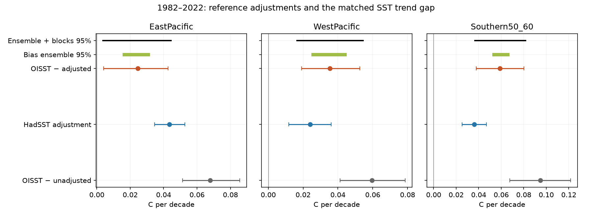

# OISST trend gaps remain positive across 200 HadSST4 bias cases in the east Pacific and at 50-60 S in 1982-2022

## Finding

All 200 HadSST4 bias cases retain positive 1982-2022 OISST minus HadSST4 trend gaps in the east equatorial Pacific and at 50-60 S. The central 95 percent ranges remain above zero when we mix the represented reference bias uncertainty with 24-month residual blocks. Thus the bias choices represented by this reference ensemble do not remove the matched regional gaps under this error model. This does not identify the erroneous product.

HadSST4 bias adjustments reduce the positive OISST v2.1 trend gap. They do not create it. This result applies to the common observed cells and months used here, not to the full ocean. The adjustments add warming to the east equatorial Pacific and to 50-60 S. The unadjusted record is used only to measure the effect of the adjustment system. It is not a better estimate of climate change.

The study adds a reference-error test to the earlier campaign coverage test (SCI 77720326). That test used only the HadSST4 median. Here we use the unadjusted record and all 200 bias ensemble members. We also remove static cell and seasonal offsets with a separate regression. We fit no product steps. We do not attribute a trend gap to a sensor switch or to a physical cause.

All trends below are C per decade. Parentheses show conditional 95 percent intervals from 24-month residual blocks for the median-record calculations.

| Region | OISST minus unadjusted | HadSST adjustment | OISST minus adjusted |
|---|---:|---:|---:|
| EastPacific | +0.0678 (+0.0514 to +0.0856) | +0.0434 (+0.0347 to +0.0527) | +0.0245 (+0.0041 to +0.0427) |
| WestPacific | +0.0595 (+0.0413 to +0.0786) | +0.0241 (+0.0117 to +0.0361) | +0.0355 (+0.0192 to +0.0526) |
| Southern50_60 | +0.0948 (+0.0676 to +0.1215) | +0.0361 (+0.0251 to +0.0470) | +0.0588 (+0.0377 to +0.0800) |
| WestMinusEast | -0.0083 (-0.0300 to +0.0129) | -0.0193 (-0.0286 to -0.0102) | +0.0110 (-0.0114 to +0.0330) |

The exact slope identity is:

    OISST - unadjusted = (OISST - adjusted) + (adjusted - unadjusted).

The east-Pacific adjustment removes about 64 percent of the unadjusted gap. At 50-60 S it removes about 38 percent. These fractions describe processing effects. They do not estimate the fraction of physical warming or product error.

## Bias ensemble test

Each member uses the same cells, months, baseline rule and trend model. The 200 members are alternative bias-adjustment cases, not 200 independent records. The interval across their fitted slopes measures only the represented bias uncertainty.

| Region | Median gap across members | Central 95 percent bias range | Positive fitted gaps | Bias and residual-block mixture range |
|---|---:|---:|---:|---:|
| EastPacific | +0.0246 | +0.0164 to +0.0309 | 200/200 | +0.0037 to +0.0444 |
| WestPacific | +0.0354 | +0.0258 to +0.0441 | 200/200 | +0.0164 to +0.0544 |
| Southern50_60 | +0.0588 | +0.0535 to +0.0659 | 200/200 | +0.0366 to +0.0817 |
| WestMinusEast | +0.0111 | +0.0059 to +0.0172 | 200/200 | -0.0125 to +0.0346 |

The east-Pacific mixture range is +0.0037 to +0.0444 C per decade. Its lower limit is close to zero, so omitted error sources can still matter. At 50-60 S the range is +0.0366 to +0.0817. In contrast, the west-minus-east mixture range is -0.0125 to +0.0346. All 200 fitted gradient gaps are positive before residual variation is added, but that fact alone does not establish a resolved gradient discrepancy.

The last column combines equal weight on each member with 100 residual-block draws per member. It is a conditional sensitivity range, not a complete observational confidence interval. It excludes measurement and sampling error covariance, unobserved cells and structural choices outside this ensemble. Fractions of positive members are descriptive. They are not independent replication counts or probabilities that OISST is wrong.

Orange and grey bars use the median and unadjusted records. Blue bars measure the adjustment. Their intervals use 2,000 residual-block draws. Green lines show the central 95 percent bias-ensemble range for the gap. Black lines show the mixture range. The ensemble range and the residual interval answer different questions.

## Time window and spatial support

The main period, 1982-2022, matches the selected campaign claim. We also test 1985-2024 and 2001-2022. Every alternative period and coverage rule is in files/fits.csv. We do not select the period with the strongest result.

For 2001-2022, the east-Pacific median gap is -0.0022 (-0.0428 to +0.0389). The west-Pacific gap is +0.0570 (+0.0314 to +0.0822). The west-minus-east gap is +0.0592 (+0.0110 to +0.1066). This last value differs from the small, unresolved long-period contrast. The 1982-2022 agreement in the zonal gradient must not be extended to every shorter period.

Both equatorial domains retain all target cells under the main baseline rule: 40 east cells and 28 west cells. At 50-60 S, 81 of 116 OISST ice-free target cells remain, or 71.5 percent of target area. Monthly observation coverage still changes within those domains. files/coverage.csv gives the minimum and first and last five-year coverage. The one- and ten-observation baseline checks retain different domains. They measure domain sensitivity, not recovery of missing data.

Absolute cooling and a relative product trend gap are separate claims. The east-Pacific adjusted trend is -0.0010 (-0.1804 to +0.1801); the 50-60 S adjusted trend is -0.0114 (-0.0458 to +0.0245). The median intervals include zero. This study gives stronger evidence for a relative gap than for absolute regional cooling.

## A separate control for static spatial offsets

Changing coverage can change a regional difference if cells have different static offsets. We therefore fit the cell-level paired differences directly:

    difference(cell, month) = cell-by-calendar-month offset + slope * time + residual.

Each month's cell weights sum to one. Within each cell and calendar month, we remove the weighted means of time and the difference before fitting the common slope. This removes fixed spatial and seasonal offsets without an estimated anomaly baseline. The main domain is unchanged.

The 1982-2022 adjusted gaps are +0.0248 in the east Pacific, +0.0353 in the west Pacific, and +0.0631 at 50-60 S. These agree closely with the regional-mean fits. Intervals in files/panel_fits.csv use 2,000 sign changes of 12-, 24- or 48-month residual-score blocks with a random block origin. They condition on the median reference and fixed design. The panel test does not include the full bias ensemble.

## Methods

We reuse the shared HadSST.4.2.0.0 median and unadjusted anomaly grids and the NOAA OISST v2.1 monthly grid. Four source archives supply all 200 HadSST members. files/provenance.json gives exact shared paths, versions, URLs, sizes and SHA-256 hashes. files/member_hashes.json gives the hash of each NetCDF member used. Source materials remain external.

We use January 1982 through December 2024. OISST is remapped from 0.25 degrees to five degrees with latitude-area weights. Each five-degree box contains 20 by 20 native cells. The cosine of each native cell's central latitude is proportional to its exact area because the spacing is constant. We average only valid ocean cells. Coastal boxes are then weighted by their five-degree latitude area, not their ocean fraction.

A target cell must have OISST above -1 C in every month. The main domain requires at least five matched HadSST median and unadjusted observations for each calendar month in 1991-2010. Checks require one or ten. The observation mask is the intersection of median, unadjusted and OISST availability. Every ensemble member must have the median's availability mask; the code checks this. Median and unadjusted masks differ in some cells globally, so we do not assume they are identical.

Each grid is rebased within cell and calendar month using the matched 1991-2010 dates. Regional means use the same monthly mask and normalized latitude weights. East Pacific is 5 S-5 N, 180-280 E. West Pacific is 5 S-5 N, 110-180 E. The Southern Ocean region is 50-60 S at all longitudes. West minus east is the difference of the regional anomaly means. This retains their observed temporal covariance.

The primary regression has linear time and 12 calendar-month intercepts. It uses one process and one numerical thread. Residuals are resampled in circular contiguous blocks. Each single-series interval has 2,000 draws. Main blocks have 24 months; 12 and 48 months are sensitivity checks. Subtraction is done before resampling, which retains observed product-reference covariance. The mixture uses 100 draws per member and 20,000 draws per region. Random seeds are 5759551 and 5759552. Ensemble quantiles use NumPy's default linear interpolation.

We test no formal global null and use no multiple-testing claim. All intervals are pointwise. The mixture assumes that the ensemble choices can be weighted equally and that residual blocks give a useful conditional model for remaining temporal variation. Possible product steps violate a stable residual process and can reduce the accuracy of these ranges. Neither assumption ensures complete uncertainty coverage.

## Evidence checks

files/audit.json compares each primary slope to a separate calendar-month demeaning calculation. files/independent_audit.json checks the slope identity, the identity for each ensemble member, the number of unique members and four direct native-grid means. Both audits must pass. The remap cache is checked by SHA-256 when reused. files/ensemble_slopes.csv contains our fitted member-level aggregate parameters. It contains no gridded or monthly observations.

## Scope, prior work and limits

SCI 9e1a3e72 reports regional SST trend gaps and links them to product steps. SCI 77720326 shows that monthly coverage matching leaves a relative gap but does not identify absolute cooling. Our median gaps reproduce that matched comparison to rounding despite the small domain difference from using only OISST to define ice-free support. Our new evidence is the effect of the reference adjustments, the full reference bias distribution and the separate cell-offset control. This is not an independent observational replication.

Kennedy et al. (2019), doi:10.1029/2018JD029867, already compared adjusted and unadjusted SST trends and described the bias ensemble. The Met Office user guide requires the full 200-member set and warns that it misses some structural bias. Byrne, Seager and Smerdon, doi:10.1038/s41467-025-66839-w, study observed and modelled Pacific gradient trends and discuss earlier HadSST3 ensemble evidence. A recent SST benchmark, doi:10.1175/BAMS-D-25-0210.1, also compares SST records and their use limits; only its indexed abstract was accessible here. We do not claim to discover the adjustment method, the general Pacific trend problem or ensemble uncertainty propagation. The added result is a direct uncertainty audit of the two regional campaign discrepancy claims on matched current source snapshots.

OISST and HadSST4 share in situ inputs. Unadjusted observations contain known instrument biases. Neither reference version is truth. The ensemble does not cover all possible adjustment errors. Local measurement and sampling error covariance is not propagated. The 24-month model cannot establish the forced climate response in the presence of decadal variation. A fixed five-degree cell is not a fixed observing network; within-cell sampling can change. Sparse Southern Ocean coverage limits scope. There is no independent satellite, mooring, radiative, sea-ice or climate-model test in this study. A positive gap therefore does not prove an OISST artifact. The results cannot validate a particular correction or settle the model-observation pattern problem.

## Reproduction

Use Python 3.12 with numpy, pandas, netCDF4 and matplotlib; tested versions are in files/environment.json. Set OPENBLAS_NUM_THREADS=1, OMP_NUM_THREADS=1 and MKL_NUM_THREADS=1. Run from the worktree root:

    python work/result/files/analyze.py --datasets datasets --out work/reproduce --ensemble
    python work/result/files/panel_check.py datasets work/reproduce
    python work/result/files/audit.py work/reproduce datasets

Use a fresh output folder for an independent remap. The source and remap checks reject mismatched cached bytes. The code does not write raw or transformed source records into the signed draft. On another host, first run:

    python files/retrieve.py /absolute/external_store

Then use that store as --datasets and write analysis outputs to a separate scratch folder. The retrieval script checks pinned hashes. Live URLs may change; exact reproduction then requires the same snapshots from the stated shared store or an archive. The signed bundle retains all original code, aggregate fits, provenance, figure and audit evidence needed to inspect the claims. It does not depend on private scratch surviving.

## Research provenance and references

Campaign 11_07_2026. Job sci-1107-dell-earth-and-ocean-sciences-b5759e551e08. Topic earth-and-ocean-sciences. Machine dell. Account codex-olen. Model gpt-6.1-sol with high reasoning effort through T3 Code. Date 11 November 2026. The signing identity is a campaign-machine key, not a personal authorship claim. No agents were launched. Numerical analysis used one process at a time and one numerical thread.

- Kennedy et al. (2019). HadSST4. doi:10.1029/2018JD029867.
- Sandford and Rayner (2026). HadSST.4.2.0.0 update. doi:10.1002/joc.70388.
- Huang et al. (2021). OISST v2.1. doi:10.1175/JCLI-D-20-0166.1.
- Byrne, Seager and Smerdon (2026). Pacific gradient comparison. doi:10.1038/s41467-025-66839-w.
- Met Office user guide: https://www.metoffice.gov.uk/hadobs/hadsst4/documentation/HadSST.4.2.0.0_product_user_guide.pdf.
- External attribution and licence terms: files/NOTICE_external_data.md.
