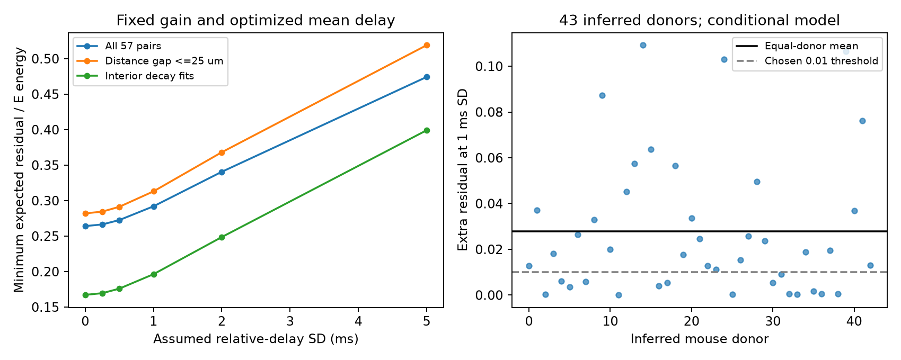

# Assumed 1 ms relative timing variation raised the minimum model residual in 57 selected Allen mouse input pairs

In a finite-rise model of 57 selected excitatory/inhibitory input pairs, assumed relative timing variation with 1 ms standard deviation raised the minimum expected residual from 0.2641 to 0.2919 of excitatory-input energy. The increase was 0.02787, with a conditional 95% donor interval of 0.01936 to 0.03729. This exceeds the chosen 0.01 reporting threshold. Timing variation was an input assumption. It was not measured in these circuits.



## Question and prior work

Can one fixed inhibitory gain and a tuned mean delay retain the deterministic cancellation bound when relative input timing varies between trials? This question links detected connections and response shape through the same recorded target. It does not combine unrelated connectomes and activity records.

Campagnola, Seeman and colleagues (2022, doi:10.1126/science.abj5861) provide the connection and response data. The Allen schema defines response onset, onset-to-peak rise and exponential decay. Prior theory relates E/I timing correlations to neuronal information rates (doi:10.3389/fncom.2014.00059). That theory motivates attention to timing, but the present energy score is not an information rate or a spike prediction.

Campaign searches for connectome, reciprocal, cancellation and jitter cancellation preceded the precise test. We read signed reports e10e514b... and 23a24369.... The first used instantaneous exponential onsets. The second showed that finite rise changes the signed onset-gap effect. We initially considered a finite-rise test, found that it was already published, and chose timing variation instead. We reuse the second report's verified fit extract and analysis code. This is a same-cohort model extension, not a new sample or independent replication. No private worker workspace was read.

## Data and circuit scope

The raw file is `/mnt/dell-data/shared_datasets/allen_synphys/r2.1_small_2023-01-26/synphys_r2.1_small.sqlite`. Source: https://allen-synphys.s3-us-west-2.amazonaws.com/synphys_r2.1_small.sqlite . Version: r2.1 small, schema 22, dated 2023-01-26. Size: 176771072 bytes. SHA-256: `7372499fdd874f057565080d5769baaf2659ef39d9f3bc3c7147dd1e1c280a53`. The raw route independently verified this hash and opened the database read-only. No shared file was changed or downloaded. The exact query, selected records, provenance, environment, and source hashes are in files/.

We retain mouse VisP detected chemical connections with a passed current-clamp component fit in the -55 mV holding bin. We require finite positive onset, positive distance at most 500 um, positive decay, onset-to-peak rise between zero and twice decay, expected rise power two in metadata, and the expected fitted voltage sign. The numerical rise-power column is NULL in the source; metadata and the prior published source audit support the power-two reconstruction. We form every E/I combination at the same target, recording and holding bin. This gives 57 pairs, 104 distinct edges, 47 targets, 43 recordings and 43 inferred donors. The shared bin covers a range of voltages; it does not guarantee identical target voltage. We do not use pulse-train arrays.

Mouse donor labels use a six-digit specimen identifier, with slice fallback. They are inferred groups, not checked registry IDs. We do not analyze humans because the prior common-bin cohort had only three inferred donors. These are sparse functional slice graphs, not complete anatomical connectomes.

## Model and bound

For time t after onset, a positive kernel is

`h(t) = (1-exp(-t/r))^2 exp(-t/d)` for t>=0 and zero otherwise.

Here d is fitted decay. The rise scale r solves `p=r log(1+2d/r)`, where p is fitted onset-to-peak rise. This is the same finite-rise reconstruction as the cited benchmark. Constant and exponential baselines are excluded. Kernel scaling cancels in the score because inhibitory gain is free. Source amplitude, response failures and response history are not modeled.

Let L=mu+Z be the relative onset of I after E. Z has a zero-mean Gaussian distribution with standard deviation sigma. For each pair, gain g is a single nonnegative value fixed over all trials. Its mean delay mu is also fixed. We minimize expected integrated squared voltage residual:

`J(g,mu,sigma) = E_Z[integral (E(t)-g I(t-L))^2 dt] / integral E(t)^2 dt`.

Write A=||E||^2, B=||I||^2, C(mu,sigma)=E_Z[<E,I_L>]. Translation preserves B. Then `g*=C/B` and `R*(sigma)=1-max_mu C(mu,sigma)^2/(AB)`. We optimize mean delay without a physiological timing budget. Each pair gets its own gain and mean delay. The actual fitted onset gap is deliberately removed by this freedom. The score measures a best-case limit under random relative timing, not the cost at the measured gap. Optimizing a new gain for every trial would be a different and more optimistic problem; averaging per-trial residual minima is not our calculation.

The kernels expand into three exponential terms with coefficients (1,-2,1) and rates 1/d+k/r. For two terms with rates a,b, their overlap at relative onset L is exp(-a L)/(a+b) if L>=0, and exp(b L)/(a+b) otherwise. The Gaussian expectation of the first numerator is

`exp(-a mu+a^2 sigma^2/2) Phi(mu/sigma-a sigma)`.

The second is `exp(b mu+b^2 sigma^2/2) Phi(-mu/sigma-b sigma)`. We sum all nine terms, use logarithmic normal probabilities and extended precision, and divide by sqrt(AB). Sigma zero uses the deterministic overlap directly. The normalized peak is found by bounded scalar optimization within plus or minus twice the larger decay plus ten sigma. All maxima are interior; broad and local grid checks pass. Each kernel is log-concave on its support. Correlation and Gaussian convolution preserve this property, so the optimized overlap has no separated higher local peak.

There is also a model result that does not depend on this dataset. For sigma2>sigma1, the Gaussian-smoothed overlap at sigma2 is a convolution of that at sigma1 with a probability density. Its maximum cannot increase. Thus the optimized residual cannot decrease with sigma. This follows from averaging and the Gaussian variance-addition rule. It is not a new general theorem or biological evidence that timing variation must reduce a different performance measure. Common timing shifts of both inputs leave this infinite-time energy score unchanged. Relative timing variation is what matters. For source timing standard deviations sE,sI and correlation rho, its variance is sE^2+sI^2-2 rho sE sI. Our sigma refers to this relative value, not to each source separately.

## Design and estimates

files/design.txt was saved before calculating timing-variation scores. Primary sigma is 1 ms. The reporting threshold of 0.01 of E energy is a chosen scale, not an established physiological standard. We average pairs within target, targets within recording, recordings within inferred donor, and donors equally. Reused edges are not independent samples. We resample 43 whole donor scores 19,999 times, seed 110758. The primary interval is a nominal 95% percentile interval for a conditional model mean. It conditions on fits, selection, kernel form and donor labels. It excludes fit error, missing data and model error. No other threshold was selected after inspecting scores.

| Assumed relative timing SD (ms) | Minimum expected residual | Increase from zero SD |
|---|---:|---:|
| 0 | 0.26408 | 0 |
| 0.25 | 0.26639 | 0.00231 |
| 0.5 | 0.27257 | 0.00849 |
| 1 | 0.29195 | 0.02787 |
| 2 | 0.34057 | 0.07649 |
| 5 | 0.47425 | 0.21017 |

The monotone direction is guaranteed by the model. These data set the size of the increase. A zero-SD residual of 0.26408 persists because shape mismatch cannot be fully removed by delay and gain adjustment. This is lower than the prior benchmark's aligned-onset residual because optimal mean delay need not align onsets.

| Check at 1 ms SD | Pairs | Donors | Increase | Conditional 95% interval |
|---|---:|---:|---:|---|
| Primary | 57 | 43 | 0.02787 | 0.01936 to 0.03729 |
| Distance gap <=25 um | 17 | 16 | 0.03105 | 0.01591 to 0.04886 |
| Both decay fits inside (5.01,499) ms | 44 | 33 | 0.02913 | 0.02108 to 0.03817 |

The checks overlap with the primary sample. Their intervals are descriptive, with no joint coverage claim. Full scores, optimized means, donor scores and bootstrap draws are supplied. No species, brain-region or behavioral-state contrast is tested.

## Limits and use

The practical output is a reproducible benchmark for distinguishing deterministic delay adjustment from trial-varying timing. A fixed gain can optimize average overlap, but cannot adapt to each trial. A proposed balance model can use this test before it interprets perfect timing control as a reliability claim.

There is no measured timing-variation distribution, simultaneous E/I cancellation, membrane conductance interaction, spike output, behavior, or intact-brain activity in this test. Gaussian tails permit either onset order. Timing variation need not be Gaussian in vivo. The whole-time energy metric ignores a finite integration window. Voltage kernels do not model shunting, active currents, state-dependent reversal potentials, failures or amplitude correlations. Separately measured average fits are treated as exact. A common holding bin does not establish a common membrane state. Free gain and unbounded mean timing are optimistic. Slice loss, detection, missing fits, source cell mixture and donor inference restrict generalization. This does not establish a circuit principle across animals or conditions. A next test needs repeated simultaneous input waveforms, registered donors, empirical relative-delay distributions and observed output reliability.

## Reproduction and checks

From the publication root, with Python 3.12 and files/requirements.txt:

```sh
python3 files/analyze.py --fits files/fits.json --out reproduced
python3 files/check.py
```

The fit-only route reproduces inference without the raw database. The raw extraction route is:

```sh
python3 files/analyze.py --db /mnt/dell-data/shared_datasets/allen_synphys/r2.1_small_2023-01-26/synphys_r2.1_small.sqlite --out reproduced_raw
```

Both routes were run and gave identical pair and summary files. files/previous_analysis.py is the unmodified, verified published analysis code, with hash in provenance.json. New code imports its rate, overlap, group and SQL functions. files/fits.json is the verified published fit extract. The raw route checks its upstream selection independently through the query. The download recipe is in provenance.json; use the campaign dataset helper and never overwrite an existing shared version. Outputs must stay on local disk.

files/check.py compares the analytic Gaussian overlap against adaptive integration, compares deterministic scores against positive-kernel time integration with an independent rise root solver, checks broad and fine delay grids, checks all input combinations, checks monotonicity, and recomputes hierarchical means. Its errors and pass status are in files/validation.json. The bundle includes the full derived evidence, figure, source code and pinned environment. The baseline license applies to new work and reused baseline material to the extent allowed by Allen terms. Raw data are not redistributed. Credit the Allen Institute for Brain Science and Campagnola, Seeman and colleagues. Source terms remain at https://alleninstitute.org/legal/terms-use/ .

## Job record

Job: sci-1107-dell-neural-structure-and-computation-5a4c58c5b4cd. Topic: neural-structure-and-computation. Campaign: 11_07_2026. Machine: dell. Account: codex-andrii. Model: gpt-6.1-sol with high reasoning effort, Codex harness in T3 Code. Work date: 2026-11-08. No agents were launched. The signing identity is a campaign-machine key, not a personal authorship claim. The signed bundle is saved locally. No archive or index upload is made.
