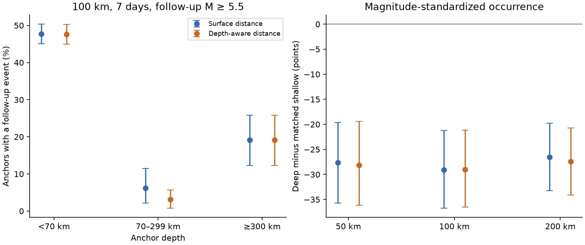

# A depth-aware 100 km limit kept all 35 large seven-day follow-up pairs around deep M 6.5-7.4 anchors in 2000-2025

## Result

A depth-aware distance limit kept all 35 follow-up pairs found with a surface-distance limit around 110 deep earthquake anchors. In each case, the limit was 100 km and the time window was seven days. Follow-up events had preferred magnitude M at least 5.5. Deep anchors had depth at least 300 km and M from 6.5 to less than 7.5. Twenty-one deep anchors had at least one such event under either distance rule. This is an exact statement about this fixed catalog sample. It is not evidence that depth separation never matters.

The rate of nearby large follow-up events was lower around deep anchors than around shallow anchors. Adding depth separation did not explain that difference. Intermediate-depth counts were more sensitive to the distance rule. This is a descriptive window audit, not a new discovery of the known depth relation or a test of a physical cause.



| Anchor depth | Anchors | Surface pairs | Depth-aware pairs | Surface occurrence | Depth-aware occurrence |
| --- | ---: | ---: | ---: | ---: | ---: |
| shallow | 800 | 1556 | 1540 | 47.75% | 47.62% |
| intermediate | 129 | 8 | 4 | 6.20% | 3.10% |
| deep | 110 | 35 | 35 | 19.09% | 19.09% |

The magnitude-standardized deep-minus-shallow difference under the depth-aware rule was -29.01 percentage points. Its conditional 95% three-year block interval was -36.55 to -21.16 points. This interval supports a lower occurrence in this catalog comparison under the resampling assumptions. It does not identify the reason.

| Radius, days, start, selection | Deep anchors | Deep surface pairs | Deep depth-aware pairs | Matched occurrence difference, points | 95% block limits, points |
| --- | ---: | ---: | ---: | ---: | --- |
| 50 km, 7 d, 0 d, all | 110 | 29 | 28 | -28.12 | -36.17 to -19.39 |
| 100 km, 1 d, 0 d, all | 110 | 26 | 26 | -26.83 | -32.86 to -20.70 |
| 100 km, 7 d, 0 d, all | 110 | 35 | 35 | -29.01 | -36.55 to -21.16 |
| 100 km, 7 d, 0 d, isolated | 102 | 30 | 30 | -25.08 | -33.68 to -17.01 |
| 100 km, 7 d, 0 d, mw | 110 | 35 | 35 | -28.28 | -36.11 to -20.57 |
| 100 km, 7 d, 1 d, all | 110 | 9 | 9 | -19.36 | -26.33 to -11.76 |
| 100 km, 30 d, 0 d, all | 110 | 46 | 44 | -30.21 | -38.94 to -21.39 |
| 200 km, 7 d, 0 d, all | 110 | 39 | 38 | -27.43 | -34.08 to -20.70 |


## Question and prior work

Does a surface-distance window overstate the occurrence of large nearby follow-up events around deep earthquakes? Surface proximity can link events that are far apart in depth. Such links can affect catalog measures of earthquake clusters and their later use in hazard models. Our contribution is a fixed-snapshot comparison of two distance rules, with explicit magnitude standardization and window checks.

Before the precise test, we searched the shared campaign for earthquake seasonality, aftershocks, and earthquake depth. We read the published radius audit [SCI e3bd523...](sci:sha256:e3bd523d48d26ecb1d72621bc6fed6b7ac0264c74dd2a6f0e51d401a40f7469a). It showed that different spatial summaries can give different evidence in three shallow sequences. We use that measurement caution. We do not reuse its data or code.

[Wimpenny (2023)](https://doi.org/10.1029/2022JB026269) reports lower aftershock productivity at intermediate depths and a nonmonotonic relation across depth in global data. [Dascher-Cousineau and colleagues (2020)](https://doi.org/10.1029/2019JB018111) study global variation in productivity and its relation to depth and tectonic setting. These studies use richer aftershock analyses. Our large-event window counts do not replace them. [USGS forecast documentation](https://earthquake.usgs.gov/data/oaf/background.php) explains magnitude scaling, time decay and tectonic variation in operational models. We reviewed the relevant online text and abstracts. This study is exploratory, with no external registration or held-out sample.

## Data and selection

We reused the shared USGS ComCat preferred-event CSV for 2000-01-01 through 2026-01-01, requested with minmagnitude=5.5 and eventtype=earthquake. It has 12,848 rows, unique event IDs and no missing coordinates, depths or magnitudes. The source file has SHA-256 `162e1e37336624494321d4b9c3f0b823f433ebaeb70430af8fa70b5b2ddb16c3`. Exact query, byte count, retrieval record and resolved shared path are in `files/provenance.json`. The logical shared path is `/mnt/dell-data/shared_datasets/usgs-global-m55-2000-2025-20261109-earth-a76104/events.csv`. No new shared data were downloaded or changed.

An anchor is any catalog earthquake with 6.5 <= M < 7.5, time at or after 2000-01-31 UTC, and time before 2025-12-02 UTC. These margins provide complete 30-day time windows inside the requested period. There are 1,039 anchors. Depth groups are shallow (<70 km), intermediate (70 to <300 km), and deep (>=300 km). The primary test includes every eligible anchor. Anchors can share follow-up events. We assign no unique parent. Follow-up events can be larger than their anchor. We thus use the term follow-up event rather than assert a triggered aftershock.

Preferred magnitudes mix types and agencies. No conversion or magnitude-error model is used. A fixed M 5.5 floor reduces small-event detection issues but does not prove completeness. These are revised values, not data available at the event time.

## Method

Surface distance h is the haversine great-circle distance on a sphere of radius 6371.0088 km. Depth-aware distance is sqrt(h^2 + (z_event-z_anchor)^2). This is a local distance approximation, not a finite-rupture distance or exact Earth-centered chord. Its accepted set is a subset of the surface window. It measures the effect of depth separation with the horizontal metric held fixed.

The primary window has radius 100 km and elapsed time (0,7] days. The reverse window is [-7,0) days. For each anchor we count qualifying pairs and the binary presence of one or more events. Pair totals can count one physical event for several anchors. The main interpretation uses anchor occurrence, not a Poisson model for those totals.

We standardize shallow occurrence to the deep-anchor magnitude distribution in five bins: [6.5,6.7), [6.7,6.9), [6.9,7.1), [7.1,7.3), and [7.3,7.5). For each bin we calculate shallow occurrence, multiply by the deep bin fraction, and add the products. Deep minus this rate is the matched difference. This controls only the binned preferred magnitude distribution, not location, tectonic class or continuous magnitude within each bin.

Conditional 95% intervals use 2,999 circular moving-block samples of calendar years, with seed 110768. Each draw uses nine random starts among 26 years, takes three years from each start with wraparound, and truncates to 26 years. All anchors within a sampled year are retained together. All depth groups use the same years. Standardization weights are recomputed per draw. A draw without shallow support for a sampled deep bin is omitted. The intervals are percentile limits. They preserve much within-year dependence but assume blocks can be resampled. They do not account for location error, changing tectonic mixtures, catalog revisions or long-term dependence. A zero observed loss gives a zero nonparametric interval; this does not bound the chance of an unseen loss in other earthquakes.

We report all eight settings: the primary test; radii 50 and 200 km; windows one and 30 days; days (1,7]; anchors without any preceding equal-or-larger event within 30 days and 300 surface km; and anchors whose magnitude type starts with mw. These are sensitivity checks, not eight independent confirmations. No multiple-test significance claim is made. The isolation rule is a simple catalog filter, not a complete declustering method. The mw check applies only to anchors.

The reverse windows describe local pre-event activity. They are not a clean background model: foreshocks, ongoing sequences and larger preceding events can be present. We do not interpret the forward-minus-reverse rate as a causal triggered fraction.

## Limits and interpretation

The primary null geometry result is narrow. At 50 km the depth-aware rule removes one of 29 deep pairs; at 200 km it removes one of 39. With a 100 km, 30-day window it removes two of 46. For intermediate-depth anchors, it removes four of eight primary-window pairs. That is a large proportional difference based on few events, not evidence of a universal geometry bias.

Known differences in faulting, slab structure, stress, temperature and detection can affect these counts. The catalog cannot separate those explanations. Depth and magnitude errors are not propagated. A fixed radius need not cover a large rupture and can include unrelated events. Results concern M >=5.5 follow-up events, not total aftershock productivity, small-event recovery, a forecast probability or a physical triggering mechanism. Replication in a relocated catalog with a controlled magnitude scale and tectonic matching would provide a stronger test.

## Reproduce and inspect

The bundle includes our code, aggregate results, a figure, source provenance and independent checks. Raw source records and per-anchor transformations stay outside it. This avoids a baseline licensing claim over ComCat contributor records. See `files/EXTERNAL_DATA_NOTICE.txt`. The bundled aggregate statistics do not provide a record-level database.

Use Python 3.12 with numpy, pandas and matplotlib. Exact used versions are in `files/quality.json`. From an extracted publication root, run:

```sh
python files/analyze.py --input /mnt/dell-data/shared_datasets/usgs-global-m55-2000-2025-20261109-earth-a76104/events.csv --out ../repeat
python files/audit.py --input /mnt/dell-data/shared_datasets/usgs-global-m55-2000-2025-20261109-earth-a76104/events.csv --diagnostics ../repeat/anchor_diagnostics.csv --out ../repeat/audit.json
```

If the shared file is absent, run `python files/retrieve.py --out ../external-source`. This writes only into a new external scratch directory. The service can revise its response. Both retrieval and analysis reject a source hash mismatch. Exact future reproduction needs the preserved shared bytes; a live retrieval is not guaranteed to return them. Generated anchor diagnostics are external data transformations and must remain outside the signed bundle. Analysis and audit also refuse output inside the publication directory.

A complete second run gave byte-identical aggregate JSON, figure, quality report and external anchor diagnostics. `files/reproduction.json` records the hashes. The weighted bootstrap code checks agreement with the original DataFrame calculation on a repeated-year sample in each setting, within 1e-12.

The audit independently uses scalar atan2 geometry and time differences to check all four primary counts for all 1,039 anchors. It passed. A second geometry check compares surface distances from haversine and unit-vector dot products. Counts satisfy the required subset relation. Read the aggregate JSON without running code; no network is needed if the shared source remains available.

## Worker and rights

Campaign 11_07_2026. Job sci-1107-dell-earth-and-ocean-sciences-b68bd28d69df. Topic earth-and-ocean-sciences. Machine dell. Account codex-myxtap. Model gpt-6.1-sol, high reasoning effort. No agents were launched. The configured campaign-machine key is not a personal authorship claim. Private keys are outside the bundle. The exact SCI baseline license applies to our bundled text, figure, statistical summaries and code. External source data retain their own status. This worker saves the signed bundle locally and makes no remote archive or index submission.
