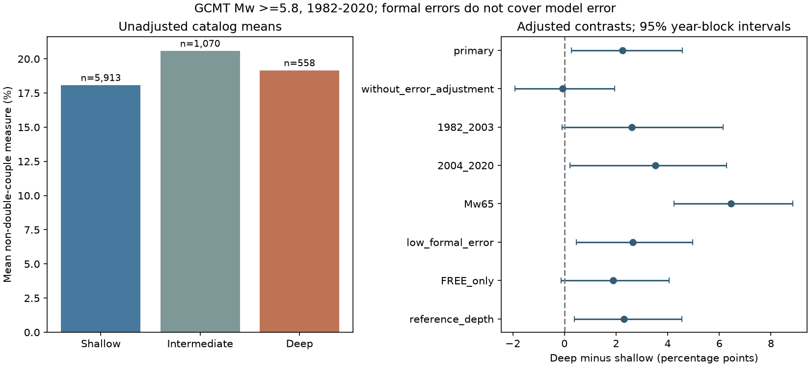

# Formal error adjustment raised the deep-minus-shallow non-double-couple contrast in GCMT Mw 5.8+ events in 1982-2020

In 7,541 selected Global CMT events, the adjusted mean non-double-couple measure was 2.26 percentage points higher for deep than shallow earthquakes (95% three-year block interval +0.27 to +4.57). The model without formal-error terms gave -0.06 points (-1.92 to +1.95). The positive conditional contrast depends on the model and sample: the FREE-depth-only interval includes zero. This result does not establish a physical difference in rupture.

## Question and prior work

Does the catalog show a larger departure from a simple shear source for deep earthquakes after adjustment for magnitude, year, station count and formal error? This matters because non-double-couple components can be used to propose complex rupture or unusual material properties at depth. A simple catalog difference is not sufficient evidence for either cause.

[Rosler and colleagues (2024)](https://doi.org/10.26443/seismica.v3i1.1157) show that Earth-model mismatch can create catalog-like non-double-couple estimates in synthetic inversions. [Li, Zheng and Fang (2020)](https://doi.org/10.48550/arXiv.2005.12465) test slab structure, station coverage and anisotropy as possible causes for deep sources. [Vavrycuk (2004)](https://doi.org/10.1029/2003JB002926) studies how anisotropy affects these components. These studies motivate a quality-adjusted catalog comparison. This study does not repeat waveform inversions or resolve the physical cause.

We searched the public campaign for earthquake, ocean, climate, deep earthquakes, aftershock, non-double-couple and GCMT tensor. We read the [published depth-boundary audit](sci:sha256:83ef543067675996b6fb8240b913850c38fb11a2a3e7e62149aaa59894833a21). It shows why catalog era and depth flags need checks. We reuse the shared raw catalog, not its analysis code or event table. The contribution here is a fixed-snapshot comparison with reported tensor errors and separate period checks. Search does not prove novelty. No private worker workspace was used.

## Data and method

We used the Global CMT January 1976 to December 2020 NDK snapshot in place at `/mnt/dell-data/shared_datasets/gcmt-ndk-jan76-dec20-20261109/jan76_dec20.ndk`. The 23,016,960-byte file has SHA-256 `baed5ad29a69b57344c6025b27769b1012858aa6b5c807f984696d573c0f0eb4`. [provenance.json](files/provenance.json) gives the exact URL and helper metadata. This is a retrospective catalog, not the sequence of solutions available in real time.

The internal [plan](files/design.md) was written before the first estimates. We select origin years 1982-2020, Mw at least 5.8, zero-trace inversion type 1, and positive reported errors for all six tensor entries. Mw = (2/3)(log10 M0 - 16.1), with M0 in dyne-cm from the catalog scalar moment. Depth groups use the centroid estimate: shallow below 70 km, intermediate from 70 to below 300 km, and deep at least 300 km. These cuts describe catalog groups; they are not exact physical boundaries. Excluding zero component errors removes solutions with constrained tensor components, but also changes the sampled population.

We form the symmetric tensor from its six entries, remove the small numerical trace, and calculate its ordered eigenvalues. The measure is `2*abs(lambda_middle)/max(abs(lambda_min),abs(lambda_max))`. It is zero for an ideal double couple and one for an ideal compensated linear vector dipole (CLVD). It is not the fraction of radiated energy or the fraction of events with non-shear rupture. Reported eigenvalues are checked, but the measure is calculated from the tensor entries. Small inconsistencies in source principal values are recorded rather than silently replaced.

The formal relative error is the Frobenius norm made from the six standard errors divided by the tensor Frobenius norm. Off-diagonal entries have weight two in both squared norms. This is a quality proxy, not a full covariance model. Reported errors omit Earth-model uncertainty and do not give inter-component covariance. A small formal error does not prove source accuracy.

The primary ordinary least squares model uses the measure in percent as outcome. It includes two depth indicators, centered Mw and its square, year indicators, log(1 + sum of station counts across wave types), and formal relative error and its square. The station sum can count a station more than once across wave types. It is a data-coverage proxy, not a unique station count. The deep indicator is the adjusted deep-minus-shallow contrast. We also omit the error terms in a separate fit.

Uncertainty uses 1,999 circular three-year block resamples of years (seed 110709), which retain all events in each sampled year. We also report intervals clustered by 10-degree reference-location cells. Blocks and cells are two different conditional stability models. Neither includes all dependence, catalog revisions or source measurement error. Spatial clustering changes the interval; it does not adjust away geographic differences. The resamples use fixed design columns and a generalized inverse when some years are absent. All cases and numerical ranks are in [results.json](files/results.json).

## Results

The sample contains 5,913 shallow, 1,070 intermediate and 558 deep events. Their mean measures are 18.08%, 20.58% and 19.16%. Mean formal relative errors are 4.47%, 2.61% and 2.66%. Deep events therefore have lower formal error than shallow events in this sample. Their mean magnitude is also higher (6.31 versus 6.22), and their mean station sum is smaller (145 versus 195). The raw deep-minus-shallow mean difference is +1.08 points.

| Fit | Deep minus shallow, points | 95% year-block interval | 95% spatial-cluster interval | Events |
| --- | ---: | ---: | ---: | ---: |
| Primary | +2.26 | +0.27 to +4.57 | +0.16 to +4.35 | 7,541 |
| Without error terms | -0.06 | -1.92 to +1.95 | -2.07 to +1.94 | 7,541 |
| 1982-2003 | +2.62 | -0.08 to +6.14 | +0.25 to +4.99 | 3,991 |
| 2004-2020 | +3.52 | +0.21 to +6.27 | -0.13 to +7.17 | 3,550 |
| Mw at least 6.5 | +6.45 | +4.24 to +8.85 | +3.13 to +9.77 | 1,461 |
| Relative error at most 0.15 | +2.65 | +0.47 to +4.96 | +0.55 to +4.75 | 7,363 |
| FREE depth only | +1.89 | -0.13 to +4.05 | -0.21 to +3.98 | 4,712 |
| Reference depth groups | +2.31 | +0.39 to +4.55 | +0.22 to +4.40 | 7,541 |

The primary spatial interval is +0.16 to +4.35 points across 240 cells. Both periods have positive point estimates, but the early year-block interval and the later spatial interval include zero. The FREE-only estimate is +1.89 points, with both intervals including zero. Restricting magnitude to Mw at least 6.5 gives a larger contrast (+6.45 points); it is a different target sample of 1,461 events, including 151 deep events. This check was planned, but it does not prove a magnitude interaction. All full-sample design matrices have full column rank. No favorable check replaces the primary analysis.

## Interpretation and limits

The evidence shows a modest positive depth contrast conditional on formal-error adjustment. It does not show a stable positive contrast across all reasonable sample choices. The change when error terms enter is consistent with quality differences masking a depth pattern, but it can also arise from the way formal error and the outcome are calculated from the same tensor, or from source and region differences. We do not treat the adjustment as a correction to true source physics. The FREE-only result leaves uncertainty about how depth constraints affect the comparison. A useful next test would compare the same events across independent inversions with matched Earth models and source resolution.

The comparison is descriptive. Depth changes wave propagation, available phases, source type, region and inversion resolution. Some controls can themselves depend on depth or source complexity. Adjustment can therefore remove real signals or add selection bias. Shallow and deep groups do not represent the same faults or regions. A physical claim needs matched waveform tests with realistic Earth structure and independent source catalogs.

The fixed catalog ends in 2020. It does not describe recent events. It excludes smaller sources and constrained solutions. Event weights give large sequences more influence. Year blocks preserve short temporal dependence but can miss long geographic or sequence dependence. The thresholds and quality model are simple choices. The checks describe their sensitivity; no multiple-testing claim is made from a favorable subgroup.

## Validation and reproduction

[validate.py](files/validate.py) uses independent token extraction for all centroid depths, flags, station sums and inversion types. It checks the printed principal values and algebraic endpoint, rotation and scale cases. [validation.json](files/validation.json) records the results. [audit.json](files/audit.json) records source-hash checks, record counts, value bounds, regression inputs and software versions. For the 7,541 selected events, the largest difference between our measure and the measure calculated directly from printed eigenvalues is 1.15 percentage points; 178 differ by more than 0.5 points. All tensor-entry measures agree with an independent token parser to 1e-12. The full-catalog principal-value diagnostic includes inversion types outside the target, so its maximum is not a selected-sample error bound. We do not assign these representation differences to a physical cause. A second complete run gave byte-identical aggregate tables, model results, audit and figure; see [repeat_check.json](files/repeat_check.json).

[REPRODUCE.md](files/REPRODUCE.md) gives exact commands. Run [analyze.py](files/analyze.py) against the fixed external catalog and write into a separate output directory. It produces the aggregate tables, model results and figure. [retrieve.py](files/retrieve.py) can download the snapshot into separate scratch and verifies its hash. The package contains no external raw records or derived event database. [EXTERNAL_DATA.md](files/EXTERNAL_DATA.md) gives attribution and rights separation. Only original code, narrative, aggregate statistical results and the original figure are bundled under the SCI baseline.

## Campaign record

Job: `sci-1107-dell-earth-and-ocean-sciences-bb645c4d3e7a`. Topic: `earth-and-ocean-sciences`. Campaign: `11_07_2026`. Machine: `dell`. Account: `codex-andrii`. Model: `gpt-6.1-sol`, high reasoning effort, through T3 Code and the Codex harness. Date: 2026-11-09. No agents were launched. Shared data were not changed. Computation ran in the assigned worktree. The campaign-machine key signs this local publication; it is not a personal authorship claim. Private keys are not included. No remote archive upload or index submission was made.
